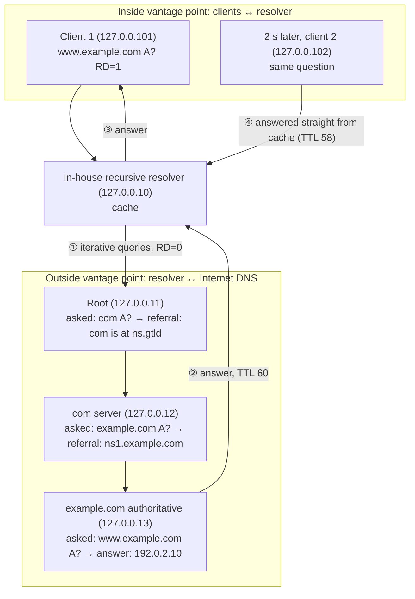

# 2.6 — DNS Structure: Records, Messages, Compression, Hierarchy, Vantage Points { #dns-structure }

!!! abstract "Scope of this lesson"
    - Why DNS matters to an investigation: almost every connection starts with a DNS lookup
    - Record types: A, AAAA, NS, CNAME, MX, PTR, SRV, TXT, NULL, SSHFP, plus [Supplement] the HTTPS (SVCB) record you now see everywhere
    - Building a "normal" from record-type ratios
    - Message structure: transaction ID, flags, response codes (NXDOMAIN)
    - UDP, TCP and EDNS: the 512-byte limit and [Changed] the post-2020 1232-byte default
    - Name compression: reading `0xC0..` pointers byte by byte
    - Hierarchy, recursion and caching, and how **what you see depends on where you look** ([Changed] QNAME minimisation)
    - CNAMEs: stitching queries and responses together, and why their TTLs drift apart

!!! note "Lab environment and notation"
    **(Actual output)** came from a **small practice DNS hierarchy** built inside this environment. I ran five instances of Unbound 1.19.2 (Ubuntu package) as a root (`127.0.0.11`), the TLDs `com`, `net`, `org` and `arpa` (`127.0.0.12`), the authoritative server for `example.com` and `example.net` (`127.0.0.13`), the authoritative server for `example.org` (`127.0.0.14`), and an in-house recursive resolver (`127.0.0.10`). It is not the real Internet root; it imitates the same structure on loopback addresses. Clients queried with dig 9.18.39 from `127.0.0.101` and `127.0.0.102`; captures used tcpdump, and decoding used TShark 4.2.2 and dnspython 2.9.2. All record addresses are documentation addresses (`192.0.2.0/24`, `198.51.100.0/24`, `203.0.113.0/24`, `2001:db8::/32`), and the domains are example domains (`example.com/net/org`).

## 1. DNS is the glue between people and the network { #why-dns }

Nobody types `192.168.24.102` to reach the timecard system or `172.30.41.216` for webmail. We type names like `timecard.example.com` and `webmail.example.com`. Turning names into addresses is the job of DNS (the Domain Name System). We use it countless times a day, usually without noticing.

A phone book is a fair analogy: look up a name, get a number. It breaks in three places. ① A phone book is one volume, but DNS is **split across a huge number of servers**, each responsible for its own part (section 7). ② A phone number stays put for years, but every DNS answer carries a **lifetime (TTL)** and can change at any time. Attackers exploit exactly that (lesson 2.7). ③ DNS answers many **kinds of questions**, not just name → address: mail servers, service locations, even arbitrary text (section 2).

DNS matters to investigators for a simple reason. Web, mail, remote access, and malware calling its command server almost all **begin with a DNS lookup**. Read DNS records well and you can take the pulse of nearly everything happening on the network. That is why DNS is also a foundation for threat hunting and real-time alerting.

## 2. Record types { #record-types }

Some terms first.

- **Resource record (RR)**: one line of information that DNS stores and returns: name, TTL, class (almost always `IN`), type and value.
- **Forward lookup**: asking for an address by name. The most common kind, especially where people work.
- **Reverse lookup**: asking for a name by address (PTR).

| Type | Number | Name | What it does |
| --- | --- | --- | --- |
| A | 1 | Address | Name → IPv4 address |
| AAAA | 28 | IPv6 address | Name → IPv6 address (128-bit) |
| NS | 2 | Name server | The authoritative servers for a domain or subdomain |
| CNAME | 5 | Canonical name | An alias: "look up that name instead" (section 8) |
| MX | 15 | Mail exchange | The servers that receive a domain's mail, with priorities |
| PTR | 12 | Pointer | Reverse lookup. `192.0.2.25` is queried as `25.2.0.192.in-addr.arpa` |
| SRV | 33 | Service locator | Location of any service (priority, weight, port, host). A generalised MX |
| TXT | 16 | Text | Arbitrary text, these days mostly machine-read data such as SPF and DKIM |
| NULL | 10 | Null | Arbitrary content (up to 65,535 bytes). Experimental; it **should almost never appear** in production |
| SSHFP | 44 | SSH fingerprint | Host-key fingerprints of SSH servers, to help confirm you reached the right server |
| HTTPS | 65 | HTTPS binding | [Supplement] see below |

This is only part of the full list, which lives in the IANA registry (references).

I asked the practice authoritative server for a few of these. `+norec` means "don't ask for recursion" (section 7), and `+noall +answer` means "show only the answer section".

**(Actual output)**

```text
$ dig @127.0.0.13 _sip._tcp.example.com SRV +norec +noall +answer
_sip._tcp.example.com.	300	IN	SRV	10 60 5060 sip.example.com.

$ dig @127.0.0.13 -x 192.0.2.25 +norec +noall +answer
25.2.0.192.in-addr.arpa. 3600	IN	PTR	mail.example.com.

$ dig @127.0.0.13 ssh.example.com SSHFP +norec +noall +answer
ssh.example.com.	300	IN	SSHFP	4 2 0123456789ABCDEF0123456789ABCDEF0123456789ABCDEF01234567 89ABCDEF

$ dig @127.0.0.13 www.example.com HTTPS +norec +noall +answer
www.example.com.	300	IN	HTTPS	1 . alpn="h2,h3"
```

How to read them:

- SRV `10 60 5060 sip.example.com.`: priority 10, weight 60, port 5060, host `sip.example.com`. The `_sip._tcp` prefix means "the SIP service over TCP".
- `dig -x 192.0.2.25` has dig **reverse** the address and ask for PTR at `25.2.0.192.in-addr.arpa`. The leftmost octet of an address is the largest unit, so it is flipped to sit at the right-hand (largest) end of the name.
- SSHFP `4 2 …`: key algorithm 4 (Ed25519), fingerprint type 2 (SHA-256), then the fingerprint. This one is a fake value made for practice. dig merely breaks long values with a space; there's no space in the data itself.
- HTTPS `1 . alpn="h2,h3"`: priority 1, target `.` (this same name), and a hint that HTTP/2 and HTTP/3 are supported.

!!! info "[Supplement] HTTPS and SVCB records (standardised in 2023)"
    They're not on the book's list, but capture a user segment today and you'll see **type 65 (HTTPS)** queries pouring out alongside A and AAAA. RFC 9460 (November 2023) defines SVCB and its HTTPS-specific form. Before connecting, a browser can learn from DNS that "this site speaks HTTP/3" (what lesson 2.3's `Alt-Svc` used to do), an alternate port, or Encrypted Client Hello (ECH) settings. For investigations, know that ① a large share of HTTPS queries in a user segment's type ratio is **normal**, and ② HTTPS queries with NODATA answers, or without a matching A query, are common. The `alpn="h2,h3"` here is a practice value I added.

!!! warning "[Correction] TXT isn't limited to \"255 characters per record\""
    The book describes TXT as "limited to 255 characters per record". More precisely, a TXT value is made of **one or more character-strings**, and **each string** is at most 255 bytes, because its length is stored in a single byte. One record can hold several strings, so the full value can be far longer than 255 bytes (the limit for the whole value is 65,535 bytes). Long SPF records and DKIM keys are split across strings this way.

    **(Actual output)** I fetched a two-string TXT record with dnspython and counted.

    ```text
    strings: 2 [243, 244]
    ```

    One record holds strings of 243 and 244 bytes, 487 bytes together. The practice zone also has `big.example.com`, a TXT of seven strings totalling about 1.4 KB, which section 5 uses. For investigations, this connects to the idea that **long TXT answers** can be a sign of DNS tunnelling or of data being brought in (lesson 2.7).

## 3. Building "normal" from type ratios { #baseline }

A useful metric to track is the **ratio of record types at each vantage point**. Once you know the usual ratio (the baseline), a swing beyond some threshold is a starting point for spotting suspicious activity. The key is to build baselines **separately for each point**, because what counts as normal varies greatly from segment to segment.

- **Mail (SMTP) server segments** do a reverse lookup for every new TCP connection, so **PTR queries dominate**.
- **Segments where people work** are mostly web browsing, so **A and AAAA** (and nowadays HTTPS) take the biggest share.

To check the commands, I deliberately generated queries from two "segments": `127.0.0.101` acted like a web user, `127.0.0.102` like a mail server.

**(Actual output; the query mix was constructed for practice)**

```text
$ tshark -r mix.pcap -Y 'dns.flags.response == 0' -T fields -e ip.src -e dns.qry.type \
    | sort | uniq -c | sort -k2,2 -k1,1nr
     18 127.0.0.101	1
     18 127.0.0.101	28
      6 127.0.0.101	65
     12 127.0.0.102	12
      3 127.0.0.102	15
      3 127.0.0.102	16
```

Piece by piece:

- `-Y 'dns.flags.response == 0'`: queries only. Counting responses too would count each question twice.
- `-T fields -e ip.src -e dns.qry.type`: print only the source address and the query type **number**, tab-separated.
- `sort | uniq -c`: group identical lines and prefix a count.
- `sort -k2,2 -k1,1nr`: group by the second column (address), then by count, descending.

Read the type numbers from the table in section 2: 1=A, 28=AAAA, 65=HTTPS, 12=PTR, 15=MX, 16=TXT. The user segment shows only A, AAAA and HTTPS; in the mail segment, PTR is over half. On a real network you'd accumulate these numbers daily and by hour to form a baseline, then look closer when, say, **TXT or NULL suddenly rises from user PCs**, or MX lookups pour out of something that isn't a mail server (a spam bot).

**Count response codes too.** Every response carries a status code, and most are success (NOERROR). **NXDOMAIN** means "no such name". Large volumes of it can signal certain malicious activity (DGAs, lesson 2.7).

**(Actual output)**

```text
$ dig @127.0.0.13 nosuch.example.com A +norec
;; ->>HEADER<<- opcode: QUERY, status: NXDOMAIN, id: 30504
;; flags: qr aa; QUERY: 1, ANSWER: 0, AUTHORITY: 1, ADDITIONAL: 1
```

There are zero answers, and the AUTHORITY section holds the zone's SOA record. It tells the asker how long it may remember the "doesn't exist" answer (negative caching).

## 4. Message structure: query and response { #message }

At its core, DNS is a simple protocol. A client sends a **query** to a server and the server sends back a **response**. The response repeats the question and appends the answers.

It normally uses **UDP port 53**. UDP keeps no connection state, so when a client has dozens of queries outstanding it needs a way to match each response to its query. That's the **transaction ID**, a 2-byte field that DNS software should **randomise**.

Here are the first bytes of the first query sent to the practice resolver (`tshark -x` prints a packet in hex).

**(Actual output, excerpt)**

```text
0020  00 0a d4 c8 00 35 00 40 fe c0 bd 70 01 20 00 01   .....5.@...p. ..
0030  00 00 00 00 00 01 03 77 77 77 07 65 78 61 6d 70   .......www.examp
0040  6c 65 03 63 6f 6d 00 00 01 00 01 00 00 29 04 d0   le.com.......)..
```

After the UDP header (`d4 c8` = source port 54472, `00 35` = destination 53) come the 12 bytes of the DNS header.

| Bytes | Value | Meaning |
| --- | --- | --- |
| 1–2 | `bd 70` | Transaction ID 0xbd70 |
| 3–4 | `01 20` | Flags. `0x0100` = RD (recursion desired), `0x0020` = AD (tell me the validation result). dig sets AD by default |
| 5–6 | `00 01` | 1 question |
| 7–8 | `00 00` | 0 answers |
| 9–10 | `00 00` | 0 authority records |
| 11–12 | `00 01` | 1 additional record (the EDNS OPT record, section 5) |

The question follows: `03 77 77 77` (length 3, `www`), `07 …` (length 7, `example`), `03 63 6f 6d` (length 3, `com`), `00` (end). Then type `00 01` (A) and class `00 01` (IN). The trailing `00 00 29 04 d0` is EDNS: `0x29` = 41 (OPT type) and `0x04d0` = 1232 (the size the client can accept).

The response flags were `0x8180`: QR (response), RD (echoed from the query) and RA (recursion available). The **transaction ID was the same 0xbd70**, and the destination port was the query's source port (54472). Those two values are how the client pairs response with query.

!!! info "[Supplement] A 2-byte ID wasn't enough: source-port randomisation"
    With only 65,536 possible IDs, an attacker who floods forged responses can guess right. After a cache-poisoning attack built on this became widely known in 2008, resolvers began **randomising the source port as well** (RFC 5452). The 11 queries this lab's resolver sent to authoritative servers **all used different source ports** (actual output). Conversely, if a client floods queries from **one fixed port with sequentially increasing IDs**, consider that it may be a **custom tool** rather than an ordinary OS resolver. That is a hypothesis to weigh with other evidence.

## 5. UDP, TCP and EDNS { #udp-tcp-edns }

DNS normally uses UDP, but in certain cases it **falls back to TCP**.

- **The original limit: 512 bytes.** The 1987 DNS standard (RFC 1035) capped UDP messages at 512 bytes. If an answer doesn't fit, the server sends what fits and sets the **TC (truncated) flag**, and the client **re-asks over TCP**.
- **Zone transfers.** When DNS servers replicate a whole zone (AXFR), they use TCP from the start.
- **EDNS (Extension Mechanisms for DNS).** As IPv6 and DNSSEC spread, answers over 512 bytes became common, and opening a TCP connection each time was costly. EDNS was the answer. The query carries an OPT record saying "I can receive UDP up to this size", in a way that remains compatible with old clients that don't understand EDNS (current standard: RFC 6891).

I asked the practice authoritative server for an approximately 1.4 KB TXT (`big.example.com`) under varying conditions.

**(Actual output)**

```text
--- A: no EDNS (+noedns)
;; Truncated, retrying in TCP mode.
;; SERVER: 127.0.0.13#53(127.0.0.13) (TCP)
;; MSG SIZE  rcvd: 1480
--- B: EDNS, accept up to 1232 bytes (+bufsize=1232)
;; Truncated, retrying in TCP mode.
; EDNS: version: 0, flags:; udp: 1232
;; SERVER: 127.0.0.13#53(127.0.0.13) (TCP)
;; MSG SIZE  rcvd: 1491
--- C: EDNS, accept up to 4096 bytes (+bufsize=4096)
;; Truncated, retrying in TCP mode.
; EDNS: version: 0, flags:; udp: 1232
;; SERVER: 127.0.0.13#53(127.0.0.13) (TCP)
;; MSG SIZE  rcvd: 1491
--- D: keep the truncated reply (+noedns +ignore)
;; flags: qr aa tc; QUERY: 1, ANSWER: 0, AUTHORITY: 0, ADDITIONAL: 0
;; SERVER: 127.0.0.13#53(127.0.0.13) (UDP)
;; MSG SIZE  rcvd: 33
```

Interpretation:

- **A**: over 512 bytes, so truncated → re-asked over TCP and received 1,480 bytes.
- **D**: with `+ignore` blocking the TCP retry, the truncated UDP reply had the `tc` flag, **zero** answers and 33 bytes. This server doesn't half-fill an overflowing reply; it **returns just the question, meaning "come back over TCP"**.
- **C** is the interesting one. The client offered to accept 4,096 bytes, yet the server answered `udp: 1232` and truncated. That's because this server (Unbound 1.19.2) **caps its own UDP replies at 1232 bytes**, which the next box explains.

In packets, case A went: UDP query → UDP reply (TC=1, 0 answers) → TCP three-way handshake → query over TCP → reply over TCP (1 answer) → connection close (packets 1–12 of `tc.pcap`).

!!! warning "[Changed] Since 2020: UDP up to about 1232 bytes, and TCP is mandatory"
    The book's statement ("EDNS allows larger UDP packets") still holds, but operational defaults have moved.

    - On **DNS Flag Day 2020** (effective 2020-10-01), major DNS software vendors and operators lowered the default EDNS buffer size to **1232 bytes**. The aim was to avoid IP fragmentation of large UDP replies, which get lost or abused in spoofing attacks. 1232 is the IPv6 minimum MTU of 1280 minus 48 bytes of IPv6 and UDP headers. BIND, Unbound and others changed their defaults; case C above shows the result.
    - **TCP is required, not optional.** RFC 7766 (2016) requires DNS implementations to support TCP, and RFC 9210 (2022) tells operators not to block TCP 53 either.

    **What this means for investigations:** ① Large answers (DNSSEC, long TXT, many addresses) now show up **on TCP 53 more often**. A capture filter of `udp port 53`, chosen because "DNS is just UDP", misses these answers entirely. Use `port 53`. ② Conversely, **heavy outbound TCP 53 from user PCs** is worth checking for zone-transfer attempts or DNS tunnelling (lesson 2.7).

## 6. Name compression: say the shared tail once { #compression }

To fit many names into 512 bytes, the DNS designers invented a clever **compression** scheme. It exploits how often DNS data repeats the same tail (for example `example.com`).

**Basic encoding:** each dot-separated piece of a name (a label) is written as **one length byte plus the characters**, ending with a zero length (`00`). Section 4's `03 www 07 example 03 com 00` has this shape.

**Compression pointer:** if the **top two bits of a length byte are `11`**, it isn't a length but a **pointer**. In those two bytes, the remaining 14 bits after the top two give a zero-based offset from the start of the DNS message. The rest of the name is whatever is already written at that offset, read until its terminating `00`. Top bits `00` mean an ordinary length byte, which is why a label can be at most 63 (`0x3F`) bytes.

Following the book's idea, I encoded five names with dnspython, uncompressed and compressed. A 12-byte placeholder header comes first so the offsets match a real message.

**(Actual output)**

```text
uncompressed total name bytes: 99
  off 0x0C www.example.com.               17B  03 77 77 77 07 65 78 61 6D 70 6C 65 03 63 6F 6D 00
  off 0x1D mail.example.com.              18B  04 6D 61 69 6C 07 65 78 61 6D 70 6C 65 03 63 6F 6D 00
  off 0x2F mail2.example.com.             19B  05 6D 61 69 6C 32 07 65 78 61 6D 70 6C 65 03 63 6F 6D 00
  off 0x42 superlong.mail2.example.com.   29B  09 73 75 70 65 72 6C 6F 6E 67 05 6D 61 69 6C 32 07 65 78 61 6D 70 6C 65 03 63 6F 6D 00
  off 0x5F mx.example.net.                16B  02 6D 78 07 65 78 61 6D 70 6C 65 03 6E 65 74 00
compressed total name bytes: 60
  off 0x0C www.example.com.               17B  03 77 77 77 07 65 78 61 6D 70 6C 65 03 63 6F 6D 00
  off 0x1D mail.example.com.               7B  04 6D 61 69 6C C0 10
  off 0x24 mail2.example.com.              8B  05 6D 61 69 6C 32 C0 10
  off 0x2C superlong.mail2.example.com.   12B  09 73 75 70 65 72 6C 6F 6E 67 C0 24
  off 0x38 mx.example.net.                16B  02 6D 78 07 65 78 61 6D 70 6C 65 03 6E 65 74 00
```

**Decoding the pointer `C0 10`**

```text
  C0 10  =  1100 0000  0001 0000
            ^^                     top two bits 11 → pointer
              00 0000  0001 0000   remaining 14 bits = 0x010 = 16
```

What's at offset 16 (0x10)? The first name starts at 0x0C, and right after `03 77 77 77` (4 bytes), at 0x10, comes `07 example 03 com 00`. So `04 mail C0 10` means "`mail` + `example.com` (read from offset 16)" = `mail.example.com`.

`superlong.mail2.example.com` is `09 superlong C0 24`. 0x24 is where the second name, `mail2.example.com`, begins. Following it gives `05 mail2` and then another pointer, `C0 10`, which leads on to `example.com`. **Pointers can lead to more pointers.**

`mx.example.net` was **not** compressed. The label `example` appeared earlier, but compression can only point at a matching tail **from the right-hand end**. No earlier name ended in `example.net`, so it has to be written out in full.

Result: name bytes dropped from 99 to 60, about 39% (the book's example went 82 → 57, about 30%; different names give different numbers).

!!! tip "When investigators need to understand compression"
    - **When looking at raw bytes**: a plain string search (`grep`, Wireshark's "find string") for `mail.example.com` can fail inside a response, because the packet contains only `mail` and a pointer. Search with **decoded fields** such as Wireshark's `dns.qry.name` and `dns.resp.name`.
    - **Malformed pointers**: pointers to themselves (infinite loops) or outside the message have long been used to break parsers. Bugs in DNS compression handling have led to remote code execution in several DNS implementations and embedded TCP/IP stacks. A packet with strange compression is evidence in its own right.

## 7. Hierarchy, recursion, caching and vantage points { #hierarchy }

### 7.1 Terms { #terms }

- **Authoritative server**: a server that **holds** a zone's records itself. Only `example.com`'s authoritative servers can give the definitive answer for `example.com`.
- **Recursive resolver**: a server that chases answers all the way on a client's behalf. In-house DNS, ISP DNS and public DNS services are all resolvers.
- **Recursive query**: "find me the final answer" (RD=1). Client → resolver.
- **Iterative query**: "tell me what you know" (RD=0). Resolver → authoritative servers. A server that doesn't know returns a **referral** ("ask that server").
- **Cache and TTL**: a resolver remembers answers for their TTL (in seconds), and until then serves the same question from memory **without asking outside**.

As an analogy, a recursive resolver is an **errand runner** for paperwork. I ask once, "please get me this certificate" (recursion), and the runner goes from city hall's front desk (root) to the district office (TLD) to the responsible department (authoritative server), one after another (iteration). Asked for the same document again, they hand over the copy they kept (cache). Where it breaks: an errand runner would write my name on the request form, but **a DNS resolver does not put my address on the queries it sends outside**. That is the heart of this section.

### 7.2 One query, many round trips { #one-query }

In the practice hierarchy, with the resolver's cache empty, two clients asked for the same name (`www.example.com`) two seconds apart.

**Figure 7-1. The round trips caused by one query, and two vantage points** (top to bottom in time order; each boxed group is what one vantage point can see)



**How to read it:** the upper "inside" box is what a sensor between users and the resolver sees; the lower "outside" box is what a sensor at the perimeter (Internet egress) sees. ①–③ are the first client's lookup; ④ is the second client's.

Splitting the actual capture by vantage point:

**(Actual output, summary of `vantage.pcap`)**

```text
Inside (clients ↔ resolver) — 4 packets
  0.000 s  127.0.0.101 → 127.0.0.10  query  www.example.com A   RD=1
  0.004 s  127.0.0.10 → 127.0.0.101  answer www.example.com A 192.0.2.10 (TTL 60)
  2.029 s  127.0.0.102 → 127.0.0.10  query  www.example.com A   RD=1
  2.030 s  127.0.0.10 → 127.0.0.102  answer www.example.com A 192.0.2.10 (TTL 58)

Outside (resolver ↔ authoritative servers) — 22 packets (11 queries), all within 0.000–0.005 s
  127.0.0.1 → root        . NS        (checking the root server list, "priming")
  127.0.0.1 → root        com A       ← not www.example.com
  127.0.0.1 → com server  example.com A
  127.0.0.1 → auth server www.example.com A   ← the full name only here
  (plus 7 queries for the A/AAAA of the name servers themselves)
  For client 2's query 2 s later: 0
```

Three things to take away.

1. **The outside vantage point has no client addresses.** Every outbound query came from the resolver (here it left as `127.0.0.1`). Nothing in the packets shows **which PC** asked. With only a perimeter sensor, you can't tell "who".
2. **The outside vantage point sees only the first query.** The second client got its answer from cache, so there were **zero** outbound queries. Counted at the perimeter, "the name was looked up once"; in fact two PCs looked it up. The longer the TTL, the bigger the gap. The second answer's TTL of **58** rather than 60 marks it as a cached answer, two seconds older.
3. **Outside, even the name may be only partly visible.** See the next box.

!!! warning "[Changed] QNAME minimisation: root and TLD servers don't get the full name"
    The book's diagram shows the traditional behaviour, where the resolver sends the **full name** (`www.example.com`) to root and TLD servers too. Today's resolvers usually use **QNAME minimisation** (RFC 9156, 2021; first proposed as RFC 7816 in 2016): each server is asked **only as much as it needs to answer**. Above, the root was asked only `com`, the `com` server only `example.com`, and only the final authoritative server saw the full name. Unbound's manual documents this feature as on (`yes`) by default (in this lab I set `qname-minimisation: yes` explicitly in the config and confirmed the behaviour), and the other major resolvers support it too. Minimised queries may also go out as type **A** rather than the original type (AAAA, MX and so on).

    **What this means for investigations:** in perimeter captures, depending on resolver configuration, one event can appear as **name fragments split across stages**, and query types may differ from what the client really asked. Don't conclude "the full name isn't in the outside DNS log, so nobody looked it up". In perimeter data, look for the query that reached the final authoritative server. Better still, get the **inside (in front of the resolver) records**.

!!! info "[Supplement] There can be a clue about the client outside: EDNS Client Subnet"
    The book says there is no way to determine the original client's address from the perimeter. By default that's right. But a resolver with **EDNS Client Subnet (ECS, RFC 7871)** enabled sends the **leading part of the client's address (e.g. a /24)** to authoritative servers such as CDNs, so they can pick the nearest server. When you see it, you can narrow things to "someone in this range". It's still not an individual address, and it's often off by default, as with this lab's resolver. And if users bypass the in-house resolver with DNS over HTTPS (DoH), nothing lands in the inside DNS records either. Lesson 2.7 covers this.

### 7.3 The "13 root servers" { #root-servers }

A resolver starts with a **list of root servers** (root hints). The book calls them "the 13 root DNS servers". More precisely:

!!! info "[Supplement] 13 is the number of names (addresses); there are roughly 2,000 actual servers"
    The root servers are defined as **13 names and addresses**, `a.root-servers.net` through `m.root-servers.net`, run by 12 organisations. Each address is served by **anycast** (the same address announced from many places worldwide), so there are about 2,000 actual server instances; a post to the RIPE DNS Working Group list on 30 October 2025 reported that 2,000 had been passed. root-servers.org wasn't reachable from this environment, so the figure was checked through search results (2026-11-05). For investigations, what helps is that **the 13 root addresses don't change**. A workstation querying them directly instead of going through the resolver is unusual.

As this lab showed, a resolver with an empty cache first asks the root for `. NS` to confirm the list (priming), and makes **extra queries** to find the addresses of the name servers themselves (`ns.gtld.test`, `ns1.example.com`). That's why one client question produced 11 outbound queries. A real Internet resolver already has most of this cached and asks far less.

## 8. CNAMEs: stitching responses together { #cname }

A CNAME response is a kind of **hand-off**. Instead of an address it returns another name: "**look this one up instead**". A CNAME's value must be a name. Responses take one of two forms.

- **If the responding server can also answer for the target name**, it returns the CNAME **together with** the target's answer (an A record, say).
- **If not**, it returns only the CNAME, and the client (usually a resolver) sends a **completely separate query** for the new name.

I asked the authoritative server directly to see both cases. `127.0.0.13` serves both `example.com` and `example.net`, but not `example.org`.

**(Actual output)**

```text
$ dig @127.0.0.13 alias.example.com +norec +noall +answer
alias.example.com.	300	IN	CNAME	www.example.com.
www.example.com.	60	IN	A	192.0.2.10

$ dig @127.0.0.13 ext.example.com +norec +noall +answer
ext.example.com.	300	IN	CNAME	host.example.org.
```

In the first case the same server also serves `www.example.com`, so both came back. In the second, it doesn't serve `example.org`, so only the CNAME came back. When `ext.example.com` was asked via the resolver, the outside records show the resolver asking `127.0.0.13` for `ext.example.com` (getting just the CNAME), then going via the `org` server and sending a **new query for `host.example.org`** to `127.0.0.14`. The client received one combined answer from the resolver.

So an analyst sometimes has to **stitch query/response pairs together** to see the full result. In outside-vantage or authoritative-side records especially, `ext.example.com` and `host.example.org` are logged as **separate queries**.

### 8.1 [Caution] CNAME and A records have separate TTLs and cache states { #cname-ttl }

A CNAME record and its target's A record are **fully independent** records, with different TTLs and different cache lifetimes. I checked with `cdn.example.com` (CNAME, TTL 300) → `edge.example.net` (A, TTL 30): one query to a resolver with an empty cache, then another client asking 33 seconds later.

**(Actual output)**

```text
First query (0 s)
cdn.example.com.	300	IN	CNAME	edge.example.net.
edge.example.net.	30	IN	A	198.51.100.80

Another client 33 s later
cdn.example.com.	267	IN	CNAME	edge.example.net.
edge.example.net.	30	IN	A	198.51.100.80

Outbound queries from the resolver at that point: just one, edge.example.net A
```

Interpretation: the CNAME was still cached (300 − 33 = 267), so the resolver didn't ask outside for it. The A record had **expired** after 30 seconds, so the resolver re-asked only for `edge.example.net` (a fresh answer, hence TTL 30 again). At the outside vantage point at the 33-second mark, the name **`cdn.example.com` never appears**; there's only the `edge.example.net` query. Yet `cdn.example.com` was the name the user actually wanted.

**What this means for investigations:** CDNs and cloud services stack CNAMEs several deep and keep the final A record's TTL very short. Looking only at outside records, or a short window, it can seem "this PC only looked up some unfamiliar `edge…` name". Following the CNAME chain backwards to the **original name** is the analyst's job. Attackers use CNAMEs for the same reason: keep an innocuous-looking name and just swap its target.

## 9. How this is used in real investigations { #in-practice }

1. **Write down the vantage point first.** Is this DNS record between clients and the resolver (you can see who asked) or outside the resolver (you can't, and the cache hides some lookups)? Record it in the report.
2. **Capture filter: `port 53`.** `udp port 53` misses large answers that moved to TCP (section 5).
3. **Baseline types and response codes per vantage point.** Don't mix user and server segments. Watch for rises in NXDOMAIN, TXT and NULL.
4. **Search decoded fields.** Compression makes byte-string searches miss names (section 6).
5. **Stitch CNAME chains together.** Outside, they appear as separate queries with independent TTLs (section 8).
6. **Read the cache from TTLs.** If a resolver's answer has a smaller TTL than the original, it came from cache. That's a clue for working back to the first lookup (original TTL − remaining TTL = time since the first lookup). It's only an **estimate**, because resolvers may cap, floor or refresh TTLs.
7. **Collect the resolver's configuration.** QNAME minimisation, ECS and forwarding settings change what's visible outside.

## 10. Summary { #summary }

- DNS is a distributed system that turns names into addresses and more. Almost every connection starts with a DNS lookup, which makes it a great starting point for investigations.
- Main records: A, AAAA, NS, CNAME, MX, PTR (reversed into `in-addr.arpa`), SRV, TXT, NULL, SSHFP, and [Supplement] **HTTPS (type 65)**, now common in user segments. **[Correction]** TXT's 255-byte limit applies to each string, not each record.
- Baseline type ratios per vantage point: PTR for mail servers; A, AAAA and HTTPS for users. Mass NXDOMAIN is a signal.
- Header: a random 2-byte transaction ID, flags (QR, RD, RA, TC, AA…) and per-section counts. Resolvers randomise source ports too.
- UDP is the default, but a truncated (TC) answer is re-asked over TCP. **[Changed]** Since 2020 UDP replies are often capped near 1232 bytes, so TCP 53 shows up more often.
- Name compression: top bits `11` mark a pointer, and the remaining 14 bits give an offset. In my own encoding, 99 bytes shrank to 60, and a name with a different tail (`example.net`) wasn't compressed.
- Recursion (RD=1) versus iteration (RD=0), caching and TTLs. What I confirmed: the outside vantage point has **no client addresses** and **doesn't see the second lookup**, and **[Changed]** with QNAME minimisation the root and TLD servers received **only part of the name**.
- A CNAME comes with its target's answer if the same server serves both, separately otherwise, and CNAME and A records have independent TTLs and cache states (a CNAME with 267 s left beside a freshly fetched 30 s A record).

## Review questions { #review }

**Question 1. (Basics)** Explain each line of this dig output, and say what you can infer about the server that gave it.

```text
shop.example.com.	300	IN	CNAME	shop.cdn.example.net.
shop.cdn.example.net.	20	IN	A	198.51.100.31
```

??? success "Answer and explanation"
    Line 1: `shop.example.com` is an alias whose canonical name is `shop.cdn.example.net`, and this may be cached for 300 seconds. Line 2: `shop.cdn.example.net` has IPv4 address `198.51.100.31`, valid for only 20 seconds. Inference: if this response came **straight from an authoritative server**, that server serves both zones; if it came from a **recursive resolver**, the resolver may have made two lookups and combined them (section 8). The `flags:` line in dig's output helps: `aa` means an authoritative answer, `ra` means recursion available. A very short TTL on the A record is typical of CDNs.

**Question 2. (Vantage points)** You captured a month of DNS with a sensor just outside the perimeter firewall. The incident lead asks for "a list of internal PCs that looked up the malicious domain `bad.example.org`". What can and can't you do with this data?

??? success "Answer and explanation"
    **Can't:** produce the PC list. Every outbound query comes from the internal resolver, and nothing in the packets shows which PC asked (section 7.2). Because of caching, repeat lookups within the TTL never leave the network, so you can't get **counts** either. **Can:** the times the resolver first asked outside for the name (once each time the cache expired), the addresses it got back (a lead for finding later connections to them), and CNAME chains. **Next steps:** obtain the internal resolver's query records (or a capture in front of it, or the logs from lesson 2.7), and use the resolved addresses to find which PCs actually connected, via firewall, proxy or NetFlow records. Also remember that if the resolver uses QNAME minimisation, the full name `bad.example.org` may never have gone to the `org` server in the perimeter data.

**Question 3. (Changed conditions)** In question 2's situation, what changes if the internal resolver had **EDNS Client Subnet enabled**? What limits remain?

??? success "Answer and explanation"
    Queries from the resolver to authoritative servers may carry the leading part of the client's address (e.g. a `/24`), so reading that option in the perimeter capture narrows things to "a client in this range" (the [Supplement] in section 7.2). **Remaining limits:** ① It's a range, not an individual PC. ② ECS is usually configured for specific authoritative servers (CDNs and the like), so it may not have gone to the attacker's domain. ③ Lookups answered from cache still don't appear outside. ④ Private-range addresses are usually not sent via ECS. It doesn't replace inside records.

**Question 4. (Common misconception)** "DNS only uses UDP 53, so to save disk I set the DNS capture filter to `udp port 53`." What could you miss?

??? success "Answer and explanation"
    You'd miss **entire large answers** that are re-fetched over TCP after a truncated (TC) reply (section 5's experiment: over UDP only the question came back with zero answers; the real 1,480-byte answer came over TCP). Since 2020 UDP replies are often capped near 1232 bytes, so answers with DNSSEC signatures, long TXT records or many addresses increasingly arrive over TCP. You'd also miss zone transfer (AXFR) attempts and DNS tunnelling over TCP. Use `port 53`. Port 853 (DNS over TLS) and DoH on 443 aren't caught by that filter either; that's lesson 2.7.

**Question 5. (Reading compression)** Part of a response packet's bytes is shown below. The first name starts at offset 0x0C. Read the name at offset 0x1D.

```text
0x0C: 03 61 70 69 07 65 78 61 6D 70 6C 65 03 63 6F 6D 00
...
0x1D: 03 64 65 76 C0 0C
```

??? success "Answer and explanation"
    The name at 0x0C is `03 api 07 example 03 com 00` = `api.example.com`. At 0x1D, `03 64 65 76` is a 3-byte label `dev`; then `C0 0C` has top bits `11`, so it's a pointer, and its remaining 14 bits are `0x00C` = 12. Reading from offset 12 (0x0C) gives `api.example.com`, so the full name is **`dev.api.example.com`**. A pointer to the **start** of a name (0x0C) appends that whole name as the tail; a pointer into the middle, like section 6's `C0 10`, appends just the remainder.

**Question 6. (Interpretation)** A capture in front of the internal resolver shows one PC asking for `www.example.com` three seconds apart, receiving TTLs of 3600, 3597 and 3594. Another PC asked for the same name the same day and got TTL 1205. What can you infer?

??? success "Answer and explanation"
    The first PC's first answer (3600) was **freshly fetched** by the resolver (the original TTL appears to be 3600), and 3597 and 3594 were served **from cache**, dropping 3 seconds each time. The second PC's 1205 means the answer had been in the cache for about 3600 − 1205 = 2395 seconds (about 40 minutes). So you can **estimate** that **someone** — the first PC, or another PC not in this record — first looked up the name about 40 minutes before the second PC asked. Resolvers that cap or floor TTLs, or prefetch, throw this calculation off, so record it as an estimate and confirm with resolver logs or an outside capture.

**Question 7. (Common misconception)** "TXT records are limited to 255 characters, so you can't smuggle larger data out over DNS." Refute this on two grounds.

??? success "Answer and explanation"
    ① **[Correction]** 255 bytes is the limit for **each string** within a TXT record, and one record can hold several strings (section 2's experiment: 243 + 244 bytes; the practice `big` record is seven strings, about 1.4 KB). A single response can also carry multiple TXT records. ② More fundamentally, size limits don't matter if the data is **chopped up and sent many times**. Real DNS tunnelling encodes outbound data into query names (subdomains) across thousands of lookups and receives commands in TXT, NULL or CNAME answers (lesson 2.7). That's why the baseline (section 3) watches TXT and NULL ratios and the number of unique subdomains under one domain.

**Question 8. (Interpretation)** In a perimeter capture, the internal resolver asks a root server address for `com` A and a `com` server for `example.com` A. A colleague concludes "someone was only interested in the name `example.com`". What did they miss?

??? success "Answer and explanation"
    **QNAME minimisation** (the [Changed] box in section 7.2). The resolver asks each server only as much as that server can answer, so the root gets `com` and the `com` server gets `example.com`. The client's real question might have been `www.example.com` or `x7f3.data.example.com`, and the original type might have been AAAA or TXT (minimised queries may go out as A). Look for the real name in the next stage, the query to `example.com`'s authoritative server; the most reliable source is the record in front of the resolver. If that next-stage query is missing, consider whether the resolver already had `example.com`'s delegation cached.

**Question 9. (Application)** You're asked to reshape your organisation's DNS architecture to help investigations. What principles from this lesson would you propose?

??? success "Answer and explanation"
    For example: ① **Run a small number of internal resolvers** and make every client use them (distributed via DHCP). ② At the perimeter firewall, allow **only those resolvers** to reach outside DNS (53, and 853 too), and block clients from going to outside DNS directly. Then "who asked" is concentrated in one place. ③ Log **both queries and responses** at the resolver, or put a sensor in front of it on the client side (section 7.2: outside, clients and cached lookups are invisible). ④ Capture with `port 53` (section 5). ⑤ Build per-vantage-point baselines of types and response codes (section 3). ⑥ Document resolver settings (QNAME minimisation, ECS, forwarding). The book likewise advises against outsourcing such a critical function and recommends internal resolvers. The remaining gap, DoH (DNS leaving on 443), is covered in lesson 2.7.

## References { #references }

- Tools used in this environment: Unbound 1.19.2 (a practice hierarchy of four authoritative servers and one recursive resolver), dig 9.18.39 (BIND), tcpdump, TShark 4.2.2, dnspython 2.9.2, Python 3.13. Results obtained on 2026-11-05.
- IETF, [RFC 1034](https://www.rfc-editor.org/rfc/rfc1034) and [RFC 1035](https://www.rfc-editor.org/rfc/rfc1035) (1987: record formats, header, 512-byte UDP limit, name compression, TXT character-strings).
- IETF, [RFC 6891](https://www.rfc-editor.org/rfc/rfc6891) (EDNS(0)), [RFC 7766](https://www.rfc-editor.org/rfc/rfc7766) (TCP support required), [RFC 9210](https://www.rfc-editor.org/rfc/rfc9210) (operational requirements for TCP, 2022).
- [DNS Flag Day 2020](https://www.dnsflagday.net/2020/) (1232-byte default EDNS buffer recommendation; checked via search results on 2026-11-05).
- IETF, [RFC 9156](https://www.rfc-editor.org/rfc/rfc9156) (QNAME minimisation, 2021), [RFC 7871](https://www.rfc-editor.org/rfc/rfc7871) (EDNS Client Subnet), [RFC 5452](https://www.rfc-editor.org/rfc/rfc5452) (resilience against forged answers: source-port randomisation).
- IETF, [RFC 9460](https://www.rfc-editor.org/rfc/rfc9460) (SVCB and HTTPS records, 2023), [RFC 4255](https://www.rfc-editor.org/rfc/rfc4255) (SSHFP), [RFC 2782](https://www.rfc-editor.org/rfc/rfc2782) (SRV).
- IANA, [DNS Parameters](https://www.iana.org/assignments/dns-parameters/dns-parameters.xhtml) (full list of record type numbers).
- Root server instance count: [root-servers.org](https://root-servers.org/) (not reachable from this environment) and the RIPE DNS Working Group list post of 30 October 2025 (2,000 passed). Checked via search results on 2026-11-05.
- rfc-editor.org couldn't be opened directly from this environment, so RFC content was checked through search results and the published standards' known text.

!!! note "About this page"
    A personal study note, rewritten in my own words from several learning resources. The practice DNS hierarchy, records and queries are my own, and the scenarios are hypothetical.
