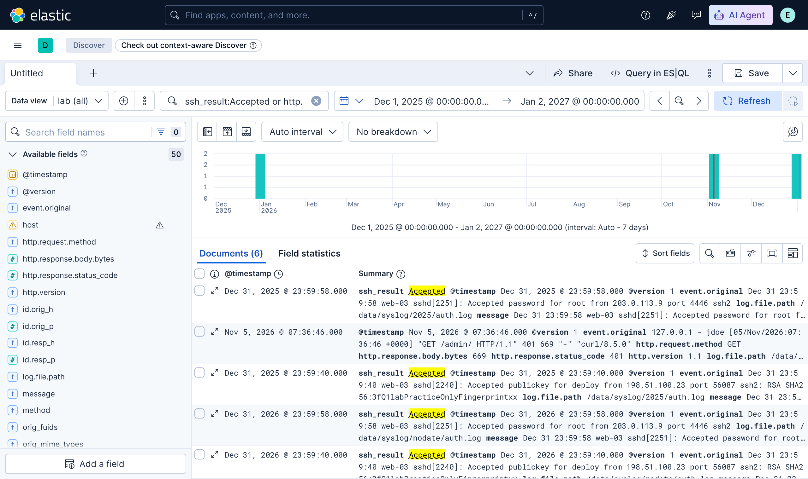
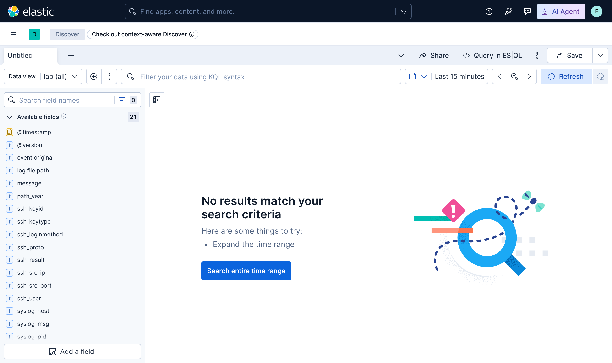

# 2.13 — The Elastic Stack and SOF-ELK { #elastic-stack-sof-elk }

!!! abstract "Scope of this lesson"
    - The Elastic Stack's three parts: Elasticsearch (storage and search), Logstash (input, parsing, enrichment, output), Kibana (front end), plus Beats
    - Strengths and weaknesses: it scales enormously, but out of the box it does almost nothing
    - Logstash: inputs, filters (grok, date, GeoIP), outputs; grok run for real, and [Caution] two pitfalls (silent misparsing, year-less syslog)
    - Kibana: KQL, time ranges, and [Correction] what "tokenised on dots" really means
    - SOF-ELK: an Elastic Stack built for investigations; ingest directories and [Changed] the current release (July 2026)

!!! note "Lab environment and notation"
    **(Actual output)** came from **Elasticsearch, Logstash and Kibana 9.4.3** (single node) run from the official Docker images in this environment — the same version as the current SOF-ELK release. Data loaded: a small practice syslog file I wrote (documentation addresses), lesson 2.5's Apache practice-server log, and lesson 2.8's Zeek `http.log`. The environment's disk usage was above Elasticsearch's default limit (90%), so I disabled the disk threshold check **for the lab only**. **I couldn't run the SOF-ELK virtual machine itself here**; SOF-ELK content is based on its official wiki (checked 2026-11-05).

## 1. The Elastic Stack: three parts and Beats { #components }

The Elastic Stack is a popular "big data" platform that has shifted towards the SIEM market. The common "ELK" acronym names its three core parts.

| Part | What it does | Analogy |
| --- | --- | --- |
| **Elasticsearch** | A document-centric storage, search and analytics engine, fast even over large stores | The library stacks and card catalogue |
| **Logstash** | Reads input, transforms and enriches it, and sends it to one or more destinations | The librarian who classifies and labels incoming books |
| **Kibana** | The web front end for exploring data through dashboards and visualisations | The reading-room search desk |

Lightweight shippers called **Beats** (lesson 2.12) feed everything from raw log files to process statistics into this pipeline.

Where the analogy breaks: a librarian classifies books by reading them, but Logstash splits data **only by the rules it's given**. Without parsing rules, a log line goes into the stacks as one long string. And how the catalogue cards (Elasticsearch fields) were built changes the answer to the same question (section 3.1).

**Strengths**

- **It scales hugely.** Clusters handling hundreds of thousands of events per second, tens of billions of events in total, aren't unusual. A single VM won't reach those numbers, but the platform is designed to scale through clustering, and an analyst can still get a lot from one VM.
- **Anyone can use it.** The whole platform is available to anyone willing to invest time, with a well-documented plugin architecture (licensing: see [Changed] below).
- **Logstash's flexible parsing and enrichment.** Each event is translated internally into JSON and sent to various destinations, and users can extract exactly the data points that serve their investigative goals.

**Weaknesses**

- **Out of the box it does almost nothing.** Building the hardware and configuring the software takes significant effort and cost, and building and testing the parsing and visualisation configuration takes a lot more. Success with any data science platform depends entirely on the use case, organisational requirements and the formats of the available evidence.
- **Documentation can be hit and miss.** Some modules are documented thoroughly, others sparsely.

!!! warning "[Changed] Licensing and security defaults (as of 2026-11-05)"
    - **Licensing**: as in lesson 2.12, section 5, Elastic moved to the Elastic License and SSPL in 2021 and added AGPL as an option in 2024. "Free to use" holds, but some features still need a paid subscription.
    - **Security is on by default**: the book says Kibana lacks native security such as authentication and access control, and should sit behind a reverse proxy in production. In the 9.4.3 instance I ran, Elasticsearch accepted **HTTPS only** (plain HTTP connections failed), answered **401** without credentials, and Kibana redirected to a **login page** before showing anything (actual output). Since Elastic 8.0 (2022), security is enabled by default even for single-node installs. The principle of not exposing it directly to the Internet and restricting access still stands.

## 2. Logstash: inputs, filters, outputs { #logstash }

A Logstash configuration has three parts.

| Stage | Examples |
| --- | --- |
| **Input** | Local files (ideal for forensics and hunting), syslog, RELP, Beats, NetFlow (v5, v9), SNMP traps, HTTP POST |
| **Filter** | grok parsing, GeoIP, JSON/CSV/XML handling, string modification, hashing |
| **Output** | Elasticsearch, WebSockets, HTTP POST, APIs (SMS and email notifications), message queues |

All three stages use a plugin architecture, so adding sources and destinations is fairly straightforward.

### 2.1 grok: turning human-readable logs into fields { #grok }

The most important part of the filter stage is the **grok** pattern syntax — "regex without all the crying and gnashing of teeth", as the unofficial tagline goes. You combine predefined patterns (`WORD`, `IPORHOST`, `POSINT`, `USERNAME` and so on) as `%{PATTERN:field}` to pull values out of logs meant for humans (syslog, web server logs). Kibana includes a grok debugger (Dev Tools) for testing.

I ran the book's SSH log example on practice data (documentation addresses): first stripping the syslog prefix, then matching the book's SSH pattern against the message.

```text
grok { match => { "message" => "^%{SYSLOGTIMESTAMP:syslog_ts} %{SYSLOGHOST:syslog_host} %{PROG:syslog_prog}(?:\[%{POSINT:syslog_pid}\])?: %{GREEDYDATA:syslog_msg}$" } }
grok { match => { "syslog_msg" => "^%{WORD:ssh_result} %{WORD:ssh_loginmethod} for %{USERNAME:ssh_user} from %{IPORHOST:ssh_src_ip} port %{POSINT:ssh_src_port} %{WORD:ssh_proto}(?:: %{WORD:ssh_keytype} %{DATA:ssh_keyid})?$" } }
```

One input line:

```text
Dec 31 23:59:40 web-03 sshd[2240]: Accepted publickey for deploy from 198.51.100.23 port 56087 ssh2: RSA SHA256:3fQ1labPracticeOnlyFingerprintxx
```

**(Actual output; fields of the indexed document)**

```text
ssh_result=Accepted  ssh_loginmethod=publickey  ssh_user=deploy  ssh_src_ip=198.51.100.23  ssh_src_port=56087  ssh_proto=ssh2  ssh_keytype=RSA
```

The trailing `(?:: %{WORD:ssh_keytype} %{DATA:ssh_keyid})?` means "if `: keytype keyid` follows, extract it too; otherwise fine", so it also matched password logins (lines ending `... ssh2`).

### 2.2 [Caution] grok can be silently wrong { #grok-pitfall }

I loaded lesson 2.5's Apache log (Ubuntu's `combined` format) with Logstash's built-in `%{COMBINEDAPACHELOG}` pattern. **Zero** documents were tagged `_grokparsefailure`. But two things were off.

**(Actual output)**

```text
original:  127.0.0.1 - - [05/Nov/2026:07:04:23 +0000] "GET /index.html HTTP/1.1" 200 256 "-" "tab\there \"quoted\" \xed\x95\x9c\xea\xb8\x80"
user_agent.original = 'tab\\there \\'
```

1. **The User-Agent was cut short.** As lesson 2.5, section 3.3 showed, Apache escapes quotes as `\"`, and this pattern treated `\"` as the end of the value, discarding the rest (`quoted"` and the Korean bytes). With no failure tag, it's a **silent misparse**: an attacker putting quotes in a User-Agent could keep its content out of searches and aggregations.
2. **The field name doesn't match its meaning.** The size went into `http.response.body.bytes` (body bytes), but, as lesson 2.5, section 3.2 confirmed, Ubuntu's `combined` puts `%O` — **including headers** — in that position. Trusting the name misreads the size.

**What this means for investigations:** check parsed fields **against the original line** (`event.original`, `message`), especially lines with odd characters (quotes, tabs, byte escapes) and lines likely to be attack traces. Record the parsing rules (which patterns, which format definitions) with the evidence.

!!! info "[Changed] Field names are now ECS"
    As above, Logstash 9.4.3's `COMBINEDAPACHELOG` produced **ECS (Elastic Common Schema)** names such as `source.address`, `http.request.method`, `url.original`, `http.response.status_code` and `user_agent.original` (actual output). Older versions used names like `clientip`, `verb`, `request`, `response` and `agent`, because ECS compatibility became the default in Logstash 8. Old course material, queries and dashboards may not find their fields, so check the data's real field names first.

### 2.3 [Caution] Year-less syslog in Logstash { #syslog-year }

Lesson 2.10, section 3.3's problem (no year in traditional syslog) persists in Logstash. I placed the same four `Dec 31 …` lines in two places: `/data/syslog/2025/auth.log` and `/data/syslog/nodate/auth.log`. As SOF-ELK does, when a four-digit year appears in the path, it's attached to the timestamp.

```text
grok { match => { "[log][file][path]" => "/data/syslog/(?<path_year>\d{4})/" } tag_on_failure => [] }
if [path_year] { mutate { add_field => { "ts_full" => "%{path_year} %{syslog_ts}" } }
                 date { match => ["ts_full", "yyyy MMM dd HH:mm:ss", "yyyy MMM  d HH:mm:ss"] timezone => "UTC" } }
else           { date { match => ["syslog_ts", "MMM dd HH:mm:ss", "MMM  d HH:mm:ss"] timezone => "UTC" } }
```

**(Actual output; `@timestamp` and file path)**

```text
2025-12-31T23:58:02.000Z /data/syslog/2025/auth.log
2025-12-31T23:59:58.000Z /data/syslog/2025/auth.log
2026-12-31T23:58:02.000Z /data/syslog/nodate/auth.log
2026-12-31T23:59:58.000Z /data/syslog/nodate/auth.log
```

Without a year in the path, the events landed on **2026-12-31**, nearly two months **in the future** relative to now (2026-11-05): Logstash attached the current year to year-less timestamps. `timezone => "UTC"` is deliberate too; without it, Logstash interprets times in the time zone of the system it runs on. What time zone the original device used must be confirmed from its configuration; record it as an **assumption** made during parsing.

The figure below shows this data in Kibana. The same events appear as bars in **two places, late December 2025 and late December 2026**.

{ loading=lazy }

**Figure 2-1. Discover in Kibana 9.4.3 (actual output).** At the top is the KQL search bar, to its right the time range, in the middle the histogram of documents over time, and below the document list. The warning icon next to `host` in the field list on the left is a **type conflict**: viewing several indices together, a same-named field has different types per index (Zeek's string versus Logstash's `host.name` object). Click the image to enlarge it.

## 3. Kibana and KQL { #kibana-kql }

Kibana lets you search, filter and explore data stored in Elasticsearch, using **KQL (Kibana Query Language)** — designed to be intuitive for people while still allowing very focused searches.

I ran a query shaped like the book's example against this lab's data, both in the Kibana UI (Figure 2-1) and as KQL inside Elasticsearch's ES|QL via the `KQL()` function.

```text
FROM lab-httpd
| WHERE KQL("url.original:*zip* or (http.response.status_code >= 400 and http.response.status_code < 500)")
| KEEP @timestamp, url.original, http.response.status_code | SORT @timestamp
```

**(Actual output)**

```text
       @timestamp       | url.original  |http.response.status_code
2026-11-05T07:04:23.000Z|/a\x01b        |400
2026-11-05T07:36:46.000Z|/report.zip    |200
2026-11-05T07:36:46.000Z|/admin/        |401
```

Reading KQL:

- `field:value` matches records where the field matches the value; `*` is a wildcard (`*zip*` = contains zip).
- Combine with `and`, `or`, `not` and parentheses.
- Range comparisons such as `>=` and `<` work on numeric and date fields.
- Quotes match a phrase as is (`host:"www.lab.example"`).
- The search is only meaningful **when fields are present with appropriate names and types**. If parsing is wrong or field names differ, as in 2.2, a correct query gives wrong results.

!!! info "[Supplement] ES|QL"
    Since the book, Elastic has added **ES|QL**, a query language that chains steps with pipes (`|`), as above. `STATS … BY` aggregates directly, handy for investigations. For example, `FROM lab-syslog | WHERE KQL("ssh_result:Accepted") | STATS n = COUNT(*) BY ssh_user, ssh_src_ip` returned `deploy 198.51.100.23 2` and `root 203.0.113.9 2` (actual output; 2 each because the same four lines went in twice, under two years).

### 3.1 [Correction] Tokenisation: what "split on dots" really means { #tokenization }

The book explains that text fields are **tokenised** by default (Elasticsearch calls them "analyzed"), split on characters such as `.`, `/`, `-` and whitespace, so a search `somefield:sitename` matches values like `sitename.com` or `/cases/sitename/lab-2.3/`; and that a separate `.keyword` field may hold the untokenised string.

I checked how the default (standard) analyzer actually splits, using Elasticsearch's `_analyze` API.

**(Actual output)**

```text
www.lab.example              -> ['www.lab.example']
site2026.com                 -> ['site2026', 'com']
site.com                     -> ['site.com']
/cases/lab-2.3/report.zip    -> ['cases', 'lab', '2.3', 'report.zip']
cloudsync-tw.example.com     -> ['cloudsync', 'tw.example.com']
198.51.100.23                -> ['198.51.100.23']
python-requests/2.31.0       -> ['python', 'requests', '2.31.0']
```

It split on `/`, `-` and whitespace, but **`.` depended on context**. `site2026.com` was split (a dot after a digit) while the same-shaped `site.com` wasn't, and **dots between letters** — `www.lab.example`, `tw.example.com`, `report.zip` — **were not**, because the standard analyzer follows Unicode word-boundary rules (UAX #29). The actual searches confirmed it.

**(Actual output; the `host` field of Zeek `http.log`, dynamically mapped as `text` + `.keyword`)**

```text
host:lab                 hits=0
host:www.lab.example     hits=5
host.keyword:lab         hits=0
host:*lab*               hits=6
user_agent:curl          hits=4
user_agent:python        hits=1
```

`host:lab` returned **zero**: `www.lab.example` is a single token, so there's no `lab` token. The wildcard (`host:*lab*`) found all five `www.lab.example` records plus one `portal.lab.example`. Meanwhile `user_agent:python` matched thanks to the split at the `-` in `python-requests/2.31.0`.

**What this means for investigations:** believing "searching part of a domain finds everything" will make you **miss things**. Check how a field is mapped (which analyzer) and split with `_analyze`, and use wildcards, `.keyword`, or a dedicated field built for the data (such as a configuration that pre-splits domains, as SOF-ELK-style distributions may do) where needed. SOF-ELK uses its own mappings, so results there may differ from this experiment; I couldn't check that here. Remember too that tokenised fields allow broad searches at a performance cost, and `.keyword` matches only exact values.

### 3.2 The time range: "last 15 minutes" by default { #time-range }

{ loading=lazy }

**Figure 3-1. Discover with the time range unchanged (actual output).** At the top right the time range reads **Last 15 minutes**, with a "no results" message and a "Search entire time range" button.

By default Kibana shows only **the 15 minutes before now**. That suits live monitoring, but in forensics with evidence from days or years ago it's the most common reason loaded data seems to show "nothing". Use the calendar icon for common or recent ranges, or set dates explicitly; you can also enable auto-refresh, or drag on the histogram to narrow the range. This lab's data only appeared after widening the range to 2025-12-01 through 2027-01-02 (Figure 2-1). Records landed in **the wrong year**, as in the previous section, may fall outside the range, so start wide and narrow down.

### 3.3 Dashboards, filters and expanding documents { #dashboards-filters }

Kibana dashboards are fundamentally **interactive**: not a read-only view of one predetermined picture, but a tool for exploring the underlying data as hypotheses are refined.

- Dragging on the **histogram** changes the time range; clicking a **pie slice** creates a filter on that value.
- Below the dashboard is a **document list** (one record per row, spreadsheet-like) matching the current search and filters, with adjustable columns.
- **Expanding** a row shows all fields and values, with icons per field to filter "for this value" (+), "excluding this value" (−), "add as a column", or "records where this field exists".
- Filters can be **pinned** (kept across dashboards), edited, **negated**, **temporarily disabled** and deleted. All active filters are combined with **AND**.

!!! tip "Make a habit of pinning filters"
    When you find a pivot point (a suspicious address or account), pin that filter and move through the Syslog, HTTPD and NetFlow dashboards in turn. You can tie together the same address's traces across log types at once (lesson 2.12, section 2's "follow the whole incident from one place").

## 4. SOF-ELK: an Elastic Stack built for investigations { #sof-elk }

**SOF-ELK** (Security Operations and Forensics ELK) was created to keep the Elastic Stack's strengths while easing its weaknesses (it does nothing out of the box; you must build parsing and dashboards). It's a virtual machine appliance with the Elastic Stack preinstalled and **parsers and dashboards** for many log types and NetFlow. It's distributed as a free, open source resource usable outside any course, and its configuration files and dashboards are maintained in a public GitHub repository.

!!! warning "[Changed] The current release (official wiki, checked 2026-11-05)"
    - Latest release: **v20260706**, based on Ubuntu 26.04 with **Elastic Stack 9.4.3**, configuration from the repository's `public/v20260706` branch, in separate **x86 and ARM (Apple M-series and others)** builds. Check downloads against the SHA-256 values on the wiki.
    - Components: Elasticsearch, Logstash, Kibana, and Filebeat (handling file ingestion).
    - Updates: configuration files are updated from GitHub with an included script; a new VM download is needed only for major changes to the OS or Elastic Stack.
    - GeoIP: because MaxMind's licensing changed, current GeoIP databases aren't redistributed. Create a free MaxMind account and licence key, load them with `geoip_bootstrap.sh`, and optionally enable periodic updates (as in the book).

### 4.1 Loading evidence: drop it in a directory { #ingest }

SOF-ELK parses and loads files placed in **subdirectories of `/logstash/`** according to their type. There are more types than at the book's time (per the official wiki).

| Directory | Contents |
| --- | --- |
| `syslog/` | Syslog format. **Put the year in the path** (`/logstash/syslog/2025/…`) because of the year problem in 2.3; a timestamp with a year, such as ISO 8601, is used as is |
| `httpd/` | Apache common, combined, vhost-combined |
| `passivedns/` | Logs from the passivedns tool (lesson 2.7) |
| `nfarch/` | Archived NetFlow, converted with `nfdump2sof-elk.sh`; conversion scripts also exist for AWS and Azure flow logs |
| `zeek/` | Zeek **JSON** logs (decompressed). `conn.log` goes in like NetFlow, `http.log` like HTTPD logs, `dns.log` like other DNS logs, so they appear together on the same dashboards |
| `kape/` | KAPE JSON output (check supported files and naming) |
| `plaso/` | Plaso CSV |
| `microsoft365/`, `azure/`, `aws/`, `gcp/`, `gws/` | Cloud logs |
| `hayabusa/`, `volatility/`, `kubernetes/` | [Supplement] added since the book: output of the Windows event log analysis tool Hayabusa, Volatility 3 JSON, Kubernetes logs |

!!! warning "[Changed] Filebeat 9's \"new file\" logic: the 1,024-byte rule"
    According to the official wiki, from Filebeat 9 the default file-identity method changed to **fingerprint**, with two effects on SOF-ELK file ingestion:

    - **Files smaller than 1,024 bytes aren't read.** The wiki advises concatenating small log files of the same type until they exceed 1,024 bytes.
    - **Files whose first 1,024 bytes are identical are treated as the same file and skipped.** For example, several log files with an identical header may result in only one being loaded (the wiki suggests shuffling lines with `shuf` to make a "different" file for one-record-per-line logs, warning never to do this to multiline JSON).

    **What this means for investigations:** after loading evidence, always **compare the original's line count with the number of indexed documents**. Small files or files with identical headers may have been silently skipped. (I confirmed this rule from the wiki; I didn't test it with SOF-ELK here.)

### 4.2 Live input { #live }

The book describes SOF-ELK as a live collector too, listing ports for syslog (TCP/UDP 5514), HTTPD logs (5515), RELP and Filebeat (TCP 5516) and NetFlow v5 (UDP 9995). You open firewall ports and often switch the VM's network from NAT to bridged mode.

!!! info "[Changed] Network inputs listed on the current wiki"
    The official wiki's input page (checked 2026-11-05) lists only **NetFlow v5, v9 and IPFIX (UDP 9995)** as a network input, noting that the firewall port must be opened first. Whether the book's syslog, HTTPD and RELP ports still exist in the current release isn't confirmed by that page; check the introduction dashboard and documentation of the release you're using.

### 4.3 Built-in dashboards { #sof-elk-dashboards }

Because SOF-ELK's data loading and parsing are predictable, it ships with default dashboards.

- **Introduction dashboard**: which evidence has been loaded for the selected period (by record type and source), plus instructions for loading evidence. Start here to check "did everything I loaded arrive?"
- **Syslog dashboard**: events per time unit at the top, pie charts by source system and source program, and the document list below.
- **HTTPD log dashboard**: web server access logs and proxy logs together, with timelines by request method and response code, top requesting ASNs, top virtual hostnames, a map of source locations and top User-Agents. Known IP fields are enriched with ASN and geolocation if the GeoIP database is present.
- Others — NetFlow, Eventlog, LNK file dashboards — exist per data type (see the wiki's index and dashboard table).

## 5. How this is used in real investigations { #in-practice }

1. **Count that everything loaded arrived.** Original line counts against indexed documents, parse-failure tags (`_grokparsefailure` and others), and, on SOF-ELK, the 1,024-byte rule.
2. **Check time.** Year (did you put it in the path?), time zone (an assumption made during parsing), and Kibana's time range (15 minutes by default).
3. **Compare parsed fields with the original.** Silent misparsing (section 2.2), fields whose names don't match their meaning (body bytes versus total bytes).
4. **Check field names and mappings.** ECS names? How text fields are tokenised (`_analyze`)? Is there `.keyword`? Type conflicts across indices?
5. **Search broadly, then narrow.** Try both wildcards and exact values, and don't take zero hits at face value.
6. **Pivot with pinned filters.** Tie the same address or account together across dashboards.
7. **Record the platform itself.** Version, parsing configuration, mappings. The same query gives different results under different settings.

## 6. Summary { #summary }

- Elastic Stack = Elasticsearch (storage and search) + Logstash (input, filter, output) + Kibana (front end), plus Beats. It scales enormously but does almost nothing out of the box. **[Changed]** Licensing has changed, and in 9.4.3 HTTPS, authentication and the Kibana login were on by default.
- grok turns human-readable logs into fields; the book's SSH pattern worked as is. **[Caution]** `COMBINEDAPACHELOG` truncated a User-Agent containing an escaped quote without a failure tag, and put Ubuntu's `%O` under a "body bytes" name. **[Changed]** Field names are ECS.
- Year-less syslog got the current year in Logstash too and landed in the future; taking the year from the path, as SOF-ELK does, fixed it.
- I filtered with KQL and aggregated with ES|QL's `KQL()` and `STATS`. **[Correction]** The default analyzer splits on `/`, `-` and whitespace, but not on `.` between letters, so `host:lab` returned zero. Kibana's default time range is the last 15 minutes.
- SOF-ELK is an investigation-oriented Elastic Stack with parsers and dashboards. **[Changed]** Release v20260706 (Ubuntu 26.04, Elastic 9.4.3, x86 and ARM), more input types, Filebeat 9's 1,024-byte rule, and the wiki now lists NetFlow (UDP 9995) as the network input.

## Review questions { #review }

**Question 1. (Basics)** Say what each of the Elastic Stack's three parts does, and for each, one thing to suspect when an investigator feels "the search results are odd".

??? success "Answer and explanation"
    **Logstash** (input, parsing, enrichment, output): parsing may be wrong (section 2.2's silent truncation), the year or time zone may have been attached incorrectly (section 2.3), or not every loaded file was read (SOF-ELK's 1,024-byte rule). **Elasticsearch** (storage and search): field mappings and tokenisation may not match what you expect (section 3.1's zero hits for `host:lab`), or there may be type conflicts across indices. **Kibana** (front end): the default 15-minute time range may exclude the data (section 3.2), or active filters (including pinned ones) may be ANDed in.

**Question 2. (Interpretation)** A colleague searched Kibana for `domain:evil`, got zero hits, and concluded "there was no communication with that domain". The real logs may contain values like `cdn.evil.example`. What do you check?

??? success "Answer and explanation"
    The default analyzer doesn't split on `.` between letters, so `cdn.evil.example` may be **one token** (section 3.1: `www.lab.example` was one token, so `host:lab` returned zero). Check: ① how the field is split, via `_analyze` or its mapping; ② search again with a wildcard (`domain:*evil*`), the exact value (`domain:"cdn.evil.example"`) or the `.keyword` field; ③ whether the data has a separate field that splits domains (a distribution's configuration, such as SOF-ELK's); ④ whether the time range is wide enough; ⑤ whether other fields were searched too (DNS `query`, HTTP `host`, proxy URLs). "Zero hits" isn't a conclusion until the query and mapping are checked.

**Question 3. (Changed conditions)** In 2026 you receive a copy of a Linux server's `auth.log` (traditional syslog format) from an incident in late 2024. Where should you put it in SOF-ELK, and what happens if you don't?

??? success "Answer and explanation"
    Put it in a directory **with the year in the path**, such as `/logstash/syslog/2024/` (section 4.1), so year-less timestamps get 2024. Otherwise, as in section 2.3's experiment, **the year at load time (2026)** is attached and the incident lands at the wrong time, such as December 2026 (sometimes in the future). If the file spans the new year and contains January records, those should be 2025, so consider splitting the file at the date boundary into separate year directories. Check the original server's time zone too.

**Question 4. (Common misconception)** "When grok fails, `_grokparsefailure` is added, so documents without that tag were parsed correctly." Refute this with section 2.2's results.

??? success "Answer and explanation"
    In section 2.2, `COMBINEDAPACHELOG` **truncated** a User-Agent containing `\"`, yet zero documents had the failure tag, because the pattern as a whole still "matched" (the remainder went elsewhere or was dropped). And the size field parsed, but its **name (`http.response.body.bytes`) didn't match its real meaning** (Ubuntu's `%O`, including headers). No failure tag means "the pattern matched", not "the values are right". Check lines with odd characters, and important lines, against the original (`event.original`).

**Question 5. (Application)** You're about to load Zeek logs (JSON) made from a pcap into SOF-ELK. List, in order, what to check before and after loading.

??? success "Answer and explanation"
    **Before:** ① that they're JSON (lesson 2.8's `LogAscii::use_json=T`) and decompressed (section 4.1 requires decompressed files); ② that file names match supported shapes (`conn.*`, `http.*`, `dns.*`, etc.); ③ record the originals' line counts and hashes; ④ whether any files are under 1,024 bytes or share identical headers (Filebeat 9 rule). **After:** ⑤ compare document counts per index and on the introduction dashboard with the original line counts; ⑥ widen the time range to the evidence period (15 minutes by default); ⑦ know that `conn.log` appears on the NetFlow dashboard and `http.log` on the HTTPD dashboard, and check there; ⑧ spot-check a few records' parsed fields against their original lines.

**Question 6. (Changed conditions)** A Kibana query from an old internal document, `response:404 and clientip:10.10.1.19`, finds nothing in a new Elastic Stack (9.x), though the data is definitely there. What's the likely cause, and how do you fix it?

??? success "Answer and explanation"
    Most likely the **field names changed to ECS** (section 2.2's [Changed]). The old `COMBINEDAPACHELOG` produced `response` and `clientip`; with the default ECS compatibility since Logstash 8 they're `http.response.status_code` and `source.address`. Check the real names in Discover's field list or an expanded document and rewrite as `http.response.status_code:404 and source.address:"10.10.1.19"`. Review old dashboards, saved searches and alert rules too.

**Question 7. (Interpretation)** In Figure 2-1's field list, `host` has a warning icon. What does it mean, and how could it affect an investigation?

??? success "Answer and explanation"
    It's a type conflict: viewing several indices (`lab-*`) through one data view, a same-named field has **different types** per index. In this lab, Zeek `http.log`'s `host` was a string (the requested Host header), while the `host` Logstash added for file input was an object with `host.name` (the container Logstash ran in). Same name, **different meaning** too. Effects: filtering or aggregating on that field may work only for some indices or error out, and assuming "host" means the same thing everywhere leads to misinterpretation. View indices separately, or rename during parsing (for example, Zeek's to `url.domain`) to remove the conflict.

## References { #references }

- Tools used in this environment: Elasticsearch, Logstash and Kibana 9.4.3 (official Docker images, single node, default security), Playwright (screenshots), curl. Results obtained on 2026-11-05.
- Elastic, [Logstash documentation](https://www.elastic.co/docs/reference/logstash) (inputs, filters, outputs, grok, date, ECS compatibility), [Kibana Query Language](https://www.elastic.co/docs/explore-analyze/query-filter/languages/kql), [ES|QL](https://www.elastic.co/docs/explore-analyze/query-filter/languages/esql), [Elastic Common Schema](https://www.elastic.co/docs/reference/ecs), [the standard analyzer and `_analyze` API](https://www.elastic.co/docs/reference/text-analysis/analysis-standard-analyzer), [Filebeat filestream input (fingerprint)](https://www.elastic.co/docs/reference/beats/filebeat/filebeat-input-filestream).
- Unicode, [UAX #29: Unicode Text Segmentation](https://www.unicode.org/reports/tr29/) (word-boundary rules).
- Wiki pages "Virtual Machine README" and "Inputs and Preprocessing" in the official SOF-ELK repository (checked 2026-11-05: release v20260706, Ubuntu 26.04, Elastic 9.4.3, ingest directories, Filebeat 9 caveats, NetFlow input).
- MaxMind, [GeoLite2](https://dev.maxmind.com/geoip/geolite2-free-geolocation-data).

!!! note "About this page"
    A personal study note, rewritten in my own words from several learning resources. The lab data and configuration are my own, and the scenarios are hypothetical.
