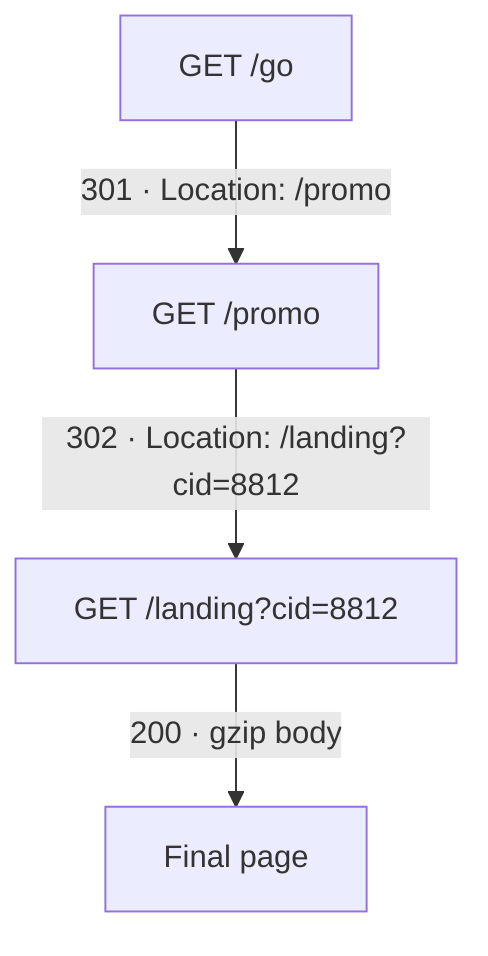

# 2.2 — Reading HTTP Responses: Status Codes, Response Headers and Investigative Use { #http-responses }

!!! abstract "Scope of this lesson"
    - The three parts of the status line: version, status code, reason phrase. **One byte** of reason phrase can fingerprint a server (tested directly)
    - The five families of status codes and the ones common in investigations. [Correction] the name of 400, and 302 versus 307/308
    - Reading attacker intent from the flow of status codes: a storm of 404s, a 200 after 500s
    - Response headers: `Connection` ([Correction] HTTP/1.1 keeps connections alive by default), `Server`, content information and compression, `Date` (measuring clock skew), cache directives, `Location`
    - Typical investigative uses of HTTP: paste sites, User-Agent profiles, Basic authentication, URI records

!!! note "Lab environment and notation"
    **(Actual output)** was produced in this environment. Responses came from a practice server on loopback (written in Python for this lesson), deliberately built to run its **clock 437 seconds slow** and to return two redirects, a gzip-compressed body, and a response with one extra space after the reason phrase. Requests were sent with `curl` 8.5.0, captured with tcpdump 4.99.4 and read with tshark 4.2.2. Addresses and scenarios are hypothetical.

## 1. Responses tell you "what happened on the server side" { #why-responses }

The requests of lesson 2.1 tell you **what the client wanted**. The response tells you **how that request was actually handled**. Writing "they accessed the admin page" from request logs alone is half the story. Whether the request got a 200 (success), a 403 (refused) or a 302 back to the login screen changes everything.

As an analogy, the request is **an application form** handed in at a service counter, and the response is **the notice of outcome** the counter returns. The notice carries a result number (the status code), a short description (the reason phrase), notes about the handling (response headers), and possibly an attached document (the body). Where the analogy differs: the server can write most of that description and those notes **however it likes**, just like request headers in lesson 2.1.

## 2. The status line: version, code, reason phrase { #status-line }

The first line of a response is the **status line**.

```http
HTTP/1.1 301 Moved Permanently
```

- **Version (`HTTP/1.1`):** usually matches the request's version.
- **Status code (`301`):** a three-digit number. Programs decide what to do from this number alone.
- **Reason phrase (`Moved Permanently`):** a short description for humans. The standard recommends phrases, but clients **must ignore** it and servers can write **anything**.

### 2.1 One byte of reason phrase becomes a fingerprint { #phrase-fingerprint }

The source material describes a researcher who found the servers of a popular attack and penetration-testing framework by **a single space after the reason phrase**. Those servers sent `HTTP/1.1 200 OK ` with an extra space after `OK`, and scanning the Internet for this quirk turned up thousands of them (it has since been fixed). Clients ignore the reason phrase, so nothing breaks, but **an implementation that deviates slightly from the standard** becomes a fingerprint of that program.

I tested this principle. The practice server returns `OK ` (with the space) only for `/beacon` requests.

```bash
tshark -n -r resp.pcap -Y 'http.response.phrase == "OK "' -T fields -e tcp.stream
```

**(Actual output)** `9`. Of twelve responses, only the one with the space (stream 9) matched. The table below lists all responses; by eye, the difference between `OK` and `OK ` is barely visible.

**(Actual output, some columns trimmed)**

```text
tcp.stream  code  phrase             location            content_encoding  content_length
0           301   Moved Permanently  /promo                                0
0           302   Found              /landing?cid=8812                     0
0           200   OK                                     gzip              78
1           404   Not Found                                                12
...         ...   ...
8           404   Not Found                                                12
9           200   OK                                                       48
```

**What it means for investigations:** when threat intelligence reports "this C2 server sends this unusual response", one display filter can find the same server across all your past pcaps. Conversely, remember that such fingerprints **vanish the moment the attacker fixes them**. Don't conclude from one characteristic alone; use it alongside other evidence such as the destination, timing patterns and content.

!!! info "[Changed] HTTP/2 and HTTP/3 have no reason phrase"
    HTTP/2 (RFC 9113) and HTTP/3 (RFC 9114) send only the status code, in the `:status` pseudo-header, and don't carry the version or reason phrase at all. So reason-phrase fingerprints work only on HTTP/1.x responses. If a logging tool shows a reason phrase for an HTTP/2 response, it's a standard phrase **filled in** by the tool to match the code.

## 3. Status codes { #status-codes }

### 3.1 The five families { #families }

| Family | Meaning | One-line summary |
| --- | --- | --- |
| 1xx | Informational | still working, carry on |
| 2xx | Success | the request was received and handled |
| 3xx | Redirection | go elsewhere, or use what you already have |
| 4xx | Client error | something is wrong with the request |
| 5xx | Server error | the request was fine, but the server couldn't handle it |

Even for an unfamiliar code, the first digit gives the broad meaning. The standard says to treat an unknown code as the x00 of its family.

### 3.2 Codes commonly seen in investigations { #common-codes }

| Code | Standard name | How to read it in investigations |
| --- | --- | --- |
| 100 | Continue | confirmation before sending a body (`Expect: 100-continue`). A precursor of large uploads |
| 200 | OK | handled successfully. Read together with body size |
| 204 | No Content | success, no body. Common as a beacon's "nothing to do" reply |
| 206 | Partial Content | sent part only (`Range` request). The PDF fetched three times in the same second in lesson 1.4 |
| 301 | Moved Permanently | permanent move. Follow the `Location` header |
| 302 | Found | temporary move. Return after login, the new post's address after an upload (lessons 1.4 and 1.13) |
| 304 | Not Modified | use the copy you have. **No body**: no content was exchanged at that moment |
| 307 · 308 | Temporary · Permanent Redirect | like 302 and 301, but resend **without changing** the method and body |
| 400 | Bad Request | malformed request. Fuzzing, sloppy tools |
| 401 | Unauthorized | authentication required. Look at subsequent `Authorization` attempts |
| 403 | Forbidden | refused regardless of authentication |
| 404 | Not Found | nonexistent resource. Many at once suggests reconnaissance (section 3.3) |
| 405 | Method Not Allowed | that method isn't allowed. Traces of trying method after method |
| 407 | Proxy Authentication Required | proxy authentication required (the proxy version of 401) |
| 429 | Too Many Requests | requesting too often. Brute forcing or scraping hitting a limit |
| 500 | Internal Server Error | internal server error. A web app falling over on strange input |
| 502 · 504 | Bad Gateway · Gateway Timeout | front-end equipment got no answer from the back-end server |
| 503 | Service Unavailable | overloaded or under maintenance |
| 511 | Network Authentication Required | the login screen of places like public Wi-Fi (captive portals) |

!!! warning "[Correction] The name of 400 and the meaning of 302"
    - The source material calls 400 "Bad Syntax", but the standard name is **Bad Request** (RFC 9110 section 15.5.1).
    - The source material describes 302 as "in practice a temporary relocation, though not strictly in compliance with the standard". The background: 302 originally meant "repeat the request with the same method", but browsers turned a `POST` answered with 302 into a `GET`. Today's standard (RFC 9110 section 15.4.3) accepts that reality and allows the method to change to `GET` after a 302, and provides **307** (temporary) and **308** (permanent) for when the method **must** be kept. So in logs, `POST` → 302 → `GET` is a normal shape, while `POST` → 307 → `POST` means the same body was sent **once more**. It makes a difference when you count upload volume.

!!! info "[Supplement] 304 means \"no content was exchanged\""
    A 304 response has no body. It tells the client to use the copy it already has (the browser cache, lesson 1.5). So writing "they received that file at that time" from a 304 record is wrong. The file was received **some time earlier**; at that moment only the question "is it still valid?" was exchanged. To find when it was first received, search back for a 200 response to the same address.

### 3.3 Reading intent from the flow of codes { #code-patterns }

Status codes say more as a **flow** than one at a time. I requested common admin pages and config file names from the practice server one after another, like a reconnaissance tool.

**(Actual output, requests joined with their response codes)**

```text
/phpmyadmin/      404   Mozilla/5.0 zgrab/0.x
/pma/             404   Mozilla/5.0 zgrab/0.x
/admin/setup.php  404   Mozilla/5.0 zgrab/0.x
/wp-login.php     404   Mozilla/5.0 zgrab/0.x
/.env             404   Mozilla/5.0 zgrab/0.x
/.git/config      404   Mozilla/5.0 zgrab/0.x
/backup.zip       404   Mozilla/5.0 zgrab/0.x
/server-status    404   Mozilla/5.0 zgrab/0.x
```

Eight requests all got 404 within 0.06 seconds; no person with a browser could do that. This is the source material's **"long bout of 400-series codes from a single address"**, the classic shape of reconnaissance. The names requested also show **what was being looked for** (a database admin tool, WordPress login, config files holding passwords, source repositories, backups). Lesson 2.5 shows the same shape in real web server log formats.

Another flow the source material describes is **500-series codes against a search form, then a 200, followed by many POSTs**. Input with broken SQL syntax causes an error between the web app and the database, so it usually comes back as a 500. If an attacker kept adjusting input and getting 500s and finally got a 200, that may be **the moment the injection succeeded**, and the POSTs after it may be post-compromise operations. The server's **error log** often holds database error messages in such cases, so secure it too.

!!! warning "[Caution] A pile of 404s doesn't mean \"it failed, so we're fine\""
    If a reconnaissance run ended all in 404s, that only means nothing was found from that list. Check whether **even one** request from the same address got a 200, and whether that address came back days later in another way. Also, as lesson 1.10, section 6.3 showed, an exported file named `backup.zip` may contain a 404 page. In this lab too, the file exported under the name `backup.zip` was a 12-byte `<h1>404</h1>` **(actual output)**.

## 4. Response headers { #response-headers }

### 4.1 `Connection`: [Correction] HTTP/1.1 keeps connections alive by default { #connection }

The source material says HTTP/1.1 gained the ability to carry several request/response pairs over one TCP connection, and that when the client signals support with `Connection: Keep-Alive`, the server answers with the same header. More precisely, **persistent connections are the default in HTTP/1.1** (RFC 9112 section 9.3). The connection stays open without any announcement, and the side wanting to close sends `Connection: close`. Stating `Keep-Alive` explicitly is the HTTP/1.0-era extension.

**What it means for investigations:** one TCP connection (one stream, as in lesson 1.9) can contain **several** requests. In this lab, the three requests `curl -L` made following redirects (`/go`, `/promo`, `/landing`) all travelled in **stream 0** **(actual output)**. So don't count "one stream = one request", and remember that one connection in flow records (lesson 1.11) can hold several requests. Zeek, covered in lesson 2.8, distinguishes them with `trans_depth`.

### 4.2 `Server`: the name the server declares for itself { #server }

The server-side counterpart of lesson 2.1's `User-Agent`. Values like `Apache/2.4.29 (Ubuntu)`, `nginx` and `Microsoft-IIS/10.0` are common and useful for guessing the server type and version. But **it can also be written freely**. This lab's server was written in Python yet declared `Server: Apache/2.4.29 (Ubuntu)` **(actual output)**, because I made it so. Many operators remove versions or write misleading names for security, and front-end CDNs or proxies may replace it with their own. Headers such as `Via`, `X-Cache` and `X-Served-By` are clues that a cache or CDN sits in between.

### 4.3 Content information: length, type, compression { #content-headers }

- **`Content-Length`:** the number of bytes in the body. This is the size **on the wire**.
- **`Content-Type`:** the body's type (MIME type) and character set. Only what the server claims; confirm the actual content by its magic number (lesson 1.13).
- **`Content-Encoding`:** compression applied to the body: `gzip`, `br` (Brotli), and `zstd` seen in lesson 2.1, among others.

With compression, there are two "sizes". In this lab, the `/landing` response had `Content-Length: 78`, but the file tshark exported was **1,106 bytes** of HTML **(actual output)**, because Wireshark decompressed the gzip on export. The same response can appear in proxy logs with its on-the-wire size (around 78 bytes) and in Zeek's `http.log` with its decompressed size (`response_body_len` in lesson 2.8). When matching sizes across sources, first establish **which size it is**. And when carving directly from packets (lesson 1.13), decompression adds another layer.

### 4.4 `Date`: another clock { #date }

The time the server generated the response. Caches use it to calculate freshness (lesson 1.5), but for investigators it's **another independent clock**. Comparing the capture box's time (the packet time) with the server's `Date` shows whether one of the clocks is off.

**(Actual output)**

```text
frame.time_epoch: 1793861118.334450000   → Thu Nov  5 06:45:18 UTC 2026
http.date:        Thu, 05 Nov 2026 06:38:01 GMT
```

```bash
date -u -d @1793861118
```

The capture time and the server's `Date` differed by **437 seconds (7 minutes 17 seconds)**, exactly as expected since I set the practice server's clock that far back. In a real case, a difference like this means checking ① the capture box's NTP status (lesson 1.11) and ② that server's clock, then **correcting all of that server's log times by the same amount** before matching them with other evidence. Conversely, in a pcap captured on a user's PC, if many servers' `Date` values are all off in the same direction, **the PC's clock** is likely wrong. The source material also mentions malware that used the `Date` value of an ordinary web request as the seed for its domain generation algorithm (lesson 2.7): a clock is useful to malware too.

### 4.5 Cache directives: `Cache-Control`, `Expires`, `ETag`, `Vary` { #cache-headers }

These are the headers seen with the proxy cache in lesson 1.5. Briefly:

- `Cache-Control: max-age=1800` means fresh for 30 minutes; `no-store` means don't store; `private` means don't store in a shared cache.
- `Expires` is an absolute time when freshness ends (the older approach).
- `ETag` is an **identifier for that content**. If the client sends it back in `If-None-Match` on the next request, the server answers 304 when it hasn't changed.
- `Vary: Accept-Encoding` means "store separate copies by compression method".

`ETag` is surprisingly useful in investigations. The same `ETag` is the server's indication of **the same content**, so it can be used to compare whether requests at different times or from different PCs received the same file. But how `ETag`s are generated varies by server (some build them from file size and modification time), and they can be faked, so they don't replace hashes.

### 4.6 `Location`: chains of redirects { #location }

3xx responses carry a `Location` header giving the next address. One request in this lab (`/go`) continued like this.



**How to read it:** top to bottom, the order in which the browser (here `curl -L`) followed automatically. The text on each arrow is that step's response code and `Location` value.

The user clicked **once**, yet three requests went out. Such chains are very common, and mostly normal, with URL shorteners, ad tracking and login flows. But malicious delivery networks love chains too: multiple hops make it easier to hide the final server and evade blocking. In investigations, find both the **start** of the chain (the link the user actually clicked, and where it came from) and the **end** (the content actually received), and put the intermediate addresses into block lists and threat intelligence. The query in a `Location` (`cid=8812`) can, like a campaign identifier, tell you **who sent the link**.

## 5. Typical investigative uses of HTTP { #investigative-uses }

The source material lists four. Tying them to earlier lessons:

- **Exfiltration to paste and file-sharing sites.** Attackers open a browser on a remotely accessed PC and upload data to a paste site, or build the site's published API into malware to upload automatically. Lessons 1.4 (the shape seen in logs) and 1.13 (the content carved from packets) were this case. A 302 and short `Location` after a `POST` are the typical traces.
- **Profiles built from User-Agents.** A well-managed organisation knows its permitted User-Agent values, so unfamiliar ones signal **unauthorised software**. Some malware puts its own version in the User-Agent, so collecting User-Agents at the perimeter quickly sketches **the extent of an infection and its version distribution**. Remember, as lesson 2.1 showed, that they can be faked.
- **Basic authentication.** Every request carries the account in Base64 (lesson 2.1, section 6.5), so over plain HTTP the account can be obtained at any point while the subject uses the site. A strong identity clue, and sensitive information.
- **URI records.** Search terms, clicked results, form submissions and API calls show up in URIs. For malware, a network analyst and a malware analyst working together can learn **which commands were exchanged**.

And the starting point of lesson 2.1 was that all of this remains **on the wire and in logs** even after private mode, portable apps and disk encryption have wiped it from the endpoint. The `Date` header becomes an independent clock for refining the sequence of events.

## 6. How to use this in real investigations { #in-practice }

1. **Pair every request with its response.** Write not "they accessed it" but "they accessed it and got a 200 (or a 403)".
2. **Read status codes as a flow.** Look for a storm of 404s from one address, a 200 after 500s, success after 401s.
3. **Read 304 and 206 carefully.** 304 means no content was exchanged at that moment; 206 means only part was.
4. **State which layer a size belongs to.** Compressed on-the-wire size, or decompressed size.
5. **Align clocks with `Date`.** Measure the differences between the capture box, servers and endpoints, and record the corrected values and the method in the report.
6. **Find the start and end of redirect chains.** Intermediate addresses are material for blocking and threat intelligence.
7. **Save unusual responses as fingerprints.** Reason phrases, header order, unfamiliar `X-` headers. But don't conclude from one fingerprint alone.

## 7. Summary { #summary }

- The response tells you **how a request was actually handled**. The status line is version, code and reason phrase.
- The reason phrase is up to the server, so even one byte (a space after `OK`) becomes a fingerprint (tested: one display filter matched only that response). **[Changed]** HTTP/2 and 3 have no reason phrase.
- Status codes come in five families. **[Correction]** 400 is Bad Request; after a 302 the method may change to GET, and 307/308 keep it. 304 means no content was exchanged at that moment.
- A storm of 404s from one address suggests reconnaissance; a 200 after 500s can signal successful injection (a hand-made reconnaissance flow: eight 404s in 0.06 seconds).
- **[Correction]** HTTP/1.1 keeps connections alive by default, so one stream can carry several requests (confirmed: three redirect requests in one stream).
- `Server` is also a self-declared name. `Content-Length` is the on-the-wire size, so with compression it differs from the decompressed size (78 bytes versus 1,106).
- `Date` is an independent clock; comparing it with packet times measured a 437-second skew.
- Find both the start and the end of `Location` chains.

## Review questions { #review }

**Question 1. (Status line)** A response's first line is `HTTP/1.1 200 Everything is fine, nothing to see here`. How does a browser handle it, and what might an investigator consider?

??? success "Answer and explanation"
    The browser **ignores** the reason phrase and treats it as a normal response from the 200 alone. The standard says clients must ignore the reason phrase and servers can write anything, so nothing is formally wrong. For the investigator, **the unusual reason phrase** is the clue. Common web server software uses the standard phrase (`OK`), so this may be the trace of a hand-built server or a particular tool. Search past pcaps with a display filter (`http.response.phrase contains "nothing to see"`) for other servers returning the same phrase, and look for what they have in common (address ranges, certificates, timing patterns).

**Question 2. (Common misconception)** A proxy log has `GET /reports/q3-financials.xlsx 304` at 2026-11-03 14:10. Can you write "this employee downloaded this file at 14:10"?

??? success "Answer and explanation"
    No. A 304 (Not Modified) has no body. At 14:10 only "is my copy still valid?" was exchanged, and the server answered "it hasn't changed, use what you have". So the employee's browser had already received the file **some time before 14:10** and held it in cache. To find when it was first received, search back for a 200 response to the same address, and check the endpoint's browser cache too. Use 14:10 only as grounds for "they probably reopened the file (from cache) at that time".

**Question 3. (Corrected content)** A web app log shows `POST /upload 307` followed by `POST /storage/upload 201`. How many times did the client's uploaded file probably cross the wire, and how would it differ with a 302?

??? success "Answer and explanation"
    307 means "resend to another address **keeping the method and body**", so the client most likely sent the `POST` containing the same file to `/storage/upload` **once more**: the same body crossed the wire twice. Be careful not to double-count upload volume (the actual data is one copy). With a 302, most real browsers would change the method to `GET` and re-request without the body, so the second request wouldn't have carried the file. Clients can differ, though, so confirm from the second request's method and size.

**Question 4. (Interpretation)** In three minutes, one external address sent 1,200 `GET`s to the same web server: 1,196 got 404, 3 got 403 and 1 got 200. What do you check first?

??? success "Answer and explanation"
    The 1,196 404s are the classic shape of **reconnaissance** trying name after name (section 3.3). But the most important are **the single 200** and **the three 403s**. ① The URI and response size of the request that got 200: did the attacker actually find what they were looking for (a config file, a backup, an admin screen)? ② The URIs of the 403s: resources that exist but are blocked, which told the attacker "there's something here". ③ Whether that address later came back and re-requested the resource that got 200, and whether other addresses requested the same resource. Use the 404 list itself as material showing **what the attacker was after** (which software, which files).

**Question 5. (Calculation)** In a pcap captured on a user's PC, the `Date` headers of three unrelated web servers are **ahead** of the packet times by exactly 3 min 2 s, 3 min 1 s and 3 min 3 s respectively. Which clock is probably wrong, and how should other evidence from this PC be handled?

??? success "Answer and explanation"
    If three unrelated servers are all consistently about three minutes ahead, the wrong clock is most likely not the servers but **the PC that stamped the packet times**: its clock is about 3 min 2 s **slow** (servers are usually NTP-synchronised). So when matching this PC's evidence (this pcap's times, its event logs, file times) with other evidence, correct by about **+182 seconds**. In the report, record the original times, the correction and its basis (the comparison with three servers' `Date` values). Differences of about a second are natural, given the gap between when the server generated the response and when the packet was stamped, and `Date`'s one-second resolution.

**Question 6. (Application)** A proxy log records a response as 2,048 bytes, while Zeek's `http.log` records the same response's body as 15,320 bytes. Is one of them wrong?

??? success "Answer and explanation"
    Not necessarily. If the response was compressed (`Content-Encoding: gzip` etc.), the proxy log records **the on-the-wire size** sent to the client (possibly including headers, lesson 1.3), while Zeek's `response_body_len` records **the decompressed body size** (lesson 2.8). In this lab, a response with `Content-Length: 78` was 1,106 bytes decompressed. Text compresses well, so a sevenfold difference isn't strange. First confirm the two records are the same response by time and URI, check the response's `Content-Encoding` header, and state in the report which layer's size you're quoting.

**Question 7. (Interpretation)** An employee's PC opened an unfamiliar short link, and at the end of a `301 → 302 → 302 → 200` chain an executable was downloaded. What goes on the block list, and what do you investigate further?

??? success "Answer and explanation"
    Record the hosts of **every step** of the chain, and put the intermediate steps and the final delivery server into block lists and threat intelligence. The URL-shortening service at the start may be a legitimate service, so block **that short link**, not the whole service. Investigate further: ① the **start** of the chain: where did the employee get the short link (email, messenger, another page's `Referer`)? ② query values in intermediate steps (like campaign identifiers, they may reveal who sent the link); ③ the final file's hash and content (the methods of lesson 1.13); ④ **other PCs** that opened addresses in the same chain (scoping, lesson 1.11).

**Question 8. (Common misconception)** "The response says `Server: Microsoft-IIS/10.0`, so this C2 server is a Windows server." Explain the problem with this judgement.

??? success "Answer and explanation"
    The `Server` header is a value the server **declares for itself**, and anything can be written there. This lab's server was written in Python but declared `Apache/2.4.29 (Ubuntu)`. An attacker may imitate a common value to look like a normal server, or a front-end CDN or proxy may have changed it. To estimate the real server, look at several characteristics together: ① the order of its response headers and its combination of default headers, ② the look of its error pages, ③ its TLS certificate and TLS handshake fingerprints (Part 5), ④ other services at the same address. Even then, keep open the conclusion "it may be a server **imitating** IIS".

**Question 9. (Changed conditions)** You put the "reason-phrase fingerprint" detection rule from section 2.1 on the organisation's packet sensors, and it hasn't fired once in a year. Can you conclude the attacker is gone? Give possible reasons.

??? success "Answer and explanation"
    No. ① The attack tool may have **fixed** the quirk (the source material's example was fixed). ② If the traffic is **HTTPS**, sensors can't see the status line. ③ With **HTTP/2 or HTTP/3**, there's no reason phrase at all (the [Changed] box in section 2.1). ④ The sensors may not sit where that traffic passes (lesson 1.11). Fingerprint-based detection is "a strong clue when it fires, silent when it doesn't", so don't conclude absence from its silence. Record each detection rule's creation date, basis and applicable conditions (plain HTTP/1.x) alongside it.

## References { #references }

- Tools used in this environment: a practice server written in Python 3, curl 8.5.0, tcpdump 4.99.4, tshark 4.2.2. Outputs were obtained on 2026-11-05.
- IETF, [RFC 9110: HTTP Semantics](https://www.rfc-editor.org/rfc/rfc9110). Section 15 (status codes; 15.4.3 for 302 and method change; 15.4.8–15.4.9 for 307 and 308; 15.5.1 for 400 Bad Request), section 6.6.1 (Date), section 8.8.3 (ETag), section 10.2.2 (Location), section 10.2.4 (Server).
- IETF, [RFC 9112: HTTP/1.1](https://www.rfc-editor.org/rfc/rfc9112), section 4 (status line and reason phrase), section 9.3 (persistent connections by default).
- IETF, [RFC 9113: HTTP/2](https://www.rfc-editor.org/rfc/rfc9113), section 8.3.2 (the `:status` response pseudo-header; no reason phrase).
- IETF, [RFC 6585: Additional HTTP Status Codes](https://www.rfc-editor.org/rfc/rfc6585) (429, 511, etc.), [RFC 9111: HTTP Caching](https://www.rfc-editor.org/rfc/rfc9111).

!!! note "About this page"
    A personal study note, rewritten in my own words from several learning resources. The practice server and requests are my own, and the scenarios are hypothetical.
