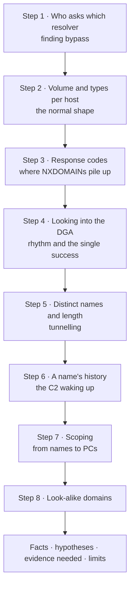
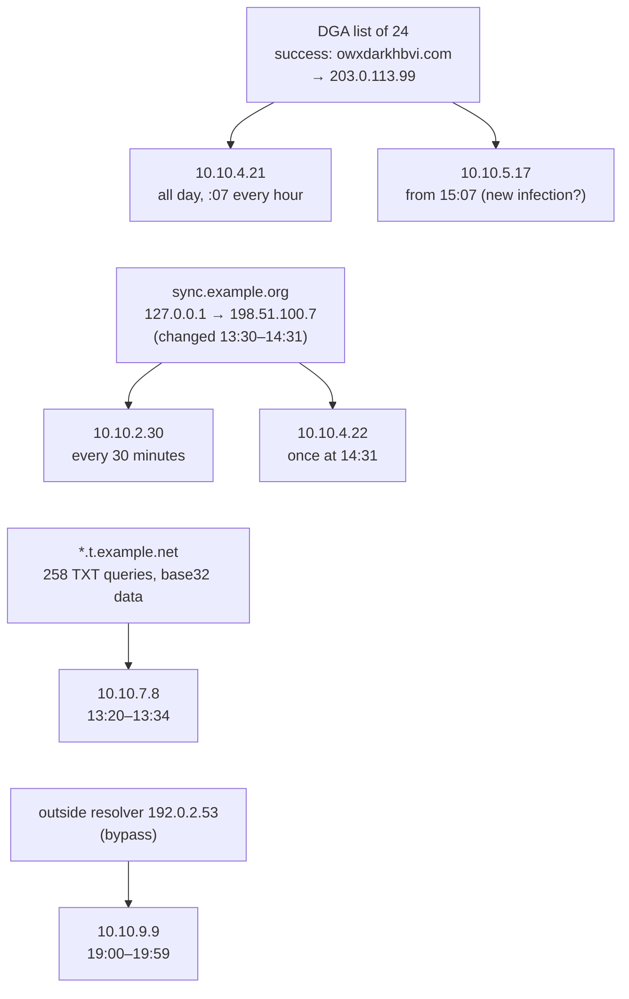

# 2.9 — Lab Guide: DNS Profiling, Anomalies and Scoping { #lab-dns-profiling }

!!! abstract "Scope of this lesson"
    - Drawing a segment's "normal" from one day of Zeek `dns.log`: who asks which resolver, how much, and for which types
    - Finding anomalies: resolver bypass, NXDOMAIN surges and DGAs, TXT tunnelling, a C2 waking up from `127.0.0.1`, look-alike domains
    - Separating them from **everyday noise**: the mail server's PTRs, typos, browsers' interception-detection queries
    - **Scoping**: starting from the names you found to locate other infected PCs and infection times
    - Writing results up as facts, hypotheses, evidence still needed and observation limits

!!! note "Lab environment and notation"
    **(Actual output)** came from Zeek 9.0.1 (official Docker image), jq 1.7 and GNU coreutils in this environment. The lab pcap `office-dns.pcap` was **assembled by me** with dnspython to imitate **one day (2026-11-03, UTC)** of DNS in an office segment (94,324 packets). The collection point is **between clients and the internal resolver (`10.10.0.53`)** — lesson 2.6's "inside vantage point" — and the resolver's caching (TTLs counting down) is imitated too. Addresses are private and documentation addresses, domains are example domains, and all anomalous behaviour is **invented for practice**. Remember that assembled data is simpler and cleaner than the real thing.

## 1. The situation { #scenario }

**(Hypothetical)** A security appliance raised a vague alert: "a PC in the office segment is talking to an unknown outside address", without saying which PC or which address. A sensor in front of the internal resolver holds one day of pcap. Since DNS starts almost every connection (lesson 2.6), the goal is to **profile that day through DNS**, find what departs from normal, and from there **scope** the incident (which PCs, since when).

It's the same idea as lesson 2.4's HTTP profiling. Picture a local post office clerk. Knowing who usually sends letters where, they'd notice someone suddenly posting hundreds of letters a day to **addresses that don't exist** (a DGA), someone writing **cipher-like text** densely on the back of postcards (tunnelling), or someone skipping the post office to use **another town's postbox** (resolver bypass). Where it breaks: in DNS, "the letter's content" (the query name) can itself carry information, and when the post office answers from **memory** (the cache), nothing goes outside at all.

## 2. Lab guide { #how-to-use }

**Objectives**

1. Summarise each host's "normal" from a day of DNS (resolver, volume, types, response codes).
2. Find departures from normal and separate them from everyday noise.
3. Scope from the names and addresses found (other PCs, start times).
4. Report as facts, hypotheses, evidence still needed and limits.

**Preparation**

- Zeek (or a ready-made `dns.log`), jq, `sort`, `uniq`
- The lab pcap `office-dns.pcap`. The only lead is a vague alert that "some PC is odd".

Hash it on receipt and produce JSON logs with Zeek. The assembled pcap has correct checksums (no need for lesson 2.8's `-C`).

```bash
sha256sum office-dns.pcap
zeek -r office-dns.pcap LogAscii::use_json=T
jq -s 'map(.ts) | [min, max] | map(todate)' dns.log
jq -s 'length' dns.log
```

**(Actual output)**

```text
9519a551b4fb32efb03b45894076df3b8ee97a28fce1cf943cda0821d047f2d0  office-dns.pcap
[
  "2026-11-03T00:00:01Z",
  "2026-11-04T00:00:25Z"
]
47162
```

A full day, 47,162 query/response records. `-s` (slurp) reads all lines **into one array**, used here for the overall min, max and count. It loads the whole file into memory, so be careful with big logs. I didn't record a hash of `dns.log`: as lesson 2.8 showed, `uid`s change with every run, so the log file's hash differs even for the same pcap. As evidence, record the pcap's hash together with the processing conditions (Zeek 9.0.1, base scripts, JSON).

**Figure 2-1. Order of this lab** (top to bottom; each step looks again, from a different angle, at what the previous steps didn't filter out)



## 3. Step 1: who asks which resolver { #resolvers }

With the architecture from lesson 2.7, section 1, every PC should ask only the internal resolver `10.10.0.53`. Count the responders (`id.resp_h`).

```bash
jq -r '."id.resp_h"' dns.log | sort | uniq -c | sort -rn
jq -r 'select(."id.resp_h"!="10.10.0.53") | ."id.orig_h"' dns.log | sort | uniq -c
jq -r 'select(."id.resp_h"=="192.0.2.53") | .ts|todate' dns.log | sed -n '1p;$p'
```

**(Actual output)**

```text
  47122 10.10.0.53
     40 192.0.2.53
     40 10.10.9.9
2026-11-03T19:00:02Z
2026-11-03T19:58:53Z
```

One PC, `10.10.9.9`, asked the outside resolver `192.0.2.53` **directly**, 40 times between 19:00 and 19:59. That also means firewall policy didn't stop it. These queries **don't appear** in the internal resolver's records, so looking only at resolver logs would have missed them. They're visible because this sensor sits in front of the resolver.

Keep the interpretation open: a personal VPN, a hand-set DNS server, or malware evading internal controls. Look at what it asked too (`select(."id.resp_h"=="192.0.2.53") | .query`); in this data they were ordinary work site names. Record the bypass itself and revisit it during scoping in step 7.

## 4. Step 2: volume and type mix per host { #per-host }

Look at how many queries each host made and how the types mix. jq's `group_by` builds a per-host table in one go.

```bash
jq -s -r 'group_by(."id.orig_h")
  | map({h: .[0]."id.orig_h", n: length,
         t: (group_by(.qtype_name) | map({(.[0].qtype_name): length}) | add)})
  | sort_by(-.n) | .[:6][] | "\(.h)\t\(.n)\t\(.t)"' dns.log
```

Piece by piece:

- `-s` reads everything as one array; `group_by(."id.orig_h")` makes **groups per originating address** (an array of arrays).
- For each group, build `{h: address, n: count, t: counts per type}`. `t` regroups the group by `qtype_name`, makes `{"A": count}` pieces and merges them with `add`.
- `sort_by(-.n)` sorts by count, descending; `.[:6][]` takes the first six one by one and prints them as strings.

**(Actual output)**

```text
10.10.0.25	3436	{"MX":644,"PTR":2148,"TXT":644}
10.10.4.21	2381	{"A":1466,"AAAA":470,"HTTPS":445}
10.10.7.8	2001	{"A":779,"AAAA":473,"HTTPS":491,"TXT":258}
10.10.2.30	1970	{"A":967,"AAAA":506,"HTTPS":497}
10.10.1.26	1885	{"A":828,"AAAA":523,"HTTPS":534}
10.10.1.18	1856	{"A":823,"AAAA":501,"HTTPS":532}
```

How to read it:

- **`10.10.0.25`**: mostly PTR, with MX and TXT. That's lesson 2.6, section 3's **mail server shape**: a reverse lookup for each new connection, plus MX and SPF (TXT) checks for outgoing mail. In this segment that shape is **normal** (confirm it really is the mail server from the asset inventory).
- **User PCs** (`10.10.1.x` and others): A, AAAA and HTTPS in similar proportions, lesson 2.6's **user segment shape**.
- **`10.10.4.21`**: **noticeably more A** than other PCs (1,466 versus the 800s), with similar AAAA and HTTPS. Something is asking for A records on its own; step 3 looks at it.
- **`10.10.7.8`**: a user PC with **258 TXT queries**. No other user PC in the segment asks for TXT.

Counting only hosts that ask for TXT makes it clearer.

```bash
jq -r 'select(.qtype_name=="TXT") | ."id.orig_h"' dns.log | sort | uniq -c | sort -rn
```

**(Actual output)**

```text
    644 10.10.0.25
    258 10.10.7.8
```

Only the mail server (SPF checks) and `10.10.7.8`. A user PC asking for TXT already departs from this segment's normal. Step 5 looks at it.

## 5. Step 3: response codes, where NXDOMAINs pile up { #rcodes }

```bash
jq -r 'select(.rcode_name=="NXDOMAIN") | ."id.orig_h"' dns.log | sort | uniq -c | sort -rn | head -8
```

**(Actual output)**

```text
    581 10.10.4.21
    429 10.10.0.25
    225 10.10.5.17
     17 10.10.1.12
     12 10.10.2.30
     12 10.10.1.15
     12 10.10.1.11
     11 10.10.1.29
```

Three hosts stand out; the rest have 10–20 or so. First set aside **everyday NXDOMAINs**.

- **The mail server's failed PTRs**: of `10.10.0.25`'s 2,148 PTR queries, 1,719 were NOERROR and 429 NXDOMAIN (counted with `select(."id.orig_h"=="10.10.0.25" and .qtype_name=="PTR") | .rcode_name`). Many addresses have no reverse record, so **a mail server's NXDOMAINs are usually normal**.
- **Typos**: `docs.exmaple.com` 66, `exmaple.com` 47 and `wwww.example.com` 45 times, from various user PCs. Noise made by human fingers.
- **Three dotless single-word names**: 13 PCs each asked for **exactly three**, around the start of the working day.

```bash
jq -r 'select((.query|contains("."))|not) | [(.ts|strftime("%H:%M:%S")), ."id.orig_h", .query, .rcode_name] | @tsv' dns.log | head -6
```

**(Actual output)**

```text
08:35:04	10.10.1.25	olwjlphi	NXDOMAIN
08:35:04	10.10.1.25	gcanpgsm	NXDOMAIN
08:35:04	10.10.1.25	imtqpbfbv	NXDOMAIN
08:35:46	10.10.1.11	bbbdldnwessgw	NXDOMAIN
08:35:46	10.10.1.11	pxfcnlkjycme	NXDOMAIN
08:35:46	10.10.1.11	poigwxrdl	NXDOMAIN
```

Three random names of 7–15 letters within the same second, just before that PC's first activity: lesson 2.7, section 4.3's **browser interception-detection queries** (assume these PCs have the check enabled by enterprise policy). They look random, but we don't classify them as DGA.

`@tsv` turns an array into one tab-separated line, and `strftime("%H:%M:%S")` converts Unix time to an hours:minutes:seconds string in UTC.

Setting those three aside leaves `10.10.4.21` (581) and `10.10.5.17` (225).

## 6. Step 4: looking into the DGA { #dga }

Look at `10.10.4.21`'s NXDOMAIN names and times.

```bash
jq -r 'select(."id.orig_h"=="10.10.4.21" and .rcode_name=="NXDOMAIN") | .query' dns.log | sort | uniq -c | sort -rn | head -5
jq -r 'select(."id.orig_h"=="10.10.4.21" and .rcode_name=="NXDOMAIN") | .ts | strftime("%M")' dns.log | sort | uniq -c | sort -rn | head -3
```

**(Actual output)**

```text
     24 zlonpnqfgvxwg.com
     24 zgijpsilzextwebb.com
     24 zehzobjyazd.com
     24 upgshfkgdnqje.com
     24 ugcuulcwzj.com
    576 07
      3 18
      1 49
```

Each name appears **exactly 24 times a day**, and 576 of the 581 NXDOMAINs fall **at 7 minutes past every hour**. Some program asks the same list of names in turn at :07 every hour. With the names' shape (10–16 random lowercase letters + `.com`), this fits lesson 2.7, section 4's **DGA** hypothesis well; people don't look up 24 nonexistent domains at :07 every hour.

If it's a DGA, **one name on the list should succeed**. Look at NOERROR answers the same PC got at the same minute (:07).

```bash
jq -r 'select(."id.orig_h"=="10.10.4.21" and .rcode_name=="NOERROR" and (.ts|strftime("%M"))=="07") | .query' dns.log | sort | uniq -c | sort -rn | head -5
```

**(Actual output)**

```text
     24 owxdarkhbvi.com
      9 news.example.net
      6 update.example.com
      6 telemetry.example.net
      5 time.example.org
```

Only `owxdarkhbvi.com` succeeded **24 times**, once at :07 every hour; the rest are sites a person happened to open during that minute. The 09:07 batch shows the order.

```bash
jq -r 'select(."id.orig_h"=="10.10.4.21" and (.ts|strftime("%H:%M"))=="09:07") | [(.ts|strftime("%H:%M:%S")), .query, .rcode_name] | @tsv' dns.log | sed -n '15,20p'
```

**(Actual output)**

```text
09:07:13	brugcsbfehzqw.com	NXDOMAIN
09:07:13	sdpdxazvjckhiq.com	NXDOMAIN
09:07:14	zgijpsilzextwebb.com	NXDOMAIN
09:07:15	owxdarkhbvi.com	NOERROR
09:07:15	fljysaaludeuen.com	NXDOMAIN
09:07:16	szuvrwofhhw.com	NXDOMAIN
```

One success sits among the NXDOMAINs. Its answer (`select(.query=="owxdarkhbvi.com") | .answers`) was `203.0.113.99`. That address is likely the alert's "unknown outside address", which leads to the next evidence: `10.10.4.21` → `203.0.113.99` in firewall and NetFlow records.

!!! tip "Why does it keep asking after succeeding?"
    The program in this data asks the whole list every hour even after a success. Real DGA malware varies: it may stop on success, shuffle the order, or ask only part of a daily pool of thousands. Don't decide by a single number such as "more than N NXDOMAINs means DGA"; look at **repetition of the same names, a fixed rhythm and the success among them** together.

## 7. Step 5: distinct names and length — tunnelling { #tunnel }

Now look at `10.10.7.8`'s TXT queries from step 2. DNS tunnelling (lesson 2.7) carries data in query names, so ① the **number of distinct names** under one domain grows sharply, and ② names get **longer**.

**Distinct names per domain** (treating a name's last two labels as the "domain")

```bash
jq -r '.query | split(".") | "\(.[-2:]|join("."))\t\(join("."))"' dns.log | sort -u | cut -f1 | uniq -c | sort -rn | head -6
```

`split(".")` breaks the name into labels, `.[-2:]` rejoins the last two as the "domain", and the "domain tab full name" pairs are deduplicated with `sort -u` and counted per domain.

**(Actual output)**

```text
    503 in-addr.arpa
    262 example.net
     11 example.com
      3 example.org
      2 exmaple.com
      2 corp.example
```

`in-addr.arpa` is the mail server's reverse lookups, so high is normal. But 262 under `example.net` can't be explained by the usual handful (`news`, `cdn`, `telemetry` and so on).

**[Caution] "The last two labels" is an approximation.** For top-level domains where two labels form one unit, such as `co.kr` or `co.uk`, `example.co.kr` gets grouped as `co.kr`. In real investigations, use a tool that applies the Public Suffix List to get the "registrable domain".

**Name length per host**

```bash
jq -s -r 'group_by(."id.orig_h") | map({h: .[0]."id.orig_h", avg: ((map(.query|length)|add)/length), max: (map(.query|length)|max)}) | sort_by(-.max) | .[:4][] | "\(.h)\tavg=\(.avg|floor)\tmax=\(.max)"' dns.log
jq -r 'select(."id.orig_h"=="10.10.7.8" and .qtype_name=="TXT") | [(.ts|strftime("%H:%M:%S")), .query, (.answers|tostring)] | @tsv' dns.log | head -3
```

**(Actual output)**

```text
10.10.7.8	avg=23	max=66
10.10.0.25	avg=20	max=27
10.10.1.11	avg=17	max=21
10.10.1.12	avg=17	max=21
13:20:00	jbhvgvb5izeu4lkqimwtaob3kvjukur5njvws3j3kezsaytv.0.t.example.net	["TXT 8 rlrpw7ml"]
13:20:03	mrtwk5bamrzgcztuebzg653tebitgidcovsgozluebsheylg.1.t.example.net	["TXT 8 7ak7gela"]
13:20:07	oqqhe33xomqfcmzamj2wiz3foqqgi4tbmz2ca4tpo5zsaujt.2.t.example.net	["TXT 8 cayvlwnv"]
```

`10.10.7.8` has the longest names, up to 66 characters. They look like `[48 characters].[sequence].t.example.net`, and the first label uses only a–z and 2–7, which looks like **base32**. A sequence number climbing 0, 1, 2… is the shape of **chunked data sent in order**. The TXT answers are short random strings, like acknowledgements. The 258 queries ran from 13:20:00 to 13:33:59.

I joined the first labels in sequence order and decoded them as base32.

```bash
jq -r 'select(."id.orig_h"=="10.10.7.8" and .qtype_name=="TXT") | .query | split(".") | "\(.[1])\t\(.[0])"' dns.log \
  | sort -n -u | head -43 | cut -f2 | tr -d '\n' > chunks.txt
python3 -c "import base64; s=open('chunks.txt').read().upper(); print(b''.join(base64.b32decode(c+'='*(-len(c)%8)) for c in [s[i:i+48] for i in range(0,len(s),48)])[:90])"
```

**(Actual output)**

```text
b'HOST=FIN-PC-08;USER=jkim;Q3 budget draft rows Q3 budget draft rows Q3 budget draft rows Q3'
```

Out came a PC name, a username, and what looks like a "Q3 budget draft" (invented content). The sequence numbers went from 0 to 257, but every 43rd (0, 43, 86…) carried the identical chunk again: the same data **sent six times over** (the command above used `head -43` to join only the first round). The decoded first round was 1,285 bytes. When you can decode it, you can show directly "what left"; real tunnelling tools often add encryption or compression, so it won't always decode. Then estimate the size from **volume** (distinct names × name length).

## 8. Step 6: a name's history — the C2 waking up { #name-history }

To find lesson 2.7, section 2.1's "parking" trick, check whether **a name's answer changed**. A quick way is to find names that had more than one answer during the day, one of them `127.0.0.1`.

```bash
jq -r 'select(.answers != null and (.answers | index("127.0.0.1"))) | .query' dns.log | sort | uniq -c
jq -r 'select(.query=="sync.example.org") | .answers[]' dns.log | sort | uniq -c
```

**(Actual output)**

```text
     30 sync.example.org
     19 198.51.100.7
     30 127.0.0.1
```

`sync.example.org` had two answers during the day: `127.0.0.1` and `198.51.100.7`. In time order:

```bash
jq -r 'select(.query=="sync.example.org") | [(.ts|strftime("%H:%M:%S")), ."id.orig_h", (.answers|join(",")), (.TTLs|map(tostring)|join(","))] | @tsv' dns.log | sed -n '25,34p'
```

**(Actual output)**

```text
12:00:11	10.10.2.30	127.0.0.1	1799.0
12:30:11	10.10.2.30	127.0.0.1	3600.0
13:00:12	10.10.2.30	127.0.0.1	1798.0
13:30:13	10.10.2.30	127.0.0.1	3600.0
14:00:12	10.10.2.30	127.0.0.1	1800.0
14:30:12	10.10.2.30	127.0.0.1	0.0
14:31:09	10.10.4.22	198.51.100.7	300.0
15:00:12	10.10.2.30	198.51.100.7	300.0
15:30:13	10.10.2.30	198.51.100.7	300.0
16:00:13	10.10.2.30	198.51.100.7	300.0
```

`10.10.2.30` asked for this name **every 30 minutes** (48 times a day), and from 14:31 the answer changed to `198.51.100.7` (TTL 300). That's a parked C2 waking up.

**Narrowing the change time with TTLs.** TTL 3600 means the resolver **freshly fetched** the answer; 1799, 1800 and 0 mean answers **from cache** (lesson 2.6, section 9). So:

- At 13:30:13 the resolver freshly fetched an answer that was still `127.0.0.1`.
- The 14:30:12 answer was an **old** one with 1 second left in cache, so it says nothing about whether the record had already changed by then.
- At 14:31:09 another PC (`10.10.4.22`) asked, and the freshly fetched answer was `198.51.100.7`.

So all you can say is that the record changed on the authoritative side **after 13:30:13 and before 14:31:09**. This inside vantage point can't narrow it further; you'd need captures outside the resolver, the resolver's own records, or an external passive DNS service. Also note that because of caching, `10.10.2.30` may have received the new address **up to nearly an hour** after the real change.

## 9. Step 7: scoping — from names to PCs { #scoping }

Starting from the "bad names" found so far, find **other PCs that asked for the same names**. This is what lesson 2.7, section 3.2 meant by "using DNS records to scope the infection and find newly infected hosts".

```bash
for n in owxdarkhbvi.com sync.example.org; do echo "$n:"; jq -r --arg n $n 'select(.query==$n) | ."id.orig_h"' dns.log | sort | uniq -c; done
jq -r 'select(.query|endswith(".t.example.net")) | ."id.orig_h"' dns.log | sort | uniq -c
```

**(Actual output)**

```text
owxdarkhbvi.com:
     24 10.10.4.21
      9 10.10.5.17
sync.example.org:
     48 10.10.2.30
      1 10.10.4.22
    258 10.10.7.8
```

- `10.10.5.17` also asked for the DGA's successful name, **9 times** — the same PC that stood out in step 3 with 225 NXDOMAINs.
- `10.10.4.22` asked for the woken C2 `sync.example.org` **once**, right after the change (14:31).
- Only `10.10.7.8` used the tunnelling domain.

**Search with the whole list, not just the successful name.** A DGA's successful name changes daily, so put the full list `10.10.4.21` asked at :07 into a file and find PCs that asked for any name on it.

```bash
jq -r 'select(."id.orig_h"=="10.10.4.21" and .rcode_name=="NXDOMAIN" and (.ts|strftime("%M"))=="07") | .query' dns.log | sort -u > dga24.txt
jq -r --rawfile d dga24.txt '($d | split("\n") | map(select(length>0))) as $names
  | select(.query as $q | $names | index($q)) | ."id.orig_h"' dns.log | sort | uniq -c
jq -r --rawfile d dga24.txt '($d | split("\n") | map(select(length>0))) as $names
  | select(."id.orig_h"=="10.10.5.17" and (.query as $q | $names | index($q))) | .ts|todate' dns.log | head -1
```

- `--rawfile d dga24.txt`: pass the whole file content as the string `$d`.
- `split("\n") | map(select(length>0))`: turn it into an array of lines, dropping empty ones.
- `.query as $q | $names | index($q)`: the position if this record's name is on the list (truthy), `null` if not (falsy).

**(Actual output)**

```text
    576 10.10.4.21
    216 10.10.5.17
2026-11-03T15:07:07Z
```

`10.10.5.17` started asking for the same list **at 15:07:07**. Before that (09:00–15:05) it asked only for ordinary work sites. So this PC may have been **infected around 15:05–15:07** (hypothesis: check web access, email and USB use just before then in endpoint records). Searching by the name list catches even **freshly infected PCs** that haven't yet asked for the successful name.

**Figure 9-1. What this lab found and how it connects** (four groups, top to bottom; arrows mean "asked for")



**How to read it:** four groups from top to bottom. The first box in each group is an odd name (or destination) found in this day; the boxes its arrows point to are the PCs that asked for it. Two arrows from one name mean the same thing happened on two PCs. There are no lines between groups: whether different names are related (the same attacker?) can't be told from this data alone.

## 10. Step 8: look-alike domains { #lookalike }

Finally, find names starting with `xn--` and decode them (lesson 2.7, section 7).

```bash
jq -r 'select(.query|startswith("xn--")) | [(.ts|todate), ."id.orig_h", .query, (.answers|join(","))] | @tsv' dns.log
python3 -c "n='xn--crp-sed.example'.encode().decode('idna'); print(n, [hex(ord(c)) for c in n[:4]])"
```

**(Actual output)**

```text
2026-11-03T10:12:04Z	10.10.1.19	xn--crp-sed.example	203.0.113.140
cоrp.example ['0x63', '0x43e', '0x72', '0x70']
```

Decoded, it's `cоrp.example`, but the second letter is **Cyrillic `о` (U+043E)**, not Latin `o` (0x6f). It's a **look-alike** that renders identically to our internal domain `corp.example` (seen in step 2's sites as `intranet.corp.example` and `portal.corp.example`). `10.10.1.19` asked once at 10:12:04 and got `203.0.113.140`. Suspect a click on a phishing link, and check mail records just before that time and the HTTP/HTTPS connections afterwards (proxy logs). Include in scoping whether other PCs asked for the same name (none did in this data).

## 11. Writing it up { #report }

- **Observations (facts):**
    - On 2026-11-03, this collection point (in front of the internal resolver) saw 47,162 DNS query/response records.
    - All day, at **:07 every hour**, `10.10.4.21` asked in turn for 24 random-looking `.com` names; only `owxdarkhbvi.com` succeeded each time, answering `203.0.113.99` (576 NXDOMAINs).
    - **From 15:07:07**, `10.10.5.17` began asking for the same list on the same rhythm (216 NXDOMAINs, 9 successes).
    - `10.10.2.30` asked for `sync.example.org` every 30 minutes. Answers were `127.0.0.1` up to the one freshly fetched at 13:30:13, and `198.51.100.7` (TTL 300) from the one freshly fetched at 14:31:09. `10.10.4.22` also asked once at 14:31:09 and got the new address.
    - From 13:20:00 to 13:33:59, `10.10.7.8` sent 258 TXT queries to `*.t.example.net`. Joining the first labels in sequence and decoding as base32 yields a PC name, a username and what looks like document content.
    - From 19:00 to 19:59, `10.10.9.9` asked `192.0.2.53`, not the internal resolver, directly, 40 times.
    - At 10:12:04, `10.10.1.19` asked for `xn--crp-sed.example` (Cyrillic `о`), resembling the internal domain, and got `203.0.113.140`.
- **Interpretation (hypotheses):**
    - `10.10.4.21` and `10.10.5.17` are infected with **the same DGA-based malware**, and the day's C2 is `203.0.113.99`. `10.10.5.17` may have been newly infected around 15:05–15:07.
    - `sync.example.org` is a C2 normally parked on `127.0.0.1`, woken between about 1:30 and 2:30 p.m. `10.10.2.30` and `10.10.4.22` may carry its implant.
    - Data left `10.10.7.8` through DNS tunnelling.
    - Whether these activities are one attack or separate events is not yet known.
- **Evidence still needed:**
    - Connections to `203.0.113.99`, `198.51.100.7` and `203.0.113.140` in firewall, NetFlow and proxy records (which PCs, when, how much).
    - Endpoint records on those PCs: the querying processes (Sysmon 22), `10.10.5.17`'s activity around 15:05, `10.10.1.19`'s mail around 10:12.
    - Records outside the resolver or external passive DNS (the exact time `sync.example.org` changed; its history on other days).
    - pcaps from other days (when the DGA and the 30-minute rhythm began).
    - The user and configuration of `10.10.9.9` (why it bypassed the resolver).
- **Observation limits:**
    - One day, DNS at this collection point only. Encrypted DNS such as DoH (lesson 2.7, section 6) isn't visible.
    - Caching can make PCs receive answers later than the real change, and queries the resolver answered from cache never go outside.
    - "Domain" grouping approximated by the last two labels.
    - This data was assembled for practice.

## 12. Summary { #summary }

- I summarised a day of `dns.log` with jq **by resolver, host, type and response code** to draw the segment's normal, building a per-host table in one go with `-s` and `group_by`.
- I set aside everyday noise first: the mail server's PTRs and their NXDOMAINs, human typos, and browsers' three random single-word names at start-up.
- Found directly: resolver bypass (`10.10.9.9`), a DGA (:07 every hour, one success in 24, `10.10.4.21`), a new infection by the same DGA (`10.10.5.17`, from 15:07), TXT tunnelling (`10.10.7.8`, decoded from base32), a parked C2 waking up (`sync.example.org`, changed between 13:30 and 14:31), and a look-alike domain (`10.10.1.19`, Cyrillic `о`).
- Scoping works **backwards from names (or name lists) to PCs**, and searching by the whole list catches even freshly infected PCs.
- TTLs separate fresh answers (original value) from cached ones (counted down), which lets you state the **window** in which a record changed.
- Results were written up as facts, hypotheses, evidence needed and limits.

## Review questions { #review }

**Question 1. (Basics)** In step 3, `10.10.0.25` had many NXDOMAINs (429). Why didn't we suspect a DGA? Under what conditions should we?

??? success "Answer and explanation"
    In step 2, `10.10.0.25` had the **mail server shape** (PTR, MX and TXT only), and all its NXDOMAINs came from PTRs (addresses without reverse records). Missing reverse records are common, so a mail server's PTR failures are usually normal. Conditions that should raise suspicion, for example: ① the mail server asking in bulk for random-looking names via **A queries**; ② its NXDOMAIN ratio rising well above its own normal (about 20% of PTRs in this data); ③ it repeatedly asking a particular domain for TXT or NULL records it doesn't usually request. Compare against "that host's normal".

**Question 2. (Changed conditions)** If this sensor had sat **outside the resolver (on the Internet side)** instead of in front of it, which of this lab's results would change or become impossible?

??? success "Answer and explanation"
    ① **You couldn't identify PCs.** Outside, every query comes from the resolver (lesson 2.6, section 7.2), so conclusions such as "`10.10.4.21` and `10.10.5.17`" or "`10.10.7.8`" would be impossible. ② **Caching reduces counts.** The DGA's successful name has TTL 300, so it only goes outside when the cache expires, and two PCs asking may look like one lookup. ③ With QNAME minimisation, root and TLD servers see only part of the names. ④ Conversely, the **resolver bypass** (`10.10.9.9` → `192.0.2.53`) is visible to an outside sensor too, and stands out even more because the source is an internal PC rather than the resolver. ⑤ For `sync.example.org`'s change time, the resolver's fresh lookups (13:30, 14:31) leave outside packets, so you could still state the same window.

**Question 3. (Common misconception)** "Step 5 found 262 distinct names under `example.net`, so block all of `example.net`." What's the problem?

??? success "Answer and explanation"
    `example.net` also covers names this segment uses legitimately (`news.example.net`, `cdn.example.net`, `telemetry.example.net` and others). The rise in distinct names came from **`t.example.net`** beneath it; blocking the whole domain would cut off work sites too. And "the last two labels" is an approximation that may not match the real registrable domain. Respond by ① narrowing to `t.example.net` (or the real registrable domain), ② sinkholing that zone at the resolver, and ③ finding other PCs that asked for it. In a real case where a tunnelling zone sits under a big service's domain like `example.net`, also check whether that service's free hosting or dynamic DNS was abused.

**Question 4. (Interpretation)** In step 6, the answer `10.10.2.30` received at 14:30:12 was `127.0.0.1` with TTL `0.0`. What can and can't you tell from that line?

??? success "Answer and explanation"
    **Can:** with TTL 0, it's an old answer **from the resolver's cache**, about to expire (within a second). That cache entry was freshly fetched at 13:30:13 (TTL 3600 then). **Can't:** whether the authoritative record had already changed by 14:30:12, because the resolver answered from cache without asking outside. So the change can only be placed "after 13:30:13 and before 14:31:09 (when the new answer first appeared)". The interpretation should also account for this PC possibly getting the new address later than the real change (up to about an hour).

**Question 5. (Application)** You estimated `10.10.5.17`'s infection at "around 15:05–15:07". What would you look at to confirm or refute that?

??? success "Answer and explanation"
    ① **Endpoint records**: process creation between 15:00 and 15:07 (new executables, scripts), new files in the downloads folder, mail attachments opened, USB connections, and the **process** that made the first DGA query at 15:07:07 (Sysmon 22). ② **Network records**: the PC's HTTP/HTTPS connections around 15:05 (proxy logs, downloads in Zeek's `http.log` and `files.log`) and the hashes of files received. ③ **Possible refutation**: the malware may have been present already and **first started at 15:07** (PC boot time, a scheduled task, user logon). The PC was on, since its DNS activity began at 09:00, but the malware may have started on another condition (user action, a delay). So state the fact as "**the time DGA activity began**", not "the infection time", and fix the infection time from endpoint evidence.

**Question 6. (Common misconception)** "The amount tunnelled out is 258 TXT queries × name length (about 66 bytes) ≈ 17 KB." Explain the problem with this estimate using this lab's results.

??? success "Answer and explanation"
    ① Not the whole name is data: the data is the first label (48 characters); `.[sequence].t.example.net` is framing. ② base32 turns 5 bytes into 8 characters, so 48 characters are **30 bytes** originally. ③ In step 5, the sequence ran 0–257, but **the content repeated every 43 chunks** (six times). Since the same data was resent, the unique amount is 43 chunks × up to 30 bytes; decoded, it was **1,285 bytes (about 1.3 KB)**. "258 × 66" overstates it more than tenfold. Conversely, if the data was compressed, the original document could be larger. When estimating volume, account for encoding, framing and repetition, and decode to confirm when you can.

**Question 7. (Interpretation)** In step 2, `10.10.4.21` made more A queries than other PCs, but similar numbers of AAAA and HTTPS. How does this support the DGA hypothesis, and why isn't it enough on its own?

??? success "Answer and explanation"
    Human web use has browsers asking for A, AAAA and HTTPS **together**, so all three rise similarly. A rising on its own signals **another program asking only for A**, which turned out to be the DGA queries in step 4 (all A: 24 × 24 hours = 576). But that alone isn't enough: many legitimate programs ask only for A (update checks, time sync, mail clients), and it could be a heavy user. Only together with **NXDOMAINs, the names' shape, the rhythm and the single success** does it become a hypothesis.

**Question 8. (Application)** To monitor for this lab's findings automatically the next day, what rules (or queries) would you create? Propose at least three, with their false-positive risks.

??? success "Answer and explanation"
    For example: ① **List monitoring**: sinkhole today's DGA list (or tomorrow's, if you've recovered the algorithm), `sync.example.org`, `t.example.net` and `xn--crp-sed.example` at the resolver, and alert on PCs that ask. Few false positives, but DGA names change daily, so the list needs updating. ② **NXDOMAIN rate**: alert when a user PC gets 20 or more NXDOMAINs in an hour. False positives: typo-prone users, misconfigured programs, browser detection queries (exclude dotless names). ③ **TXT/NULL from user PCs**: alert when a non-mail host asks for TXT, or when one domain gets 50+ distinct names in an hour. False positives: some security products and cloud services fetch configuration via TXT; long CDN names. ④ **Resolver bypass**: port 53/853 queries whose `id.resp_h` isn't an internal resolver. False positives: approved exceptions, test equipment. ⑤ **Outside names answered with `127.0.0.1` or private addresses changing**: alert when an answer moves from loopback to a public address. False positives: some blocking services and ad-block lists. Give every rule **a baseline and an exception list**, and tune them regularly.

## References { #references }

- Tools used in this environment: Zeek 9.0.1 (official Docker image `zeek/zeek`), jq 1.7, GNU coreutils, Python 3.13 and dnspython 2.9.2 (assembling the lab pcap; decoding base32 and Punycode). Results obtained on 2026-11-05.
- Lab pcap `office-dns.pcap`: assembled by me, SHA-256 `9519a551b4fb32efb03b45894076df3b8ee97a28fce1cf943cda0821d047f2d0`, 94,324 packets.
- jq, [manual](https://jqlang.github.io/jq/manual/) (`-s`, `group_by`, `--arg`, `--rawfile`, `strftime`, `@tsv`, `index`).
- Zeek, [dns.log documentation](https://docs.zeek.org/en/master/logs/dns.html).
- Mozilla, [Public Suffix List](https://publicsuffix.org/) (for finding the "registrable domain").
- This lab builds on lesson 2.6 (vantage points, caching and TTLs, type ratios), lesson 2.7 (DGAs, tunnelling, parked C2, Punycode) and lesson 2.8 (Zeek, jq).

!!! note "About this page"
    A personal study note, rewritten in my own words from several learning resources. The lab data and scenario are my own, and the scenarios are hypothetical.
