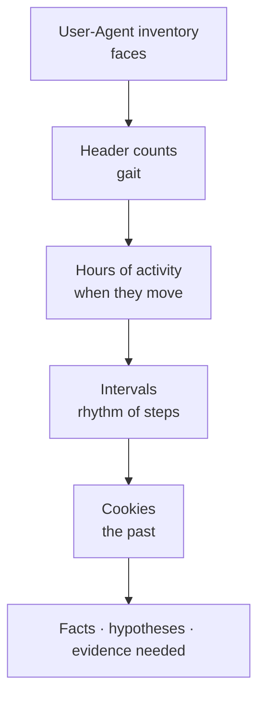

# 2.4 — Lab Guide: HTTP Profiling { #lab-http-profiling }

!!! abstract "Scope of this lesson"
    - Strategies for collecting useful HTTP artifacts: which fields, grouped by what
    - Finding **what stands out (outliers)**: the User-Agent inventory, header counts, hours of activity
    - Forming hypotheses about **human versus program**: regularity of intervals, working hours, sub-resource requests
    - **Seeing beyond the evidence with advertising cookies**: finding a first visit seven months earlier in one day of pcap
    - Writing results up as facts, hypotheses and evidence still needed

!!! note "Lab environment and notation"
    **(Actual output)** was produced with this environment's tshark 4.2.2 and GNU awk. The lab pcap `day.pcap` was assembled in Python to imitate **one day (2026-11-02, UTC)** of HTTP on an office segment (9,162 packets, private and documentation addresses and example domains only). It mixes human web use, a legitimate updater and a deliberately hidden automated channel. Being assembled, it shows a **simplified** version of human behaviour; real traffic is much messier.

## 1. When you must find "what's odd on this segment" with no leads { #why-profiling }

**(Hypothetical)** The day after lesson 1.11's "something seems off in the research lab" case. The capture box in front of the research segment holds a day of pcap, and there are proxy logs. But the proxy logs are in lesson 1.3's default format, with no User-Agent, only URLs and sizes. As the source material's lab takeaways put it, **the data formats available are not always ideal**. This time the pcap, with headers, is more flexible, so we build the profile from it.

**Profiling** means summarising "what **normally** travels on this segment" so you can find **what deviates** from it. Think of a door guard who knows the faces and arrival times of the staff, and so can spot a stranger or someone coming in at dawn. Where the analogy differs: we know **even faces (User-Agents) can be forged** (lesson 2.1). So we look not at one face but also at gait (header combinations), hours of movement (time of day) and rhythm of steps (intervals).

## 2. How this lab is organised { #how-to-use }

**Objectives**

1. Form strategies for collecting useful HTTP artifacts (which fields, grouped by what).
2. Identify outliers that warrant further investigation.
3. Form hypotheses separating human activity from program activity.
4. Use advertising cookies to see beyond the period of the evidence you have.

**Preparation**

- tshark, awk, `sort`, `uniq`, `date`
- The lab pcap `day.pcap`. There's no starting lead, only "the research segment seems odd".

Record a hash first, as soon as you receive it.

```bash
sha256sum day.pcap
capinfos -c -a -e day.pcap
```

**(Actual output)**

```text
2cc699cf6bd7d49b69f8dd12b8589cbe052fc65255efcca74ebb69c58fc03bf6  day.pcap
Number of packets:   9162
First packet time:   2026-11-02 00:02:17.000000
Last packet time:    2026-11-02 23:55:02.382120
```

A full day. Note first that there are packets **from just after midnight to just before midnight**. If HTTP is moving on an office segment in the small hours, who (or what) is sending it?



**How to read it:** top to bottom, the order of this lab. Each step looks again, from another angle, at what the previous steps didn't filter out.

## 3. Step 1: the User-Agent inventory, this segment's "faces" { #ua-inventory }

```bash
tshark -n -r day.pcap -Y http.request -T fields -e http.user_agent | sort | uniq -c | sort -rn
```

**(Actual output)**

```text
   2823 Mozilla/5.0 (Windows NT 10.0; Win64; x64) AppleWebKit/537.36 (KHTML, like Gecko) Chrome/141.0.0.0 Safari/537.36
    951 Mozilla/5.0 (Windows NT 10.0; Win64; x64; rv:144.0) Gecko/20100101 Firefox/144.0
    777 Mozilla/5.0 (Windows NT 10.0; Win64; x64) AppleWebKit/537.36 (KHTML, like Gecko) Chrome/141.0.0.0 Safari/537.36 Edg/141.0.0.0
     30 VendorUpdate/5.3 (Windows)
```

As the source material's lab takeaways note, tshark's `-T fields` output makes such reports quick (lesson 1.10). There are only four faces: Chrome, Firefox, Edge, and an updater called `VendorUpdate/5.3`. No unfamiliar faces. **By User-Agent alone, this segment looks clean.** Stop here and the lab fails.

Whether `VendorUpdate/5.3` really is that company's updater is checked against the administrators' allow list (lesson 2.2, section 5). In this lab we assume it's an allowed program.

## 4. Step 2: header counts, this segment's "gait" { #header-count }

Remember from lesson 2.1 that `curl` sent three headers and the browser fourteen? A User-Agent can be faked in one line, but not many programs imitate **the whole combination of headers**. Count the header lines per request, by source and site. The sub-resource host `cdn.example.net` is excluded because it's too numerous.

```bash
tshark -n -r day.pcap -Y 'http.request && http.host != "cdn.example.net"' -T fields -E aggregator='|' \
  -e ip.src -e http.host -e http.request.line \
  | awk -F'\t' '{n=split($3,a,"|"); print $1, $2, n}' | sort | uniq -c | sort -k2,2 -k3,3
```

- `-e http.request.line`: the **header lines** after the request line. There are several, so one cell holds several values (lesson 1.10, section 7.2).
- `-E aggregator='|'`: joins those values with `|` instead of commas. Header **values** contain commas (like `Accept`'s value), so joining with commas gives the wrong count. My first count with commas came out too high, which is why I switched.
- `awk ... split($3,a,"|")`: the number of `|`-separated pieces is the number of header lines.

**(Actual output, the 10.10.6.14 part and one other PC)**

```text
    144 10.10.6.14 cdn-sync.example 3
     31 10.10.6.14 docs.example.com 10
     24 10.10.6.14 intranet.lab.example 10
     19 10.10.6.14 jobs.rival.example 10
     18 10.10.6.14 mail.example.org 10
     26 10.10.6.14 news.example 10
      6 10.10.6.14 update.vendor.example 3
     ...
     36 10.10.7.11 docs.example.com 10
     29 10.10.7.11 intranet.lab.example 10
     30 10.10.7.11 mail.example.org 10
     31 10.10.7.11 news.example 10
      6 10.10.7.11 update.vendor.example 3
```

Two things show.

- Browser requests from every PC have **10** header lines and the updater **3**. That's this segment's "normal gait".
- **Only `10.10.6.14`** (hq-rd-04) sent **3-line** requests to `cdn-sync.example`, **144 times**. No other PC has this site at all.

So what User-Agent did those 3-line requests use? Step 1's inventory had no unfamiliar faces, so it must have borrowed one of the existing ones.

```bash
tshark -n -r day.pcap -Y 'http.host == "cdn-sync.example"' -T fields -e http.user_agent | sort | uniq -c
```

**(Actual output)** `144 Mozilla/5.0 (Windows NT 10.0; Win64; x64) AppleWebKit/537.36 (KHTML, like Gecko) Chrome/141.0.0.0 Safari/537.36`

A User-Agent **identical, character for character**, to the real Chrome. These 144 were hiding among the 2,823 Chrome requests of step 1. Same face, different gait: none of the `Accept-Language`, `Accept-Encoding`, `Sec-Fetch-*` or cookies Chrome sends when opening a page (lesson 2.1, section 6.2, question 5).

## 5. Step 3: hours of activity, when this segment "moves" { #hours }

People arrive, work, eat lunch and go home. Look at the **earliest and latest hour** (UTC) at which requests appear, by source and site.

```bash
tshark -n -r day.pcap -Y 'http.request && http.host != "cdn.example.net"' -T fields -e ip.src -e http.host -e frame.time_epoch \
  | awk -F'\t' '{h=strftime("%H",$3,1); k=$1" "$2; c[k]++;
                 if(!(k in mn)||h<mn[k])mn[k]=h; if(!(k in mx)||h>mx[k])mx[k]=h}
                END{for(k in c) print k, c[k], mn[k]"-"mx[k]}' | sort
```

- `strftime("%H",$3,1)`: turns Unix time into the **UTC** hour; the final argument `1` means UTC (GNU awk). Fixed to UTC to avoid the time-zone trap from lesson 1.10.
- `mn[k]`, `mx[k]`: remember the earliest and latest hour for each group.

**(Actual output, the 10.10.6.14 part)**

```text
10.10.6.14 cdn-sync.example 144 00-23
10.10.6.14 docs.example.com 31 08-17
10.10.6.14 intranet.lab.example 24 08-17
10.10.6.14 jobs.rival.example 19 09-17
10.10.6.14 mail.example.org 18 08-17
10.10.6.14 news.example 26 08-17
10.10.6.14 update.vendor.example 6 00-20
```

Browser requests from the other PCs were all between 08 and 17 as well **(actual output)**. So human web use on this segment is concentrated in **working hours**, and only two things appear all day (00–23): `update.vendor.example` (every PC) and **`cdn-sync.example` (10.10.6.14 only)**. The small-hours packets came from these two programs.

!!! info "[Supplement] When there are no logon/logoff records"
    The source material's lab takeaways say "with no logon/logoff data, human activity is difficult to characterise, so we turn to other clues". This lab is exactly that case. With the endpoint's logon records (lesson 1.11, section 2.2) you could tell directly who was at the keyboard; without them you estimate from **hours of activity, intervals, sub-resource requests and human irregularity**. It's an estimate, so the report says so.

## 6. Step 4: intervals, this segment's "rhythm of steps" { #intervals }

Measure the intervals between requests from the same source to the same site, and compute the mean, standard deviation, minimum and maximum. Human browsing is irregular; programs are often regular (the 900 seconds of lesson 1.10, the five minutes of lesson 1.11).

```bash
for h in cdn-sync.example update.vendor.example jobs.rival.example; do
  tshark -n -r day.pcap -Y "http.request && http.host == \"$h\" && ip.src == 10.10.6.14" -T fields -e frame.time_epoch \
  | awk -v h=$h 'NR>1{d=$1-p; s+=d; ss+=d*d; n++; if(n==1||d<mn)mn=d; if(n==1||d>mx)mx=d} {p=$1}
                 END{m=s/n; printf "%-22s n=%d mean=%.1f sd=%.1f min=%.1f max=%.1f\n", h, n+1, m, sqrt(ss/n-m*m), mn, mx}'
done
```

**(Actual output)**

```text
cdn-sync.example       n=144 mean=600.0 sd=2.5 min=594.3 max=605.7
update.vendor.example  n=6 mean=14400.0 sd=0.0 min=14400.0 max=14400.0
jobs.rival.example     n=19 mean=1601.6 sd=1663.5 min=4.8 max=5652.3
```

- **`cdn-sync.example`:** mean **600 seconds (10 minutes)**, standard deviation 2.5 seconds, barely wavering between 594 and 606 seconds. 144 a day = 24 hours × 6. **A machine's rhythm.** The few seconds of wobble may be deliberate "jitter": many tools shake their intervals slightly to evade detection.
- **`update.vendor.example`:** exactly every four hours (14,400 seconds). Also a machine's rhythm, but it appears identically on every PC and is an allowed program.
- **`jobs.rival.example`:** intervals range wildly from 5 seconds to an hour and a half; the standard deviation is as large as the mean. Closer to **a human rhythm**. Looking at the request lines, each page carries `Sec-Fetch-User: ?1`, followed by a cluster of sub-resource requests (lesson 2.1, section 6.7).

By now `cdn-sync.example` has narrowed to "something pretending to be Chrome, sending requests every ten minutes all day that get no content back (`204`)". Look at the request paths too.

**(Actual output, beginning)**

```text
1793577902.857440000	198.51.100.66	/api/ping?id=7f3a&n=0
1793578501.155126000	198.51.100.66	/api/ping?id=7f3a&n=1
1793579101.926539000	198.51.100.66	/api/ping?id=7f3a&n=2
1793579698.945641000	198.51.100.66	/api/ping?id=7f3a&n=3
```

`id=7f3a` looks like an identifier for the infected device, and `n=` like an incrementing counter. The response is a bodyless `204 No Content` every time, the shape lesson 2.2's table described as "common as a beacon's nothing-to-do reply".

## 7. Step 5: seeing the past through cookies { #cookies }

Now to the human side. The user of `10.10.6.14` opened the competitor's recruitment site `jobs.rival.example` 19 times during working hours. Since when have they been looking at it? We have only one day of pcap, but we look at the cookies using lesson 2.3's method.

```bash
tshark -n -r day.pcap -Y 'http.request && ip.src == 10.10.6.14 && http.cookie && http.host != "cdn.example.net"' \
  -T fields -e http.host -e http.cookie | sort -u
```

**(Actual output)**

```text
docs.example.com	_ga=GA1.1.16400249.1783036800
intranet.lab.example	_ga=GA1.1.19789581.1773446400
jobs.rival.example	_ga=GA1.1.18205781.1773792000
mail.example.org	_ga=GA1.1.16424006.1782777600
news.example	_ga=GA1.1.13668194.1785715200
```

There's **one** `_ga` value per site: the same browser store kept sending the cookie it received from each site. Convert the last number to a date.

```bash
date -u -d @1773792000 +%F
```

**(Actual output)**

| Site | Last number of `_ga` | Date (UTC) |
| --- | --- | --- |
| `jobs.rival.example` | 1773792000 | **2026-03-18** |
| `intranet.lab.example` | 1773446400 | 2026-03-14 |
| `mail.example.org` | 1782777600 | 2026-06-30 |
| `docs.example.com` | 1783036800 | 2026-07-03 |
| `news.example` | 1785715200 | 2026-08-03 |

Following lesson 2.3, section 3's interpretation (last number = the time the cookie was first created), this browser store first received the competitor's recruitment-site cookie on **18 March 2026**. One day of pcap reached back **seven and a half months**. The internal intranet cookie dating from 14 March is interesting too. This browser store may have come into use in mid-March (a new PC, a new browser profile, cookies cleared). If so, 18 March is "four days after the store came into being", and the possibility remains that the site was visited **before** that from another store. That's what lesson 2.3, section 4's "a user is a store" means.

!!! warning "[Caution] The cookies in this lab are invented values"
    The `_ga` values in the lab pcap were made to show the structure. With real evidence, ① check the value format and the basis of the interpretation as lesson 2.3 cautions, ② bound it with browser cookie-lifetime caps (Chrome 400 days, Safari 7 days), and ③ check it against the endpoint's cookie database and past proxy-log records.

## 8. Writing it up { #report }

- **Observations (facts):**
    - On 2026-11-02, at this capture point, HTTP requests showed four User-Agent values.
    - Only `10.10.6.14` sent requests to `cdn-sync.example` (`198.51.100.66`): 144 of them, at a mean interval of 600 seconds (standard deviation 2.5 seconds), continuing from 00:00 to 23:00.
    - Those requests used the same User-Agent as genuine Chrome but carried three header lines (the same PC's browser requests carried ten). Every response was `204`.
    - The same PC opened `jobs.rival.example` 19 times during working hours (09:00–17:00). The last value of the `_ga` cookie on requests to that site corresponds to 2026-03-18.
- **Interpretation (hypotheses):**
    - The `cdn-sync.example` traffic appears to be periodic check-ins (beaconing) by **an automated program imitating Chrome**, not a person's browser.
    - The recruitment-site visits appear to be human browsing, and by this browser store may have continued since mid-March at the latest.
    - Whether the two activities are related isn't yet known.
- **Evidence still needed:**
    - The process that opened the `198.51.100.66` connections on the endpoint.
    - DNS records for `cdn-sync.example` (lessons 2.6–2.7) and when it first appeared.
    - Pcaps and proxy logs from other days (when did the ten-minute rhythm start?).
    - Whether the same rhythm appears on PCs in other segments (scoping).
    - For the recruitment-site visits, whether HR or legal needs to make a judgement.
- **Limits of the observation:**
    - One day, plain HTTP only. This method can't see headers of HTTPS traffic.
    - The cookie interpretation relies on a widely used interpretation, not official documentation.

As the last item suggests, the recruitment-site visits may be **an HR matter, not a security incident**. The investigator records the facts accurately and leaves it to the authorised departments to decide how to handle them.

## 9. Summary { #summary }

- The data formats you have aren't always ideal. A pcap with headers is often more flexible for profiling than proxy logs without them.
- The User-Agent inventory alone found nothing (no unfamiliar faces). Header counts (3 lines versus 10) found the 144 requests **hiding inside the same User-Agent**.
- Human web use clustered in working hours (08–17), and only two programs appeared all day.
- The standard deviation of intervals separated people from machines: 10 minutes ± 2.5 seconds (machine), exactly 4 hours (the allowed updater), 5 seconds to 1.5 hours (human).
- Cookies let one day of pcap read a first visit seven and a half months earlier (2026-03-18), with the "store" caveat attached.
- Write results up as facts, hypotheses, evidence needed and limits.

## Review questions { #review }

**Question 1. (Strategy)** In section 3 the User-Agent inventory looked clean, yet we didn't stop. Besides this lab's method, give at least two other ways to find a program hiding inside the same User-Agent.

??? success "Answer and explanation"
    ① **The number and order of headers** (this lab); ② **combinations of header values**: for the same browser, the values of `Accept`, `Accept-Language` and `Accept-Encoding` are nearly identical across PCs; ③ **presence of Client Hints and `Sec-Fetch-*`** (lesson 2.1): claiming to be Chrome without `sec-ch-ua` is odd; ④ **presence of cookies**: browsers used by people send cookies for sites they visit often; ⑤ **hours and intervals** (sections 5–6); ⑥ for HTTPS, **TLS handshake fingerprints** (Part 5): the same User-Agent with a different TLS library gives a different fingerprint. Whatever the method, don't conclude from one alone; look at several characteristics together.

**Question 2. (Reading a command)** What goes wrong if you count section 4's command without `-E aggregator='|'`, joining with commas?

??? success "Answer and explanation"
    `-T fields` joins several values in one cell with **commas** by default (lesson 1.10, section 7.2). But header lines **themselves** contain commas: `Accept: text/html,application/xhtml+xml,...` or `Accept-Encoding: gzip, deflate, br, zstd` is one line with several commas. So splitting on commas gives a count **larger** than the number of header lines, and the more commas a browser's values contain, the more wrong it is. In this lab too, my first comma-based count came out too high. Using a separator that doesn't appear in header values (`|`) gives the right count.

**Question 3. (Calculation)** In section 6, the 144 requests to `cdn-sync.example` spanned the day. If the interval were exactly 600 seconds, how many should there be in a day (86,400 seconds), and does it match?

??? success "Answer and explanation"
    86,400 ÷ 600 = **144**, exactly matching the lab's 144. "Requests per day = day ÷ interval" fitting this neatly is itself a sign of **a program that never stops**: people sleep, turn PCs off and leave their desks. Conversely, if the number falls short, the PC was off, the network dropped, or capture missed a period, and looking for those gaps can reveal the PC's usage pattern (lesson 1.10, question 5).

**Question 4. (Interpretation)** `update.vendor.example` also appeared all day, exactly every four hours. Why didn't we suspect it like `cdn-sync.example`? What should still be checked?

??? success "Answer and explanation"
    ① It appeared with the same rhythm on **every PC** (the shape of a program deployed organisation-wide). ② Its User-Agent is its own name, and its header combination is the same on every PC. ③ We assumed it's on the allow list. `cdn-sync.example`, by contrast, went from **one PC only**, **under someone else's name (Chrome)**, **to a destination not on the allow list**. Still check that `update.vendor.example`'s destination address (`203.0.113.120`) really belongs to that company, that response sizes are as usual, and the program file's signature: supply-chain attacks can **abuse legitimate update paths**.

**Question 5. (Common misconception)** "`cdn-sync.example` has CDN in its name and the responses were `204`, so no content was exchanged and it's harmless." What's wrong?

??? success "Answer and explanation"
    ① Anyone can choose a name; `cdn` and `sync` are common words used to look normal. ② `204` may mean **the server had no command to send at that moment**. A beacon gets "nothing to do" most of the time, then a different response (200 with a body) the moment the attacker queues a command. ③ The requests carry information too: `id=7f3a` looks like a device identifier, `n=` like a counter, and the request itself signals "this device is alive". ④ Above all, **imitating Chrome** is not how legitimate programs behave. So look in other days' records for non-`204` responses, and at what happened on the PC right after them.

**Question 6. (Changed conditions)** You have to do the same investigation, but this time with no pcap, only Squid logs in lesson 1.3's **default format** (no User-Agent). Which steps of this lab can you do, and which can't you?

??? success "Answer and explanation"
    **Can do:** section 5's hours (the log's times and source addresses), section 6's intervals (time differences between the same address and destination), response codes and sizes (`204` and 0 bytes), request URLs (`/api/ping?id=7f3a&n=...`). In fact, these alone are enough to expose the all-day ten-minute rhythm. **Can't do:** section 3's User-Agent inventory, section 4's header counts and section 7's cookies. So the fact that it "imitated Chrome" and the recruitment site's first-visit time can't be known. As the source material's lab takeaways suggest, when the available format isn't ideal, **do what the fields you have allow first**, and recommend adding User-Agent to the log format for the future (lesson 1.3).

**Question 7. (Interpretation)** In section 7, the intranet cookie dated from 14 March and the recruitment-site cookie from 18 March. Give two interpretations of these two dates, and say how you'd check each.

??? success "Answer and explanation"
    **Interpretation ①:** this browser store came into being around 14 March (a new PC, a new profile, all cookies cleared). Then the cookie for the intranet the employee uses daily was recreated that day, and the recruitment site may have been viewed earlier. Check: PC issue or reinstall records, the creation time of the endpoint's browser profile, and proxy logs before 14 March for the same PC's intranet and recruitment-site access. **Interpretation ②:** the store existed earlier and only the intranet cookie changed that day (e.g. a change to the intranet's analytics setup). Then 18 March is more likely the recruitment site's first visit. Check: whether other PCs' intranet cookie dates also cluster around 14 March. If they do, it's a change on the site's side.

**Question 8. (Application)** You want to turn this lab's method into organisation-wide continuous detection. What rules would you make, and what would you watch out for?

??? success "Answer and explanation"
    For example: ① "the same source requests the same destination more than 50 times a day with an interval standard deviation under 5% of the mean" (rhythm); ② "a browser User-Agent with far fewer headers than that browser normally sends" (gait); ③ "browser-shaped requests outside working hours" (hours); ④ "regular requests to a never-before-seen destination" (novelty). Watch out that ① legitimate programs (updaters, monitoring, messengers) are regular too, so maintain an **allow list** alongside; ② tools with large jitter can evade standard-deviation thresholds; ③ HTTPS hides headers, so flow- and TLS-fingerprint-based rules are needed. Record each rule's basis, creation date and false-positive cases.

## References { #references }

- Tools used in this environment: tshark 4.2.2, GNU awk (`strftime` with the UTC option), coreutils `sort`, `uniq`, `date` and `sha256sum`, capinfos. The lab pcap was assembled in Python, and outputs were obtained on 2026-11-05.
- This lab uses lessons 2.1 (request headers), 2.2 (response codes), 2.3 (tracking cookies) and 1.10 (building tables with tshark). See each lesson's references too.
- GNU, [Gawk manual: time functions](https://www.gnu.org/software/gawk/manual/html_node/Time-Functions.html). `strftime([format [, timestamp [, utc-flag]]])`.

!!! note "About this page"
    A personal study note, rewritten in my own words from several learning resources. The lab procedure and practice pcap are my own, and the scenarios are hypothetical.
