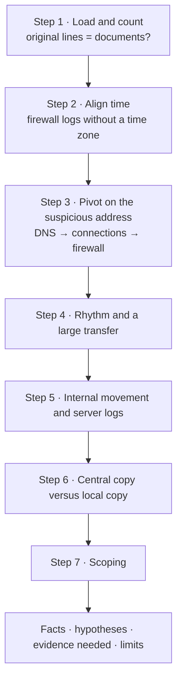
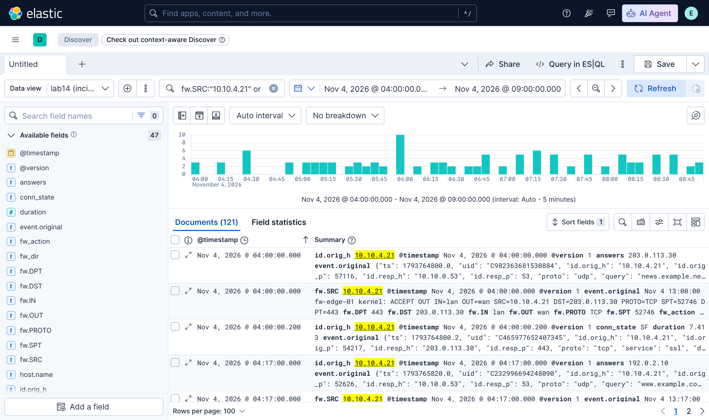

# 2.14 — Lab Guide: Log Aggregation and Analysis { #lab-log-aggregation }

!!! abstract "Scope of this lesson"
    - Gathering four different log sources (firewall syslog, Zeek `dns.log` and `conn.log`, and the central and local copies of a file server's `auth.log`) into one Elastic Stack and tying them into one incident
    - Counting that everything loaded arrived, and [Caution] aligning **logs without a time zone** with other logs
    - Pivoting on one suspicious address: DNS → connections → firewall → internal movement → server logs
    - Rhythm (beaconing), a large transfer, lateral movement, log tampering (central versus local copy), scoping
    - Writing results up as facts, hypotheses, evidence needed and limits

!!! note "Lab environment and notation"
    **(Actual output)** came from the **Elasticsearch, Logstash and Kibana 9.4.3** started in lesson 2.13. The lab data is five files **I assembled** in Python to imitate **one day (2026-11-04, UTC)** in an office segment. The firewall writes **Korea Standard Time (UTC+9) without any time zone marker** in RFC 3164 shape; Zeek logs are JSON in UTC; the file server's `auth.log` uses RFC 3339 timestamps in UTC. Addresses are private or documentation addresses, domains are example domains, and attacker behaviour and account names are invented. Instead of the SOF-ELK VM, I loaded the data with my own Logstash configuration into the same Elastic Stack version, so the lab uses Kibana Discover and ES|QL rather than SOF-ELK's dashboards.

## 1. The situation { #scenario }

**(Hypothetical)** The administrator of the finance team's file server `fs-01` (`10.10.0.30`) says "the server was briefly slow yesterday afternoon, and there's nothing odd in the logs". But the security team saw the outside address `203.0.113.66` appear on a threat intelligence list the same day. Here's what's at hand:

| Source | File | Format | Time |
| --- | --- | --- | --- |
| Perimeter firewall `fw-edge-01` | `fw/2026/fw-edge-01.log` | syslog (RFC 3164), key=value | **Local time (UTC+9), no time zone marker** |
| Zeek on an internal sensor | `zeek/dns.log`, `zeek/conn.log` | JSON | UTC (Unix time) |
| `fs-01`'s auth log as collected on the central log server | `auth/central/fs-01-auth.log` | syslog (RFC 3339 timestamps) | UTC |
| `fs-01`'s auth log copied directly from the server | `auth/local/fs-01-auth.log` | same | UTC |

The goal, in lesson 2.12's words, is to **put all the data in one place** and follow the whole incident from a single suspicious address.

**Figure 1-1. Order of this lab** (top to bottom)



**How to read it:** proceed top to bottom. Steps 1–2 check "are we ready to analyse?" Mistakes there undermine every later conclusion.

## 2. Step 1: load and count { #ingest }

Record the originals' hashes and line counts on receipt.

```bash
sha256sum fw/2026/*.log zeek/*.log auth/*/*.log
wc -l fw/2026/*.log zeek/*.log auth/*/*.log
```

**(Actual output; first 16 hex digits of each hash)**

```text
6f9526a8acc2b08d  fw/2026/fw-edge-01.log       677 lines
fd21ddc200aa18a7  zeek/dns.log                 485 lines
1d448214ede60f8c  zeek/conn.log                678 lines
71e794f8ef083805  auth/central/fs-01-auth.log    9 lines
9689ab5a2d490055  auth/local/fs-01-auth.log      3 lines
```

The key points of the Logstash configuration (shaped like lesson 2.13's):

- Firewall: strip the syslog prefix with grok, then split the remaining `SRC=… DST=… DPT=…` with the **`kv` filter** (key=value pairs into fields) into fields such as `fw.SRC` and `fw.DST`. Take the year from the path's `2026` (lesson 2.13, section 2.3).
- Zeek: read with the `json` codec and turn `ts` (Unix time) into `@timestamp`.
- `auth.log`: parse the timestamp with `TIMESTAMP_ISO8601` and extract the user and source address from SSH login lines. The central and local copies go into **different indices**.

Compare document counts per index with the originals.

```text
GET /_cat/indices/lab14-*?v&h=index,docs.count&s=index
```

**(Actual output)**

```text
index                docs.count
lab14-auth-central            9
lab14-auth-local              3
lab14-fw                    677
lab14-fw-assumed-utc        677
lab14-zeek-conn             678
lab14-zeek-dns              485
```

All match the original line counts. Why there are two firewall indices is explained in the next step.

!!! warning "[Caution] Two things I ran into while loading"
    - **The `clone` filter's marker has changed.** To load the firewall log under two time zone assumptions at once, I made copies with the `clone` filter and routed by `[type]`, but at first all 1,354 events went into one index. In Logstash 9's ECS compatibility mode, `clone` marks copies in **`tags`** rather than `type`. Changing the condition to `if "fw_kst" in [tags]` fixed it. As in lesson 2.13, section 2.2, reusing old configuration examples can silently skew results like this; the habit of counting documents caught it.
    - **You can't delete indices with a wildcard.** Sending `DELETE /lab14-*` to reload returned `Wildcard expressions or all indices are not allowed`: since Elasticsearch 8 the default setting (`action.destructive_requires_name`) blocks accidental mass deletion. I deleted by naming each index. A welcome default for an evidence store.

## 3. Step 2: align time { #time-alignment }

One firewall line:

```text
Nov  4 14:14:07 fw-edge-01 kernel: ACCEPT OUT IN=lan OUT=wan SRC=10.10.4.21 DST=203.0.113.66 PROTO=TCP SPT=… DPT=443
```

**Neither year nor time zone.** The path solved the year, but there's no way to tell the time zone from inside the log. So I loaded the same log under two assumptions: `lab14-fw-assumed-utc` ("assume UTC") and `lab14-fw` ("Korea Standard Time, `Asia/Seoul`, as the device documentation says"). Which is right is confirmed by comparing **the same event from another source**. I found the first `10.10.4.21` → `203.0.113.66` record in each.

```text
FROM lab14-fw-assumed-utc, lab14-fw METADATA _index
| WHERE fw.SRC == "10.10.4.21" AND fw.DST == "203.0.113.66"
| STATS first_seen = MIN(@timestamp), n = COUNT(*) BY _index
```

**(Actual output)**

```text
       first_seen       |       n       |       _index
2026-11-04T14:14:07.000Z|114            |lab14-fw-assumed-utc
2026-11-04T05:14:07.000Z|114            |lab14-fw
```

The same query against Zeek `conn.log` gives the first connection at **2026-11-04T05:14:07Z** (step 3). The UTC assumption is off by **exactly nine hours**; the `Asia/Seoul` load matches to the second. The count (114) also equals Zeek's connection count. So the assumption that this firewall logs Korea Standard Time is **supported by comparing two independent sources**.

!!! tip "Reserved words in ES|QL"
    I first named the columns `first` and `last` and got a syntax error, `no viable alternative at input 'first ='` (actual output). In ES|QL, `first` and `last` are reserved, so use names such as `first_seen`.

**What this means for investigations:** for logs without a time zone, **always determine the zone by comparison with another source**, and state the grounds (which event, how many hours' difference) in the report. Loaded as UTC without comparison, this incident's firewall records would sit nine hours **late** — nothing like the "afternoon" the administrator described. If the difference is minutes rather than hours, it may be **device clock error** rather than a time zone, and should be recorded separately.

From here on, only `lab14-fw` (corrected to Korea Standard Time) is used.

## 4. Step 3: pivot on the suspicious address { #pivot }

Start from the threat intelligence address `203.0.113.66`. First, who connected to it?

```text
FROM lab14-zeek-conn | WHERE id.resp_h == "203.0.113.66"
| STATS conns = COUNT(*), first_seen = MIN(@timestamp), last_seen = MAX(@timestamp), max_out = MAX(orig_bytes) BY id.orig_h
```

**(Actual output)**

```text
     conns     |       first_seen       |       last_seen        |    max_out    |   id.orig_h
114            |2026-11-04T05:14:07.000Z|2026-11-04T23:53:53.507Z|48211907       |10.10.4.21
98             |2026-11-04T07:40:02.000Z|2026-11-04T23:50:11.166Z|419            |10.10.5.17
```

Two PCs talked to it. How did they learn the address? DNS:

```text
FROM lab14-zeek-dns | WHERE query == "beacon.example.org"
| STATS n = COUNT(*), first_seen = MIN(@timestamp) BY id.orig_h
```

(Beforehand I searched for queries whose `answers` contained `203.0.113.66`; all 20 were for `beacon.example.org`.)

**(Actual output)**

```text
       n       |       first_seen       |   id.orig_h
19             |2026-11-04T05:14:06.600Z|10.10.4.21
1              |2026-11-04T07:40:01.700Z|10.10.5.17
```

Both PCs looked up `beacon.example.org` **0.3–0.4 seconds before** their first connection: name → address → connection, chained to the second. But `10.10.4.21` made 114 connections with only 19 lookups. With a 300-second TTL and a connection every ten minutes, it should have asked each time; it didn't, so the program seems to **remember the answer longer itself** (hypothesis). That's client-side behaviour, distinct from the resolver caching of lesson 2.6. Counting beacons from DNS records alone therefore undercounts.

I ran the same pivot in Kibana, with a data view on `lab14-*` (excluding the UTC-assumed firewall index) and one KQL query across the three sources' field names:

```text
fw.SRC:"10.10.4.21" or id.orig_h:"10.10.4.21" or ssh_src_ip:"10.10.4.21"
```

{ loading=lazy }

**Figure 4-1. Discover tying three sources together by one address (actual output).** Time range 2026-11-04 04:00–09:00 UTC, oldest first. At the same 04:00:00 sit Zeek's DNS (`answers 203.0.113.30`), the firewall (a line whose `event.original` reads local time `Nov 4 13:00:00`) and Zeek's connection — possible only because the time zone was corrected. The tall histogram bar around 06:00 is step 5's SSH attempts and login.

**What this means for investigations:** **the same meaning has different field names in each source** (`fw.SRC`, `id.orig_h`, `ssh_src_ip`). Filter on one and the others drop out. In a real environment, normalising during parsing to common names such as ECS's `source.ip` makes pivots like this much easier (lesson 2.13, section 2.2).

## 5. Step 4: rhythm and a large transfer { #beacon-exfil }

I computed the intervals between `10.10.4.21`'s small connections (under 1,000 bytes) to `203.0.113.66` (timestamps from ES|QL, arithmetic in Python).

**(Actual output)**

```text
n 113 mean 599.9 s, stdev 1.7 s, min 597.1, max 603.0
```

A mean of **600 seconds** with a standard deviation of 1.7 seconds: as in lesson 2.4, a program's **beacon** rhythm, not a person's. And one connection was a different size.

```text
FROM lab14-zeek-conn | WHERE id.orig_h == "10.10.4.21" AND id.resp_h == "203.0.113.66"
| SORT orig_bytes DESC | KEEP @timestamp, orig_bytes, resp_bytes, duration | LIMIT 3
```

**(Actual output)**

```text
       @timestamp       |  orig_bytes   |  resp_bytes   |     duration
2026-11-04T06:47:31.000Z|48211907       |5120           |412.0
2026-11-04T09:24:04.259Z|420            |218            |0.3824181854724884
2026-11-04T15:44:14.688Z|420            |231            |0.4622810482978821
```

At 06:47:31 UTC, `10.10.4.21` **sent about 46 MB** and received only 5 KB in a connection lasting 412 seconds — utterly unlike the usual ~400-byte beacons, a **large outbound** shape (the same idea as lesson 2.8, review question 4). It's HTTPS (443), so the content isn't visible.

## 6. Step 5: internal movement and server logs { #lateral }

Where did `10.10.4.21` connect **inside** the network, besides outside?

```text
FROM lab14-zeek-conn | WHERE id.orig_h == "10.10.4.21" AND id.resp_h != "203.0.113.66" AND id.resp_h LIKE "10.*"
| KEEP @timestamp, id.resp_h, id.resp_p, duration, orig_bytes, resp_bytes
```

**(Actual output)**

```text
       @timestamp       |   id.resp_h   |   id.resp_p   |   duration    |  orig_bytes   |  resp_bytes
2026-11-04T06:02:12.000Z|10.10.0.30     |22             |1520.0         |5120           |90311
```

At 06:02:12 it connected to **the file server `10.10.0.30` on SSH (22)** and stayed 1,520 seconds (about 25 minutes). Now the file server's auth log (central copy):

```text
FROM lab14-auth-central | KEEP @timestamp, syslog_msg | SORT @timestamp
```

**(Actual output)**

```text
2026-11-04T01:05:02.000Z|Accepted publickey for admin_kim from 10.10.1.12 port 51022 ssh2
2026-11-04T02:30:40.000Z|Accepted publickey for admin_kim from 10.10.1.12 port 51190 ssh2
2026-11-04T06:01:50.000Z|Failed password for svc_backup from 10.10.4.21 port 52200 ssh2
2026-11-04T06:01:54.000Z|Failed password for svc_backup from 10.10.4.21 port 52201 ssh2
2026-11-04T06:01:59.000Z|Failed password for svc_backup from 10.10.4.21 port 52202 ssh2
2026-11-04T06:02:12.400Z|Accepted password for svc_backup from 10.10.4.21 port 52203 ssh2
2026-11-04T06:09:03.000Z|svc_backup : TTY=pts/2 ; PWD=/srv/finance ; USER=root ; COMMAND=/usr/bin/tar czf /tmp/.c.tgz /srv/finance
2026-11-04T06:27:40.000Z|Disconnected from user svc_backup 10.10.4.21 port 52203
2026-11-04T08:15:00.000Z|Accepted publickey for admin_kim from 10.10.1.12 port 52011 ssh2
```

Network records and server logs interlock.

- 06:01:50–59: three failed passwords from `10.10.4.21` for **the backup service account `svc_backup`**, then **success** at 06:02:12.4, 0.4 seconds after Zeek's connection start (06:02:12.0).
- 06:09:03: that account became root via `sudo` and **archived `/srv/finance` into `/tmp/.c.tgz`** (a hidden file name starting with a dot).
- 06:27:40: disconnected. Zeek's start + 1,520 seconds = 06:27:32, within 8 seconds.
- Twenty minutes later, at 06:47:31, `10.10.4.21` sent 46 MB outside (step 4).

Against the usual administrative access (`admin_kim`, public key, from `10.10.1.12`), this login — by password, with a service account, from a never-seen PC — departs sharply from the baseline.

## 7. Step 6: central copy versus local copy { #central-vs-local }

The server administrator said "nothing odd in the logs". What they looked at was the server's **local** `auth.log`. Count both copies.

```text
FROM lab14-auth-central, lab14-auth-local METADATA _index | STATS n = COUNT(*) BY _index
```

**(Actual output)**

```text
       n       |      _index
3              |lab14-auth-local
9              |lab14-auth-central
```

Three lines locally, nine centrally. The three local lines are just `admin_kim`'s ordinary logins. Counting the lines missing from the local copy with KQL:

```text
FROM lab14-auth-central | WHERE KQL("ssh_src_ip:10.10.4.21 or syslog_msg:*svc_backup*") | STATS n = COUNT(*)
```

**(Actual output)** `6`

**Exactly the six lines** involving `10.10.4.21` and `svc_backup` are missing locally — the same pattern as lesson 2.12, section 3. That's why the administrator saw "nothing odd". The difference is itself evidence of what the attacker wanted to hide, and if the server is still running, the deleted original held open by the logging daemon (`/proc/<PID>/fd`, lesson 2.12, section 3.2) is worth checking too.

## 8. Step 7: scoping { #scoping }

Step 3 found **two** PCs talking to `203.0.113.66`. Look at `10.10.5.17`:

- 07:40:01.7 lookup of `beacon.example.org` → 07:40:02 first connection → 98 connections every ten minutes afterwards (step 3).
- Largest transfer 419 bytes: **no** large transfers.
- Connections to `10.10.0.30` or any other internal address: **zero** (actual output, rerunning step 5's query with `10.10.5.17`).

So `10.10.5.17` appears to be **a second infected PC that started the same beacon at 07:40**, with no sign of data leaving it within this data. It may still be in an "early stage", which makes it high priority: isolating it now might prevent what happened on `10.10.4.21` (internal movement, a large transfer).

## 9. Writing it up { #report }

- **Observations (facts):** all times UTC.
    - At 05:14:06.6, `10.10.4.21` looked up `beacon.example.org` and received `203.0.113.66`, then connected to port 443 at that address 114 times from 05:14:07 to 23:53. Small connections were spaced at a mean of 599.9 s with a standard deviation of 1.7 s.
    - From 06:01:50 to 06:01:59, three failed passwords for the `svc_backup` account went from `10.10.4.21` to `fs-01`, followed by a successful login at 06:02:12 (central log and Zeek connection agree within 0.4 s). At 06:09:03 the account used `sudo` to archive `/srv/finance` into `/tmp/.c.tgz`; the connection ended at 06:27:40.
    - At 06:47:31, `10.10.4.21` had a 412-second connection to `203.0.113.66` sending 48,211,907 bytes and receiving 5,120.
    - `fs-01`'s local `auth.log` lacks the six SSH/sudo lines above, which are present in the central log server's copy.
    - `10.10.5.17` looked up the same name at 07:40:01.7 and made 98 connections at ten-minute intervals to the same address from 07:40:02. No large transfers.
    - The firewall logs Korea Standard Time; this interpretation was confirmed by comparison with Zeek connections (first connection matching to the second, identical counts).
- **Interpretation (hypotheses):**
    - `10.10.4.21` was infected around 05:14 with malware using `203.0.113.66` as C2.
    - Via `10.10.4.21`, the attacker got `svc_backup`'s password right (success after three failures: a guess, or a password obtained elsewhere), entered the file server, archived finance data, and may have taken it via `10.10.4.21` and sent it outside (the 46 MB at 06:47). How the archive reached `10.10.4.21`, and whether the 46 MB is that archive, is not yet confirmed.
    - The attacker scrubbed their traces from `fs-01`'s local log.
    - `10.10.5.17` is a second infection by the same malware.
- **Evidence still needed:**
    - Whether `/tmp/.c.tgz` exists on `fs-01`, with size and hash; if the server is running, the logging daemon's open file handles (deleted original logs); shell history.
    - Endpoint evidence from `10.10.4.21` and `10.10.5.17`: infection vector, the process that looked up `beacon.example.org`, files received from `fs-01`.
    - Where the `svc_backup` password is used and stored (other servers, scripts, configuration files).
    - Proxy and TLS negotiation records (server name and certificate for the `203.0.113.66` connections), and logs from the days before and after (when the infection began).
    - The firewall's time zone configuration documentation (to confirm the conclusion reached by comparison).
- **Observation limits:**
    - Traffic was on 443, so contents weren't seen; "46 MB = finance data" is an inference from timing and size.
    - Apart from the `sudo` line in the server log, what happened inside the SSH session (06:02–06:27) is unknown.
    - `fs-01`'s log source addresses and times are values as received by the central server; the reception time and sender address from lesson 2.10, section 3.4 aren't in this data.
    - This data was assembled for practice.

## 10. Summary { #summary }

- I gathered four sources into one Elastic Stack and first checked **that original line counts equal document counts**; that habit caught the `clone` filter's ECS behaviour change.
- The time-zone-less firewall log was loaded under two assumptions and compared with Zeek: **UTC was off by exactly nine hours; Korea Standard Time matched to the second**.
- From one suspicious address I linked DNS (name) → Zeek (connections) → firewall (allowed) → internal movement (SSH) → server log (login, `sudo tar`) → large transfer (46 MB), putting each source's differently named fields into one KQL query.
- I found a 600-second beacon, a password login with a service account from a never-seen PC, six lines missing only from the local copy, and a second infected PC starting at 07:40.
- The results were written up as facts, hypotheses, evidence needed and limits.

## Review questions { #review }

**Question 1. (Basics)** What problem did step 1's check — "original lines equal documents?" — actually catch in this lab? And if you'd used SOF-ELK, what else should you suspect?

??? success "Answer and explanation"
    When splitting the firewall log across two time zone assumptions, counting revealed that all 1,354 events had gone into one index: in Logstash 9's ECS mode, the `clone` filter marks copies in `tags` rather than `type` (the [Caution] in section 2). Without counting, one index would have mixed the same records under two time zones and wrecked every time analysis. On SOF-ELK, also suspect Filebeat 9's rules (files under 1,024 bytes aren't read; files with identical first 1,024 bytes are skipped as duplicates; lesson 2.13, section 4.1). This lab's local `auth.log` (3 lines, 348 bytes), for example, might never have been loaded.

**Question 2. (Changed conditions)** If you had loaded the firewall log only under the UTC assumption (`lab14-fw-assumed-utc`) and analysed that, how would the incident timeline differ?

??? success "Answer and explanation"
    Firewall records would sit **nine hours late**. The first `10.10.4.21` → `203.0.113.66` record would show at 14:14 UTC rather than 05:14, out of line with Zeek (05:14) and DNS (05:14). That would ① invite wrong readings such as "the firewall only saw this traffic nine hours later" or "these are different communications"; ② place the firewall record for the 46 MB transfer (06:47) at 15:47, twisting its order relative to the SSH login (06:02); and ③ make every firewall-only event (periods without Zeek) wrong. Hence the need to determine the zone of time-zone-less sources by comparison, and record the grounds (section 3).

**Question 3. (Interpretation)** In step 3, `10.10.4.21` made 114 connections but only 19 DNS lookups. How do you interpret this, and how does it affect the investigation?

??? success "Answer and explanation"
    With a 300-second TTL and a connection every ten minutes, it didn't ask each time, so the program seems to **remember the answer longer itself** or use the address directly (hypothesis). Effects: ① counting beacons or activity periods from DNS alone underestimates them; ② if the attacker changes the name's address, this program may keep going to the old one for a while, so DNS sinkholing alone may not cut it off immediately; ③ so read DNS (names) and connection records (addresses) together, and block both names and addresses. Resolver caching (lesson 2.6) isn't the cause here, since this data observed traffic between client and resolver.

**Question 4. (Common misconception)** "There's nothing odd in `fs-01`'s local `auth.log`, so the file server wasn't compromised." Refute this with this lab's results.

??? success "Answer and explanation"
    In step 6, the local copy had three lines and the central copy nine, and the six missing lines were exactly those involving `10.10.4.21` and `svc_backup` (three failures, the success, `sudo tar`, the disconnect). The local log is clean **because someone scrubbed it**, and the difference is itself evidence of compromise and concealment (lesson 2.12, section 3). Zeek's connection record (06:02:12, port 22, 1,520 seconds) is **independent network evidence** telling the same story. Don't conclude from one server log; read the central copy and network records together.

**Question 5. (Application)** To confirm whether step 4's 46 MB transfer really was the archive of `/srv/finance`, what do you need beyond this data, and in what order would you look?

??? success "Answer and explanation"
    ① If `/tmp/.c.tgz` still exists on `fs-01`, its **size and hash** (around 46 MB?); if deleted, look for traces with disk forensics. ② How the file got from `fs-01` to `10.10.4.21`: the SSH connection's `resp_bytes` was only 90,311 bytes, so 46 MB didn't move over that session. Look for **another path** (another connection, SMB, SCP at another time) in Zeek `conn.log` between `10.10.0.30` and `10.10.4.21` from 06:09 to 06:47. In this data there were **zero** connections involving `10.10.0.30` in that window (actual output), so consider paths this sensor can't see (traffic within the same switch, another segment), or that the file may still be only on the server. ③ On `10.10.4.21`'s endpoint, the file or its traces and the process behind the 06:47 connection. ④ If proxy or TLS interception records exist, content or size information for the 06:47 connection. Until these pieces interlock, keep "46 MB = finance data" as a hypothesis.

**Question 6. (Interpretation)** If you had pivoted with only `fw.SRC:"10.10.4.21"` in KQL, what would be missing? How would you reduce this problem in a real environment?

??? success "Answer and explanation"
    Only firewall records would remain; the same PC's Zeek DNS and connections (`id.orig_h`) and the server log's source address (`ssh_src_ip`) would **all drop out**, because each source uses a different name for the same meaning (section 4). To reduce it: ① normalise during parsing (Logstash) to **common field names** such as ECS's `source.ip`, `destination.ip`, `destination.port`, `user.name`; ② failing that, OR all the fields when pivoting, or search by value without a field; ③ document which fields share meaning in each data view. As with lesson 2.13, review question 7's type conflict, also watch for fields with the same name but different meanings.

**Question 7. (Application)** The manager receiving this report asks, "Should we isolate both PCs now, or keep watching?" What decision grounds would you give from this lab's results?

??? success "Answer and explanation"
    Grounds: ① `10.10.4.21` talked to the C2 all day, entered the file server with a service account, archived data, and appears to have sent 46 MB outside — damage **already in progress**. ② `10.10.5.17` started the same beacon at 07:40 but shows no large transfers or internal movement in this data — **early stage**, so acting now may prevent greater damage. ③ The attacker knows the `svc_backup` account, so **change its password and review where it's used**. ④ But isolation may alert the attacker and lose endpoint memory evidence, so decide together whether to capture memory and disk evidence first and whether to isolate both at once (isolating one may warn the other). The decision is the manager's; the investigator's job is to convey the facts, hypotheses and risks clearly.

## References { #references }

- Tools used in this environment: Elasticsearch, Logstash and Kibana 9.4.3 (official Docker images; `kv`, `clone`, `date` and `grok` filters; ES|QL), Playwright (screenshots), Python 3.13 (data assembly and interval arithmetic). Results obtained on 2026-11-05.
- Lab data: assembled by me. First 16 hex digits of SHA-256: `fw-edge-01.log` 6f9526a8acc2b08d, `dns.log` fd21ddc200aa18a7, `conn.log` 1d448214ede60f8c, central `fs-01-auth.log` 71e794f8ef083805, local `fs-01-auth.log` 9689ab5a2d490055.
- Elastic, [Logstash kv filter](https://www.elastic.co/docs/reference/logstash/plugins/plugins-filters-kv), [clone filter](https://www.elastic.co/docs/reference/logstash/plugins/plugins-filters-clone) (behaviour in ECS compatibility mode), [ES|QL](https://www.elastic.co/docs/explore-analyze/query-filter/languages/esql), [`action.destructive_requires_name`](https://www.elastic.co/docs/reference/elasticsearch/configuration-reference/index-management-settings).
- This lab builds on lesson 2.4 (beacon rhythm), lessons 2.6–2.9 (DNS), lesson 2.8 (Zeek), lesson 2.10 (syslog timestamps), lesson 2.12 (central copies) and lesson 2.13 (the Elastic Stack).

!!! note "About this page"
    A personal study note, rewritten in my own words from several learning resources. The lab data and scenario are my own, and the scenarios are hypothetical.
