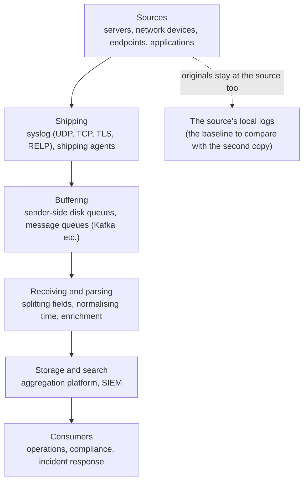

# 2.12 — Log Aggregation: Why Collect, How to Ship, What to Use { #log-aggregation }

!!! abstract "Scope of this lesson"
    - Logs are the unsung heroes of network investigations, and they come with baggage (no standard, volume, dispersion)
    - Benefits of central aggregation: a **second copy** of what attackers delete, working in parallel, multiple vantage points
    - Confirmed directly: comparing a scrubbed local log with the central copy, and [Caution] the daemon that keeps writing to a file scrubbed with `sed -i`
    - Better transport: rsyslog and syslog-ng, queues, TLS, RELP, log shippers, message queues
    - Choosing an aggregation platform: file ingestion, parsing, custom formats; [Changed] what's changed since the book

!!! note "Lab environment and notation"
    **(Actual output)** came from rsyslog 8.2312.0 (Ubuntu 24.04 packages, including `rsyslog-gnutls`) in this environment. A "server" rsyslog wrote to a local file while also forwarding over TCP and UDP to another rsyslog acting as the "central aggregator" (`127.0.0.40`). The log messages and the "attacker's log scrubbing" are invented for practice; addresses are private or documentation addresses.

## 1. Logs are the unsung heroes { #why-logs }

Think how many systems a single network communication touches between source and destination. Each of those systems, and the software on them, may be recording valuable evidence of that packet's existence in some log.

That's great news for investigators. Logs are usually small and compress well. For compliance or ordinary record-keeping they're often **retained for a long time**, often in ways that can be considered forensically sound. If "long-term retention of forensically sound evidence" doesn't make your ears perk up, you might be in the wrong business. Even for incidents long past, logs are often the best material for recreating what happened.

But this gold mine comes with **baggage**.

- **There's no standard for "log data" in general.** Specific formats have standards — syslog (lesson 2.10), HTTP's Common Log Format (lesson 2.5) — but there's no RFC or IEEE standard for all logs. Taking part in a TCP conversation requires following the protocol; logging can take any shape a software (or even hardware) developer dreams up.
- **There's no limit to the volume.** Wading through overwhelming amounts in varied formats by hand will drive an investigator to the frayed edges of sanity.
- **Devices have no storage.** Many network devices lack persistent storage and keep logs **in memory**. When the allocated memory fills, old entries roll out, lost forever, and a reboot starts with an empty buffer. Not conducive to forensics.
- **They're scattered.** With thousands of systems each holding their own logs, remote collection to one place is the best plan, but in geographically dispersed or topologically complex environments it's never that simple. Even when feasible, it spends analysts' time on collecting, and correlating events across sources by hand degrades the analysis.
- **There's no common protocol.** Every source has its own format needing its own parser, until you have an overflowing toolbox of Perl, Python, PowerShell and bash scripts.

In short, log analysis looks simple but is a very wide problem: **vital evidence buried in voluminous free-form data** — sometimes the **only remaining evidence** of an event.

## 2. Central aggregation: in one place, in real time { #why-aggregate }

The answer is **real-time, centralised, aggregated logging**. Besides keeping the engagement manager happy, it brings the organisation many benefits.

**A second copy.** Most attackers know the systems they compromise log their activity, and actively **scrub or remove logs**. With aggregation, log entries are recorded **in multiple places at once**. Unless the attacker knows this and compromises the aggregator too, a secondary record survives. And the **disparity** between on-system and aggregated logs is itself a clear indication of what the attacker wanted to hide.

**Divide and conquer.** Several analysts can work on aggregated data at once, splitting a large task (many platforms offer web front ends). Some aggregation technologies send the same logs to **multiple destinations** simultaneously, so specialised analysis software and the long-term archive can receive the same source data.

**Follow the whole incident from one place.** The real power is having the entire environment's data **in one place**. Query by one infected PC and the malware download (proxy), execution and installation (endpoint) and C2 traffic (DNS, firewall) come together on one screen.

**The same event from multiple vantage points.** A perimeter IDS never sees activity between internal subnets, but an internal firewall or router may have logged events crucial to the incident timeline (the same idea as lesson 2.6's vantage points).

It's not a new idea. Some high-security environments used to **connect badge readers to line printers in another room**. A badge swipe was logged in the reader's memory and printed on paper at the same time, so an electronic compromise couldn't erase every record. With the printer under lock and key and fed tractor paper, a virtually indelible log was available. Central aggregation is that printer's modern form. Where the analogy breaks: printed records can't be altered later, but an aggregator's files **can be altered by whoever compromises it**. That's why the aggregator's own access control and integrity (separate privileges, append-only storage, hashes) matter.

**Different roles, different needs.** A network operations team may need only switches, routers, firewalls and proxies, for perhaps a month. A PCI compliance team at an organisation processing card payments needs real-time visibility of transaction-related records retained for the period PCI-DSS mandates, with stricter access controls for that sensitive data. Incident response and hunt teams want as much evidence as possible for as long as the lawyers allow (these figures are illustrations; organisations vary widely). Add multiple offices, jurisdictions, mergers and divestitures, and outside consultants, and today's network environment is too complex to run without some form of log aggregation.

**Figure 2-1. The big picture of log aggregation** (top to bottom: the direction logs flow)



**How to read it:** solid lines are the path logs take to the centre; the dotted line is the original left at the source. Investigators **compare** the two streams (section 3). Remember that at each stage, logs can be **lost (shipping), delayed (buffering) or reshaped (parsing)**.

## 3. Confirmed directly: a scrubbed local log and the central copy { #scrub-lab }

### 3.1 Before and after { #before-after }

The "server" recorded six authentication events, writing them to a local `auth.log` while forwarding over TCP to the central aggregator. Then the "attacker" scrubbed their traces — lines containing the attacker's address `203.0.113.9` and the `sudo` line that archived `/etc/shadow` — with `sed -i`.

```bash
sed -i '/203\.0\.113\.9\|\/etc\/shadow/d' auth.log
```

**(Actual output; the local file after scrubbing)**

```text
2026-11-05T08:17:44.716341+00:00 vm sshd: Accepted password for jkim from 10.10.1.19 port 50111 ssh2
2026-11-05T08:17:44.726769+00:00 vm sshd: Accepted password for mlee from 10.10.1.30 port 50190 ssh2
```

Two ordinary logins remain. Now compare just the message parts with the central copy.

```bash
diff <(sed -E 's/^\S+ \S+ //' auth.log) <(grep via=imtcp central.log | sed -E 's/^.* host=\S+ //')
```

`sed -E 's/^\S+ \S+ //'` strips the local lines' first two fields (timestamp and hostname), and the central `sed` strips everything up to the `host=` field, so `diff` compares only **the message parts**. `<( … )` is a bash feature that hands a command's output to `diff` as if it were a file.

**(Actual output)**

```text
1a2,5
> sshd: Failed password for root from 203.0.113.9 port 4444 ssh2
> sshd: Failed password for root from 203.0.113.9 port 4445 ssh2
> sshd: Accepted password for root from 203.0.113.9 port 4446 ssh2
> sudo: root : TTY=pts/1 ; PWD=/root ; USER=root ; COMMAND=/usr/bin/tar czf /tmp/x.tgz /etc/shadow
```

The **four lines missing locally** that `diff` shows are exactly what the attacker wanted to hide: two failed passwords → root login → archiving the password hash file. As the book says, the disparity between local and aggregated logs clearly showed "what they tried to hide".

A central line looked like this (the template records reception time, reported time, sender address and input path; lesson 2.10, section 3.4).

**(Actual output, excerpt)**

```text
received=2026-11-05T08:17:44.719731+00:00 reported=2026-11-05T08:17:44+00:00 from=127.0.0.1 via=imtcp host=vm sshd: Failed password for root ...
```

**[Caution]** `reported` was cut to **whole seconds**, though the local file had microseconds, because the sender's forwarding action used the default template (the traditional, RFC 3164 shape). Configure forwarding with an RFC 5424 template too (such as rsyslog's `RSYSLOG_SyslogProtocol23Format`) so precision, year and time zone survive.

### 3.2 [Caution] The daemon keeps writing to a file scrubbed with `sed -i` { #deleted-inode }

After the scrub, three new events occurred on the same server (the experiment in 3.3). But **not one new line appeared** in the local `auth.log`. I looked for the reason.

```bash
ls -l /proc/$(cat cli/pid)/fd | grep auth.log
```

**(Actual output)**

```text
l-wx------ 1 root root 64 Nov  5 08:18 6 -> …/cli/auth.log (deleted)
```

`sed -i` doesn't edit a file "in place"; it **writes a new file and renames it over the original name**. rsyslog still held **the original file (now nameless, deleted)** open and kept writing to it. I read that deleted file through the open file handle.

**(Actual output)**

```text
lines in deleted inode: 9; with 203.0.113.9: 3
visible file lines: 2
inode 829105 (the visible auth.log)   inode 829062 (the file rsyslog holds open)
```

The deleted original still held **all six lines from before the scrub** (including the three with the attacker's address) plus the three new ones: nine lines. The visible `auth.log` (a different inode) had two.

**What this means for investigations:**

- **On a live system**, before restarting the logging daemon, look in `/proc/<PID>/fd/` for log files marked `(deleted)` and copy them. The attacker's scrubbed original may be there. A restart, or rotation reopening files, closes that handle and returns the content to free disk space (then it's a disk forensics problem).
- Conversely, scrubbing this way has a side effect: **later local logs don't appear in the visible file**. A log that "went quiet" at some point is a clue pointing to tampering like this.
- And the central copy **kept receiving** regardless (next section).

### 3.3 When the aggregator goes down briefly: queues { #queue }

I took the central aggregator down and sent the same events meanwhile over **both** TCP forwarding (with a disk-assisted queue) and UDP forwarding. The sender's TCP forwarding looked like this:

```text
authpriv.* action(type="omfwd" target="127.0.0.40" port="10601" protocol="tcp"
                 queue.type="LinkedList" queue.filename="fwd_tcp" queue.saveOnShutdown="on"
                 action.resumeRetryCount="-1" action.resumeInterval="5")
```

- `queue.type="LinkedList"` with `queue.filename`: an in-memory queue that **spills to disk** when full or at shutdown (disk-assisted).
- `action.resumeRetryCount="-1"`: **retry forever** until the destination returns.
- `action.resumeInterval="5"`: retry every 5 seconds.

I created three events at 08:18:02–04 and brought the aggregator back around 08:18:17.

**(Actual output; the central copy)**

```text
received=2026-11-05T08:18:22.238783+00:00 reported=2026-11-05T08:18:02+00:00 from=127.0.0.1 via=imtcp … while-down 1 …
received=2026-11-05T08:18:22.238783+00:00 reported=2026-11-05T08:18:03+00:00 from=127.0.0.1 via=imtcp … while-down 2 …
received=2026-11-05T08:18:22.238783+00:00 reported=2026-11-05T08:18:04+00:00 from=127.0.0.1 via=imtcp … while-down 3 …
The same three events sent over UDP: 0
```

All three TCP events **arrived** once the aggregator was back, all received at 08:18:22 (the backlog delivered at once), with reported times 08:18:02–04 intact. **None** of the UDP copies survived, and neither side knew they were lost.

**What this means for investigations:** a **cluster of identical reception times** in the central copy may mean an outage of the aggregator or network just before. Re-sort that span by reported time, and note that sources received only over UDP **may have gaps** there. Queues have size limits too, so long outages can lose data even over TCP.

## 4. Better transport than plain syslog { #better-transport }

Lesson 2.10 showed syslog's two weaknesses: **UDP's unreliability** (fire-and-forget, so messages can be silently dropped or spoofed) and **plaintext** (sensitive logs, normally in root-only files, sent onto a wire where anyone can observe, intercept or alter them). Even if it's baked into most UNIX systems, weigh the risks before deploying a plaintext logging protocol. Fortunately, open source has produced improved implementations.

### 4.1 rsyslog and syslog-ng { #rsyslog-syslogng }

- **rsyslog**: the default logging service in Red Hat-family distributions (Fedora, CentOS derivatives, etc.), Ubuntu and others, and buildable for other UNIXes such as BSD and Solaris. A big draw is that it can use **the legacy syslog configuration format as is**, easing migration (lesson 2.10, section 5's configuration worked unchanged).
- **syslog-ng**: uses a different configuration format but offers much more granular filtering and parsing.

Both support **TCP transport and encryption**, and can **queue** messages generated while the server is unavailable, releasing them when it returns (confirmed in 3.3). They replace the aging syslog daemon with very little effort while adding many integrity and security features.

### 4.2 TLS: unreadable on the wire { #tls-lab }

I created a practice certificate authority, gave the aggregator a certificate (`logs.example.net`), and had the sender verify the certificate name (`x509/name`), sending on port 6514.

```text
# sender
*.* action(type="omfwd" target="127.0.0.41" port="6514" protocol="tcp" StreamDriver="gtls"
           StreamDriverMode="1" StreamDriverAuthMode="x509/name" StreamDriverPermittedPeers="logs.example.net")
```

**(Actual output)**

```text
== line stored on the aggregator
2026-11-05T08:18:59+00:00 vm sshd: TLS-TEST Failed password for root from 203.0.113.9
== packets on the wire
      6 TCP
      5 TLSv1.2
searching the pcap for plaintext "TLS-TEST": 0
```

The aggregator stored it normally, but the message text **couldn't be found** in the captured packets — the opposite of lesson 2.10's plaintext syslog. This rsyslog's TLS driver (GnuTLS) negotiated TLS 1.2.

**From a network forensics perspective it cuts both ways.** TLS stops logs being read or altered in transit, but, unlike lesson 2.10, section 6.2, **pcaps no longer serve as a second copy**. The more you use TLS, the more the aggregator's own retention and integrity matter.

### 4.3 RELP, log shippers, message queues { #shippers-queues }

- **RELP** (Reliable Event Logging Protocol): built by the rsyslog team to **confirm that each message reached** its destination. With TCP alone, messages in a buffer can vanish the moment a connection drops; RELP prevents that with application-level acknowledgements. It has built-in TLS support. (The `rsyslog-relp` module is installed here, but I didn't run an experiment with it.)
- **Log shippers**: small agents on each system watch data sources, normalise events and send them straight to storage or on to a parsing/enrichment stage. Elastic's **Beats** are the classic example: Filebeat for raw files, Winlogbeat for Windows event logs (lesson 2.11), Metricbeat for system status, and many (unsupported) community Beat modules.
- **Message queues**: constructs originally for inter-process communication (IPC), but well suited by nature to exchanging log data between creator and recipient. Dozens are in use, including RabbitMQ, ZeroMQ and Apache Kafka, and most aggregation platforms can ingest some of them. They **buffer** when the aggregator slows or stops (Figure 2-1).

!!! info "[Supplement] Shipping and collection tools that became common after the book (as of 2026-11-05)"
    Alongside Beats, Elastic Agent (lesson 2.11) and less vendor-tied tools such as **Fluentd/Fluent Bit**, **Vector** and the **OpenTelemetry Collector** (handling logs, metrics and traces together) are widely used. In cloud environments, each cloud's logging service can be both source and destination. Whatever the tool, the investigator's questions are the same: **what does it drop, what does it change, and how much does it hold when the link breaks?**

## 5. Choosing an aggregation platform { #platforms }

Many tools provide log aggregation and analysis. Most **SIEMs** use logs as core data; because of their scale and scope they tend to be commercial, but free (or free-ish) tools offer similar functions. Among general-purpose log aggregation tools, perhaps the most rapidly adopted is the **Elastic Stack** ("ELK": Elasticsearch for storage and search, Logstash for ingestion, parsing and enrichment, Kibana as the front end), and **SOF-ELK**, used in this course, is a free, full-stack community distribution of it (lesson 2.13). Others include ELSA (Enterprise Log Search and Archive) on the free side, and Splunk and LogRhythm on the commercial side.

The SIEM and aggregator market is crowded, with dozens of options. Evaluating with forensics, response and hunting in mind:

1. **How does data get in?** Most log evidence comes as **files**; a platform that can't ingest them is unsuitable for most DFIR workflows. Being able to load **both** existing file evidence and live sources is a very powerful combination for ongoing incidents and hunting.
2. **How does it handle formats?** A syslog message is just free text, each application choosing its own structure, which doesn't allow easy analysis. Most aggregators **parse common formats automatically** and let users **define formats** to split frequently met data into meaningful fields. Many recognise common data types such as IP addresses and dates and tokenise them for searching even without custom definitions.
3. **What's used for custom parsing?** Custom parsing is **almost always** needed. Logstash uses a syntax called **grok**, for example, whereas ELSA used an XML-based structure. When evaluating, check that the language or framework suits your data.

!!! warning "[Changed] How the platform landscape has shifted since the book (as of 2026-11-05)"
    - **Elastic's licensing**: the book presents the Elastic Stack as "free software". In 2021 Elastic relicensed Elasticsearch and Kibana from Apache 2.0 to the Elastic License and SSPL (free to use, but not OSI-approved open source licences), and AWS responded by forking 7.10.2 as **OpenSearch** (Apache 2.0). In August 2024 Elastic added **AGPL** as a third option, making it available under an open source licence again (checked via coverage). If your organisation is evaluating it, check the licence and the subscription terms for individual features.
    - **ELSA**: as far as searches show, ELSA is no longer actively developed, and Security Onion, which used ELSA, moved to an Elastic-based stack (Security Onion 2.x documentation doesn't mention ELSA). Unless old evidence lives in an ELSA instance, it isn't something to choose today.

## 6. How this is used in real investigations { #in-practice }

1. **Map where the copies are first.** The source's local logs, the central aggregator, the queues in between, archival storage (Figure 2-1).
2. **Compare local with central.** The differences are clues (section 3.1). Normalise the leading fields so you can `diff` the message parts.
3. **On live systems, secure open log handles first.** `(deleted)` files under `/proc/<PID>/fd` (section 3.2). Restart daemons only afterwards.
4. **Look for clusters of reception times and gaps.** Outages and losses from UDP sources (section 3.3).
5. **Check for changes in transit.** Has precision, year or time zone been reduced (the whole-second timestamps in 3.1)? Have fields been dropped (lesson 2.11, section 5.1)?
6. **Treat the aggregator itself as evidence.** Access records, integrity, configuration (which templates, from where it accepts).
7. **Know each role's retention.** For old incidents, which team's store still covers that period?

## 7. Summary { #summary }

- Logs are small, compress well and are often kept long, letting us recreate even old incidents. But there's no general standard, volumes are huge, some live only in device memory, they're scattered, and there's no common protocol.
- Benefits of central aggregation: a **second copy** (what attackers delete survives, and the difference is a clue), working in parallel, following the whole incident from one place, multiple vantage points. It's the modern badge-reader line printer, but an aggregator can be altered if compromised, so integrity matters.
- Confirmed directly: `diff` exposed the four scrubbed lines (two failures → root login → archiving `/etc/shadow`), and **after `sed -i`, rsyslog kept writing to the deleted original**, whose nine original lines were still reachable via `/proc/<PID>/fd`. The default forwarding template cut timestamps to whole seconds.
- With the aggregator down, TCP (disk-assisted queue) events all arrived after it returned (reception times clustered), while none of the UDP copies survived. Logs sent over TLS couldn't be read from the pcap.
- Better transport: rsyslog (legacy-config compatible), syslog-ng (granular parsing), TCP, TLS and queues, RELP, shippers such as Beats, message queues such as Kafka. **[Supplement]** Fluent Bit, Vector, OpenTelemetry Collector.
- Platform evaluation: file and live ingestion, automatic parsing and custom formats (grok and others). **[Changed]** Elastic's licensing (SSPL/ELv2 in 2021, the OpenSearch fork, AGPL added in 2024) and ELSA's decline.

## Review questions { #review }

**Question 1. (Basics)** Give three benefits central aggregation brings to investigations, linking each to an experiment or example from this lesson.

??? success "Answer and explanation"
    For example: ① **a second copy**: if an attacker scrubs local logs, the central copy survives, and **the difference shows what they hid** (section 3.1: `diff` exposed the four scrubbed lines); ② **following the whole incident from one place**: query by one infected PC to link the proxy download, endpoint execution and DNS/firewall C2 on one screen (section 2); ③ **multiple vantage points**: internal firewall logs reveal activity between internal subnets that the perimeter IDS can't see. Parallel work by several analysts and sending the same logs to multiple destinations are benefits too.

**Question 2. (Interpretation)** Investigating a live Linux server, the last line of `/var/log/auth.log` is three days old and nothing follows, yet `rsyslogd` is running. What do you suspect, and what do you do first?

??? success "Answer and explanation"
    As in section 3.2, suspect that someone **swapped the file** with something like `sed -i`, so rsyslog keeps writing to **the deleted original** (no new lines in the visible file). First: **don't restart rsyslog**; look in `ls -l /proc/$(pidof rsyslogd)/fd` for log files marked `(deleted)`, copy their content through the handle (`cp /proc/<PID>/fd/<N> evidencefile`) and hash it. It may hold the pre-scrub original plus everything since. Then compare the visible file's inode and modification time, shell history and the central copy. Also check other possibilities (rotation misconfiguration, a full disk, configuration changes).

**Question 3. (Changed conditions)** In section 3.3's experiment, suppose the sender had no queue (`queue.type` omitted) and default retry settings. How do you expect the result would differ, and how would you confirm it?

??? success "Answer and explanation"
    **Expectation (hypothesis):** events during the aggregator's downtime would likely be **partly or wholly lost**, even over TCP. With defaults, an action is suspended after a few failures, and there's no disk queue to hold messages meanwhile; in-memory capacity is limited, and restarting the sending rsyslog discards what's in memory. **Confirm** by repeating the experiment without a queue, counting lines in the central copy, and reading the sending rsyslog's internal messages (action suspended, messages discarded). This lesson didn't run that variant, so don't assert the result; confirm it experimentally.

**Question 4. (Common misconception)** "We have a central aggregator, so it doesn't matter if attackers delete logs." Give at least three holes in this claim.

??? success "Answer and explanation"
    ① **If the aggregator itself is compromised**, the copy can be altered too (where section 2's analogy breaks); separate privileges, append-only storage and hashes are needed. ② **Logs never sent don't exist**: without configuration to ship every source and event, there's no copy (lesson 2.10's selectors). ③ **Loss in transit**: UDP drops silently (section 3.3), and even TCP can lose data during outages without a queue. ④ **Delay**: where events are batched, as with Windows Event Forwarding, deletion before sending leaves no copy (lesson 2.11, section 3.2). ⑤ **Attackers can cut forwarding first**: stopping the daemon or changing its configuration stops later events reaching the centre (though "it went quiet from this point" is itself a clue). ⑥ **Alteration**: a copy with reduced precision, missing fields or lost time zones may be less useful than the original (section 3.1).

**Question 5. (Interpretation)** In the central copy, 40 events from one server **all** have reception time `02:31:07.4`, while their reported times spread from `02:12:00` to `02:30:55`. What probably happened, and how do you handle it?

??? success "Answer and explanation"
    It's section 3.3's pattern. From around 02:12 until just before 02:31, transport between that server and the aggregator was **interrupted** (aggregator outage, network fault, firewall change, etc.), and events queued on the sender arrived **all at once** at 02:31:07. To handle it: ① build the timeline on **reported time**, remembering it's the sender's claim; ② note that **other sources received only over UDP** may have gaps during those 19 minutes; ③ find the cause of the interruption (aggregator logs, network device logs) — the attacker may have cut it deliberately; ④ check whether real-time alerting was delayed during the span.

**Question 6. (Application)** Your organisation is choosing a new aggregation platform. Write five evaluation questions from the incident response team's perspective.

??? success "Answer and explanation"
    For example: ① Can it easily ingest **existing file evidence** (Zeek logs from pcaps, log files from seized servers, CSV), alongside live inputs (section 5)? ② Does it **parse** common formats automatically, what language does **custom parsing** use (grok or similar), and does it keep the raw original when parsing fails? ③ Does it store **reception time and original time**, and sender address, separately (lesson 2.10, section 3.4)? How does it handle time zones? ④ Retention period and cost, search speed on old data, **integrity** (change and access records). ⑤ Export: can investigation results be extracted in original form or JSON for other tools and reports? ⑥ Licensing and cost structure (section 5's [Changed]), and degree of vendor lock-in. ⑦ Concurrent use by several analysts and separation of permissions.

**Question 7. (Common misconception)** "Sending logs over TLS is always better for investigations." Summarise the pros and cons using this lesson's experiment.

??? success "Answer and explanation"
    **Pros:** logs can't be read or altered on the wire (section 4.2: the message text couldn't be found in the pcap), and certificate name checks (`x509/name`) prevent sending to the wrong server. **Cons (from an investigative view):** as in lesson 2.10, section 6.2, **pcaps stop serving as a second copy of the logs**, so you rely more on the aggregator's own retention and integrity; and if forwarding stops because of an expired certificate or misconfiguration, logs pile up or vanish meanwhile (queue settings matter). In conclusion, use TLS in most environments, but pair it with **measures that protect the aggregator as an evidence store** and **monitoring that notices forwarding failures**.

## References { #references }

- Tools used in this environment: rsyslog 8.2312.0 (Ubuntu 24.04 packages; `omfwd` with a disk-assisted queue, the `rsyslog-gnutls` TLS driver, `rsyslog-relp` installed), OpenSSL (practice CA and certificates), util-linux `logger` 2.39.3, GNU `sed` and `diff`, tcpdump, TShark 4.2.2. Results obtained on 2026-11-05.
- rsyslog, [documentation](https://www.rsyslog.com/doc/) (`omfwd`; queue parameters `queue.type`, `queue.filename`, `action.resumeRetryCount`; the `gtls` TLS driver; RELP).
- syslog-ng, [documentation](https://syslog-ng.github.io/).
- IETF, [RFC 5425](https://www.rfc-editor.org/rfc/rfc5425) (syslog over TLS, port 6514).
- Elastic, [Beats](https://www.elastic.co/beats/) (Filebeat, Winlogbeat, Metricbeat).
- Project documentation for Apache Kafka, RabbitMQ and ZeroMQ (message queues).
- Elastic licensing changes: the 2021 move to ELv2/SSPL and the OpenSearch fork, and AGPL added in August 2024 (checked via coverage on 2026-11-05). [OpenSearch](https://opensearch.org/).
- ELSA and Security Onion's migration: Security Onion documentation and mailing list (checked via search results on 2026-11-05).

!!! note "About this page"
    A personal study note, rewritten in my own words from several learning resources. The log messages and tampering experiments are my own, and the scenarios are hypothetical.
