# 2.10 — Syslog: Message Formats, Facility and Severity, Reading Configuration { #syslog }

!!! abstract "Scope of this lesson"
    - Syslog is both a **daemon** and a **protocol**, and why it's precious to investigators
    - Who sends syslog, and who receives it
    - Reading messages: the traditional format (RFC 3164) and the current standard (RFC 5424). [Caution] there's no year or time zone, and the timestamp and hostname are **set by the sender**
    - Facility, severity, and computing the PRI
    - Reading configuration files: selectors and actions. [Correction] a `!` selector on its own selects nothing
    - Transport: UDP loss, TCP, and [Changed] syslog in the journald era

!!! note "Lab environment and notation"
    **(Actual output)** came from **rsyslog 8.2312.0**, util-linux `logger` 2.39.3 and TShark 4.2.2 in this environment (Ubuntu 24.04). I ran a receiving rsyslog on `127.0.0.30`, port 10514 (UDP and TCP), and a sending rsyslog that takes messages on its own socket, to watch the flow between the two instances. The container's hostname is `vm`, so messages carry `vm`. The year-rollover experiment used `faketime` to imitate **only the receiving server's clock** at 2027-01-01. Message contents (login failures, DHCP and so on) are invented for practice.

## 1. Syslog: a daemon and a protocol { #what-is-syslog }

As the name says, syslog handles system log events. But the word refers to **two things**.

- **The daemon**: a long-standing UNIX program that receives log messages and delivers them to **one or more destinations** (files, other programs, other systems on the network) according to its configuration. rsyslog and syslog-ng are today's implementations.
- **The protocol**: the agreement on **what messages look like on the wire** when sent over the network.

As an analogy, the syslog daemon is **the company mail room** and the protocol is **the envelope format**. Each department (program) hands a note to the mail room, which looks at the markings on the envelope (facility and severity, section 4) to decide which filing cabinet (file) it goes in, whether to send it to head office (a remote server), or, if urgent, to phone the boss (every user's screen). Where it breaks: a real mail room checks who sent something, but syslog **trusts the sender and date written on the envelope** (section 3.4). And an envelope sent by UDP can be **lost without anyone knowing** (section 6).

Syslog was built to help administrators with operations, but the security community soon saw its value. Logs are a **partial transcript** of past events. Used with an understanding of their limits, they greatly improve our picture of the past when added to the body of evidence, and point to **further evidence** to seek. Durable logs are therefore a critical part of security posture, and the book recommends every organisation keep **at least a year of logs on hot standby**. Storage keeps getting cheaper and logs compress well, so keeping more is advisable. Where regulations such as PCI-DSS, HIPAA, SOX or FISMA apply, the requirements are clear and inflexible, and some even mandate keeping logs **in multiple locations** via network aggregation (lesson 2.12).

## 2. Who sends, and who receives { #sources-destinations }

**Senders**

- **UNIX, Linux and BSD**: inherently syslog-aware, as are user programs whose developers include the feature.
- **Network equipment**: most core devices — routers, switches, IDSes, firewalls, wireless access points — have long been able to send their log events to another host via the syslog protocol, even if they don't run a syslog daemon internally. Consumer gear increasingly can too.
- **Other devices**: NAS heads, the drive sled banks of large storage area networks, surveillance cameras that log changes in their field of view, alarm systems logging door and window events, motion detectors. Many run embedded UNIX derivatives, so adding syslog is easy.
- **Windows**: uses its own log format (lesson 2.11), but can "push" to a syslog destination with third-party service software.

What makes this convenient is that so many devices share **a common logging mechanism**. Instead of learning new tools or hand-parsing a sea of formats, mastering syslog gives you insight into the logs of thousands of kinds of devices. Forensic practitioners rarely get a break like this.

**Receivers**

- **The syslog daemon itself**: easily configured to receive remote messages (like this lab's receiver).
- **NAS devices**: embedded UNIX plus lots of storage, so many products include reception.
- **Log aggregation platforms**: aggregators such as the free SOF-ELK (lesson 2.13) or commercial Splunk, and the **SIEM** (Security Information and Event Management) platforms investigators mostly meet, all receive syslog as a core feature. Tools built to vacuum up as many logs as possible would be remiss to ignore the most tried-and-true logging protocol.
- **Windows servers**: can receive remote syslog with third-party software such as SolarWinds Kiwi Syslog Server or Snare Server.

## 3. Reading messages { #message-format }

### 3.1 On the wire: the traditional format (RFC 3164) { #rfc3164 }

I sent one UDP message to the receiver with `logger` and captured the bytes on the wire.

```bash
logger --rfc3164 -n 127.0.0.30 -P 10514 -d -p local7.info -t dhcpd "DHCPACK on 10.10.1.19 to 02:00:00:00:01:19 via eth0"
```

`-n` is the server, `-P` the port, `-d` UDP, `-p` facility.severity (section 4) and `-t` the tag (program name).

**(Actual output; UDP payload)**

```text
<190>Nov  5 07:59:40 vm dhcpd: DHCPACK on 10.10.1.19 to 02:00:00:00:01:19 via eth0
```

| Part | Value | Meaning |
| --- | --- | --- |
| PRI | `<190>` | Facility and severity combined (section 4). 190 = local7.info |
| Timestamp | `Nov  5 07:59:40` | The **sender's** clock. **No year or time zone** |
| Hostname | `vm` | The name the **sender** wrote |
| Tag | `dhcpd:` | Usually program name and PID (like `sshd[999]:`), but a program can write **any string** |
| Message | `DHCPACK on …` | Free text |

This format is a later write-up (RFC 3164, 2001, informational) of practice on BSD systems, so it's **convention** rather than a strict standard, with many device-specific variants.

The receiver's traditional-format file (`RSYSLOG_TraditionalFileFormat`) stored it without the PRI.

**(Actual output)**

```text
Nov  5 07:59:40 vm dhcpd: DHCPACK on 10.10.1.19 to 02:00:00:00:01:19 via eth0
```

### 3.2 The current standard: RFC 5424 { #rfc5424 }

```bash
logger --rfc5424 -n 127.0.0.30 -P 10514 -d -p authpriv.warning -t sshd "Failed password for invalid user admin from 198.51.100.23 port 51122 ssh2"
```

**(Actual output; UDP payload)**

```text
<84>1 2026-11-05T07:59:40.968247+00:00 vm sshd - - [timeQuality tzKnown="1" isSynced="0"] Failed password for invalid user admin from 198.51.100.23 port 51122 ssh2
```

After `<84>` (the PRI) comes `1`, the **format version**, then a **timestamp with year and time zone** (to microseconds), the hostname, the app name (`sshd`), the process ID (`-` = none), the message ID (`-`), **structured data** (`[timeQuality …]`) and the message.

!!! info "[Supplement] RFC 5424 (2009) is the current standard"
    The book shows a default format and an "enhanced" one (with ISO 8601 timestamp and PRI). As a wire format, **RFC 5424** (2009) is the standard that replaces RFC 3164. In the structured data `timeQuality` above, `tzKnown="1"` means "the time zone is known" and **`isSynced="0"` means "the sender's clock is not synchronised (by NTP or similar)"**. The sender reports its own clock quality, a useful clue for investigators (this container really had no time-sync information). Many devices still send RFC 3164 shapes or variants, though.

### 3.3 [Caution] No year, no time zone { #no-year }

RFC 3164 timestamps have **no year and no time zone**. The receiver has to **guess** the year. I tested how rsyslog fills it in.

First, with the receiver's real clock (2026-11-05), I sent three messages with different timestamps.

**(Actual output; the "reported time" as the receiver interpreted it, and the actual reception time)**

```text
<14> reported=2026-12-31T23:59:59+00:00 received=2026-11-05T07:59:53.993084+00:00
<14> reported=2026-11-30T12:00:00+00:00 received=2026-11-05T07:59:53.993084+00:00
<14> reported=2026-11-04T23:00:00+00:00 received=2026-11-05T07:59:53.993149+00:00
```

Next I used `faketime` to imitate **the receiver's clock at 2027-01-01 00:00:30**, simulating messages created just before year end arriving after the new year.

**(Actual output)**

```text
<14> reported=2027-12-31T23:59:58+00:00 received=2027-01-01T00:00:32.516385+00:00
<14> reported=2027-01-01T00:00:29+00:00 received=2027-01-01T00:00:32.516385+00:00
```

The message created at `Dec 31 23:59:58` was interpreted as **2027-12-31**, nearly **a year in the future** relative to its reception. This rsyslog version attached **the receiver's current year** to year-less timestamps, even though the message was really from 2026-12-31.

**What this means for investigations:** in incidents spanning the new year, sorting RFC 3164-style logs chronologically can badly scramble the order. Confirm whether a `Dec 31` line is really from last year using the file's last-modified time, log rotation dates and the surrounding lines. And with **no time zone**, check the device's configuration for whether it logs local time or UTC.

### 3.4 [Caution] The sender sets the timestamp and hostname { #sender-controlled }

A message's timestamp and hostname are written **by whoever created the message**, and the receiver records them **verbatim**. A device with a bad clock is recorded with the bad time, and they can also be **forged** at will. I crafted a message with a different hostname and a timestamp from early this year.

```bash
printf '<38>Jan  2 03:04:05 fw-core-01 sshd[999]: Accepted password for root from 203.0.113.9 port 4444 ssh2' > /dev/udp/127.0.0.30/10514
```

`/dev/udp/address/port` is a bash feature that sends a UDP datagram to that address. You can "make up" syslog messages without any special program.

**(Actual output)**

```text
Traditional-format file:
Jan  2 03:04:05 fw-core-01 sshd[999]: Accepted password for root from 203.0.113.9 port 4444 ssh2

File that also records receiver-side information:
<38> reported=2026-01-02T03:04:05+00:00 received=2026-11-05T07:59:40.970961+00:00 claimed_host=fw-core-01 from_ip=127.0.0.1 proto=imudp tag=sshd[999]: msg= Accepted password for root from 203.0.113.9 port 4444 ssh2
```

From the traditional file alone, it reads as "root logged in to the core firewall `fw-core-01` in the early hours of 2 January". But the line with receiver-side information shows the **actual reception time** (5 November) and **the address that actually sent it** (`127.0.0.1`, not the firewall).

The second file comes from a **template** (output shape) defined on the receiver:

```text
template(name="Forensic" type="string"
  string="<%PRI%> reported=%timereported:::date-rfc3339% received=%timegenerated:::date-rfc3339% claimed_host=%HOSTNAME% from_ip=%fromhost-ip% proto=%inputname% tag=%syslogtag% msg=%msg:::drop-last-lf%\n")
```

| Property | Meaning |
| --- | --- |
| `%timereported%` | The timestamp **written in** the message (set by the sender) |
| `%timegenerated%` | When the receiver **received** the message (receiver's clock) |
| `%HOSTNAME%` | The hostname **written in** the message |
| `%fromhost-ip%` | The network address that **actually sent** the message |
| `%inputname%` | The input module that received it (`imudp`, `imtcp`) |

**What this means for investigations:** if you run a central collector, configure it to **record reception time and sender address too**, as here. If they aren't recorded, state in the report that logged hostnames and timestamps are **claims**, and confirm them with the device's own logs or network records (the real source of the syslog packets). The book's enhanced format (`<%PRI%>%timegenerated:::date-rfc3339% …`) uses `timegenerated` for the same reason; if you choose just one, understand what that choice means.

### 3.5 Message size { #size }

Maximum message length depends on the syslog implementation. Many older implementations cut messages at **1,024 bytes** (the limit RFC 3164 describes). UDP has its own limit: over IPv4, a single UDP datagram can carry at most 65,507 bytes of data (65,535 − 20-byte IP header − 8-byte UDP header). The book's 65,527 doesn't subtract the IP header.

I sent this rsyslog UDP messages of various lengths.

**(Actual output; start of each message and the length of the line stored)**

```text
LEN01000  1156
LEN02000  2156
LEN08000  8156
LEN09000  8210
LEN20000  8210
```

The 9,000- and 20,000-byte messages were both cut to **the same 8,210-byte line** (the line includes the template's prefix). This rsyslog's default maximum message size is 8 KB, and nothing in the line indicated truncation. For logs carrying long content — long command lines, entire web requests, stack traces — remember that **the end may be missing**. Check `maxMessageSize` on both sender and receiver if needed.

## 4. Facility, severity and the PRI { #facility-severity }

Every syslog message carries two values the daemon uses to decide how to process it and **where to store it**.

- **Facility**: an identifier of the message's **source**. The daemon uses it to choose a file. There are eight `local0`–`local7` facilities reserved for administrators, and de facto conventions have emerged (many Linux distributions use `local7` for DHCP, for example). But **assignment is arbitrary**: nothing stops anyone tagging FTP messages as `mail`, and elaborate setups repurpose legacy facilities like `news` or `uucp`. That's why collecting **the relevant services' configuration files** is critical in an investigation.
- **Severity**: **importance**. Its meaning is more straightforward, but it's also set arbitrarily by the sender, and the daemon uses it to decide what to do: drop debug, send info to a frequently truncated file, email administrators about errors, and send alert and emergency to every possible destination including local and remote terminals.

**Facilities (RFC 5424)**

| No. | Keyword | Meaning | No. | Keyword | Meaning |
| --- | --- | --- | --- | --- | --- |
| 0 | kern | kernel | 12 | (none) | NTP |
| 1 | user | user-level | 13 | (none) | log audit |
| 2 | mail | mail | 14 | (none) | log alert |
| 3 | daemon | system daemons | 15 | cron | scheduler (clock daemon) |
| 4 | auth | security/authorisation | 16 | local0 | local use |
| 5 | syslog | syslogd itself | 17 | local1 | local use |
| 6 | lpr | line printer | 18 | local2 | local use |
| 7 | news | network news | 19 | local3 | local use |
| 8 | uucp | UUCP | 20 | local4 | local use |
| 9 | (none) | clock daemon | 21 | local5 | local use |
| 10 | authpriv | security/authorisation (private) | 22 | local6 | local use |
| 11 | ftp | FTP | 23 | local7 | local use |

**Severities (RFC 5424)**

| No. | Keyword | Meaning |
| --- | --- | --- |
| 0 | emerg (panic) | System is unusable |
| 1 | alert | Action must be taken immediately |
| 2 | crit | Critical conditions |
| 3 | err (error) | Error conditions |
| 4 | warning (warn) | Warning conditions |
| 5 | notice | Normal but significant condition |
| 6 | info | Informational |
| 7 | debug | Debug-level |

The **PRI** combines the two into one number.

```text
PRI = facility × 8 + severity
facility = PRI ÷ 8 (quotient),  severity = PRI ÷ 8 (remainder)
```

**(Actual output; decoded with Python's `divmod`)**

```text
190 -> facility 23 severity 6     # local7.info  (the DHCP message in 3.1)
84 -> facility 10 severity 4      # authpriv.warning  (the sshd message in 3.2)
8 -> facility 1 severity 0        # user.emerg
38 -> facility 4 severity 6       # auth.info  (the forged message in 3.4)
13 -> facility 1 severity 5       # user.notice  (logger's default)
165 -> facility 20 severity 5     # local4.notice
```

TShark also splits the PRI into facility and level when it dissects syslog (this lab used port 10514, so I set the dissector with `-d udp.port==10514,syslog`). The default file format drops the PRI (the traditional file in 3.1), which makes it hard to tell a message's facility and severity from the log alone. That's why administrators often include the PRI in their configuration.

## 5. Reading the configuration: "where do this system's logs go?" { #config }

Here's the book's example adapted to this environment as the sender's configuration (only paths and addresses changed).

```text
template(name="FullDateWithPRI" type="string" string="<%PRI%>%timegenerated:::date-rfc3339% %HOSTNAME% %syslogtag%%msg:::drop-last-lf%\n")
template(name="smsTemplate" type="string" string="%TIMESTAMP% %HOSTNAME% %syslogtag% %msg%\n")
$ActionFileDefaultTemplate FullDateWithPRI

*.info;mail.none;authpriv.none;cron.none     /…/log/messages
*.info;mail.none;authpriv.none;cron.none     @127.0.0.30:10514
authpriv.*                                   /…/log/secure
authpriv.=warning                            @@127.0.0.30:10514
mail.*                                       /…/log/maillog
local7.*                                     /…/log/dhcp.log
local3.*                                     /…/log/named.log
local6.!notice                               /…/log/clamd_debug.log
*.emerg                                      action(type="omprog" binary="/…/sms_send.sh" template="smsTemplate")
```

### 5.1 Selectors (left) { #selectors }

They take the form `facility.severity`, chain with semicolons (`;`) and allow wildcards (`*`).

- **Severity means "this or higher"**: `*.info` selects info and everything more important: notice, warning, err, crit, alert, emerg.
- **`none`**: `mail.none` means "exclude mail".
- **`=`**: exactly that severity. `authpriv.=warning` is warning only.
- **`!`**: **remove** that severity and higher. See the [Correction] below.

### 5.2 Actions (right) { #actions }

| Form | Meaning |
| --- | --- |
| `/path/file` | Write to that file |
| `@host:port` | Forward to a remote server over **UDP** |
| `@@host:port` | Forward over **TCP** ([Supplement]: the book's example has only `@`) |
| `^/path/program;template` | Run a program for each message (legacy syntax) |
| `action(type="omprog" …)` | Keep a program running and pass messages on standard input (rsyslog's current way) |
| `:omusrmsg:*` | Show on **every logged-in user's terminal** (like `wall`) |

`$ActionFileDefaultTemplate` sets the default template for file output. With several templates, remember that **the same event can be stored in different shapes at different destinations**.

### 5.3 Trying it { #config-lab }

I fed eight messages into the sending rsyslog.

```bash
L="logger -u …/dev-log"                    # the sending rsyslog's socket
$L -p local7.info     -t dhcpd   "DHCPACK on 10.10.1.19"
$L -p authpriv.info   -t sshd    "Accepted publickey for jkim from 10.10.1.19"
$L -p authpriv.warning -t sshd   "Failed password for root from 198.51.100.23"
$L -p mail.err        -t postfix "connect to mx.example.net: Connection timed out"
$L -p local6.debug    -t clamd   "scan detail"
$L -p local6.warning  -t clamd   "Eicar-Test-Signature FOUND"
$L -p user.emerg      -t root    "LAB_EMERGENCY_TEST"
$L -p user.debug      -t app     "debug noise"
```

**(Actual output; lines stored in each file)**

```text
== dhcp.log
<190>2026-11-05T08:00:28.816246+00:00 vm dhcpd: DHCPACK on 10.10.1.19
== maillog
<19>2026-11-05T08:00:28.821820+00:00 vm postfix: connect to mx.example.net: Connection timed out
== messages
<190>2026-11-05T08:00:28.816246+00:00 vm dhcpd: DHCPACK on 10.10.1.19
<180>2026-11-05T08:00:28.825199+00:00 vm clamd: Eicar-Test-Signature FOUND
<8>2026-11-05T08:00:28.826954+00:00 vm root: LAB_EMERGENCY_TEST
== secure
<86>2026-11-05T08:00:28.818307+00:00 vm sshd: Accepted publickey for jkim from 10.10.1.19
<84>2026-11-05T08:00:28.820128+00:00 vm sshd: Failed password for root from 198.51.100.23
== sms.out  (received by the script started via omprog)
SMS-GATEWAY got: Nov  5 08:00:28 vm root:  LAB_EMERGENCY_TEST
== receiver (127.0.0.30)
<190> … proto=imudp tag=dhcpd: …
<84>  … proto=imtcp tag=sshd: …
<180> … proto=imudp tag=clamd: …
<8>   … proto=imudp tag=root: …
```

How to read it:

- The DHCP message (`local7.info`) went to **two files**, `dhcp.log` and `messages`, and to the receiver too (`*.info` also matches local7).
- Authentication messages are **absent** from `messages` (`authpriv.none`) and present only in `secure`. Of those, only the warning-level failed login went to the receiver, **over TCP** (`proto=imtcp`, from `authpriv.=warning` → `@@`). The successful login isn't on the remote side.
- The mail error is only in `maillog`, not on the receiver (`mail.none`).
- The emergency message (`user.emerg`) went to `messages`, the receiver and the SMS script, which received it in `smsTemplate` shape (no PRI, year-less timestamp). **The same event in three shapes.**
- `user.debug` is nowhere (below `*.info`).
- `clamd_debug.log`, meant to receive `local6.debug`, **was never even created**. See the next box.

!!! warning "[Correction] `kern.!notice` on its own selects nothing"
    The book says "`kern.!notice` would match all kernel messages with a severity lower than notice". In rsyslog's rules (and sysklogd's, on which they're based), `!` **removes from what's already selected**, so with nothing selected beforehand the result is empty. I checked directly.

    **(Actual output; sending local6 debug, info, notice, warning and err one each)**

    ```text
    local6.!notice              → file never created (nothing matched)
    local6.*;local6.!notice     → debug, info  (below notice)
    local6.=warning             → warning
    ```

    To select "below notice", **select everything first, then remove**: `local6.*;local6.!notice`. When reading someone else's configuration during an investigation, remember that a `!` line may have logged nothing at all, contrary to its intent. Where you can, confirm with `rsyslogd -N1 -f configfile` (configuration check) and whether the files actually exist.

!!! info "[Supplement] How `^` program execution actually behaves"
    The book's `^/usr/local/bin/sms_send.py;smsTemplate` (legacy syntax) still worked in rsyslog 8.2312. Running it, **a new program process was started for each message, with the message passed as a command-line argument** (the script's arguments: ` CARET_TEST`). Many messages mean as many processes, and message content lands on the command line verbatim, so rsyslog's documentation recommends `omprog`, which keeps the program running and passes messages on standard input.

**Figure 5-1. Where logs go in this configuration** (one group per selector, top to bottom: selector → destination)

```mermaid
flowchart TD
    A["*.info (except mail, authpriv, cron)"] --> F1["file: messages"]
    A --> N1["UDP @ receiver"]
    F1 ~~~ B["authpriv.*"]
    B --> F2["file: secure"]
    F2 ~~~ C["authpriv.=warning"]
    C --> N2["TCP @@ receiver"]
    N2 ~~~ D["mail.* / local7.* / local3.*"]
    D --> F3["files: maillog / dhcp.log / named.log"]
    F3 ~~~ E["*.emerg"]
    E --> P1["program: SMS script (omprog)"]
    E -.-> X["also matches *.info, so it also goes<br/>to messages and the UDP forward"]
```



**How to read it:** a message matching a selector goes to the destinations its arrows point to. A message matching several selectors goes to **all** their destinations (dotted line: an `*.emerg` message also matches `*.info`, so it also goes to messages and the UDP forward). The unlinked gaps between groups only stack them vertically and don't imply any order. As the book says, "where does this system's log data go?" is a deceptively complex question even for a basic configuration. During an investigation, collect the configuration (including **included files** such as `/etc/rsyslog.d/*.conf`) and draw a picture like this yourself.

## 6. Transport: UDP, TCP and beyond { #transport }

### 6.1 UDP loses messages silently { #udp-loss }

On the same computer (loopback), I fired 200,000 short messages at the receiver over UDP and over TCP.

**(Actual output)**

```text
UDP: sent 200000 in 0.63s   → received: 196760
TCP: sent 200000 over TCP in 0.19s → received: 200000
```

UDP lost **3,240 messages (about 1.6%)**, and neither sender nor receiver recorded the fact — on loopback, without even crossing a network. When the receive buffer overflows, the OS drops datagrams quietly. Every TCP message arrived.

**What this means for investigations:** **a gap in the central syslog server's records doesn't mean nothing happened.** Losses grow when logs surge, as during an incident. Where possible, compare against the original device's local logs, and for a UDP receiver check the OS's UDP receive error counters (such as receive buffer errors in `netstat -su`).

### 6.2 TCP, TLS, RELP { #tcp-tls }

!!! info "[Supplement] Transport options (as of 2026-11-05)"
    - **UDP 514** (RFC 5426): most common, most prone to loss, and **plaintext**.
    - **TCP** (port 514 by convention; RFC 6587 documents the framing): no loss while the connection holds, but if the receiver goes down, messages pile up in the sender's buffer and can overflow. The TCP messages in this lab were delimited by newlines (`\n`).
    - **Syslog over TLS** (RFC 5425, usually port 6514): encryption and peer authentication.
    - **RELP** (rsyslog's Reliable Event Logging Protocol): application-level acknowledgements prevent loss.

    **From a network forensics perspective:** plaintext syslog (UDP/TCP 514) **can be read straight from packet captures**; this lab read the wire messages with TShark. If the central server's logs were deleted or tampered with, pcaps of the path in between can serve as **a second copy**. Conversely, it means sensitive information — failed authentications, usernames, internal addresses — flows in plaintext.

## 7. [Changed] Syslog in the journald era { #journald }

!!! warning "[Changed] Modern Linux may have no `/var/log/messages`"
    On systemd-based Linux, **systemd-journald** receives logs first and stores them in its own **binary format** (the journal), read with `journalctl`. And some distributions no longer install a traditional syslog daemon by default. For example, **Debian 12 (2023) dropped rsyslog from the default installation** and made the journal persistent on disk (`/var/log/journal`) (checked via the Debian mailing-list discussion and related coverage; the official release notes couldn't be opened from this environment, 2026-11-05). Others, like this lab's Ubuntu 24.04, still ship rsyslog alongside.

    **What this means for investigations:** ① When investigating a Linux server, don't conclude "there are no logs" because `/var/log/messages` or `/var/log/syslog` is missing. Collect the journal files under `/var/log/journal/` and read them with `journalctl --file`. ② Unlike syslog, the journal records **information about the sending process** (PID, UID, executable path, systemd unit) for each entry as values verified by the kernel, making it more robust against section 3.4's "forged tag" problem. ③ To centralise, rsyslog or syslog-ng read from the journal and forward (`imjournal`), or tools such as systemd-journal-remote are used; on the wire it becomes syslog again.

## 8. How this is used in real investigations { #in-practice }

1. **Collect the configuration first.** Use `/etc/rsyslog.conf` and `/etc/rsyslog.d/*.conf` (or syslog-ng's configuration) to map "what goes where" (section 5). Facility assignments are only convention.
2. **Separate sender-set values from receiver-verified ones.** Timestamps and hostnames are claims; compare with reception time and sender address where recorded (section 3.4).
3. **Check year and time zone.** In RFC 3164 shapes, the year is the receiver's guess and can go wrong across the new year (section 3.3). Check the device's time zone setting.
4. **Suspect gaps and truncation.** UDP loss (section 6.1), maximum message size (section 3.5).
5. **Compare original and copies.** The device's local logs, the central server's logs, and pcaps of the path between.
6. **Don't forget the journal.** On systemd systems, `/var/log/journal/` (section 7).

## 9. Summary { #summary }

- Syslog is both a **daemon** that receives messages and routes them to destinations and a **protocol** on the wire, shared by UNIX, network equipment, all kinds of embedded devices and (via third parties) Windows. Receivers include syslog daemons, NAS devices, aggregation platforms and SIEMs.
- The traditional format (RFC 3164) is PRI, timestamp, hostname, tag and message, with **no year or time zone**. In my test, rsyslog attached the receiver's year, so a `Dec 31` message arriving after the new year was interpreted **a year in the future**. **[Supplement]** The current standard, RFC 5424, carries year, time zone and structured data (`timeQuality isSynced`).
- The sender sets the timestamp and hostname, so they can be forged. My crafted message landed verbatim in the traditional file, while `timegenerated` and `fromhost-ip` showed the truth.
- Message size: old implementations used 1,024 bytes; this rsyslog cut at its default 8 KB **without any marker**. IPv4 UDP carries at most 65,507 bytes of data.
- PRI = facility × 8 + severity; 190 = local7.info. Facility assignment is arbitrary, so configuration files are needed.
- Selectors: "this or higher", `none`, `=`, `!`. **[Correction]** `!` alone selects nothing; write `local6.*;local6.!notice` for "below notice". Actions: file, `@` UDP, `@@` TCP, program (`^` runs per message; `omprog` recommended), all user terminals.
- UDP silently lost 3,240 of 200,000 messages even on loopback; TCP delivered all. **[Supplement]** TLS (RFC 5425), RELP. Plaintext syslog in pcaps is a second copy.
- **[Changed]** More distributions default to journald; Debian 12 dropped rsyslog from the default installation.

## Review questions { #review }

**Question 1. (Basics)** Explain each part of this line, and name at least two things you can't tell from it alone.

```text
<86>Mar  3 02:17:44 web-03 sshd[2231]: Accepted password for deploy from 203.0.113.50 port 50122 ssh2
```

??? success "Answer and explanation"
    `<86>`: the PRI. 86 = 10 × 8 + 6, so facility 10 (authpriv), severity 6 (info). `Mar  3 02:17:44`: time on the sender's clock. `web-03`: the hostname the sender wrote. `sshd[2231]:`: the tag (program name and PID). The rest is the message: the `deploy` account logged in successfully with a password from `203.0.113.50`. **Can't tell:** ① the **year** (section 3.3); ② the **time zone** (is that server on UTC or local time?); ③ whether its clock was right; ④ whether **`web-03` really sent** this message (section 3.4; needs the receiver's `fromhost-ip`); ⑤ whether this is the device's own log or a copy on a central server.

**Question 2. (Changed conditions)** An incident ran from the night of 31 December 2026 into the early hours of 1 January 2027. Sorting the central syslog server's file (received in RFC 3164 shape, stored with RFC 3339 timestamps) chronologically sends the lines that look like the start of the incident to the very end (2027-12-31). What happened, and how do you fix it?

??? success "Answer and explanation"
    RFC 3164-style messages have no year, so the receiver filled it in. As in section 3.3's experiment, this rsyslog attached **the year at reception (2027)**, so messages created on 2026-12-31 were stored as 2027-12-31. To fix: ① if reception time (`timegenerated`) was stored too, compare and subtract a year from lines whose reported time is far in the future of their reception; ② if not, use line order in the file (written in reception order), log rotation times and comparison with other devices' logs; ③ document the method and grounds in the report. Going forward, have devices send RFC 5424 (with year and time zone) and have the receiver store reception time.

**Question 3. (Common misconception)** "The central syslog server holds a successful-login record from `fw-core-01`, so someone definitely logged in to that firewall." What else must you check?

??? success "Answer and explanation"
    A syslog message's hostname and timestamp are **values written by the sender** and can be forged (section 3.4: my crafted message landed verbatim in the traditional file). Check: ① the **address that actually sent** the line (whether `fromhost-ip` was stored; if not, pcaps of syslog packets for that period or the firewall's session records); ② whether **the firewall's own local log** has the same record; ③ the firewall's authentication server (RADIUS, TACACS+) records; ④ whether the message's format matches what that device normally sends (tag, field order, spacing). If the receiver accepts UDP 514 from any address, anyone on the same network can "plant" lines like this.

**Question 4. (Reading configuration)** In the configuration below, where do an `authpriv.info` message and an `authpriv.err` message go?

```text
*.info;authpriv.none        /var/log/messages
authpriv.*                  /var/log/secure
authpriv.=err               @@198.51.100.5:514
*.err                       @198.51.100.6:514
```

??? success "Answer and explanation"
    **`authpriv.info`**: not to `messages` (`authpriv.none`), yes to `secure` (`authpriv.*`), not to `198.51.100.5` (not `=err`), and `*.err` means err or higher, so info doesn't match → **`secure` only**. **`authpriv.err`**: not to `messages`, yes to `secure`, to `198.51.100.5` over **TCP** (`@@`), and it matches `*.err`, so also to `198.51.100.6` over **UDP** (`@`) → **three places**. A message matching several lines goes to all their destinations, and the `*` in `*.err` includes `authpriv` (the first line's `authpriv.none` applies only to that line).

**Question 5. (Corrected content)** A colleague added `kern.!info /var/log/kern-debug.log` to collect only debug messages, but the file stays empty. Why, and how should it be fixed?

??? success "Answer and explanation"
    `!` **removes from what's already selected**, so with nothing selected first, nothing matches (section 5.3's [Correction]: `local6.!notice` alone didn't even create its file). To select "below info (= debug)", select everything and then remove — `kern.*;kern.!info` — or, for debug alone, use `kern.=debug`. After changing it, check the configuration with `rsyslogd -N1`. Since `logger -p kern.debug` from a user program can't easily produce kern-facility messages, testing the same syntax with another facility is safer.

**Question 6. (Interpretation)** On the day of the incident, one web server's logs on the central syslog server (UDP reception) are patchy from 14:02 to 14:09, exactly when the attacker's scan made the web server's logs surge. What possibilities do you consider, and how do you check?

??? success "Answer and explanation"
    Consider **UDP loss** first (section 6.1: even on loopback, 1.6% of 200,000 messages vanished silently). When logs surge, receive buffers overflow or the network in between drops datagrams. Other possibilities: rate limiting on the sender (rsyslog's rate limiting), or the attacker blocking log forwarding. Check: ① **the web server's own local logs** (are lines continuous for that period?); ② the receiving OS's UDP receive error counters and rsyslog's own statistics (if impstats was on); ③ pcaps for the period (did syslog packets actually arrive?); ④ internal messages from the sending rsyslog (such as "messages lost due to rate-limiting"). Don't read a gap as "nothing happened".

**Question 7. (Changed conditions)** You're investigating a Debian 12 server with neither `/var/log/syslog` nor `/var/log/auth.log`. Were the logs deleted?

??? success "Answer and explanation"
    Not necessarily. Debian 12 dropped rsyslog from the default installation and keeps the journal persistently in `/var/log/journal/` (section 7). First collect the `*.journal` files under `/var/log/journal/` (from an image, read them with `journalctl --file` or `--directory`), and check whether rsyslog was ever installed (package records, configuration files). If rsyslog was installed and the files are gone, then suspect deletion or rotation settings. The journal stores each entry's PID, UID, executable and unit, so it can actually tell you more. Also run an integrity check on the journal files (`journalctl --verify`).

**Question 8. (Application)** If you were designing a new central syslog server, what principles would you include to support investigations? Give at least four.

??? success "Answer and explanation"
    For example: ① **store reception time and sender address too** (`timegenerated`, `fromhost-ip`), kept separate from reported time and hostname (section 3.4); ② require devices to use **RFC 5424** (year and time zone), **UTC** and time synchronisation (section 3.3); ③ receive important sources over **TCP or TLS (RFC 5425), or RELP** to reduce loss and eavesdropping (section 6); ④ **restrict which addresses may send** (firewall, rsyslog allow-lists) and alert on never-seen sources (against forged messages); ⑤ raise the maximum message size enough (section 3.5); ⑥ keep reception statistics (impstats) to measure loss; ⑦ retain **a year or more**, with copies elsewhere as regulations require (section 1); ⑧ keep the original devices' local logs for a period as well, so they can be compared.

## References { #references }

- Tools used in this environment: rsyslog 8.2312.0 (Ubuntu 24.04 package; `imudp`, `imtcp`, `imuxsock`, `omprog`), util-linux `logger` 2.39.3, faketime (imitating the receiver's clock), TShark 4.2.2, tcpdump, bash's `/dev/udp`, Python 3.13. Results obtained on 2026-11-05.
- IETF, [RFC 3164](https://www.rfc-editor.org/rfc/rfc3164) (the BSD syslog protocol, 2001, informational), [RFC 5424](https://www.rfc-editor.org/rfc/rfc5424) (the syslog protocol, 2009: facility and severity tables, PRI, format version, structured data, `timeQuality`), [RFC 5426](https://www.rfc-editor.org/rfc/rfc5426) (UDP transport), [RFC 5425](https://www.rfc-editor.org/rfc/rfc5425) (TLS transport), [RFC 6587](https://www.rfc-editor.org/rfc/rfc6587) (framing for TCP transport).
- rsyslog, [documentation](https://www.rsyslog.com/doc/) (selector syntax; properties `timereported`, `timegenerated`, `fromhost-ip`; templates; `omprog`; `maxMessageSize`; RELP).
- Debian 12 logging change: the Debian developers' mailing-list discussion of November 2021 and related coverage (checked via search results on 2026-11-05; the official [release notes](https://www.debian.org/releases/bookworm/amd64/release-notes/ch-information.en.html) couldn't be opened from this environment).
- systemd, [journalctl manual](https://www.freedesktop.org/software/systemd/man/latest/journalctl.html).

!!! note "About this page"
    A personal study note, rewritten in my own words from several learning resources. The configuration and messages are my own, and the scenarios are hypothetical.
