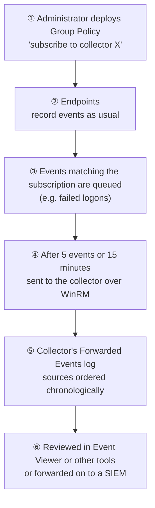

# 2.11 — Windows Event Logs and Event Forwarding { #windows-event-logs }

!!! abstract "Scope of this lesson"
    - Windows event log basics: System, Application, Security, and event IDs
    - The legacy format (EVT) and the post-Vista format (EVTX, XML schema); [Supplement] how old and new IDs relate
    - Opening one yourself: the structure of a public sample Security.evtx, record numbers versus timestamps, and [Caution] traces of a clock change
    - Windows Event Forwarding (WEF): subscriptions, push and pull, delivery latency, the collector's Forwarded Events
    - WEF on the network: WinRM, ports, encryption, and the traces it leaves
    - Windows events to syslog: bridges and log shippers, and [Caution] two pitfalls met while building one

!!! note "Lab environment and notation"
    There's no Windows in this environment. **(Actual output)** came from reading a **public sample `security.evtx`** — part of the test data of the open-source EVTX parsing library python-evtx, recorded on a test virtual machine in 2016–2017 — with **evtx 0.15.0** (Python bindings for a Rust EVTX parser). Computer and account names in the sample belong to that test data and have nothing to do with this lesson's scenarios. The syslog experiments used lesson 2.10's rsyslog 8.2312.0 receiver. WEF's network traces can't be produced here, so they were **checked through documentation only**.

## 1. Windows event log basics { #basics }

Since the first release of Windows NT (1993), Windows has shipped with a core logging capability, whose framework stayed in use until 2007. Every Windows version using that old framework is past end of life, but it wouldn't be surprising to find one in an enterprise. Old software doesn't die; it finds a mission-critical job and hides under someone's desk for a decade.

All Windows event logging has **three core logs**.

| Log | Contents |
| --- | --- |
| **System** | System components such as drivers and services |
| **Application** | Events from programs running on the system |
| **Security** | Security auditing: logon attempts, file access and deletion, etc. |

Each event has an **event ID** that tells you why the record was created. In the Security log, **4720** (Vista and later) means "a user account was created", and the record carries details such as the new account's name and who created it. For what event IDs mean, the most extensive sources are third-party: the community-driven EventID site and Randy Franklin Smith's "Windows Security Log Encyclopedia".

Think of event IDs as **hospital diagnosis codes**: the code alone tells you roughly what happened, and the chart (event data) holds the details. Where it breaks: diagnosis codes are managed by a standards body, but Windows event IDs are assigned **per provider**. A 4624 from the Security auditing provider and a 4624 from another provider can mean entirely different things, so read **the provider name and channel** together with the ID.

### 1.1 Limits of the legacy format (EVT) { #evt }

Windows before Vista and Server 2008 used the **EVT format**. At first there were just the three logs; Windows 2000 let applications create their own log files. The limits:

- **Strictly on-system logging**: an administrator had to connect to each system to review its logs.
- Small log sizes, and many important events **not logged by default** (failed logons, for example).
- Workable for a small workgroup, but not for an enterprise with thousands or tens of thousands of hosts.

XP SP2 and Server 2003 SP1 added basic remote collection, and plenty of third-party utilities forwarded event logs over the network, often via syslog.

## 2. After Vista: EVTX and XML { #evtx }

With Vista and Server 2008, Microsoft completely overhauled event logging (**Windows Eventing 6.0**). What changed:

- Every event is described by a **published XML schema**, enabling much more granular queries and filtering, and letting third-party software create and parse events without tricks.
- Two more core logs: **Setup** (software installation) and **Forwarded Events** (events collected from other computers, section 3).
- Applications and services can create their own logs (the many channels under "Applications and Services Logs"; lesson 2.7's DNS Server analytic log is one).
- **Remote forwarding** is built in (section 3).

!!! info "[Supplement] Legacy event ID + 4096 = new event ID (for the Security log)"
    As in the book's example, account creation was **624** in the legacy format and is **4720** after Vista: 624 + 4096 = 4720. Many Security audit IDs follow this relationship: successful logon 528 → **4624**, failed logon 529 → **4625** (529 + 4096). But several legacy IDs were merged into one new ID (legacy 540, network logon, also became 4624, distinguished by the logon type field), and some IDs are new, so treat it as a guide when reading old reports, not a one-to-one mapping table.

### 2.1 Opening one: the public sample Security.evtx { #sample }

```bash
sha256sum security.evtx
file security.evtx
```

**(Actual output)**

```text
5f29a03cf8c1b4bfbd82c4074ccc81ecfe85d7ee15375afc352ed5025c9a4d8d  security.evtx
security.evtx: MS Windows Vista-8.1 Event Log, 26 chunks (no. 25 in use), next record no. 2226, DIRTY
```

EVTX is a binary file made of 64 KB **chunks**, and the XML inside each record is compressed as **binary XML**. A text editor can't read it; you need a parser. `DIRTY` is a header flag meaning the logging service **didn't close the file cleanly**, common in files copied straight from a running system. So the header's "next record number" (2226) can differ from the last record actually present (2261, below). Parsers shouldn't trust the header alone; they should scan the chunks.

I summarised the whole file (converting each record to JSON with the evtx library and counting).

**(Actual output)**

```text
records 2261  first 2016-07-08T18:12:51.6816408Z  last 2017-04-14T01:21:10.9069499Z
channel: Security 2261
computer: WIN-03DLIIOFRRA 2219, 37L4247F27-25 42
top event IDs: 4907 620, 4624 583, 4672 459, 5058 102, 5061 102, 4648 45, 4608 40, 4902 40, 4735 36, 1100 36, 4647 36, 4904 31, 4905 31, 4616 26, 4781 14
```

One file, **two computer names**: the first 42 records say `37L4247F27-25`, the rest `WIN-03DLIIOFRRA`. Most likely the same system was renamed partway (4781 is "the name of an account was changed"). That's why you shouldn't assume a log file is "one computer's record"; check the `Computer` field.

### 2.2 The structure of one event { #event-xml }

Record 39 (successful logon, 4624) as XML:

**(Actual output, excerpt)**

```xml
<Event xmlns="http://schemas.microsoft.com/win/2004/08/events/event">
  <System>
    <Provider Name="Microsoft-Windows-Security-Auditing" Guid="{54849625-5478-4994-a5ba-3e3b0328c30d}"/>
    <EventID>4624</EventID>
    <Level>0</Level>
    <Task>12544</Task>
    <Keywords>0x8020000000000000</Keywords>
    <TimeCreated SystemTime="2016-07-08T18:14:59.1338646Z"/>
    <EventRecordID>39</EventRecordID>
    <Execution ProcessID="456" ThreadID="584"/>
    <Channel>Security</Channel>
    <Computer>37L4247F27-25</Computer>
  </System>
  <EventData>
    <Data Name="TargetUserName">SYSTEM</Data>
    <Data Name="LogonType">5</Data>
    <Data Name="AuthenticationPackageName">Negotiate</Data>
    <Data Name="ProcessName">C:\Windows\System32\services.exe</Data>
    <Data Name="IpAddress">-</Data>
  </EventData>
</Event>
```

| Part | Meaning |
| --- | --- |
| `Provider` | The **provider** that created the event; event IDs are per provider |
| `EventID` | 4624 = successful logon |
| `TimeCreated SystemTime` | When the event was created: **UTC**, with **7** fractional digits (100-nanosecond units) |
| `EventRecordID` | A **sequence number** within this log file |
| `Channel`, `Computer` | Log name and recording computer |
| `EventData` | Event-specific details; for 4624, target account, logon type (5 = service), authentication package, process, remote address |

`Keywords` `0x8020000000000000` carries the "audit success" bit; a failed logon (4625) sets the "audit failure" bit instead. Counting by logon type gave 5 (service) 416, 2 (interactive) 84, 0 (system) 40, 3 (network) 39, 7 (unlock) 4 (actual output). The sample's network logons were all `ANONYMOUS LOGON` with `IpAddress` `-`: a test VM with almost no remote access.

### 2.3 [Caution] Record numbers are sequential; timestamps aren't { #order }

I sorted by `EventRecordID` and counted cases where the next record's timestamp is **earlier** than the previous one.

**(Actual output)**

```text
records 2261 id range 1 2261 time going backwards between consecutive IDs: 36
(38, '2016-07-08T18:14:59.6174655Z', 1100) -> (39, '2016-07-08T18:14:59.1338646Z', 4624)
(273, '2016-07-08T23:05:19.6903545Z', 1100) -> (274, '2016-07-08T23:05:19.2691537Z', 4647)
(300, '2016-07-08T23:05:58.8456462Z', 1100) -> (301, '2016-07-08T23:05:58.0656449Z', 4647)
```

Record numbers run 1 to 2261 without gaps, but timestamps **go backwards in 36 places**. Each time, an event less than a second earlier was written right after 1100 (event logging service shutdown): events just before shutdown can be **written in a different order from when they were created**. Small inversions like this are common; when building a timeline, sort by timestamp and use record numbers to order events within the same instant.

A bigger problem is **the clock itself changing**. The sample has 26 instances of 4616 (system time changed).

**(Actual output, record 143)**

```text
4616 143 2016-07-08T22:16:31.2450000Z
  PreviousTime = 2016-07-08T18:16:31.1081039Z
  NewTime      = 2016-07-08T22:16:31.2450000Z
  ProcessName  = C:\Program Files\VMware\VMware Tools\vmtoolsd.exe
  SubjectUserName = WIN-03DLIIOFRRA$
```

The VM tools process (`vmtoolsd.exe`) moved the clock **four hours forward**, probably syncing with a host that interpreted the time zone differently (hypothesis). So between records 142 and 143, only seconds really passed, but **the timestamps jump four hours**.

**What this means for investigations:** ① When aligning Windows logs with other logs (firewall, proxy, Zeek), **look for 4616 first** to see when and how far the clock moved. ② If an attacker changed the time to muddy traces, 4616 remains too (who, with which process). ③ Gaps in record numbers may mean deletion or overwriting; this sample had none. Also remember that clearing logs leaves Security **1102** (audit log cleared) and System **104** (log cleared).

## 3. Windows Event Forwarding (WEF) { #wef }

The "Forwarded Events" log signals improved remote collection and aggregation. Windows Event Forwarding sends log entries to another system over the network **without additional software**, and receivers can pass them on for storage or other processing.

### 3.1 Terms { #wef-terms }

- **Source**: a computer that generates events.
- **Collector**: a server that gathers events, storing them in its **Forwarded Events** log by default.
- **Subscription**: the definition of "which events to gather from which sources".
- **Push (source-initiated)**: the collector directs sources to send some or all events; sources send matching events to the collector.
- **Pull (collector-initiated)**: the collector contacts sources and retrieves matching events.

As an analogy, WEF is **head office's regular reporting scheme**. Head office (the collector) issues a directive (subscription) — "report these kinds of things" — to branches (sources), and a branch with something to report **doesn't phone immediately but batches it** and sends at set times. Where it breaks: head office chases late reports, but WEF's delay is **always there** by design, and while a branch (source) is off or disconnected, events wait only within the limits of the source's log size.

### 3.2 [Caution] Delivery isn't immediate { #wef-latency }

The book explains that by default a source sends events in batches **of five, or after 15 minutes**; "fast" shortens this to 30 seconds and it can be stretched to six hours, and there's **no way to send instantly**.

!!! info "[Supplement] Subscription delivery optimisation settings (checked via search results, 2026-11-05)"
    | Setting | Delivery mode | Batch timeout |
    | --- | --- | --- |
    | Normal (default) | pull | 15 minutes, 5 items |
    | Minimize Bandwidth | push | 6 hours (heartbeat also 6 hours) |
    | Minimize Latency | push | 30 seconds |

    The Normal and Minimize Bandwidth values were confirmed in Microsoft's documentation and support article (best practice for event log forwarding performance); Minimize Latency's 30 seconds came from third-party documentation. Custom settings allow other values. learn.microsoft.com couldn't be opened directly from this environment, so I relied on search results.

**What this means for investigations:** an event's **creation time (`TimeCreated`)** in the collector's Forwarded Events and its **arrival at the collector** can differ by up to 15 minutes (six hours, depending on settings). The collector reorders multiple sources' events chronologically, but "the collector doesn't have the event yet" doesn't mean "it hasn't happened yet". During live response, allow for this delay and check urgent sources directly.

### 3.3 Group Policy and the collector { #wef-gpo }

One convenience of WEF is **managing subscriptions through Group Policy**. A domain administrator can define and enforce, with one policy, which endpoints' events go to which collector. Within one domain, authentication and authorisation are handled almost transparently.

**Figure 3-1. WEF flow in a domain** (top to bottom in time order)



**How to read it:** ① is a one-time setup; ②–⑤ repeat continuously. The gap between ③ and ④ is section 3.2's delay. Someone looking at the collector sees only ⑤'s result, so without knowing when ④ happened, events seem to "appear late".

On the collector, Event Viewer queries Forwarded Events across many systems at once. WEF's published API also lets third-party software act as an **event receiver**: Splunk can subscribe to Windows event logs, and the ArcSight SIEM offers middleware converting Windows events to the Common Event Format (CEF). Either way, accessing the data requires **authentication**: ordinary domain permissions, or client TLS certificates outside a domain. HTTP Basic authentication is possible but off by default and doesn't provide adequate security over unencrypted HTTP.

## 4. WEF on the network { #wef-network }

WEF sends **the same XML event records** used on disk over **WinRM** (Windows Remote Management, Microsoft's implementation of the WS-Management protocol), on HTTP or HTTPS.

- **Ports**: WinRM defaults to HTTP **5985** and HTTPS **5986**.
- **Encryption**: all access is authenticated, usually with Windows mechanisms (Kerberos in a domain), so **even over HTTP the content (RPC payload) is encrypted**. Plaintext interception is infeasible without proper domain credentials.
- **User-Agent**: the HTTP requests carry a distinctive User-Agent, **`Microsoft WinRM Client`**.

!!! info "[Supplement] Recognising WinRM in network records (checked through documentation only; not run here)"
    For WinRM over HTTP (5985), the **HTTP headers are plaintext** even though the content is encrypted. So lesson 2.8's Zeek `http.log` would show lines with `method` `POST`, `uri` `/wsman` and `user_agent` `Microsoft WinRM Client`, with the request body type (`Content-Type`) appearing as Kerberos-encrypted multipart (`multipart/encrypted`). That's enough to tell **who used WinRM with whom**.

    **What this means for investigations:** WinRM isn't just for WEF. PowerShell remoting (`Enter-PSSession`, `Invoke-Command`) uses the same WinRM, and attackers like it for **lateral movement**. If 5985/5986 traffic that normally flows only "WEF source → collector" appears **endpoint → endpoint** or **endpoint → server**, take a closer look. Know the normal directions (source → collector, or collector → source for pull) as a baseline.

## 5. Getting Windows events out of Windows { #to-non-windows }

So far the model has been reviewing logs with native Windows tools. That's sometimes enough, but the real power of these logs comes from **analysis software** that extracts what matters, identifies trends and correlates with other logs. Some third-party products can act as collectors, but that role requires a Windows platform.

Sooner or later you need to send **Windows events to a non-Windows system**. Splunk has its own forwarding protocol to relay from a Windows collector to a Linux instance, but because syslog is so entrenched, a **bridge that converts Windows events into syslog messages** is often the easiest solution. **Log shippers** — small agents that watch the event log and ship entries elsewhere — are another option.

| Tool | Notes |
| --- | --- |
| NTSyslog | Service for NT 4.0 and Windows 2000; for legacy platforms |
| Snare | The Snare agent, alongside the Snare Server from lesson 2.10 |
| Eventlog-to-Syslog | Event log to syslog |
| Winlogbeat | One of Elastic's "beat" shippers, used with the Elastic Stack (lesson 2.13) |

!!! info "[Supplement] Options that became common after the book (as of 2026-11-05)"
    Alongside Winlogbeat, Elastic also collects Windows events with **Elastic Agent** (Windows and System integrations). Users have reported that the two write to different indices/data streams, which can break detection rules, so check before switching. NXLog, the Splunk Universal Forwarder and each SIEM vendor's agent are also common. Whichever tool you use, **what it converts and in what shape** affects investigation results, as the next experiment shows.

### 5.1 A bridge I built, and two pitfalls { #bridge-lab }

I wrote a short **practice bridge** that converts three sample events (4624, 4720, 4616) into RFC 5424 syslog messages and sends them to lesson 2.10's receiver. It maps the event's `TimeCreated` to the syslog timestamp, `Computer` to the hostname, the provider to the app name, the event ID to the message ID, and key `EventData` fields to **structured data**.

**A message sent (Actual output, one shown)**

```text
<166>1 2016-07-08T18:14:59.1338646Z 37L4247F27-25 Microsoft-Windows-Security-Auditing - 4624 [win@32473 EventRecordID="39" Channel="Security" TargetUserName="SYSTEM" LogonType="5" IpAddress="-" ProcessName="C:\\Windows\\System32\\services.exe"] EventID 4624
```

**Lines stored on the receiver (Actual output)**

```text
<166> reported=2016-07-08T18:14:59.FZ received=2026-11-05T08:11:29.308915+00:00 claimed_host=37L4247F27-25 from_ip=127.0.0.1 proto=imudp tag=Microsoft-Windows-Security-Auditing msg=EventID 4624
<166> reported=2016-07-08T18:15:23.Z  received=2026-11-05T08:11:29.308915+00:00 claimed_host=WIN-03DLIIOFRRA ...
<166> reported=2016-07-08T22:16:31.�Z received=2026-11-05T08:11:29.309153+00:00 claimed_host=WIN-03DLIIOFRRA ...
```

Two things went wrong.

1. **The timestamps broke**: `18:14:59.FZ`, `.Z`, even a garbled character. Windows `SystemTime` has **7** fractional digits, but RFC 5424 allows **at most 6** for fractional seconds. Given a non-conforming timestamp, rsyslog decoded it into nonsense. My bridge's fault.
2. **The event details vanished.** The receiver's template (lesson 2.10, section 3.4) kept only `%msg%` and **no structured data**, so the target account, logon type and process are nowhere in the file. The message body is just `EventID 4624`.

I fixed the bridge to cut fractional seconds to 6 digits and added a receiver template with structured data (`%structured-data%`), app name (`%app-name%`) and message ID (`%msgid%`).

**(Actual output, after the fix)**

```text
reported=2016-07-08T18:14:59.133864Z received=2026-11-05T08:11:45.212785+00:00 claimed_host=37L4247F27-25 from_ip=127.0.0.1 app=Microsoft-Windows-Security-Auditing msgid=4624 sd=[win@32473 EventRecordID="39" Channel="Security" TargetUserName="SYSTEM" LogonType="5" IpAddress="-" ProcessName="C:\\Windows\\System32\\services.exe"] msg=EventID 4624
reported=2016-07-08T22:16:31.245000Z received=2026-11-05T08:11:45.213118+00:00 claimed_host=WIN-03DLIIOFRRA from_ip=127.0.0.1 app=Microsoft-Windows-Security-Auditing msgid=4616 sd=[win@32473 EventRecordID="143" Channel="Security" PreviousTime="2016-07-08T18:16:31.1081039Z" NewTime="2016-07-08T22:16:31.2450000Z" ProcessName="C:\\Program Files\\VMware\\VMware Tools\\vmtoolsd.exe"] msg=EventID 4616
```

Now timestamps read correctly and the details survive. The **7th digit (100 ns) is still lost**, though. And the gaps between `reported` (2016) and `received` (2026), and between `claimed_host` and `from_ip` (the bridge's actual address), are plain to see. An event's timestamp and computer name after a bridge are **values the bridge copied from the original**; all the syslog receiver verified is "when and from where the bridge sent it".

**What this means for investigations:** when viewing Windows events on a central server, check ① for **missing fields** compared with the original EVTX (what the shipper and the receiving template keep), ② that timestamp **precision and format** are right, and ③ that the event's **record number** survives (the key for matching the original). Without record numbers, it's hard even to tell whether an event deleted from the original survives only in the copy.

## 6. How this is used in real investigations { #in-practice }

1. **Collect the original EVTX and hash it.** Files copied from running systems may be `DIRTY`; use parsers that scan chunks rather than trusting the header.
2. **Read provider, channel and event ID together.** Don't judge by ID alone.
3. **Check the clock.** UTC? Any 4616 (time changes)? Places where record order and time order diverge widely?
4. **Look for log clearing and gaps.** 1102, 104, and gaps in record numbers.
5. **Compare the collector's copy with the original.** Events deleted at the source may survive on the collector (lesson 2.12). Allow for delivery latency (up to 15 minutes, more depending on settings).
6. **Check WinRM directions on the network.** 5985/5986, `Microsoft WinRM Client`, `/wsman`. Directions other than the usual source → collector may be lateral movement.
7. **Know the shipping path.** What the bridge or agent changes and drops (fields, timestamp precision, record numbers).

## 7. Summary { #summary }

- The core logs are System, Application and Security, and event IDs carry meaning **per provider** (for example, 4720 account creation). **[Supplement]** In the Security log, legacy ID + 4096 = new ID in many cases (624 → 4720, 528 → 4624).
- Legacy EVT was on-system only, small, and left important events out by default. Post-Vista EVTX has a published XML schema, Setup and Forwarded Events, per-application logs and remote forwarding.
- Opening a public sample showed: binary chunks and the `DIRTY` flag, two computer names in one file, `TimeCreated` in UTC with 7 fractional digits, record numbers that are continuous while timestamps go backwards in 36 places, and a 4616 where VM tools moved the clock four hours.
- WEF: subscriptions via Group Policy, push and pull, the collector's Forwarded Events. **[Caution]** The default (Normal) batches 5 events or 15 minutes, so it's not immediate.
- Network: WinRM over HTTP 5985 / HTTPS 5986, authenticated and encrypted, User-Agent `Microsoft WinRM Client`. WinRM is also used for lateral movement, so compare directions with the baseline.
- Out of Windows: NTSyslog, Snare, Eventlog-to-Syslog, Winlogbeat (and Elastic Agent and others). In my own bridge, **7-digit fractional seconds broke the timestamps** and the receiving template **dropped the structured data**; even after fixing, 100 ns precision was lost.

## Review questions { #review }

**Question 1. (Basics)** An old incident report says "hundreds of event 529 in the Security log". Which event would you look for on modern Windows, and what should you be careful about?

??? success "Answer and explanation"
    529 is the legacy "logon failure (unknown user name or bad password)", and 529 + 4096 = **4625** (an account failed to log on) is the post-Vista counterpart (the [Supplement] in section 2). Be careful that: ① the legacy format had a different ID per failure reason (529–537 and so on), whereas the new format uses **one 4625 with failure reason codes** (`Status`, `SubStatus`); ② the provider is Security auditing (`Microsoft-Windows-Security-Auditing`); ③ failed logons are only recorded if audit policy enables them, so absence of records doesn't prove absence of attempts; ④ you read logon type (3 = network, 10 = remote interactive) and source address (`IpAddress`) alongside.

**Question 2. (Interpretation)** In a server's Security.evtx, the timestamp goes back three hours between record numbers 18,200 and 18,201. What possibilities do you consider, and how do you check?

??? success "Answer and explanation"
    If record numbers continue but time jumps far backwards, the **clock probably changed** (section 2.3). Check: ① nearby **4616** (system time changed) events: `PreviousTime`, `NewTime`, and the `ProcessName` and account that changed it — VM tools, the time sync service (W32Time in `svchost.exe`), a user's manual change, or an attacker's tool; ② time service events in the System log; ③ other systems' logs and network records (Zeek `conn.log`) for the same period to align to real time. A sub-second inversion could be write-order differences as around the service shutdowns in 2.3, but three hours doesn't fit that explanation.

**Question 3. (Changed conditions)** An attacker cleared the Security log on a source PC (1102). Fortunately WEF was gathering events on a collector. But the collector's Forwarded Events has **nothing** for the ten minutes before the clearing. What should you consider?

??? success "Answer and explanation"
    WEF's delivery latency (section 3.2). With the default (Normal), events go out after 5 accumulate or **15 minutes** pass, so the last ten minutes' events may have **still been queued on the source** and wiped with the log — and the attacker may have known about the delay. Check: ① the subscription's delivery optimisation (Normal or Minimize Latency); ② whether the deleted EVTX can be recovered from the source's disk (disk forensics); ③ **network records** for those ten minutes (Zeek, firewall, proxy) and other systems' logs (the domain controller's authentication logs 4768/4769/4776, for example); ④ whether the 1102 itself reached the collector (who cleared it and when). Going forward, consider Minimize Latency for important sources.

**Question 4. (Common misconception)** "WEF uses HTTP (5985), so capturing packets lets you read event contents directly." What's wrong, and what can you still learn from the network?

??? success "Answer and explanation"
    Even over HTTP, WinRM performs **authentication and message encryption** (usually Kerberos in a domain), so event contents aren't visible in plaintext (section 4); without proper domain credentials it's practically impossible. But the HTTP headers are plaintext, so **metadata** is visible: source and destination, timing, volume, `POST /wsman`, the User-Agent `Microsoft WinRM Client`. From that you can tell which PC sent to which collector how often (finding when a source went quiet or forwarding stopped), and spot **WinRM use** other than WEF (lateral movement, PowerShell remoting).

**Question 5. (Interpretation)** In the central SIEM, some Windows logon events have timestamps like `2026-11-03T09:15:22.Z`, with the fractional part empty, while other events look fine. What do you suspect, and how do you check?

??? success "Answer and explanation"
    As in section 5.1's experiment, suspect that somewhere in the shipping path Windows' **7-digit fractional seconds** were carried into a format such as RFC 5424 (at most 6 digits) incorrectly, **breaking timestamp parsing**. Check: ① the same event's `TimeCreated` in the original EVTX (find it by record number); ② the shipper's version and timestamp-format settings; ③ the original message received by any intermediate syslog server or collection pipeline (a pcap if possible). If only the fraction broke, seconds might be trustworthy, but a malformed value can also skew **time zone or date interpretation**, so don't use it in a timeline until compared with the original.

**Question 6. (Application)** When choosing a bridge to convert Windows events to syslog, list at least five things you'd check for investigative purposes.

??? success "Answer and explanation"
    For example: ① **which fields are sent**: all of `EventData` or some (in 5.1 the structured data was dropped on the receiving side); ② whether **record number (`EventRecordID`), channel and provider** are sent (for matching the original); ③ **timestamp format and precision**: UTC? how are fractional seconds handled (the 7-digit problem)? ④ **transport**: UDP or TCP/TLS (lesson 2.10, section 6's loss); ⑤ whether it buffers and resends **when the source is off or disconnected**, and how much; ⑥ **maximum message size**: are long events (PowerShell script blocks, etc.) truncated? (lesson 2.10, section 3.5); ⑦ character encoding (non-ASCII account names, paths); ⑧ whether the receiving template **actually stores** all of this.

**Question 7. (Common misconception)** "A Security.evtx file is one computer's record, so there's no need to look at the `Computer` field." Refute this with section 2's sample results.

??? success "Answer and explanation"
    The sample Security.evtx held **two** computer names (`37L4247F27-25` 42 records, `WIN-03DLIIOFRRA` 2,219) (section 2.1). The same system appears to have been renamed partway, and matching events before and after the rename to other logs (DNS or DHCP records under the old name, domain controller records) requires knowing both names. And files gathered via a collector's Forwarded Events or other paths **mix many computers' events** in one file. Always check `Computer`.

**Question 8. (Application)** Listing connections to port 5985 from an internal sensor, most go from user PCs to the collector `10.10.0.40`, but one goes from PC `10.10.1.19` to PC `10.10.1.22`. What hypothesis do you form, and what do you check?

??? success "Answer and explanation"
    **Hypothesis:** it's **PC-to-PC WinRM**, not the usual WEF flow (source → collector), so it may be an administrative task such as PowerShell remoting or an attacker's **lateral movement** (the [Supplement] in section 4). Check: ① the connection's time, volume, duration and repetition (Zeek `conn.log`); ② HTTP metadata (Zeek `http.log`: `/wsman`, User-Agent); ③ **`10.10.1.22`'s event logs** at that time: 4624 (logon type 3, source address `10.10.1.19`), the WinRM operational log (`Microsoft-Windows-WinRM/Operational`), PowerShell logs (4103/4104), new processes (4688); ④ the account and process on `10.10.1.19` that initiated it; ⑤ whether `10.10.1.19` did the same to other PCs around then (scope). Also check whether it was legitimate work by the admin team, to rule out a false positive.

## References { #references }

- Tools used in this environment: evtx 0.15.0 (Python bindings, PyPI), `file`, rsyslog 8.2312.0, Python 3.13. Results obtained on 2026-11-05.
- Public sample: test data in the python-evtx repository, [`tests/data/security.evtx`](https://github.com/williballenthin/python-evtx/tree/master/tests/data) (SHA-256 `5f29a03c…5c9a4d8d`).
- Microsoft, "Windows Event Forwarding", "Configure Advanced Subscription Settings" and the support article on best practice for event log forwarding performance (delivery optimisation values; checked via search results on 2026-11-05; learn.microsoft.com couldn't be opened directly from this environment).
- Microsoft, [Windows Remote Management](https://learn.microsoft.com/windows/win32/winrm/portal) (WS-Management; default ports 5985/5986).
- Randy Franklin Smith, [Windows Security Log Encyclopedia](https://www.ultimatewindowssecurity.com/securitylog/encyclopedia/) (event IDs; legacy and new IDs).
- Elastic, [Winlogbeat](https://www.elastic.co/beats/winlogbeat) and the Windows integration documentation (checked via search results on 2026-11-05).

!!! note "About this page"
    A personal study note, rewritten in my own words from several learning resources. The syslog bridge and experiments are my own; apart from the public sample, the scenarios are hypothetical.
