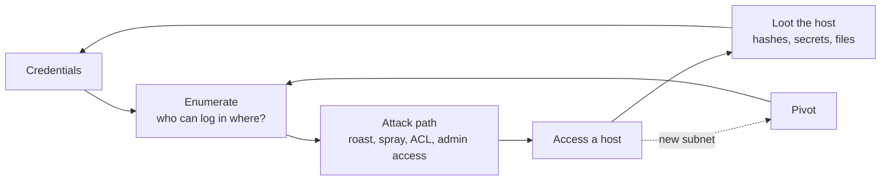

# Active Directory

**Exam weight:** 40 / 100 (10 + 10 + 20) · **Priority:** Highest · **Last updated:** 2026-10-23

!!! abstract "In one sentence"
    The AD set starts from a supplied domain user (assumed breach) and chains through two machines to the Domain Controller. Partial points count, but most passing write-ups clear all 40 — and the usual blocker is not a missing technique but a missed credential or a missed pivot.

!!! note "How this page is organised"
    This is a **study map**, not a copy-paste playbook. Each phase links to the handbook's adversary pages, which already cover the mechanics *and* the detection side of each technique. Work through those pages, then practise the full chain in the labs on [Practice labs](practice-labs.md).

## The AD loop { #ad-loop }

Every AD set is the same loop, repeated until the DC falls:

!!! tip "The habit that saves the most time"
    **Every new credential gets tried everywhere** — every host, every protocol (SMB, WinRM, RDP, MSSQL), as a domain user *and* as a local account. Keep a running `creds.txt` and add to it the moment you find anything.

## 1. Assumed-breach start { #assumed-breach-start }

You are given a domain username and password. First tasks:

- **Set up name resolution.** Kerberos works on names, not IPs — put the DC and domain in `/etc/hosts` or Kerberos-based tools will fail with confusing errors.
- **Check where the user can authenticate.** Validate the credentials against SMB, WinRM, RDP and MSSQL. A login that lets you run commands is a foothold; a valid-but-no-access login still tells you the account exists and the password is right.
- **Orient from the first host.** `whoami /all` (groups and privileges), `ipconfig /all` (a second NIC means an internal subnet to pivot into), who has logged on before.

If you land without admin, that is a local privilege-escalation problem → [Windows privesc](privesc-windows.md). If there is a second network, set up a tunnel → [Pivoting](pivoting.md).

## 2. Enumeration { #enumeration }

The study goal here is to read the domain the way BloodHound does, then confirm by hand.

- **Domain facts:** users, groups, the **password policy** (read the lockout threshold *before* spraying anything), readable and writable shares, and files on those shares (scripts, configs, backups, KeePass databases).
- **BloodHound.** Collect, then mark your user as *Owned* and run, in order: shortest paths from Owned, kerberoastable users, AS-REP-roastable users, your user's outbound object control (GenericAll / GenericWrite / WriteDACL / ForceChangePassword), and shortest paths to Domain Admins.
    - Match the collector to the GUI: BloodHound **CE** needs a CE collector; the legacy GUI needs the legacy collector. A mismatch imports nothing — decide which you use before exam day.
- **By hand (PowerView / nxc modules):** accounts with an SPN, accounts not requiring pre-auth, where you have local admin, and interesting ACLs.

## 3. Credential attacks { #credential-attacks }

These are the paths the exam set is built around. Each links to the full write-up with detection:

- **[Kerberoasting](../../adversary/kerberoasting.md)** — any domain user can request a service ticket for an SPN account and crack it offline. hashcat mode `13100` (RC4) / `19700` (AES256).
- **[AS-REP Roasting](../../adversary/asrep-roasting.md)** — accounts with pre-auth disabled hand out a crackable blob with no password needed. hashcat mode `18200`.
- **Targeted Kerberoast** — if BloodHound shows write rights over a user, you can set an SPN on it, roast, then remove the SPN.
- **Password spraying and reuse** — one likely password against every user, staying under the lockout threshold. Candidates: the given password, `Season+Year!`, the company name, the username, anything found in share files or account descriptions.

Cracking reference (which mode for which hash):

| Hash | Looks like | hashcat `-m` |
|---|---|---|
| NTLM | 32 hex chars | 1000 |
| NetNTLMv2 | `user::DOMAIN:...` | 5600 |
| Kerberoast (RC4 / AES256) | `$krb5tgs$23$` / `$krb5tgs$18$` | 13100 / 19700 |
| AS-REP | `$krb5asrep$23$` | 18200 |
| Cached domain creds (DCC2) | `$DCC2$10240#...` | 2100 |
| KeePass | `keepass2john` output | 13400 |

## 4. Lateral movement { #lateral-movement }

Pick the method by what you hold and which ports are open. The detection-side pages cover each one:

- **[Pass-the-Hash](../../adversary/pass-the-hash.md)** — reuse an NT hash where a local admin account is shared.
- **[PsExec / SMB](../../adversary/psexec-smb.md)** and **[WMI / WinRM](../../adversary/wmi-winrm.md)** — run commands on a host where you are local admin (PsExec → SYSTEM; WMI/WinRM quieter).
- **[RDP](../../adversary/rdp.md)** — interactive session where RDP rights exist.
- **Overpass-the-Hash / Pass-the-Ticket** — when NTLM is blocked or a service only accepts Kerberos, turn a hash into a ticket and use the host *name*, not the IP.
- **MSSQL** — a SQL login can often reach `xp_cmdshell`; check the service account's privileges afterwards (`SeImpersonatePrivilege` is common → [potatoes](privesc-windows.md#token-privileges)).

## 5. Loot each machine { #looting }

As soon as you are admin / SYSTEM on a host — **before moving on** — collect credentials, because this is usually where the key to the next machine hides:

- **Secrets dump:** local SAM hashes, LSA secrets (service-account passwords, sometimes in clear text), cached domain logons — see [SAM / NTDS Extraction](../../adversary/sam-ntds-extraction.md) and [LSASS Dumping](../../adversary/lsass-dumping.md).
- **By hand:** saved credentials (`cmdkey /list`), PowerShell history, config / XML / script files under `C:\Users`, and auto-logon values in the registry.

Feed everything found back into step 1 (try it everywhere).

## 6. Domain compromise { #domain-compromise }

The DC is the last 20 points. The study topics, each with its own page:

- **[DCSync](../../adversary/dcsync.md)** — an account with directory-replication rights can pull any hash from the DC, including the `krbtgt` account.
- **[Golden & Silver Tickets](../../adversary/golden-silver-tickets.md)** — forged Kerberos tickets once `krbtgt` or a service hash is known (mostly persistence in the exam context).
- **[AD CS Abuse](../../adversary/adcs-abuse.md)** — certificate-template misconfigurations (ESC1 and friends) that lead to domain privileges.
- **Delegation and GPO abuse** — constrained / unconstrained / resource-based delegation, and writable GPOs linked to the right OU.

## Exam rules that bite in the AD set { #exam-rules }

- **No spoofing / poisoning.** LLMNR/NBNS poisoning with Responder is **out**. To capture NetNTLMv2 you must *coerce* the target to connect to you (e.g. an SMB server you control, a UNC path in a file), not poison name resolution. Confirm current wording in the [exam rules](exam-format.md#restricted).
- **Metasploit on one target only, and no Metasploit pivoting** — so the AD chain is done with manual tooling (Impacket, NetExec, Rubeus, Mimikatz). See [Metasploit limits](exam-format.md#metasploit).
- **Partial points count** — a foothold on the first workstation is 10 points even if the DC stays out of reach, so always submit what you have.

## Pitfalls from 2025–2026 write-ups { #pitfalls }

- **No AD methodology** was the #1 first-attempt failure. Drill the loop above until it is automatic.
- **Pivoting** is the most common stall — owning host #1 but never reaching host #2's subnet. → [Pivoting](pivoting.md).
- **Over-exploring after admin.** Loot a host, but don't spend an hour on it when the next flag is one credential away.
- **Doing the AD set tired.** It is 40 chained points — take it while fresh, early in the exam.

## Related pages

- Detection side: [Kerberoasting](../../adversary/kerberoasting.md) · [AS-REP Roasting](../../adversary/asrep-roasting.md) · [Pass-the-Hash](../../adversary/pass-the-hash.md) · [DCSync](../../adversary/dcsync.md) · [Golden & Silver Tickets](../../adversary/golden-silver-tickets.md) · [AD CS Abuse](../../adversary/adcs-abuse.md) · [LLMNR / NTLM Relay](../../adversary/llmnr-ntlm-relay.md) · [LSASS Dumping](../../adversary/lsass-dumping.md) · [SAM / NTDS Extraction](../../adversary/sam-ntds-extraction.md) · [PsExec / SMB](../../adversary/psexec-smb.md) · [WMI / WinRM](../../adversary/wmi-winrm.md) · [RDP](../../adversary/rdp.md)
- Next step in the chain: [Pivoting & tunnelling](pivoting.md) · [Windows privesc](privesc-windows.md)

## References

- [OffSec — OSCP Exam with AD Preparation](https://help.offsec.com/hc/en-us/articles/4547917816468-Offensive-Security-OSCP-Exam-with-AD-Preparation)
- [The Dog Whisperer's Handbook (BloodHound)](https://bloodhound.specterops.io/)
