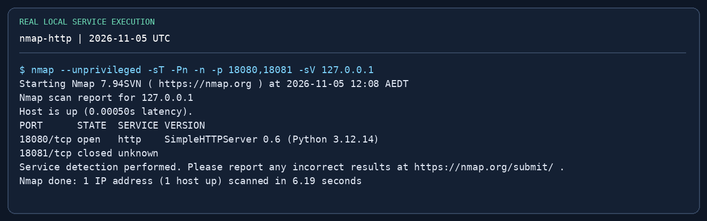
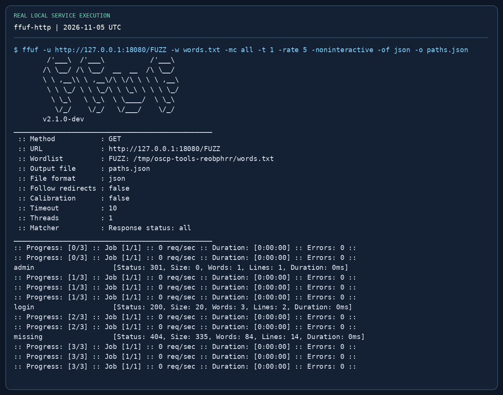
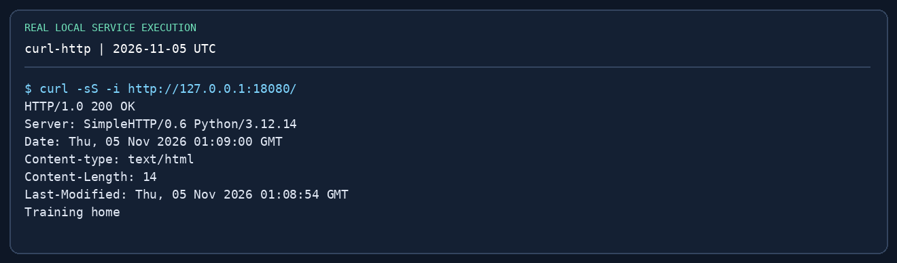
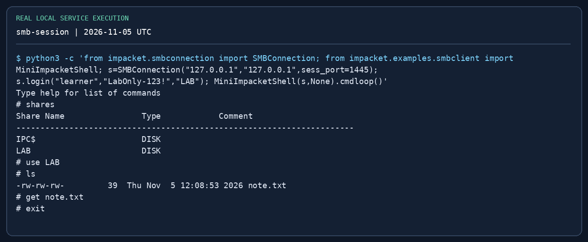
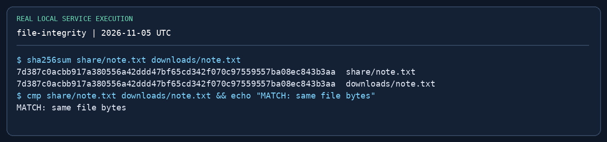

# Tool Practice: HTTP and SMB { #labs-tool-practice }

**Updated / 최종 수정:** 2026-11-05

!!! abstract "What you will actually run"
    A loopback-only HTTP service and authenticated SMB share. Discover HTTP with Nmap, fuzz three paths with ffuf, read the response with curl, transfer a harmless text file with Impacket, and compare its SHA-256. No Windows VM or domain is required.

**Prerequisites:** a Linux/Kali VM; Python 3, Nmap, ffuf, curl, Impacket; two terminals. Use only `127.0.0.1`. Ports 18080 and 1445 must be free. The high SMB port avoids root; it is for Impacket clients, not native Windows UNC access.

```bash
sudo apt install nmap ffuf curl impacket-scripts python3-impacket
mkdir -p ~/oscp-tool-lab/{web/admin,share,downloads}
cd ~/oscp-tool-lab
printf 'Training home
' > web/index.html
printf 'Training admin page
' > web/admin/index.html
printf 'Training login page
' > web/login
printf 'admin
login
missing
' > words.txt
printf 'OSCP practice: controlled SMB transfer
' > share/note.txt
```

These pages contain no vulnerable application and no exam material. A discovered `admin` path demonstrates enumeration, not compromise.

## 1. HTTP discovery and false positives { #http }

Terminal A:

```bash
cd ~/oscp-tool-lab
python3 -m http.server 18080 --bind 127.0.0.1 --directory web
```

Terminal B:

```bash
cd ~/oscp-tool-lab
nmap --unprivileged -sT -Pn -n -p 18080,18081 -sV 127.0.0.1
curl -i http://127.0.0.1:18080/
curl -i http://127.0.0.1:18080/missing
ffuf -u http://127.0.0.1:18080/FUZZ -w words.txt -mc all   -t 1 -rate 5 -noninteractive -of json -o paths.json
curl -i http://127.0.0.1:18080/admin/
```

**Read the result:** 18080 should be open; 18081 should be closed if unused. `admin` redirects to `/admin/`, `login` responds 200, `missing` responds 404. If the service name differs, trust the actual banner and port response rather than memorising the label. A 301 is a navigation hint. Use `curl -L` only after recording where it redirects.

{ loading=lazy }

{ loading=lazy }

{ loading=lazy }

**Failure drill:** stop Terminal A and repeat one curl command. Explain the difference between connection refused and HTTP 404. Restart the server before continuing.

## 2. Authenticated SMB transfer { #smb }

Terminal A (leave it running):

```bash
cd ~/oscp-tool-lab
impacket-smbserver LAB "$PWD/share" -smb2support -ip 127.0.0.1 -port 1445   -username learner -password 'LabOnly-123!'
```

Terminal B:

```bash
cd ~/oscp-tool-lab/downloads
# Impacket 0.13.1 CLI restricts -port to 139/445; use its API mini-shell here:
python3 -c 'from impacket.smbconnection import SMBConnection; from impacket.examples.smbclient import MiniImpacketShell; s=SMBConnection("127.0.0.1","127.0.0.1",sess_port=1445); s.login("learner","LabOnly-123!","LAB"); MiniImpacketShell(s,None).cmdloop()'
```

At the SMB `#` prompt:

```text
shares
use LAB
ls
get note.txt
exit
```

Back in the local shell:

```bash
cd ~/oscp-tool-lab
sha256sum share/note.txt downloads/note.txt
cmp share/note.txt downloads/note.txt && echo 'MATCH: same file bytes'
```

The two hashes must match; `cmp` exits 0 on identical bytes. You authenticated and read a permitted share, **not** obtained a Windows shell or domain admin. `shares` and `use LAB` happen in the SMB mini-shell; `sha256sum` happens in Bash.

{ loading=lazy }

{ loading=lazy }

**Failure drills:** (1) use the wrong password once and observe authentication failure; (2) use a nonexistent share and distinguish that from login failure; (3) change port 1445 to an unused high port and distinguish connection failure. No password loop is needed. Stop your servers with Ctrl-C after the exercise.

## 3. Add a Windows/AD lab next { #ad-next }

The loopback lab cannot validate LDAP, Kerberos, WMI, SCM, Windows tokens or replication. On your own isolated Windows domain or an authorised training range, provision a normal domain user, one member server, a DC and deliberately scoped test rights. Follow the [Impacket handbook](../impacket.md) and write down these observations:

| Drill | Success evidence | Expected denied case |
|---|---|---|
| Share read | Listing/download + matching file hash | Non-readable admin share |
| SPN / AS-REP | Account mapping and correctly identified hash format | Account not eligible for AS-REP |
| MSSQL | SQL identity, role membership and actual execution context | Login valid elsewhere but SQL permission absent |
| WMI / SCM | Verified identity in the target shell | Standard user cannot create an admin service |
| Offline SAM | Correct hive pair parsed into typed fields | Wrong/missing SYSTEM hive |
| DCSync | Only with deliberately granted replication rights | Member-host local admin is insufficient |
| Kerberos cache | Correct realm, hostname and selected cache | Wrong service hostname or expired cache |

Do not expect every technique on every OSCP set. Lab success is about understanding prerequisites and alternatives.

## 4. Capture provenance and limitations { #provenance }

The repository's `scripts/oscp-captures/capture.py` runs the local demonstrations and captures the upstream Impacket help output. `render.py` renders the exact captured text into PNGs without editing the output; the on-image title distinguishes help from an executed service interaction. Raw `.txt` logs and `manifest.json` record commands, versions, SHA-256 and capture time. The images are terminal-output renderings, not remote desktop/GUI screenshots. AD success screens are deliberately not invented.

Reproduce all repository captures from a Linux workspace:

```bash
python3 -m venv /tmp/oscp-captures-venv
/tmp/oscp-captures-venv/bin/pip install -r scripts/oscp-captures/requirements.txt
PATH="/tmp/oscp-captures-venv/bin:$PATH" python3 scripts/oscp-captures/capture.py
/tmp/oscp-captures-venv/bin/python scripts/oscp-captures/render.py
```

Install Nmap, ffuf and curl with your distribution first. These scripts use temporary loopback services, create only a temporary work directory, terminate their own children and write capture files under the repository. They do not contact a domain or scan a network. Port conflicts fail clearly instead of killing unrelated processes.

## Completion record { #completion }

Record the command, expected result, observed result, failure explanation and next action for each drill. Keep a target screenshot showing identity and IP in your Windows/AD mock report; the loopback file-transfer image is not a substitute for exam proof.

[Back to practical guide](../practical-guide.md) · [Impacket handbook](../impacket.md) · [Reporting](../reporting.md)
