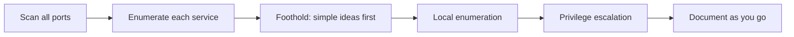

# Methodology & Habits

**Applies to:** every machine · **Last updated:** 2026-10-23

!!! abstract "In one sentence"
    Most lost points in write-ups come from missed enumeration or time sunk into rabbit holes — not from missing an advanced technique.

!!! note "How this page is organised"
    The habits that turn knowledge into points under a clock. Build these during practice so they run on autopilot in the exam.

## The per-machine loop { #loop }

## Enumeration checklist { #enumeration-checklist }

- **All ports, both protocols.** Full TCP (`-p-`), then service/version on what's open. Don't forget a UDP scan of common ports — SNMP and others hide there.
- **Read all the output.** The intended path is usually visible; the skill is noticing it, not finding something hidden.
- **Enumerate the boring things too.** A generic-looking service or an empty-looking share is often the way in.

## Simple things first { #simple-first }

Before any exploit chain, try the cheap ideas:

- Default credentials (`admin:admin`, product defaults), the username as the password, anonymous / blank logins.
- Password reuse — a credential from one box or user tried everywhere.
- "Nmap doesn't lie" — if a port is open, something is listening; find out what before assuming it's a dead end.

## Don't wait on scans { #parallel }

Long scans run in the background while you work. Found a WordPress plugin? Research it now; don't wait for the scan to finish. Keep two or three threads of investigation going at once.

## Rabbit holes { #rabbit-holes }

- **Time-box.** Give a lead a fixed budget (say 30–45 min). If it hasn't moved, note it and switch targets — come back with fresh eyes.
- **Not every hard thing is the path.** OffSec deliberately includes distractions. Good enumeration is also about *ruling things out*.
- **Backtracking is exhausting** — enumerate fully the first time so you don't have to redo a box at hour 15.

## Metasploit budget { #metasploit }

One target only, locked in once used ([exam rule](exam-format.md#metasploit)). Spend it where it helps most — many people save it for a privilege-escalation suggestion on a single stubborn box rather than an initial foothold. `msfvenom` and `multi/handler` are allowed everywhere.

## Notes and a personal cheat sheet { #notes }

- **One page per machine**, same structure every time: scan → enumeration → initial access → local enumeration → privilege escalation → flags. This *is* your report draft — see [Reporting](reporting.md).
- **Screenshot as you go**, including the proof requirements, so you're not re-hacking a box to get a missing screenshot.
- **Build a cheat sheet from your own mistakes**, not generic tips — the command you forgot, the step you skipped. That is the one resource no course gives you.

## Workflow setup { #workflow }

- Variables for target IP, your IP and the domain, so pivoting to a new box is one edit.
- A tidy folder per target; one terminal multiplexer (tmux) tab per machine.
- Your scripts, wordlists and payloads in known places before the exam starts.

## Mindset { #mindset }

- Feeling underprepared the night before is normal. If you've done the work, that feeling is a liar.
- Action kills anxiety — once the first scan is running, muscle memory takes over.
- Take real breaks and eat lightly. Burnout is a documented exam factor, not an excuse. Most breakthroughs come after stepping away.

## Related pages

- [Nmap](../../pentesting/recon/nmap/index.md) · [Reporting](reporting.md) · [Exam-day strategy](exam-day.md)

## References

- [ippsec.rocks](https://ippsec.rocks/) — search IppSec videos by technique
