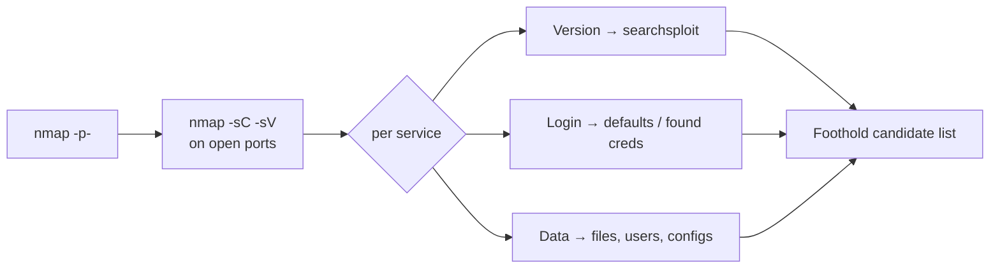

# Recon & Enumeration { #recon-enumeration }

<div class="dfir-meta" markdown>
**Applies to:** every machine, first hour · **Priority:** Highest · **Last updated:** 2026-11-03
</div>

!!! abstract "In one sentence"
    Find every open port, name every service and version, and pull everything an unauthenticated (or low-privileged) user can read — most OSCP footholds are sitting in this output, unnoticed.

!!! tip "Practical companion"
    For command selection, output interpretation and failure diagnosis, use the [practical field guide](practical-guide.md#nmap); for Windows/AD protocol detail, use the [Impacket handbook](impacket.md).

## 1. Concept { #concept }

Enumeration is two passes:

1. **Discovery** — which ports are open (all 65,535 TCP, plus the common UDP ones).
2. **Interrogation** — for each port: what software, what version, what does it let me see without credentials, and what does it let me see *with* the credentials I already have?

Output from pass 2 feeds three questions: *Is there a public exploit for this version?* · *Is there a login I can try defaults or found creds on?* · *Is there data (files, users, configs) that leaks a credential?*



## 2. Main tools { #tools }

| Tool | Use it for | Exam status |
|---|---|---|
| **nmap** (+ NSE) | Port discovery, versions, default scripts | Allowed (NSE explicitly) |
| **NetExec (`nxc`)** | SMB / WinRM / LDAP / MSSQL / RDP checks, null & guest sessions, shares, users | Allowed |
| **smbclient** | Browse and download SMB shares | Allowed |
| **enum4linux-ng** | One-shot SMB/RPC/LDAP enumeration (users, groups, policy, shares) | Allowed |
| **snmpwalk / snmp-check** | Users, processes, installed software over SNMP | Allowed |
| **showmount / mount** | NFS exports | Allowed |
| **ftp / nc / curl** | Banner grabbing, anonymous FTP, raw protocol poking | Allowed |

!!! danger "Exam rule — no mass vulnerability scanners"
    **Nessus, OpenVAS, NeXpose, Qualys and similar** are banned, and so are tools that do the same job (e.g. running a template-based vuln scanner across every host). Version detection with `nmap -sV`, NSE scripts and **searchsploit** are fine — do the "is this version vulnerable?" step yourself.

## 3. Scenarios { #scenarios }

### 3.1 nmap — new target, nothing known { #nmap }

**Situation:** A fresh IP in the control panel.

```bash
# 1) all TCP ports, fast
sudo nmap -p- --min-rate 2000 -Pn -oN nmap/all.txt $IP

# 2) scripts + versions on what is open
ports=$(grep -oP '^\d+(?=/tcp\s+open)' nmap/all.txt | paste -sd,)
sudo nmap -sC -sV -Pn -p$ports -oN nmap/svc.txt $IP

# 3) top UDP ports (SNMP, TFTP, IKE hide here)
sudo nmap -sU --top-ports 25 -Pn -oN nmap/udp.txt $IP
```

**What to read in the output:**

- `Service Info` / `OS` lines, `ssl-cert` `commonName`, `smb-os-discovery` → **hostnames and domain** → add to `/etc/hosts`.
- `http-title`, `http-generator`, `http-robots.txt` → app name and hidden paths.
- `ftp-anon: Anonymous FTP login allowed` → log in now.
- Unusual high ports (e.g. 8000, 8080, 8443, 9090, 5000) → second web app, admin panel, or custom service.
- Version strings → `searchsploit <product> <version>`.

**Next:** start on the first interesting port while the UDP scan finishes. If `-sV` returns `tcpwrapped` or `?`, poke it by hand: `nc -nv $IP <port>` and `curl -i http://$IP:<port>/`.

!!! tip "Rescan when something changes"
    After you get a shell or a pivot, rescan from the new vantage point. Ports filtered from Kali are often open from inside (`nmap -sT -Pn` through a tunnel → [Pivoting](pivoting.md)).

More nmap detail: [Nmap scanning](../../pentesting/recon/nmap/scanning.md) · [Service & NSE](../../pentesting/recon/nmap/service-nse.md) · [Output & performance](../../pentesting/recon/nmap/output-performance.md).

### 3.2 NetExec — a Windows host with SMB (445) { #netexec }

**Situation:** 445 is open. You want OS, domain, signing, and whether anonymous access works.

```bash
nxc smb $IP                                  # banner: name, domain, OS build, signing
nxc smb $IP -u '' -p '' --shares             # null session
nxc smb $IP -u 'guest' -p '' --shares        # guest
nxc smb $IP -u '' -p '' --users --pass-pol   # users + lockout policy (if allowed)
nxc smb $IP -u 'guest' -p '' --rid-brute     # usernames via RID cycling
```

**What to read:** `(name:FILES01) (domain:corp.local)` → `/etc/hosts`; any share with `READ` or `WRITE`; usernames (save to `users.txt`); `Account Lockout Threshold`.

**Next:** readable share → smbclient (below). Usernames → AS-REP roast / spray → [Active Directory](active-directory.md). Writable share → think about planting a file that makes a user connect back to you ([coercion](active-directory.md#coercion)).

### 3.3 smbclient — a readable share { #smbclient }

```bash
smbclient -L //$IP -N                         # list shares anonymously
smbclient //$IP/Shared -N                     # connect
smb: \> recurse ON
smb: \> prompt OFF
smb: \> mget *                                # pull everything
```

With credentials: `smbclient //$IP/Shared -U 'corp.local/user%Password1'`.

**What to look for in the files:** `*.config`, `web.config`, `*.ps1`, `*.bat`, `*.vbs` (hard-coded creds), `*.kdbx` (KeePass → [crack](password-attacks.md#john)), `*.xml` from Group Policy (`cpassword` → `gpp-decrypt`), backups (`*.bak`, `*.zip`), and **writable** directories.

```bash
grep -RniE 'pass(word)?|pwd|secret|cred' ./loot/ 2>/dev/null
```

### 3.4 enum4linux-ng — one-shot SMB/RPC summary { #enum4linux-ng }

**Situation:** You want the whole SMB/RPC picture in one run (good on Samba Linux boxes too).

```bash
enum4linux-ng -A $IP -oA loot/e4l          # anonymous
enum4linux-ng -A $IP -u user -p 'Password1'  # authenticated
```

**What to read:** `Domain/Workgroup`, `Users` (with descriptions — passwords are often left there), `Groups`, `Password policy`, `Shares` with `Mapping: OK`.

**Next:** descriptions with a password → try it everywhere. Samba version → searchsploit.

### 3.5 SNMP (161/UDP) { #snmp }

**Situation:** UDP scan shows `161/udp open snmp`.

```bash
onesixtyone -c /usr/share/seclists/Discovery/SNMP/common-snmp-community-strings.txt $IP
snmpwalk -v2c -c public $IP | tee loot/snmp.txt
snmpwalk -v2c -c public $IP 1.3.6.1.2.1.25.4.2.1.2    # running processes
snmpwalk -v2c -c public $IP 1.3.6.1.4.1.77.1.2.25     # Windows users
snmpwalk -v2c -c public $IP NET-SNMP-EXTEND-MIB::nsExtendObjects   # extend scripts (may show creds)
```

**What to read:** process command lines with passwords, installed software versions, usernames. **Next:** users → login attempts; software → searchsploit.

### 3.6 NFS (2049) { #nfs }

```bash
showmount -e $IP
sudo mkdir -p /mnt/nfs && sudo mount -t nfs -o vers=3,nolock $IP:/home /mnt/nfs
ls -la /mnt/nfs
```

**What to read:** SSH keys, configs, and the export options. `no_root_squash` on an export you can write to is a classic Linux privesc → [Linux privesc › NFS](privesc-linux.md#nfs).

### 3.7 FTP, SSH, databases and the rest { #other-services }

```bash
ftp $IP                        # try anonymous / anonymous
nc -nv $IP 25                  # SMTP: VRFY / EXPN user enumeration
smtp-user-enum -M VRFY -U users.txt -t $IP
mysql -h $IP -u root -p        # blank / root / found creds
impacket-mssqlclient sa:'sa'@$IP          # MSSQL defaults
ssh -v user@$IP                # auth methods offered; version
```

Port reference: [Well-known ports](../../basics/well-known-ports.md).

## 4. Common mistakes { #mistakes }

- **Only scanning the top 1000 ports.** A web app on 8443 or a service on 50000 is the way in more often than people expect. Always `-p-`.
- **Skipping UDP.** SNMP leaking a password or a process command line is a recurring OSCP pattern.
- **Not adding hostnames.** A vhost-based site shows a default page by IP and the real app by name.
- **Waiting for scans.** Start on port 80 while the full scan runs.
- **Ignoring "boring" results.** An anonymous FTP with an empty-looking directory may be writable — and served by the web server.
- **Not re-enumerating with credentials.** Every new credential means re-running `nxc`, `smbclient`, `enum4linux-ng` — the view changes.

## 5. Exam tips { #exam-tips }

- Keep `nmap/all.txt` and `nmap/svc.txt` per target — they go straight into the report.
- Make a running `users.txt` and `creds.txt` per environment from the first minute.
- If a version looks vulnerable, write the CVE and exploit path in your notes **before** trying it — it saves re-research after a revert.
- NetExec output with `[+]` means valid credentials; `(Pwn3d!)` means **local admin** on that host.

## Related pages

- [Exam workflow](exam-workflow.md) · [Web & initial access](web-initial-access.md) · [Active Directory](active-directory.md)
- [Nmap](../../pentesting/recon/nmap/index.md) · [Well-known ports](../../basics/well-known-ports.md)
- Defender view: [Network](../../network/index.md) (what scans look like in Zeek / Wireshark)

## References

- [NetExec wiki](https://www.netexec.wiki/)
- [enum4linux-ng](https://github.com/cddmp/enum4linux-ng)
- [HackTricks — Pentesting network services](https://book.hacktricks.xyz/)
