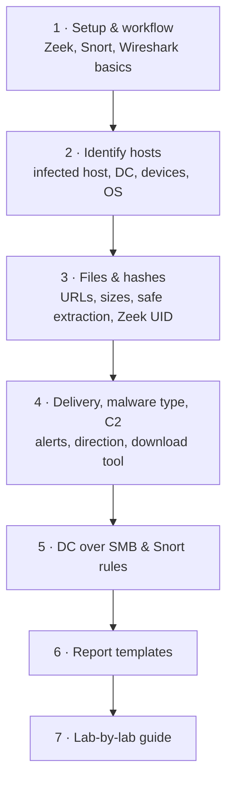

# PCAP Incident Response Labs { #pcap-ir-labs }

!!! abstract "What this section is"
    Eight hands-on incident response exercises, each built around one PCAP: "a computer on the network is behaving oddly, here is the capture, answer the questions and show your commands." The eight labs ask about 70–80% of the same things, so this section **merges the common work into topic pages** and keeps **what is different in each lab** on a separate lab-by-lab page. Every step is shown three ways: **tshark**, **Zeek** (with Snort 2 for alerts), and the **Wireshark GUI**.

## How to use this section { #how-to-use }

Read pages 1–6 once in order. They teach the repeatable workflow. When you sit a lab, open the [lab-by-lab guide](lab-guide.md): every question there links to the exact section that answers it.

Read it top to bottom: the first five pages follow the order of a real investigation (prepare → who → what was downloaded → how and where to → spread inside), page 6 turns findings into short English answers, and page 7 maps each lab's questions back onto those pages.

## Pages { #pages }

-   :material-play-circle-outline:{ .lg .middle } **1 · Setup and the Standard Workflow**

    ---

    capinfos, generating Zeek logs and Snort alerts, the four Wireshark techniques you use for everything, UTC time and timelines.

    [:octicons-arrow-right-24: Setup and workflow](setup-and-workflow.md)

-   :material-account-search:{ .lg .middle } **2 · Identifying Hosts**

    ---

    Infected host IP, MAC, hostname and user account; the Domain Controller; active hosts; fingerprinting phones, tablets and Linux boxes; OS; key network information; public IP.

    [:octicons-arrow-right-24: Identifying hosts](host-identification.md)

-   :material-file-search:{ .lg .middle } **3 · Downloads, Files and Hashes**

    ---

    Listing downloads, full URLs and sizes, extracting from HTTP/SMB/FTP, safe handling, real file type, hashing, Zeek UID/fuid correlation, macros in Word documents.

    [:octicons-arrow-right-24: Files and hashes](files-and-hashes.md)

-   :material-bug:{ .lg .middle } **4 · Delivery, Malware Type and C2**

    ---

    Reading Snort alerts, naming the malware type, email vs link vs exploit kit, what tool started a download, internal vs external source, post-infection traffic.

    [:octicons-arrow-right-24: Delivery and C2](malware-delivery-and-c2.md)

-   :material-server-network:{ .lg .middle } **5 · SMB Attacks on the DC and Snort Rules**

    ---

    Spread to the Domain Controller over SMB, telling apart failed attempts on TCP 445, and writing and testing your own Snort 2 rules.

    [:octicons-arrow-right-24: DC, SMB and Snort rules](dc-smb-and-snort-rules.md)

-   :material-text-box-edit:{ .lg .middle } **6 · Report Answer Templates**

    ---

    Short English answer templates: compromise summaries, network information, download details, safe-handling steps.

    [:octicons-arrow-right-24: Report templates](report-templates.md)

-   :material-format-list-numbered:{ .lg .middle } **7 · Lab-by-Lab Guide**

    ---

    The eight labs: what each one focuses on, each question linked to the section that answers it.

    [:octicons-arrow-right-24: Lab-by-lab guide](lab-guide.md)

## Notation { #notation }

- Commands assume the capture is called `case.pcap`, Zeek logs are in `zeek_out/` and Snort output is in `snort_out/`.
- **All example output on these pages is fake.** Values such as `172.xx.xx.xx`, `<infected IP>` or `Cxxxx` only show the *shape* of the output. Run the commands on your own PCAP to get real answers.
- Placeholders in angle brackets (`<DC_IP>`, `<infected IP>`) are values you fill in from an earlier step.
- Times in answers are always UTC.

!!! warning "Working with live malware"
    Files carved from these PCAPs are real malware. Work in an isolated analysis VM, never open or run them, and look up hashes rather than uploading files. See [Handling samples safely](files-and-hashes.md#safe-handling).

!!! note "About these pages"
    Personal study notes written from my own lab work. Not official guidance of any organisation.
