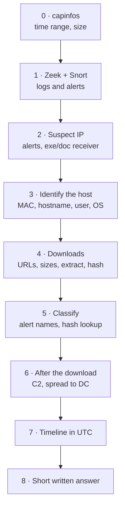

# 1 — Setup and the Standard Workflow { #setup-and-workflow }

!!! abstract "Scope of this page"
    - One fixed order of work that answers almost every lab question
    - Step 0: file overview with `capinfos`
    - Turning the PCAP into Zeek logs and Snort 2 alerts, and reading them with `zeek-cut` and `grep`
    - The four Wireshark techniques that replace almost every tshark option
    - Why every answer is in UTC, and how to build a timeline

## The standard workflow { #workflow }

Every lab is the same story: one Windows (or other) machine received something it should not have, and you have to prove who, what, when, from where and what happened next. Doing the steps in the same order every time is faster than reading the questions first.



Read top to bottom. Steps 2–3 answer "who", step 4 "what and from where", steps 5–6 "what it is and what it did", and step 7 puts it all in order for the final written explanation.

## Step 0: file overview { #capinfos }

```bash
capinfos case.pcap
```

- `capinfos` ships with Wireshark and summarises a capture: number of packets, first and last packet time, size.

```text
Number of packets:   xx k
First packet time:   ...
Last packet time:    ...
```

Wireshark: **Statistics → Capture File Properties** (same information) and **Statistics → Protocol Hierarchy** (how much HTTP, TLS, Kerberos, DHCP, SMB there is).

## Generating Zeek logs { #zeek }

```bash
mkdir zeek_out && cd zeek_out
zeek -C -r ../case.pcap local
ls *.log
cd ..
```

- `-r ../case.pcap`: read this file instead of a live interface.
- `-C`: ignore checksum errors. Captures often have wrong checksums because of NIC offloading; without `-C` Zeek drops those packets and logs can come out empty.
- `local`: load the default site policy. It adds `software.log`, MD5/SHA1 hashes in `files.log` and certificate validation in `ssl.log`.

```text
conn.log  dhcp.log  dns.log  files.log  http.log  kerberos.log
ntlm.log  smb_files.log  smb_mapping.log  software.log  ssl.log  x509.log ...
```

### Reading Zeek logs with zeek-cut { #zeek-cut }

`zeek-cut` prints only the columns you name.

```bash
zeek-cut id.orig_h query < zeek_out/dns.log
zeek-cut -u ts id.orig_h host uri < zeek_out/http.log
```

- `id.orig_h` / `id.orig_p`: the side that **started** the connection (usually the client).
- `id.resp_h` / `id.resp_p`: the side that **answered** (usually the server).
- `-u`: convert the epoch timestamp `ts` into a readable UTC date and time.
- Put `zeek-cut` **before** `grep`, not after. `zeek-cut` finds columns by reading the header lines at the top of the log; if `grep` runs first, the header is gone and `zeek-cut` prints nothing.
- Some field names changed between versions (for example `files.log` used `tx_hosts`/`rx_hosts`/`conn_uids` in older Bro/Zeek and `id.orig_h`/`id.resp_h`/`uid` in Zeek 6+). Check with `zeek --version` and `head -8 files.log`.

## Generating Snort alerts { #snort }

```bash
mkdir snort_out
sudo snort -q -k none -y -U -r case.pcap -c /etc/snort/snort.conf -A fast -l snort_out
cat snort_out/alert
```

- `-q`: hide the start-up banner.
- `-k none`: do not verify checksums (same reason as Zeek's `-C`).
- `-y`: include the year in alert timestamps (fast alerts show only month/day otherwise).
- `-U`: write timestamps in UTC instead of the analysis machine's time zone.
- `-r case.pcap`: read the capture. `-c`: the config file that loads the rules.
- `-A fast`: one line per alert. `-l snort_out`: write output to this folder.

!!! warning "Rules matter"
    Malware alerts (Emotet, IcedID, Trickbot, exploit kits…) only appear if `snort.conf` includes a current rule set such as **ET Open**. With only the default rules you may see nothing.

One fast-alert line (fake example). The part after `{TCP}` is `source -> destination`:

```text
xx/xx/xx-xx:xx:xx.xxxxxx [**] [1:xxxxxxx:x] ET MALWARE ... CnC Beacon [**] [Classification: A Network Trojan was detected] [Priority: 1] {TCP} 172.xx.xx.xx:49xxx -> x.x.x.x:8080
```

Useful one-liners:

```bash
grep -oE "ET [A-Z_]+" snort_out/alert | sort | uniq -c | sort -rn
grep -oE "\] ET [^\[]*" snort_out/alert | sort | uniq -c | sort -rn
grep -oE "[0-9.]+:[0-9]+ -> [0-9.]+:[0-9]+" snort_out/alert | sort | uniq -c | sort -rn | head
```

- Line 1: alert **categories** (`EXPLOIT_KIT`, `MALWARE`, `TROJAN`, `POLICY`, `CURRENT_EVENTS`…).
- Line 2: full alert **names**. `[^\[]*` means "everything up to the next `[`".
- Line 3: the most frequent `source -> destination` pairs.

## Wireshark essentials { #wireshark }

Almost every tshark option has a GUI equivalent. Learn these four and every later page reads naturally.

**① Display filter bar = tshark `-Y`.** Type the filter in "Apply a display filter…" and press Enter. Green means valid, red means a syntax error. The text inside tshark's `-Y "..."` goes in unchanged.

**② Apply as Column = tshark `-T fields -e`.**

1. Click a packet.
2. In the Packet Details pane, expand ▶ until you see the field (for example `User-Agent`).
3. Right-click it → **Apply as Column**. Clicking the column header sorts it, which also replaces `sort`.

**③ Statistics menu = `sort | uniq -c`.**

- **Statistics → Endpoints**: packets per IP (`-z endpoints,ip`). Tabs for IPv4, TCP, Ethernet.
- **Statistics → Conversations**: who talked to whom, with bytes and duration.
- **Statistics → HTTP → Requests** and **Request Sequences**: hosts and URLs, and which page led to which request.
- Tick **Limit to display filter** at the bottom of Endpoints/Conversations to count only the packets your current filter shows. That is the same as "`-Y` filter + `uniq -c`".

**④ Right-click → Apply as Filter → Selected.** Builds a filter from any value in Packet Details, so you do not need to remember the syntax.

Other features used in these labs:

- **View → Time Display Format → UTC Date and Time of Day**: show real UTC times.
- **File → Export Objects → HTTP / SMB / TFTP / IMF**: carve transferred files.
- **Right-click → Follow → TCP/HTTP Stream**: read a whole conversation. Red is the client, blue is the server.
- **Edit → Find Packet** (Ctrl+F) with **String** in **Packet bytes**: search inside payloads.
- **Right-click → Set/Unset Time Reference**: make a packet "time zero" so later packets show +seconds.
- **Mark/Unmark Packet** (Ctrl+M): bookmark packets you will cite in the report.
- **Edit → Configuration Profiles**: create a profile such as "IR-Lab" so the extra columns do not clutter your normal layout.

## Time: always UTC { #utc }

Answers use UTC. The same packet shows different local times on different analysis machines, so local times cause wrong answers.

- tshark: use the field `frame.time_utc`, or the option `-t ud`.
- Zeek: `zeek-cut -u`.
- Snort: `-U` (and `-y` for the year).
- Wireshark: **View → Time Display Format → UTC Date and Time of Day**.

!!! tip "Comparing times in awk"
    UTC timestamps in `YYYY-MM-DDTHH:MM:SS` form sort the same way as text, so `awk -F'\t' '$1 > "2019-01-01T10:00:00"'` keeps only lines after that time.

## Building a timeline { #timeline }

The final question of every lab ("explain this compromise") is a timeline in sentences. Pull the infected host's web activity in order:

```bash
tshark -r case.pcap -Y "ip.src==<infected IP> && (http.request || tls.handshake.type==1)" \
  -T fields -e frame.time_utc -e ip.dst -e tcp.dstport -e http.host -e http.request.uri \
  -e tls.handshake.extensions_server_name
```

- `tls.handshake.type==1`: only the first packet of each HTTPS connection (Client Hello), so HTTPS destinations appear in time order next to HTTP requests.
- `tls.handshake.extensions_server_name`: the domain (SNI) the client asked for.

Wireshark: set UTC time, apply the same filter, and read Host and Server Name columns top to bottom. Mark the key packets as you go.

!!! note "About these pages"
    Personal study notes. Not official guidance of any organisation.
