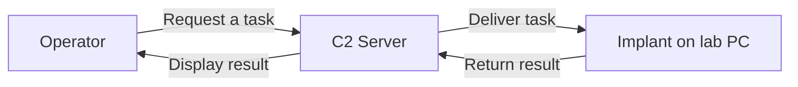

# Lesson 1 — C2 Fundamentals { #lesson-1-c2-fundamentals }

**Goal:** Explain what C2 does and why a connection does not automatically grant administrator privileges.

## Where the lecture starts { #where-the-lecture-starts }

**Lecture:** The workshop uses an **assumed-breach** model. We begin with the ability to run a program on a lab workstation and study what happens afterward. Initial access is assumed rather than reproduced in this lesson.

**Supplement:** Running a program and having administrator rights are different capabilities. A program launched as an ordinary user generally starts with that user's permissions. Using Sliver does not itself remove those limits.

## What C2 means { #what-c2-means }

**C2** means **Command and Control**: a system for delivering tasks, managing remote communication, and collecting results. The two words beginning with C give the abbreviation its name.

Imagine asking a remote lab PC for the current user's name. A program on that PC must receive the request, perform the task, and return the answer. C2 organizes that exchange.

The arrows show the logical task flow. They do not specify who initiates a network connection. An implant can contact the server first and receive tasks through that communication.

| Term | Meaning | Analogy |
|---|---|---|
| Operator | Person assigning tasks and reading results | Work coordinator |
| C2 server | System managing communication, tasks, and results | Operations office |
| Implant | Software running on the lab PC and performing tasks | Field worker |

An implant here is software, not a physical device. C2 is a general capability; **Sliver** is one framework implementing it. Bishop Fox describes Sliver as an open-source, cross-platform framework for authorized adversary emulation and red-team testing. [Official repository](https://github.com/BishopFox/sliver)

## Why use a framework instead of only a reverse shell? { #why-use-a-framework }

A **shell** is an interface for issuing commands and receiving output. In a **reverse shell**, the target side initiates a connection toward the operator's side to provide remote command input and output.

One short-lived connection may be manageable by hand. With multiple computers, an operator also needs to identify hosts, track tasks, distinguish results, and handle interruptions. A C2 framework provides structure for those activities.

| Aspect | Simple reverse shell | C2 framework |
|---|---|---|
| Main purpose | Remote command input/output | Organized remote task and connection management |
| Multiple hosts | Often managed separately | Host identification and selection features |
| Task handling | Commonly tied to a direct interaction | Can include interactive and queued tasking |
| Additional capabilities | Depend on the implementation and extra tools | Built-in features and extensions |

**Supplement — correction:** A reverse shell is not inherently unencrypted. Encryption depends on its implementation and transport. The useful distinction is the breadth of management and tasking features, not a universal encrypted/unencrypted split.

## Four separate questions { #four-separate-questions }

| What has been established? | What does not automatically follow? |
|---|---|
| C2 communication | Administrator privileges |
| Code execution on one PC | Access to another PC |
| A currently running implant | Automatic execution after a reboot |

Keep these concepts separate: **connectivity, privilege, reachability/access, and persistence**. For example, a browser can contact a server while running as an ordinary user; outbound communication is not proof of administrator rights.

## The defender's view { #the-defenders-view }

An external connection alone does not prove malicious C2. Updaters, messengers, and legitimate remote-management tools also contact servers and receive instructions.

Look at the surrounding evidence:

- Which process made the connection, and how did it start?
- Which user account was involved?
- What destination was contacted?
- What actions happened before and after the communication?

An unfamiliar program contacting a new destination and then accessing sensitive files provides a different evidential picture from an approved updater performing a scheduled update. The conclusion comes from correlated evidence, not the word “C2” or the presence of traffic alone.

## Review questions { #review-questions }

1. An implant running as an ordinary user contacts the C2 server. Has it automatically gained administrator rights?
2. A program periodically contacts an external server. Is that fact sufficient to classify it as malicious C2?

??? success "Answers and reasoning"
    **1. No.** Network communication may be available to ordinary user programs. A successful connection does not demonstrate a change of privilege.

    **2. No.** Normal applications also communicate externally. Investigate the process, destination, execution context, and associated activity.

[Continue to Lesson 2 — Components and commands](lesson-2-components-and-commands.md)
