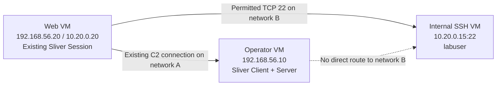
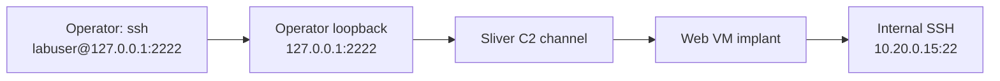
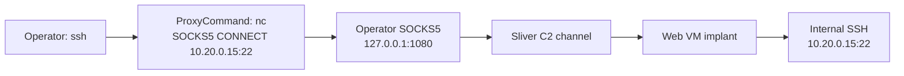

# Lesson 10 — Web Server to Internal SSH: A Virtual Lab { #lesson-10-web-server-to-internal-ssh-lab }

**Goal:** Use a web-server VM's existing Sliver session to reach an internal SSH service, then distinguish tunnel operation, server identity, user authentication, and account permissions.

**Supplement / illustrative lab:** These are worked command examples for learner-owned VMs. They describe expected observations; they are not a report of commands executed on your machines.

## Scenario and starting point { #scenario-and-starting-point }

An externally reachable web server can be an intermediate host when it also has a permitted connection to an internal service. This is a realistic architecture to model, but web-server access to internal SSH is an explicit lab condition, not a property of every web server.

We start **after an authorized Linux implant has established a working Sliver Session on the web VM**. Having a web-administration login alone would not establish that condition. No additional implant on the internal SSH VM is required for these forwarding exercises.

The web VM uses Linux in this lesson. The Windows executable used earlier does not run natively on this Linux VM. The identity of its implant process may be a low-privilege web-service account; that does not become `root` simply because forwarding works.

## Three VMs and two virtual networks { #virtual-network-layout }

All three machines belong to the isolated lab. “External” describes the operator's role relative to the internal network; the web server does not need public Internet exposure.

| VM | OS / hostname | Network A | Network B | Role |
|---|---|---|---|---|
| Operator | Linux / `operator-lab` | `192.168.56.10/24` | None | Sliver Client and Server, SSH client |
| Web server | Ubuntu / `web-lab` | `192.168.56.20/24` | `10.20.0.20/24` | Existing Linux implant Session; intermediate host |
| Internal SSH | Ubuntu / `ssh-lab` | None | `10.20.0.15/24` | OpenSSH on TCP 22; ordinary lab account `labuser` |

Use two separate virtual switches. Attach the operator only to A, the internal SSH VM only to B, and the web VM to both. Configure the listed addresses inside the guests. Keep the operator without a separate route into B. Hypervisor or host routing must not accidentally provide another direct path.



This layout gives the web VM its own connection to each network. Application forwarding makes an outbound connection from the implant; enabling kernel IP forwarding on the web VM is not required for this exercise. If your lab instead uses a router or firewall, it must allow the web VM to reach `10.20.0.15:22` and allow the existing C2 connection.

Before starting, OpenSSH must be running on the internal VM. The learner must already have a valid `labuser` login permitted by that server's policy. The examples below assume a lab password is permitted; enter it at the prompt. Key-based authentication is also shown below for a lab key that has already been provisioned.

The operator and web VMs use the **OpenBSD implementation of `nc`**, available as `netcat-openbsd` on Ubuntu. Other programs named `nc` can have different options.

## Establish a baseline from each VM { #baseline-checks }

On the **internal SSH VM's own console**, record its hostname and host-key fingerprint:

```bash
hostname
ssh-keygen -lf /etc/ssh/ssh_host_ed25519_key.pub
```

The expected hostname is `ssh-lab` if you assigned it during setup. Keep the displayed `SHA256:...` fingerprint for comparison at first SSH connection. This assumes the server has an Ed25519 host key. If it uses another host-key type, record that actual public host key instead. The fingerprint identifies the SSH server; it is separate from the user's password or login key. [OpenSSH fingerprint options](https://man.openbsd.org/ssh-keygen)

On the **operator VM's Linux terminal**, attempt the direct connection:

```bash
nc -vz -w 3 10.20.0.15 22
```

With the intended separation, this direct attempt fails. The exact message can be a routing error or a timeout, depending on the lab. Failure alone does not prove that a firewall blocked it; it establishes that this attempt did not connect.

On the **web VM's own Linux console**, run the same check:

```bash
nc -vz -w 3 10.20.0.15 22
```

A success message supports a TCP connection from the web VM to that address and port. The `-z` option performs a connection check; it does not log in or verify the server's SSH identity. These two baseline checks are run from the VM consoles to make the different network paths easy to see. [OpenBSD nc options](https://man.openbsd.org/nc)

## Select the web VM's Session { #select-web-session }

In the **Sliver console on the operator VM**:

```text
sessions
sessions --interact <Web_Session_ID>
info
help portfwd
help socks5
```

Replace `<Web_Session_ID>` with the actual session ID shown by your console, without angle brackets. Check that the selected host is the web VM. Both methods below use this live Session. If you currently have only a Beacon, follow [Lesson 9's interactive-session steps](lesson-9-port-forwarding-and-socks.md#interactive-session) and wait for the additional Session before continuing.

## Method A: a fixed forward to SSH { #fixed-forward-to-ssh }

The mapping is **operator loopback port 2222 → internal SSH port 22**. These two port numbers do not need to match.



In the **Sliver console with the web Session selected**:

```text
portfwd add --bind 127.0.0.1:2222 --remote 10.20.0.15:22
portfwd
```

`--bind` creates the local listening address on the operator's console machine. `--remote` fixes the destination that the web implant will contact. The forward does not require an SSH login to the web VM: its already established implant Session carries the connection. [Sliver port-forward flags](https://github.com/BishopFox/sliver/blob/master/client/command/portfwd/commands.go), [client-side forwarding implementation](https://github.com/BishopFox/sliver/blob/master/client/command/portfwd/portfwd-add.go)

In a **separate operator Linux terminal**:

```bash
ssh -o ConnectTimeout=10 -p 2222 labuser@127.0.0.1
```

| Part | Meaning |
|---|---|
| `ssh` | Start the SSH client on the operator VM |
| `-o ConnectTimeout=10` | Bound connection establishment and the initial SSH handshake; this does not limit the whole login session |
| `-p 2222` | Connect to the local forwarded port |
| `labuser@127.0.0.1` | Request the internal server's `labuser` account through that local endpoint |

At the first connection, compare the host-key fingerprint with the one recorded on the **internal VM**. Accept it only when it matches. Although the client addresses `127.0.0.1:2222`, the SSH server answering through this mapping is the internal VM. OpenSSH can record it under `[127.0.0.1]:2222` in `known_hosts`. [OpenSSH client behavior](https://man.openbsd.org/ssh)

Then enter the password for the internal VM's lab account when prompted. The network path and user authentication are separate steps. A valid password or accepted user key is still required. [SSH authentication protocol](https://www.rfc-editor.org/info/rfc4252/)

If your lab instead provisioned a user key, the operator-side command can be:

```bash
ssh -i ./labuser_ed25519 -o IdentitiesOnly=yes -o ConnectTimeout=10 -p 2222 labuser@127.0.0.1
```

Here `./labuser_ed25519` is your pre-provisioned **user private key on the operator VM**. It is not the server's public host-key file, and the forwarding command does not create it.

After successful login, run these commands in the **SSH shell now open on the internal VM**:

```bash
hostname
whoami
id
```

Illustrative results are `ssh-lab`, `labuser`, and that account's UID/group information. This supports successful login and command execution as that account. It does not establish `root` access or permission to modify every file. End the SSH shell with:

```bash
exit
```

## Method B: SSH through SOCKS5 { #ssh-through-socks5 }

This method uses the same web Session, but a SOCKS5-aware helper supplies the final destination for each connection.



In the **Sliver console**, with the web Session selected:

```text
socks5 start --host 127.0.0.1 --port 1080
socks5
```

This creates a local SOCKS5 listener on the operator VM. Its destination is supplied by the client connection rather than the `socks5 start` command. [Sliver SOCKS5 flags](https://github.com/BishopFox/sliver/blob/master/client/command/socks/commands.go), [listener implementation](https://github.com/BishopFox/sliver/blob/master/client/command/socks/socks-start.go)

In a **separate operator Linux terminal** using OpenBSD `nc`:

```bash
ssh -o 'ProxyCommand=nc -X 5 -x 127.0.0.1:1080 %h %p' labuser@10.20.0.15
```

| Part | Meaning |
|---|---|
| `ProxyCommand=...` | Have SSH use this helper for its connection stream |
| `nc -X 5` | Use SOCKS version 5 |
| `-x 127.0.0.1:1080` | Contact the operator's local SOCKS5 listener |
| `%h` | OpenSSH substitutes the destination hostname/IP: `10.20.0.15` here |
| `%p` | OpenSSH substitutes the SSH destination port: 22 here |
| `labuser@10.20.0.15` | Request the internal server and its lab account |

The single quotes preserve the complete helper command as one SSH option. The `%h` and `%p` tokens are expanded by OpenSSH; you do not manually replace them. This syntax assumes the stated OpenBSD `nc` implementation. [OpenSSH ProxyCommand](https://man.openbsd.org/ssh_config#ProxyCommand), [OpenBSD nc SOCKS options](https://man.openbsd.org/nc)

Verify the internal server's host-key fingerprint and authenticate with its lab account as in Method A. Because this command names `10.20.0.15` rather than `[127.0.0.1]:2222`, OpenSSH may ask to confirm that address's host key separately even when the server is the same.

After login, use `hostname`, `whoami`, and `id`, then `exit`. The key-based alternative is:

```bash
ssh -i ./labuser_ed25519 -o IdentitiesOnly=yes -o 'ProxyCommand=nc -X 5 -x 127.0.0.1:1080 %h %p' labuser@10.20.0.15
```

Starting SOCKS5 alone does not change an ordinary `ssh labuser@10.20.0.15` into a proxied connection. The explicit `ProxyCommand` provides that behavior in this example.

## Compare what the client connects to { #compare-client-targets }

| Observation | Fixed forward | SOCKS5 |
|---|---|---|
| Address in the SSH command | `127.0.0.1`, port 2222 | `10.20.0.15`, default port 22 |
| Local listener | `127.0.0.1:2222` | `127.0.0.1:1080` |
| Who chooses the internal destination? | Sliver forwarding configuration | SSH destination passed through the helper |
| Actual SSH server | Internal VM | Internal VM |
| Account being authenticated | Internal VM's `labuser` | Internal VM's `labuser` |

Neither method automatically opens an SSH session on the web VM first. The web implant relays the connection, while SSH authentication remains between the operator's SSH client and the internal SSH service.

## Diagnose the stage that failed { #diagnose-the-stage }

| Result | Interpretation and next check |
|---|---|
| Direct operator connection fails | Expected for this layout; verify the baseline rather than assuming a specific blocking cause |
| Web VM cannot connect to internal TCP 22 | Check guest addresses, virtual adapters, route, service, and firewall; a tunnel cannot repair this missing path |
| Sliver reports a bind/listen error | Inspect whether the chosen operator-side port is already in use |
| SSH reports connection refused on local port 2222 | Check that the forward is active on this operator machine; do not assume the internal server refused it |
| SSH times out through a forward | Inspect the Session, intermediate-to-internal path, and service; the timeout alone does not locate the fault |
| SSH displays a host-key prompt | Key exchange reached an SSH-speaking endpoint; compare its fingerprint before trusting its identity |
| SSH displays `Permission denied (publickey,password)` | User authentication was not accepted; inspect the account, permitted methods, and provided credentials |
| Login succeeds but a later file operation is denied | Check that account's rights for that operation and object |

The authentication error is illustrative; the method list depends on the server. It is different from proving that the entire tunnel failed.

For defensive observation on the **internal Ubuntu VM's administrative console**, inspect recent SSH service records:

```bash
sudo journalctl -u ssh.service --since "10 minutes ago" --no-pager
```

Depending on the Ubuntu installation, authentication records can also appear in `/var/log/auth.log`. With this two-network layout and no NAT between the web and internal VM, the internal service normally sees the connection from the web VM's internal address, `10.20.0.20`. Correlate timestamps, accepted or failed authentication, and the actual logged source. A source address alone does not identify the person controlling the connection. [Ubuntu OpenSSH logging guidance](https://ubuntu.com/server/docs/how-to/security/openssh-server/)

## Finish and remove the exercise listeners { #cleanup }

Exit any SSH shell first. In the **Sliver console**, list the two sets of entries and remove only those created in this exercise:

```text
portfwd
portfwd rm --id <Forward_ID>
socks5
socks5 stop --id <Proxy_ID>
```

Use the actual IDs from the corresponding lists. Keep the entry IDs distinct from Session IDs. Removing these local listeners ends their use for new connections; it does not delete a lab account or uninstall the internal SSH service.

## Review questions { #review-questions }

1. In Method A, why does `labuser@127.0.0.1` authenticate to the internal VM rather than the operator VM?
2. Does a web VM's successful TCP 22 check prove that its implant knows a valid SSH password?
3. With Sliver SOCKS5 running, what is missing from an ordinary `ssh labuser@10.20.0.15` command in this lab?
4. You log in successfully as `labuser`. Has administrator access been established?

??? success "Answers and reasoning"
    **1. The local port is mapped to the internal service.** SSH connects to loopback port 2222, and Sliver carries that stream to `10.20.0.15:22` through the web implant. The internal SSH service supplies the host key and authenticates the user.

    **2. No.** That check establishes a TCP path from the web VM. The internal service still requires valid authentication. The lab deliberately supplies a known account; the tunnel supplies connectivity.

    **3. Explicit proxy use.** The shown `ProxyCommand` asks `nc` to negotiate a SOCKS5 connection for the SSH stream. Simply starting a listener does not redirect an ordinary client.

    **4. No.** It establishes the accepted account and, after successful commands, execution in that login context. Its permissions on each resource remain a separate question.

[Previous: Port forwarding and SOCKS5](lesson-9-port-forwarding-and-socks.md) · [Return to the course overview](index.md)
