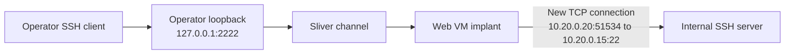

# Lesson 11 — Pivot Connections and SSH Evidence { #lesson-11-pivot-connections-and-ssh-evidence }

**Goal:** Read an internal server's SSH records without confusing a network peer, a human operator, TCP connectivity, and successful authentication.

**Supplement:** Continue the three-VM exercise from [Lesson 10](lesson-10-web-server-to-internal-ssh-lab.md). All outputs below are illustrative rather than measurements from the reader's machines.

## Keep the lab connection open { #keep-the-lab-connection-open }

| Role | Address |
|---|---|
| Operator | `192.168.56.10` |
| Web VM, external side | `192.168.56.20` |
| Web VM, internal side | `10.20.0.20` |
| Internal SSH server | `10.20.0.15:22` |

With the web VM's Session selected, the **Sliver console** creates the forward:

```text
portfwd add --bind 127.0.0.1:2222 --remote 10.20.0.15:22
```

In a **separate operator Linux terminal**, connect and authenticate with the pre-provisioned internal lab account. Verify the server host key as explained in Lesson 10:

```bash
ssh -p 2222 labuser@127.0.0.1
```

Keep this connection open while observing it from the internal VM's separate administrative console.

## Which source does the internal server see? { #which-source-does-the-server-see }

The web implant creates a new TCP connection to the internal server. In this topology, without intervening NAT or another proxy, the server normally sees the web VM's internal address, not the operator's address.



`51534` is an illustrative temporary source port. Its actual value changes. The SOCKS5 method has the same internal-facing principle: the web implant connects to the requested internal service. An additional NAT or proxy could change the source address observed by the server.

## Read SSH authentication records { #read-ssh-authentication-records }

On the **internal Ubuntu VM's administrative console**:

```bash
sudo journalctl -u ssh.service --since "10 minutes ago" --no-pager
```

`journalctl` reads the journal; `-u` selects the service, `--since` sets the time window, and `--no-pager` prints directly. Administrative log access here does not imply that the ordinary SSH account `labuser` has administrator rights. Depending on installation, authentication records can also appear in `/var/log/auth.log`. [Ubuntu OpenSSH guidance](https://ubuntu.com/server/docs/how-to/security/openssh-server/)

An illustrative record is:

```text
Oct 24 11:30:05 ssh-lab sshd[2401]: Accepted password for labuser from 10.20.0.20 port 51534 ssh2
```

| Field | Interpretation |
|---|---|
| `ssh-lab` | Server recording the event |
| `sshd[2401]` | Logging process name and PID; names vary by OpenSSH version |
| `Accepted password` | Password authentication was accepted |
| `for labuser` | Account authenticated |
| `from 10.20.0.20` | Peer source address observed by the server |
| `port 51534` | Peer source port, not the server's listening port |
| `ssh2` | SSH protocol-version information |

The supported conclusion is: **this server accepted password authentication for `labuser` on a connection it observed from `10.20.0.20`.** This alone does not identify the person controlling it, prove Sliver was involved, establish administrator rights, or record later commands. Accepted authentication also does not by itself establish that a requested interactive shell opened successfully.

## Why the port is not 2222 or 1080 { #different-ports-have-different-roles }

| Port | Role in this exercise |
|---|---|
| `2222` | Operator-side fixed-forward listener |
| `1080` | Operator-side SOCKS5 listener in the alternative method |
| `51534` | Example source port for the web VM's outbound connection |
| `22` | Internal SSH server's listening port |

Reading `port 51534` in the authentication record does not mean the SSH service is listening on 51534. Always identify which side the field describes.

## Observe a current connection { #observe-a-current-connection }

On the **internal VM's administrative console**, while the SSH connection is open:

```bash
sudo ss -tnp '( sport = :22 )'
```

`-t` selects TCP, `-n` keeps numeric addresses, `-p` requests process information, and the filter selects local port 22. Listening sockets are omitted by default. [ss manual](https://man7.org/linux/man-pages/man8/ss.8.html)

Simplified illustrative output:

```text
State  Local Address:Port  Peer Address:Port
ESTAB  10.20.0.15:22       10.20.0.20:51534
```

`Local` is the machine where this command runs: the internal server. `Peer` is the other endpoint. `ESTAB` describes an established TCP connection. It does not by itself establish SSH user authentication. After the connection ends, its absence from this current view does not erase historical login evidence.

## Detailed answer 1: source address versus human action { #answer-source-address-versus-person }

**Question:** Does the accepted-password record prove that a person using the web VM directly typed the SSH command there?

**Answer: No.** These situations can produce the same observed source address:

| Situation | Source the internal server may see |
|---|---|
| A person runs SSH in the web VM's terminal | `10.20.0.20` |
| An automated job on the web VM runs SSH | `10.20.0.20` |
| An operator elsewhere uses the web implant to relay SSH | `10.20.0.20` |

The host making the final TCP connection and the place where a person directs the action can differ. Inspect the web VM's associated process, its execution history, relevant external connections, and timestamps. Attributing a connection to a program still differs from identifying the human responsible.

Authentication acceptance is also separate from a shell request or a particular command succeeding. Record those later stages only when their own evidence supports them.

## Detailed answer 2: ESTAB versus login success { #answer-estab-versus-authentication }

**Question:** A connection is `ESTAB`, but no matching authentication success has been found. Can `labuser` login be declared successful?

**Answer: No.** A usual sequence is:

```text
TCP connection established
    -> SSH negotiation and key exchange
    -> User authentication
    -> Shell or command request
    -> Requested operation
```

TCP can be established while the client awaits host-key approval, waits for a password, or retries an incorrect password. It can also remain established after successful login. `ESTAB` alone cannot distinguish those states.

| Observation | What it supports |
|---|---|
| TCP `ESTAB` | TCP connection establishment |
| SSH host-key prompt | Progress to SSH key exchange; verify the fingerprint |
| Matching `Accepted password` record | Password authentication acceptance |
| Confirmed command result in the intended context | Success of that command |

**Not finding success is different from finding failure.** The query window, log location, collection coverage, and permissions can limit evidence. The careful conclusion is “TCP established; SSH authentication not yet confirmed,” rather than asserting either login success or failure. Match a later record to this connection using time, source address and port, account, and process context; yesterday's accepted login does not prove today's login succeeded.

## Commands and encrypted content need separate evidence { #commands-and-encrypted-content }

Ordinary SSH authentication records are not a complete command-execution audit. A record accepting `labuser` authentication does not show which later commands ran. Process-execution or other appropriately collected audit records may be needed. Shell history can help but is not a guaranteed complete execution record.

SSH protects its transport content with encryption. Seeing addresses and ports in a normal network capture does not imply that the observer can read the commands inside that connection. [SSH transport specification](https://www.rfc-editor.org/info/rfc4253/)

## Correlate evidence across hosts { #correlate-across-hosts }

| Location | Evidence to compare |
|---|---|
| Operator VM | Lab SSH command and its time |
| Web VM | Outbound internal connection and associated process |
| Internal SSH server | Observed peer, account, and authentication result |
| Additional internal audit data | Subsequent actions, when collected |

Normal web-access logs describe web requests and may not explain an outbound SSH connection. Compare operating-system process and network evidence as well. Align timestamps and time zones, addresses, ports, accounts, and processes; similar times alone do not prove two records belong to one event.

[Previous: Virtual SSH lab](lesson-10-web-server-to-internal-ssh-lab.md) · [Next: Network interfaces and sockets](lesson-12-network-interfaces-and-sockets.md)
