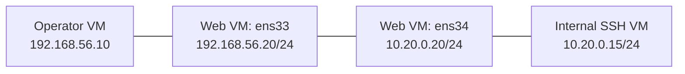

# Lesson 12 — Network Interfaces, Sockets, and Reachability { #lesson-12-network-interfaces-and-sockets }

**Goal:** Use Sliver's `ifconfig` and `netstat` to inspect the selected host, then distinguish interface addresses, listening sockets, connectivity, and application success.

**Supplement:** Expand the course's situational-awareness topic using the established virtual lab. Outputs are illustrative. The detailed answers include the follow-up question about causes other than firewall blocking.

## Select the host before interpreting Local { #select-the-host }

| Host or interface | Address |
|---|---|
| Operator | `192.168.56.10` |
| Web VM, external side | `192.168.56.20` |
| Web VM, internal side | `10.20.0.20` |
| Internal SSH VM | `10.20.0.15` |

In the **operator's Sliver console**, select the web Session using its real ID:

```text
sessions
sessions --interact <Web_Session_ID>
info
```

| Where a command is entered | Host being inspected |
|---|---|
| Sliver console with the web Session selected | Web VM |
| Operator's ordinary Linux terminal | Operator VM |
| SSH shell on the internal server | Internal SSH VM |

Sliver's built-in commands query the selected target. Their names do not change the importance of input location.

## Inspect interface addresses { #inspect-interface-addresses }

In the **Sliver console**:

```text
help ifconfig
ifconfig
ifconfig --all
```

The built-in command retrieves interface configuration. Default display can omit some adapters or addresses; `--all` requests the fuller display. Absence from the default view does not establish absence from the host. [Sliver ifconfig implementation](https://github.com/BishopFox/sliver/blob/master/client/command/network/ifconfig.go)

Simplified example; interface names depend on guest configuration:

| Interface | Address | Lab role |
|---|---|---|
| `lo` | `127.0.0.1/8` | Loopback |
| `ens33` | `192.168.56.20/24` | Operator-facing network |
| `ens34` | `10.20.0.20/24` | Internal network |



The two middle interfaces belong to the same VM. An interface is a network communication attachment; a VM's virtual network card provides one. Finding the internal address supports “this address is configured,” not “every internal service is reachable.” Link state, routing, filtering, and the destination service still matter.

## Inspect current connections { #inspect-current-connections }

With the same web Session selected:

```text
help netstat
netstat --numeric
```

`--numeric` avoids reverse-name display, making IP comparison easier. The checked defaults select IPv4 and TCP; do not interpret them as an inspection of all UDP and IPv6 activity. [Sliver network flags](https://github.com/BishopFox/sliver/blob/master/client/command/network/commands.go)

While the forwarded SSH connection is active, an illustrative entry is:

```text
Protocol  Local Address       Foreign Address  State        PID/Program name
tcp       10.20.0.20:51534     10.20.0.15:22    ESTABLISHED  2030/lab-implant
```

| Field | Meaning |
|---|---|
| Local Address | Selected web VM's endpoint |
| Foreign Address | Other endpoint of this connection |
| ESTABLISHED | Established TCP connection |
| PID/Program name | Associated process information when available |

OS and permissions can limit process attribution. The example shows an implant-related connection; it does not establish SSH authentication or later command success. [Sliver netstat implementation](https://github.com/BishopFox/sliver/blob/master/client/command/network/netstat.go)

## The same connection from opposite ends { #local-and-foreign }

| Observation point | Local | Other endpoint |
|---|---|---|
| Web VM | `10.20.0.20:51534` | `10.20.0.15:22` |
| Internal SSH server | `10.20.0.15:22` | `10.20.0.20:51534` |

Local means the host being inspected. It does not always mean the connection initiator. Foreign does not inherently identify an attacker. This is why the learner's answer **“Local is the web VM”** is correct when the web Session is selected.

## Listening is a different observation { #listening-sockets }

In Sliver:

```text
netstat --listen --numeric
```

This requests listening-socket information. An illustrative web-service entry is:

```text
Local Address   State
0.0.0.0:80      LISTEN
```

It describes an IPv4 socket bound to the wildcard local address on port 80 in that network environment. It does not configure a firewall allowance or prove remote access. `127.0.0.1:8000 LISTEN` would instead describe a loopback binding, with different direct-access conditions. [Linux IPv4 socket semantics](https://man7.org/linux/man-pages/man7/ip.7.html)

| Observation | What it supports |
|---|---|
| LISTEN | Socket waiting for connections at that binding |
| ESTABLISHED | A particular TCP connection is established |
| Expected application response | That request received the expected response |
| Matching authentication acceptance | The service accepted the account's authentication |

## A snapshot has a collection time { #snapshot-and-collection-time }

An absent SSH entry does not establish that no connection ever existed, that the server is off, or that a firewall blocked it. The connection may have ended, filters may exclude it, or collection may be limited. A Beacon task can run later than the time the operator typed it; consider check-in and actual collection time.

The basic inspection sequence is:

```text
info
ifconfig --all
netstat --numeric
netstat --listen --numeric
```

## Detailed answer 1: does LISTEN prove remote web access? { #answer-listen-versus-access }

**Question:** The web VM shows `0.0.0.0:80 LISTEN`. Can the operator necessarily use the web service?

**Learner answer:** “No. A firewall could block it. Please explain other possibilities.”

**Correct.** A successful request needs the right destination, a working path to the server, TCP establishment, request processing, and a response path. A listener is one part of that chain. The following cases explain the remaining possibilities.

### Separate virtual networks or a disconnected adapter { #virtual-network-or-link }

The operator can have `192.168.56.10/24` and the web VM `192.168.56.20/24`, yet be attached to separate, unconnected virtual switches. Matching address ranges do not connect the switches. A disconnected virtual NIC or an address configured on the wrong adapter can also break the path. Check both guest addresses and actual virtual-network attachments.

### Wrong destination, name resolution, port, or address family { #wrong-destination }

A request to `192.168.56.30` does not test a listener on `.20`. A hostname can resolve to an old or different address. Port 80 is different from 8080, and HTTP is different from HTTPS. `0.0.0.0:80` describes IPv4 listening; that entry alone establishes nothing about an IPv6 connection attempt.

### The request or response lacks a working route { #request-and-response-routes }

TCP requires communication in both directions. A request may reach a server while its response follows a wrong route. However, the operator `.10/24` and web VM `.20/24` in our directly connected subnet do **not** require a default gateway simply to communicate with each other.

In the **operator Linux terminal**, inspect the selected route:

```bash
ip route get 192.168.56.20
```

In the **web VM's own Linux terminal**, inspect the return choice:

```bash
ip route get 192.168.56.10
```

These commands read routing decisions; they do not test successful delivery or alter routes. [ip route manual](https://man7.org/linux/man-pages/man8/ip-route.8.html)

### A container listener differs from a published VM port { #container-port-mapping }

In a typical Docker bridge setup, a container's `0.0.0.0:80 LISTEN` concerns its own network environment. If its port is published as VM port 8080, the mapping is:

```text
Web VM port 8080 -> Container port 80
Operator URL: http://192.168.56.20:8080/
```

Do not infer a VM listener on port 80 from a container listener on port 80. Confirm the mapping and access conditions. This is a supplementary topology, not a claim that our earlier VM necessarily uses Docker. [Docker port publishing](https://docs.docker.com/engine/network/port-publishing/)

### Service state changed or processing is overloaded { #state-change-and-overload }

```text
11:00:00  Listener observed on port 80
11:00:02  Web-server process exits
11:00:05  Operator attempts a connection
```

The earlier observation can be correct while the later attempt fails. A live process can also delay accepting connections or handling requests under resource pressure. A listener alone does not prove overall application health.

### TCP works but the web request is not successful { #application-processing }

| Result | Interpretation |
|---|---|
| TCP connection fails | HTTP processing was not reached through that attempt |
| HTTP 403 | An HTTP response refused access |
| HTTP 500 | An HTTP response reported a server processing error |
| An unexpected site appears | A different virtual-host configuration may have handled the request |

A web server can select among sites using the HTTP `Host` header. An IP-based request may show a default site while the intended domain shows the desired one. Receiving 403 or 500 differs from complete network failure; still confirm the actual responder. [nginx request processing](https://nginx.org/en/docs/http/request_processing.html)

## Diagnose with one explicit HTTP request { #diagnose-with-curl }

In the **operator's ordinary Linux terminal**:

```bash
curl --noproxy "*" -v --connect-timeout 5 --max-time 10 http://192.168.56.20/
```

| Option | Purpose |
|---|---|
| `--noproxy "*"` | Make this request directly rather than through an environment-configured proxy |
| `-v` | Display connection and request/response details |
| `--connect-timeout 5` | Bound connection establishment |
| `--max-time 10` | Bound the complete attempt |

An explicitly configured browser or client proxy can otherwise change the actual path. [curl option reference](https://curl.se/docs/manpage.html)

| Observation | Careful interpretation |
|---|---|
| Connection timeout | Inspect path, filtering, and service state; this does not locate the cause by itself |
| Connection refused | A refusal occurred; a missing listener or explicit rejection can cause it |
| Connected, then waiting | TCP connected; HTTP processing and response need further investigation |
| HTTP status and body received | Inspect status, body, and responder to judge the request outcome |

## Detailed answer 2: which host is Local? { #answer-local-host }

**Question:** In the web Session's Sliver output, Local is `10.20.0.20:51534` and Foreign is `10.20.0.15:22`. Is Local the operator or the web VM?

**Learner answer: “The web VM.” Correct.** The selected target supplies these socket records. Typing the command at the operator's keyboard does not make the operator the Local endpoint of every reported connection. Looking at the same connection on the internal server reverses the endpoint columns.

[Previous: SSH evidence](lesson-11-pivot-connections-and-ssh-evidence.md) · [Next: Armory and BOF basics](lesson-13-armory-and-bof-basics.md)
