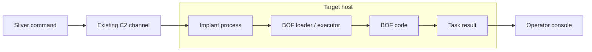

# Lesson 13 — Built-in Commands, Armory, and BOFs { #lesson-13-armory-and-bof-basics }

**Goal:** Separate Sliver's included features, package preparation on the Client, and code execution on a selected target.

## Different roles, not competing names { #different-roles }

| Term | Role | Analogy |
|---|---|---|
| Built-in command | Functionality already included in Sliver | Basic tool |
| Armory | Find, install, and manage additional tool packages | Tool catalogue and installer |
| BOF | Compiled task code following a supported execution convention | Additional working attachment |

Armory itself is not a BOF, and not every Armory package is a BOF. The official index distributes aliases and extensions. [Official Armory](https://github.com/sliverarmory/armory)

## Start with built-in functionality { #built-in-functionality }

Examples already used in the **Sliver console** include:

```text
pwd
ifconfig
netstat --numeric
```

When included functionality answers the question, an additional tool is unnecessary. Other questions can require a more specialized tool, such as a detailed inspection of account groups and privileges. Armory helps prepare additional commands for such tasks.

## Installation happens before target execution { #installation-and-execution }

```text
Prepare a tool package on the operator side
    -> Register its command in the Sliver Client
    -> Request execution on a selected target
    -> Target performs the task
    -> Result returns
```

Installation does not establish execution. Packages are installed and registered on the **Sliver Client machine**. If the Client and Server are separate, do not treat the Server's filesystem as the Client's. The installation implementation downloads package assets and registers commands; target execution is a separate action. [Armory installation implementation](https://github.com/BishopFox/sliver/blob/master/client/command/armory/install.go)

| Earlier distinction | Corresponding tool distinction |
|---|---|
| Implant generation versus execution | Tool installation versus target execution |
| Listener startup versus implant connection | Command registration versus task success |
| Task request versus task completion | BOF request versus a valid returned result |

## Find and inspect a package { #find-and-inspect-a-package }

These examples are entered in the **Sliver console**, not an ordinary OS shell:

```text
help armory
armory
armory search whoami
armory info sa-whoami
```

In the checked command version, `armory` displays available packages, `search` searches command names using a regular expression, and `info` retrieves configured armory or package details. Match syntax to the installed help rather than guessing from an older demonstration. [Current Armory command definitions](https://github.com/BishopFox/sliver/blob/master/client/command/armory/commands.go)

`sa-whoami` is present in the official index as an example. Actual results depend on configured repositories, available metadata, and version. Searching and inspecting it do not run its account query on a target. [Official package index](https://github.com/sliverarmory/armory/blob/master/armory.json)

## Install and check command registration { #install-and-check-registration }

An illustrative package-installation sequence is:

```text
armory install sa-whoami
help sa-whoami
```

| Observation | What it establishes |
|---|---|
| Package appears in search | Matching metadata was found |
| Installation reports success | Client-side installation was reported complete |
| Help appears | Command is registered in the current console |
| Expected task result returns from the intended target | Evidence of that task's execution outcome |

Registered help does not establish target compatibility. OS, implant-process architecture, supported executor, and dependencies must match. The extension implementation selects artifacts by target OS and architecture. The Linux web VM used earlier cannot be assumed compatible with a Windows tool. [Extension target selection](https://github.com/BishopFox/sliver/blob/master/client/command/extensions/load.go)

## Aliases and extensions { #aliases-and-extensions }

| Package mechanism | Introductory meaning |
|---|---|
| Alias | Configuration and assets that expose an external tool as a Sliver command |
| Extension | A mechanism for integrating additional executable functionality |

A Sliver alias is more than an ordinary shell nickname: it connects a tool and execution arguments to a command. Extensions can include BOF-related execution configurations. Ask what the package runs, which target environments it supports, and which execution mechanism it requires. The label alone does not answer all three questions.

## What a BOF contributes { #what-a-bof-contributes }

**BOF** means **Beacon Object File**. A typical Windows BOF is compiled task code, commonly written in C/C++, prepared as a COFF object file and following a compatible execution convention. An object file is not an ordinary finished EXE; it needs an appropriate loader or executor.



COFFLoader is one implementation. Current Sliver code also supports a built-in BOF executor path; the exact loader choice depends on version and package configuration. Do not assume every package needs the same manually installed loader. [COFFLoader project](https://github.com/sliverarmory/COFFLoader), [Sliver execution paths](https://github.com/BishopFox/sliver/blob/master/client/command/extensions/load.go)

The word Beacon in BOF's name does not mean the tool format is restricted to Sliver Beacon mode. BOF format and Session/Beacon communication modes are separate concepts.

## Memory execution describes only part of the behavior { #memory-execution-and-behavior }

A usual BOF execution model prepares code inside the existing implant process. This differs from starting a separate complete EXE. However, the BOF's own actions determine further effects:

| Incorrect generalization | More accurate interpretation |
|---|---|
| A BOF never creates another process | Its task code could create one |
| Memory execution means no file activity | The task could read or write files |
| Memory execution cannot be detected | Memory and runtime behavior can be observed |
| A BOF automatically grants administrator rights | Execution mechanism alone does not elevate privileges |

A file-reading BOF still performs file access; a network-querying BOF still communicates. Consider both the execution mechanism and the task's behavior. For the simplest explanation and object-file questions, continue to the [BOF, COFF, and OBJ questions](bof-coff-and-object-files-questions.md).

## Detailed answer 1: help is not a target result { #answer-help-versus-result }

**Question:** Installation succeeds and `help sa-whoami` appears. Has the selected target performed the user-information query?

**Learner answer:** “Displaying help does not guarantee target OS compatibility or execution success.”

**Correct.** The preceding stage distinction makes this even more precise: installation and help do not themselves request that target query. No target result has been established. Even after an execution request, the task may await a Beacon check-in or fail, so request and successful completion remain distinct.

## Detailed answer 2: in-process does not mean invisible { #answer-in-process-versus-effects }

**Question:** A BOF ran in the existing implant. Does that establish no file activity, no network traffic, and no possible detection?

**Learner answer: “No.” Correct.** Where code runs and what it does are different questions. File inspection can access files, a server query can open a connection, a setting change can modify a file or registry entry, and a program-launching task can create a child process. Security tools may observe behavior or memory activity; actual visibility depends on their configuration and capabilities. Neither guaranteed invisibility nor guaranteed detection follows from the term BOF.

[Previous: Network interfaces and sockets](lesson-12-network-interfaces-and-sockets.md) · [Continue: BOF, COFF, and OBJ questions](bof-coff-and-object-files-questions.md)
