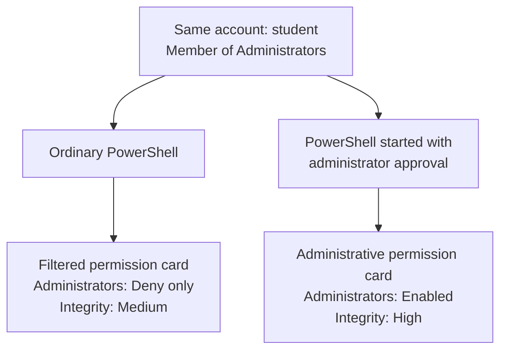
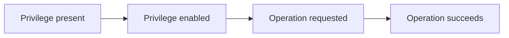

# Lesson 15 — Windows Tokens, Deny Only, and Privileges { #lesson-15-windows-tokens-and-privileges }

**Goal:** Read account, group, privilege, and integrity information without confusing group membership, a program's current permissions, and evidence that an action occurred.

Use a Windows lab VM for these examples. Outputs are illustrative, not measurements of the reader's machines. This lesson includes the follow-up questions, detailed answers, and the simpler permission-card explanation.

## One account, two programs { #one-account-two-programs }

**Two programs started by the same person can use different permissions.**

Suppose `student` belongs to local Administrators. The user opens an ordinary PowerShell, then another with **Run as administrator** and normal UAC approval. In a typical administrator-approval configuration:



The username can match while the **permission card** differs. This card is the **access token**. UAC can use a filtered token for ordinary applications and an administrative token for approved elevated applications. [Microsoft UAC explanation](https://learn.microsoft.com/en-us/windows/security/application-security/application-control/user-account-control/how-it-works)

Opening an elevated PowerShell does not automatically elevate an already running implant. Inspect the program and context actually performing the action.

## What is on the permission card? { #what-is-on-the-token }

An access token describes a process or thread's security context. Windows consults the relevant token along with the resource's rules and other controls. [Microsoft access tokens](https://learn.microsoft.com/en-us/windows/win32/secauthz/access-tokens)

| Information | Plain question |
|---|---|
| User identity | Which account is this? |
| Groups and attributes | How can these group identities participate in access checks? |
| Privileges and states | Which system-operation privileges are present and active? |
| Integrity level | Which integrity protection level applies? |

These statements need different evidence:

```text
The student account belongs to Administrators.
The implant is running with an administrative token.
```

The first does not establish the second. A username does not describe every token property. A token also does not list the outcome of every possible resource-access request.

## Read a Windows execution context { #windows-whoami-commands }

In **PowerShell on the Windows lab VM**:

```powershell
whoami.exe /all
```

Or inspect the parts separately:

```powershell
whoami.exe /user
whoami.exe /groups
whoami.exe /priv
```

| Option | Information |
|---|---|
| `/user` | Account name and SID |
| `/groups` | Groups and attributes |
| `/priv` | Privileges and states |
| `/all` | Combined current-token information |

A **SID** is a Windows security identifier. These commands inspect the context of the `whoami.exe` instance started from that terminal. Matching usernames do not prove a separate implant uses the same token. [Microsoft whoami reference](https://learn.microsoft.com/en-us/windows-server/administration/windows-commands/whoami)

## Query the implant with getprivs { #sliver-getprivs }

In the **Sliver console**, select the actual Windows Session:

```text
sessions
sessions --interact <Windows_Session_ID>
info
help getprivs
getprivs
```

Replace the placeholder without brackets. `getprivs` is built-in and Windows-specific; it needs no Armory package. The checked implementation displays process privileges and integrity level. This privilege list does not replace a separate inspection of group attributes. [Sliver getprivs implementation](https://github.com/BishopFox/sliver/blob/master/client/command/privilege/getprivs.go)

Simplified illustrative output:

```text
Privilege Information for lab-implant.exe (PID: 2030)

Process Integrity Level: Medium

Name                       Attributes
SeChangeNotifyPrivilege    Enabled
SeShutdownPrivilege        Disabled
```

Actual lists and formatting vary. Read incomplete-information or collection errors. A Beacon task may require waiting for check-in and the returned result.

| Query | Context described |
|---|---|
| Terminal: `whoami.exe /all` | That program's execution context |
| Selected implant: `getprivs` | Implant process privilege and integrity information |

## What does Deny only mean? { #deny-only-explained }

The learner asked: **“No, but what does Deny only mean?”**

```text
Group: Administrators
Attribute: Deny only
```

This group identity participates in **denial checks**, but does not obtain access through rules allowing that group.

| Resource rule | Treatment of Deny-only Administrators |
|---|---|
| Allow Administrators to read | Do not use this group identity to obtain that allowance |
| Deny Administrators modification | Consider this identity when checking the denial |

An analogy: **the administrator badge cannot claim administrator benefits, but restrictions applying to that badge can still matter.** [Microsoft token SID attributes](https://learn.microsoft.com/en-us/windows/win32/secauthz/sid-attributes-in-an-access-token)

This is a property of the **current token**. It does not mean the account was deleted or removed from the group. It does not itself create a new deny rule on every file.

## Does Deny only prohibit every file operation? { #deny-only-file-example }

**No.** Other identities in the token can still provide access. To isolate this idea, assume no other grants or restrictions in this simplified example:

| File | Read allowance |
|---|---|
| `notes.txt` | Granted directly to user `student` |
| `admin.txt` | Granted only to Administrators |

The ordinary program's token is:

```text
User: student
Administrators: Deny only
```

| File | Interpretation in this example |
|---|---|
| `notes.txt` | The user's own identity supplies read allowance |
| `admin.txt` | The Deny-only group identity cannot supply that allowance |

Deny only specifies how **one group identity** is used. Another active group or the user identity can matter. Actual access also depends on other rules and controls; this illustration is not a complete ACL-evaluation algorithm.

## Group attributes and privilege states differ { #groups-versus-privileges }

| Example | Describes |
|---|---|
| Administrators — `Deny only` | Group identity attribute |
| SeShutdownPrivilege — `Disabled` | State of a particular privilege |

A **privilege** concerns a system operation, such as local shutdown or changing system time. File read/write permissions concern operations on an object. The same domain account can have different privileges on different computers. [Microsoft privileges](https://learn.microsoft.com/en-us/windows/win32/secauthz/privileges)

| State | Meaning |
|---|---|
| Enabled | Present and currently active in the queried token |
| Disabled | Present in the queried token but currently inactive |

Disabled does not mean absent. Enabled does not mean used or guarantee every condition for success.

## A state is not an action record { #privilege-state-versus-action }

Suppose the observation is:

```text
SeShutdownPrivilege    Enabled
```

It establishes an active privilege in the inspected token. It does not establish a shutdown request, request success, or actual shutdown.



These are stages for a privilege-requiring operation, not instructions to perform shutdown. Each later claim needs separate evidence.

| Question | Answered by Enabled alone? |
|---|---|
| Is the privilege active? | Yes |
| Was shutdown requested? | No |
| Did the request succeed? | No |
| Did the machine shut down? | No |

## Integrity level is another protection property { #integrity-level }

| Level | Introductory example |
|---|---|
| Low | Restricted execution environment |
| Medium | Ordinary user program |
| High | Commonly seen in elevated programs |
| System | Commonly seen in system services |

Integrity control operates alongside object access rules. A default protection principle restricts lower-integrity code from writing to higher-integrity objects. High is not unrestricted file access or administrator access to another server. [Microsoft integrity control](https://learn.microsoft.com/en-us/windows/win32/secauthz/mandatory-integrity-control)

In our example, ordinary PowerShell uses Medium and the approved elevated program uses High. Inspect actual process information; account membership alone is insufficient.

## Read a complete example { #worked-example }

This is a teaching note combining observations, **not the literal output of one command**:

```text
Account: student
Account membership: Administrators

Current implant:
    Administrators: Deny only
    Integrity: Medium
    SeShutdownPrivilege: Disabled
```

| Question | Supported answer |
|---|---|
| Which account? | `student` |
| Does membership alone prove elevation? | No |
| Can this Administrators entry supply group allowances? | No; it is Deny only |
| Observed integrity? | Medium |
| Is the shown shutdown privilege active? | No; Disabled |
| Can every file be read or modified? | Not established; inspect the relevant operation and resource rules |

This illustrates an administrator-group account using a filtered token for an implant. Identity, current token, resource permissions, and performed actions are separate observations.

## Review answers and learner reasoning { #review-answers }

**Question 1:** Administrators appears, but it is Deny only and integrity is Medium. Does the group name establish an elevated process?

**Learner answer:** “No. What does Deny only mean?”

**Correct.** Read the attribute as well as the group name. The group entry supplies no access from its allow rules, while matching denial rules can still matter. The [two-file example](#deny-only-file-example) explains why this is not a blanket prohibition on all actions.

**Question 2:** SeShutdownPrivilege is Enabled. Does that prove actual shutdown?

**Learner answer:** “No. The privilege exists, but whether it was used is unknown.”

**Correct, with one refinement:** it is present **and currently enabled** in the queried token. Whether it was requested, used, or resulted in shutdown needs separate evidence, just as HTTP 200, TCP ESTABLISHED, or package installation has a limited evidential meaning.

[Previous: EXE, .NET, and BOF execution](lesson-14-exe-dotnet-and-bof-execution.md) · [Next: Windows services and diagnostic findings](lesson-16-windows-services-and-diagnostic-findings.md) · [Course coverage](course-coverage-and-next-steps.md) · [Course overview](index.md)
