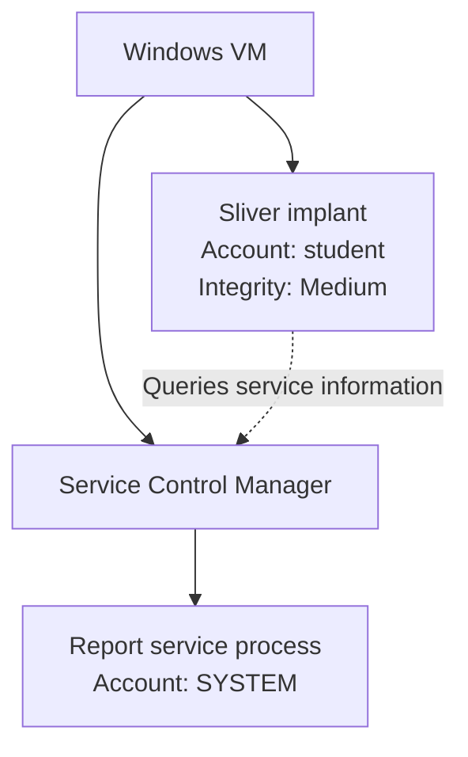
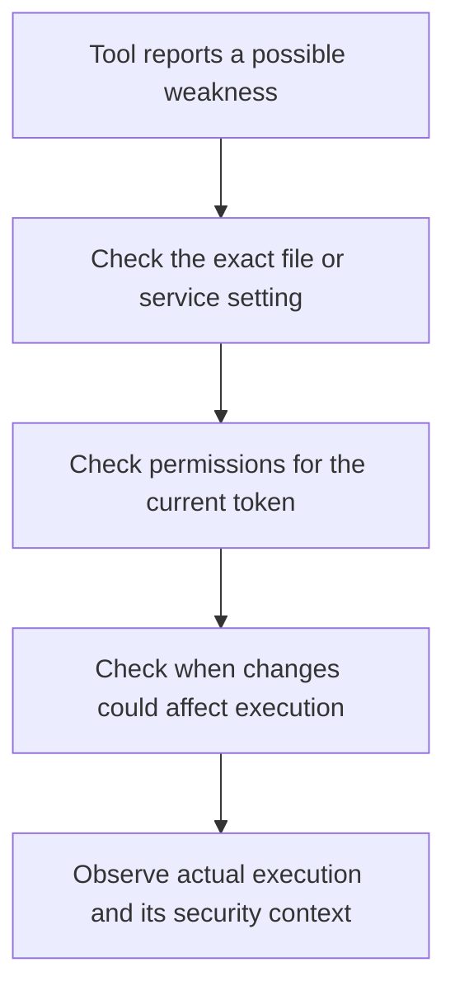
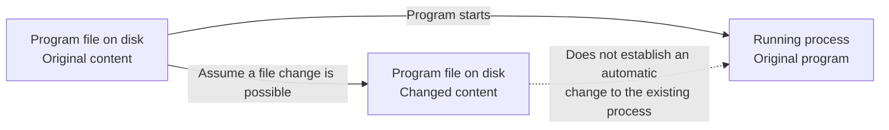

# Lesson 16 — Windows Services, Permissions, and Diagnostic Findings { #lesson-16-windows-services-and-diagnostic-findings }

**Learning goal:** Separate a service's execution identity, your rights to manage the service, your rights over its files, and evidence that a particular action actually happened.

Use your own isolated Windows lab VM. The names, paths, process IDs, and outputs below are illustrative. They are not measurements from the learner's computer. The commands shown here query information.

## What is a Windows service? { #service-basics }

A Windows service performs background work such as printing, updates, or backups. Depending on its configuration, it can run while no user is signed in. The **Service Control Manager (SCM)** manages services.

| Windows component | Company analogy |
|---|---|
| Service | An employee doing an assigned job |
| Service executable | The program used to perform the job |
| Service execution account | The employee's identity and permission card |
| Service Control Manager | The office that manages starting and stopping jobs |

A service can have its own process or share a host process with other services. This lesson assumes a service with its own process to keep the example simple. [Microsoft: service programs](https://learn.microsoft.com/en-us/windows/win32/services/service-programs)

Our fictional example is:

```text
Service name:  LabReportService
Program:       C:\LabApps\ReportService\report-service.exe
Run as:        LocalSystem
```

This means Windows is configured to start the service program under **LocalSystem**, an account with extensive privileges on the local computer. Processes running in that context commonly show the identity **NT AUTHORITY\SYSTEM**. [Microsoft: LocalSystem](https://learn.microsoft.com/en-us/windows/win32/services/localsystem-account)

## Two processes, two permission cards { #two-processes-two-tokens }

Finding a service configured for SYSTEM does not change your implant's token.



The service process and implant are separate processes. Reading information about another employee's position does not change your own permission card.

| Observation | Supported interpretation |
|---|---|
| Service StartName is LocalSystem | The configured service execution account |
| Service State is Running | The service reports that it is running at the observation time |
| Implant identity is student | The identity observed for the implant |
| Implant integrity is Medium | The integrity level observed for the implant |

**StartName is a configuration property.** To establish the actual token of a particular running process, inspect that process separately. A service listing is not proof that your implant is SYSTEM. [Microsoft: Win32_Service](https://learn.microsoft.com/en-us/windows/win32/cimwin32prov/win32-service)

## Query services from Windows PowerShell { #inspect-service }

**Input location: PowerShell inside the Windows VM you want to inspect.** These are not commands to paste directly into the Sliver command prompt.

First list services:

```powershell
Get-CimInstance -ClassName Win32_Service |
    Select-Object Name, State, StartName
```

| Element | Meaning |
|---|---|
| Get-CimInstance | Query Windows management information |
| Win32_Service | Select service information |
| Select-Object | Choose the properties to display |
| Name | Service name |
| State | Reported current state |
| StartName | Configured execution account |

Without a remote computer or CIM session, this command queries the local Windows VM where it runs. [Microsoft: Get-CimInstance](https://learn.microsoft.com/en-us/powershell/module/cimcmdlets/get-ciminstance)

Inspect one service:

```powershell
Get-CimInstance -ClassName Win32_Service -Filter "Name='LabReportService'" |
    Select-Object Name, State, StartMode, StartName, PathName, ProcessId |
    Format-List
```

**LabReportService is a fictional example, not a service installed by this lesson.** If it does not exist in your VM, use an actual service name from the first query.

Illustrative output:

```text
Name      : LabReportService
State     : Running
StartMode : Auto
StartName : LocalSystem
PathName  : C:\LabApps\ReportService\report-service.exe
ProcessId : 4120
```

Read it as: the service reports running, is configured for automatic startup under LocalSystem, and lists the program path and current process ID. **Auto is a startup setting; Running is a reported current state.** An automatically started service can still be stopped or fail to start.

## Three different permission questions { #three-permissions }

| What you inspect | Question | Example |
|---|---|---|
| Service process | Under whose authority does this process execute? | SYSTEM |
| Service object | Which management operations may my current context request? | Query, change configuration, start, or stop |
| Executable and directory | Which file operations may my current context perform? | Read, execute, write, or delete |

Service management operations have separate rights:

| Service right | Operation |
|---|---|
| SERVICE_QUERY_CONFIG | Query configuration |
| SERVICE_QUERY_STATUS | Query status |
| SERVICE_CHANGE_CONFIG | Change configuration |
| SERVICE_START | Start the service |
| SERVICE_STOP | Stop the service |

A successful query does not establish configuration-change or start/stop permission. File permissions are also separate from service-object permissions. Reading a service's status may be allowed while changing its executable is forbidden; a directory may be writable while service start/stop is forbidden. [Microsoft: service security and access rights](https://learn.microsoft.com/en-us/windows/win32/services/service-security-and-access-rights)

## Inspect executable and directory permissions { #inspect-file-permissions }

For the fictional path, run these queries in the Windows VM's PowerShell. Use a real path from your own service query when following along.

```powershell
icacls "C:\LabApps\ReportService\report-service.exe"
```

```powershell
icacls "C:\LabApps\ReportService"
```

An illustrative file entry might be:

```text
BUILTIN\Users:(I)(RX)
```

| Mark | Meaning |
|---|---|
| BUILTIN\Users | Group to which this entry applies |
| I | Inherited entry |
| R | Read |
| RX | Read and execute |
| W | Write |
| M | Modify, including deletion |
| F | Full access |

This entry grants Users read and execute rights; it does not itself grant write rights. It is one entry, not a complete effective-access decision. Other entries, the current token, parent-directory permissions, and other applicable controls can affect a particular operation. [Microsoft: icacls](https://learn.microsoft.com/en-us/windows-server/administration/windows-commands/icacls)

Recall Lesson 15: a group listed in a token may be **Deny only**, so its name alone is insufficient to establish an allow grant.

## What does a diagnostic warning mean? { #diagnostic-warning }

A fictional tool reports:

```text
Service: LabReportService
Runs as: LocalSystem
Warning: Service executable may be writable by ordinary users
```

In plain language:

> An ordinary user might be able to change a program file that a service is configured to run with SYSTEM authority.

That is an important lead. If a less-privileged user can control code that later runs under a more-privileged account, the user may be able to influence privileged behavior. But the warning does not establish that the file was changed, that changed code ran, or that an implant's token changed.

Treat the tool's “Runs as” field as a reported observation. Check whether it represents configuration or an actual process-token measurement.



Check the path against the service configuration; inspect rights for the current token; consider file locking and other controls; establish when a change could take effect; and collect evidence about the process that actually executes.

## A simpler analogy: the manager's instructions { #warning-analogy }

Imagine an ordinary employee who cannot change important company systems. A manager can change them and follows a written instruction sheet.

If the ordinary employee can edit the instructions, and the manager later follows the edited version, the employee can influence work performed with the manager's authority.

| Company analogy | Service example |
|---|---|
| Ordinary employee | Less-privileged user |
| Instructions that influence the manager's work | Service executable |
| Manager with greater authority | Service process running as SYSTEM |
| Ability to edit instructions | Ability to modify the executable |

The instruction sheet is an analogy for executable code, not a claim that an EXE is a text document.

The concern is the combination: **a less-privileged person may control what a more-privileged process executes**.

## Three checks between a warning and a result { #three-checks }

**First: can the current context really perform the required modification?** The tool may have identified a suspicious permission entry. Confirm the exact file, the current user's token and applicable rights, and whether the intended file operation is allowed. A file in use or another control can affect that operation.

**Second: will the changed content actually be executed?** Even if an on-disk change were possible, the existing process does not automatically become a new version. Establish when the relevant program would load and execute the changed content.

**Third: what ran, and under which token?** A service-start message does not by itself prove that the expected changed file ran, that a particular action happened, or that the process had the expected token. Correlate the actual process, loaded program, observed behavior, and security context.

These checks separate a possible weakness, a confirmed permission, and an observed outcome.

## Disk file versus a running process { #disk-file-and-running-process }

Suppose a service starts at 09:00 and an on-disk file could be changed at 10:00. You cannot conclude that the process already running since 09:00 instantly changes to execute the new content.



In the company analogy, the manager takes a copy of the instructions at 09:00. Someone changes the original in the cabinet at 10:00. The manager may still be following the earlier copy.

This is a conceptual distinction between a stored artifact and a running process, not a complete description of Windows executable loading. Inspect when the relevant changed content would actually be loaded and used.

## What each observation proves { #evidence-ladder }

| Observation | Supported conclusion |
|---|---|
| A tool displays a warning | A possible weakness was reported |
| The required file modification is confirmed for the current token | That particular file operation is permitted under the checked conditions |
| A disk file changes | The stored file changed |
| The service reports a successful start | A service-start outcome was reported |
| The changed program's execution and SYSTEM token are observed | Changed code executed under that observed token |

Each row requires its own evidence. Do not use one earlier observation as proof of all later events.

A service error also does not, by itself, settle whether any process or code executed. Status reporting and code execution are separate observations.

Even when a separate process is observed running changed code as SYSTEM, **an existing student implant does not automatically receive that process's token**. Check each process individually.

A precise finding would be: “A configuration that could permit privileged execution was reported. Current permissions, execution conditions, and the actual outcome still require verification.”

## Review questions and detailed answers { #review-answers }

### Question 1: a SYSTEM service was found { #answer-system-service }

**Question:** The implant is running as student at Medium integrity. A service query shows a service configured for LocalSystem. Is the implant now SYSTEM?

**Answer: no.** The query describes another service. It does not change the implant's account or token. Reading an employee's senior job title does not upgrade your own permission card.

StartName describes a configured service account. To establish the actual token of a running service process, inspect that process. To establish the implant's current authority, inspect the implant itself.

The supported conclusion is: “A service configured for LocalSystem was found; the observed implant remains student at Medium integrity.”

### Question 2: a Users RX entry was found { #answer-users-rx }

**Question:** The service executable has a BUILTIN\Users:(RX) entry. Does this entry prove that an ordinary user can modify the file?

**Answer: no.** RX grants read and execute rights through that entry. Executing an existing program and changing its file are different operations.

Do not reverse this into a blanket claim that the user can never modify the file. Another applicable entry might grant modification:

```text
BUILTIN\Users:(RX)
LAB\student:(M)
```

Here the user has a separate Modify grant. Assuming no other applicable restrictions, the direct user entry can grant modification even though the Users entry grants only read and execute.

Read the full relevant permissions, current token, and parent-directory rights. This is not a complete ACL-ordering algorithm.

## Sources and next reading { #sources }

- [Microsoft: service programs](https://learn.microsoft.com/en-us/windows/win32/services/service-programs)
- [Microsoft: LocalSystem account](https://learn.microsoft.com/en-us/windows/win32/services/localsystem-account)
- [Microsoft: Win32_Service](https://learn.microsoft.com/en-us/windows/win32/cimwin32prov/win32-service)
- [Microsoft: Get-CimInstance](https://learn.microsoft.com/en-us/powershell/module/cimcmdlets/get-ciminstance)
- [Microsoft: service security and access rights](https://learn.microsoft.com/en-us/windows/win32/services/service-security-and-access-rights)
- [Microsoft: icacls](https://learn.microsoft.com/en-us/windows-server/administration/windows-commands/icacls)

[Previous: Windows tokens and privileges](lesson-15-windows-tokens-and-privileges.md) · [Learning review and Lessons 17–25 plan](course-coverage-and-next-steps.md#lesson-plan) · [Course overview](index.md)
