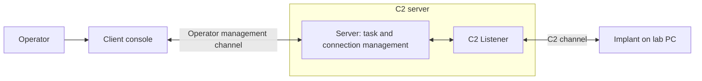

# Lesson 2 — Components and Commands { #lesson-2-components-and-commands }

**Goal:** Identify Sliver's components, distinguish the operating-system terminal from the Sliver console, and explain what each basic command proves.

## The four roles { #the-four-roles }

| Component | Responsibility | Typical location |
|---|---|---|
| Client | Operator interface for entering requests and viewing results | Operator's computer |
| Server | Central management of communication, tasks, and results | Lab C2 server |
| Listener | Server-side service receiving implant communications | Within the server |
| Implant | Program performing tasks on a lab target | Lab target PC |



There are two distinct communication paths: **Client ↔ Server** and **Implant ↔ C2 Listener**. A working operator connection does not prove that the target PC can reach the listener.

“Client” is also a generic networking word, but **Sliver Client** specifically names the operator-facing program. The implant is a separate component.

**Supplement:** Sliver can be controlled from its server console or through a separate client. These roles do not require four physical computers. [Official architecture explanation](https://github.com/BishopFox/sliver/wiki/Architecture/a1016f154840c2d9508e38a8201d887744ba5afb)

## Where to type commands { #where-to-type-commands }

| Interface | Example command | Interpreted by |
|---|---|---|
| Linux terminal | `./sliver-server` | Operating-system shell |
| Sliver console | `jobs` | Sliver |

The prompt is the text indicating that an interface is ready for input. It might look like `ubuntu@lab:~$` in Linux or `sliver >` in Sliver. **Do not copy the prompt itself.** All command blocks below contain only the part to type.

## Opening a console { #opening-a-console }

**Lecture:** The workshop provides an installed server and instructs learners to connect to its Ubuntu host using the lab's SSH key, then launch the Sliver client. The subtitles do not preserve the full SSH command or every setup step.

**Supplement — local server example:** If the Linux server binary is named `sliver-server` and is in the current directory, run this in the **Linux terminal**:

```bash
./sliver-server
```

`./` means the executable is in the current directory. A successful launch presents the server console. This assumes a suitable, already-installed binary; the command is not an installer.

**Supplement — preconfigured client example:** If the server is already running and your operator configuration has been provided/imported, start the client from the **Linux terminal**:

```bash
./sliver-client
```

A separate client requires server connection and authentication settings. Starting the executable alone does not create that setup. The server must also be configured to accept operator connections. The workshop lab supplies this preparation; filenames and installation paths can vary. [Official operator connection documentation](https://github.com/BishopFox/sliver/wiki/Multiplayer-Mode/09c86574715cd1a1e792e0815d583550d6750eac)

For the remaining examples, assume you have a working Sliver console through either route.

## Starting an HTTP listener { #starting-an-http-listener }

**Lecture:** The instructor starts an HTTP listener before generating the first beacon. The exact typed listener command is missing from the subtitles.

**Supplement — illustrative example:** Assume the isolated lab C2 server actually owns IP address `192.168.56.10`. To receive HTTP implant communication on TCP port `8080`, enter this in the **Sliver console**:

```text
http --lhost 192.168.56.10 --lport 8080
```

| Part | Meaning |
|---|---|
| `http` | Start an HTTP listener |
| `--lhost` | Local server address on which to listen |
| `192.168.56.10` | Example IP assigned to the C2 server, not the target PC |
| `--lport` | Listening port option |
| `8080` | Example listening port |

An IP/domain identifies the destination, a port identifies a communication endpoint, and a protocol specifies the communication rules. The address must exist on the server; the port must be available. Routing, firewall policy, and compatible implant settings also matter.

The listener command **does not create, copy, or execute an implant**. It prepares the server to receive communication. The syntax above was checked against the [official listener command definitions](https://github.com/BishopFox/sliver/blob/master/client/command/jobs/commands.go); it is not claimed to be the instructor's exact command.

## Inspecting server jobs { #inspecting-server-jobs }

In the **Sliver console**:

```text
jobs
```

**Illustrative output — simplified, not captured from a running lab:**

```text
ID   Name   Protocol   Port
1    http   tcp        8080
```

This means a server job exists for the HTTP listener on TCP port 8080. **It does not mean a target has connected.** Opening a reception desk and receiving a visitor are different events.

**Supplement — correction:** The lecture describes jobs in terms of listening ports. More precisely, jobs are server-managed running activities, including listeners. [Official job-list implementation](https://github.com/BishopFox/sliver/blob/master/client/command/jobs/jobs.go)

## Created builds versus communicating implants { #created-builds-versus-communicating-implants }

Run these separately in the **Sliver console**:

```text
implants
```

```text
sessions
```

```text
beacons
```

| Command | What it lists | What it does not prove by itself |
|---|---|---|
| `implants` | Archived implant builds | That the generated file is running on a target |
| `sessions` | Sessions managed by the server, with their status | That every listed entry is currently healthy; inspect status |
| `beacons` | Registered beacons and their state | That a past registration is still checking in; inspect timing |

**Lecture:** The subtitles explicitly identify `implants` as a list of generated implants and later mention `sessions`. The `beacons` comparison is included here as a supplementary clarification. [Official build-list implementation](https://github.com/BishopFox/sliver/blob/master/client/command/generate/implants.go)

| Stage | What may be visible |
|---|---|
| Listener started | Listener in `jobs` |
| Implant generated | Build in `implants` |
| File copied to target only | No new session or beacon yet |
| Implant executed and C2 registration succeeds | Corresponding session or beacon information |

Even after execution, an incorrect callback address, a blocked network path, or a stopped process can prevent successful communication. **Creation → delivery → execution → communication** are separate stages.

## Asking the installed version for help { #asking-for-help }

```text
help http
```

```text
help jobs
```

Options and output can change between versions. Consult the installed console's help before relying on lecture-era syntax.

## Review questions { #review-questions }

1. An HTTP listener appears in `jobs`. Does that prove an implant executed on the target?
2. A build appears in `implants`, but there is no new session or beacon. Give one explanation that does not require a software error.

??? success "Answers and reasoning"
    **1. No.** It establishes only that the listener job is running. Target execution and communication remain unproven.

    **2. The file may have been generated or copied but never executed.** Execution without successful communication is another possibility. The absence of a connection does not identify the cause on its own.

[Continue to Lesson 3 — Sessions and beacons](lesson-3-sessions-and-beacons.md)
