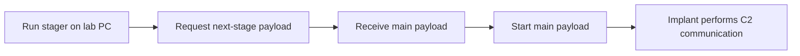

# Lesson 4 — Payloads, Stagers, and Loaders { #lesson-4-payloads-stagers-and-loaders }

**Goal:** Distinguish the code being delivered, the program performing C2 tasks, and the mechanisms used to prepare and start it.

## Payload versus implant { #payload-versus-implant }

A **payload** is code intended to perform a particular function. The word has a broad meaning across security tools. In this course it often refers to implant code or the generated output that will be delivered and executed.

An **implant** is the program operating on the lab target and performing C2 tasks. The same software may be described as a payload when discussing delivery and as an implant when discussing its role on the target. However, not every payload is a C2 implant.

| Term | Main question |
|---|---|
| Payload | What code will be delivered or executed? |
| Implant | What program runs on the target and performs C2 work? |

## Stageless: include the main program from the start { #stageless }

A **stageless** payload contains the full implant from the beginning. Think of an offline installer containing the application rather than a small installer that must retrieve the main package.

```text
Deliver the full implant
          ↓
Run it on the lab PC
          ↓
Communicate with the C2 server
```

**Stageless does not mean network-free.** It removes the need to retrieve the main implant as a separate initial stage. The running implant still needs communication with the C2 server to receive remote tasks and return results.

## Staged: retrieve the next stage { #staged }

A **stager** is a small initial program responsible for obtaining the next stage and arranging its execution. Think of a small online installer that fetches the application package.



| Term | Role |
|---|---|
| Stage 1 | Initial stage executed first |
| Stage 2 | Next stage obtained by the initial stage |
| Stager | Initial program focused on retrieving and starting another stage |

Some designs have more stages. For now, use the two-stage model: **initial program → main implant**. Sliver's official staging explanation separates the staging server, the next-stage payload, and the stager. [Official staging explanation](https://github.com/BishopFox/sliver/wiki/Stagers/e2b8417c1434c926daf746f9e85146566972a69e)

| Aspect | Stageless | Staged |
|---|---|---|
| Initially delivered | Full implant output | Initial stager |
| Separate retrieval of main implant | Not required | Required in this model |
| Initial output size | Can be larger | Can be smaller |
| Possible failure points | Execution and C2 communication | Initial execution, retrieval, main execution, and C2 communication |

A smaller initial program is not automatically undetectable. A stageless program is not automatically reliable either: incompatible platforms, blocked execution, or failed communication can still prevent it from working.

## Loader: prepare code for execution { #loader }

A **loader** prepares code to run and transfers execution to it. Loading is also a normal operating-system and application concept; the word alone does not establish malicious activity.

In this course, a loader may read a payload from disk or retrieve it from a remote source, then prepare it for execution. It does not necessarily download from the internet or run only from memory.

| Term | Focus |
|---|---|
| Payload | What will run? |
| Loader | How will that code be prepared and started? |
| Stager | How will the next-stage code be obtained and started? |

A stager can be understood as a loader specialized in next-stage delivery, although terminology varies between tools. The workshop's `gen_loader` is a separate training helper, not a universal built-in Sliver command.

## Delivery structure and communication mode are independent { #independent-choices }

| Design question | Choices |
|---|---|
| How is the main implant provided at startup? | Staged / stageless |
| How does the running implant exchange tasks? | Session / beacon |

A **stageless beacon** contains the full implant from the start and then checks in periodically. A beacon does not inherently require a stager.

Similarly, **providing the next-stage code** and **handling the running implant's C2 traffic** are distinct functions. They can share infrastructure; this does not require a separate physical server or a different port in every design.

## Inspect the generation help { #inspect-generation-help }

In the **Sliver console**:

```text
help generate
```

```text
help generate beacon
```

These commands display help. They do not generate an implant or execute anything on a target. Lesson 5 connects the generation options to the target operating system, CPU architecture, output format, and C2 address.

## Review questions { #review-questions }

1. A stageless beacon does not need to download its main program. Does it therefore have no need to communicate with C2?
2. A stager runs, but cannot retrieve the main payload. Does its successful startup prove the full implant ran?
3. The main payload finishes downloading. Does that alone prove it executed?

??? success "Answers and reasoning"
    **1. No.** It still checks in to obtain remote tasks and return results. Main-program retrieval and ongoing C2 communication are different purposes.

    **2. No.** The initial program ran, but the described execution chain stopped before the main payload could start. Starting an online installer is not the same as starting the application it would install.

    **3. No.** Downloading, execution, C2 registration, and task completion are separate stages. A new beacon check-in supports the conclusion that the implant executed and communicated at that time. Check the last-check-in value rather than relying on an old list entry. Absence of a check-in does not itself prove non-execution: the program could have started but failed to communicate.

[Continue to Lesson 5 — Reading a generation command](lesson-5-reading-generation-commands.md)
