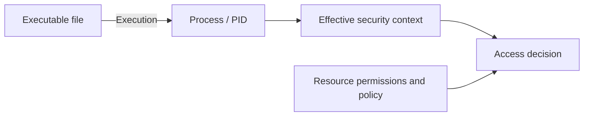

# Lesson 8 — Identity, Tokens, and Permissions { #lesson-8-identity-tokens-and-permissions }

**Goal:** Explain why an administrator account, an elevated process, and access to a particular resource require separate evidence.

**Supplement:** This lesson expands the permission questions discussed during study. Commands and simplified examples describe an authorized lab.

## A file becomes a process when it runs { #file-and-process }

An implant executable on disk is a file. When it executes, the operating system creates a process. A **PID**, or process ID, identifies that running process at that time. The same file can produce multiple processes, and an operating system can reuse a PID after a process exits.

The account associated with a process helps explain its identity. Its effective security context and the target resource's security rules determine whether a particular action is permitted.



## Read identity information in Sliver { #read-identity-information }

In the **Sliver console**, inspect the target selected in an earlier lesson:

```text
info
help whoami
whoami
```

`info` displays session or beacon information held by the server, including identity, PID, OS, and connection metadata. It is useful context; it does not perform a complete, fresh audit of every permission. Treat displayed metadata according to when and how it was collected. [Sliver info implementation](https://github.com/BishopFox/sliver/blob/master/client/command/info/info.go)

`whoami` concerns the selected implant's identity; it is not the operator's local terminal command. Check the installed version's help and read its actual output. An account name alone does not establish token elevation, every group attribute, or access to a remote server. A beacon task may also require waiting for a check-in and the returned result.

## What an access token describes { #access-token }

In Windows, an **access token** describes a process or thread's security context. It includes the account identity, group information, and privileges. A thread can also impersonate another security context, so advanced investigations may need to inspect both process and thread context. [Microsoft: Access tokens](https://learn.microsoft.com/en-us/windows/win32/secauthz/access-tokens)

For this introduction, keep three questions separate:

| Question | Example evidence |
|---|---|
| Which account is this? | Account name and SID |
| With what effective context is this action running? | Token elevation, enabled groups and privileges, integrity level |
| May it perform this action on this resource? | Relevant access controls and policy, or an appropriately scoped test |

## An administrator account can run an unelevated process { #administrator-and-elevation }

With UAC and Admin Approval Mode, a member of the local Administrators group commonly runs ordinary applications using a filtered token. An approved elevation uses the administrative token. Account membership alone does not tell you which context an implant is using. [Microsoft: How UAC works](https://learn.microsoft.com/en-us/windows/security/application-security/application-control/user-account-control/how-it-works)

**Illustrative example:**

| Observation | What it establishes | What remains unknown |
|---|---|---|
| `LAB\student` belongs to local Administrators | Account membership | Whether the implant is elevated |
| An ordinary editor runs as `LAB\student` | Process identity | Whether it has an administrative token |
| An explicitly elevated editor runs as the same user | Same account can have a different process context | What each particular file permits |

Even a correctly identified elevated process does not imply unlimited access. Resource permissions and other controls still matter. Likewise, local administrator status on one machine does not automatically grant administrator access to another server.

## Reading does not establish writing or deletion { #resource-specific-rights }

Suppose the implant successfully reads `report.txt`. The result supports that the read operation succeeded in the context used for that operation. It does not establish that the process can replace or delete the file.

| Action | Separate question |
|---|---|
| List a directory | May this context enumerate that directory? |
| Read a file | May it read this file's contents? |
| Write or replace a file | May it modify the contents or replace the object? |
| Delete a file | Do the relevant file or parent-directory rights permit deletion? |

An **ACL**, or access control list, describes access rules for an object. A folder and the files inside it can have different effective permissions. Successful reading leaves writing and deletion **unproven**; it does not prove they are forbidden either. Record the evidence as “read succeeded; write/delete not assessed.”

Avoid treating an unnecessary destructive test as a permission check. Use a lab-owned disposable object when an exercise explicitly requires testing modifications.

## Worked interpretation { #worked-interpretation }

```text
Observed: Account belongs to local Administrators.
Observed: Implant returned the contents of a lab file.
Unknown: Implant token elevation.
Unknown: Permission to modify or delete that file.
Unknown: Authentication and authorization on another server.
```

The correct conclusion stays within those observations. This is the same reasoning used earlier for HTTP 200, beacon check-ins, and Defender events: each observation establishes a particular stage or capability.

## Review questions { #review-questions }

1. The implant's account belongs to Administrators. Does that prove the implant is elevated?
2. The implant reads a file successfully. Does that prove it can overwrite or delete it?

??? success "Answers and reasoning"
    **1. No.** Membership describes the account. UAC can give a process under that account a filtered context. Inspect the effective context used for the action before claiming administrative execution.

    **2. No.** Read, write, replacement, and deletion are distinct operations. The successful read establishes only that operation. The other rights remain unknown until supported by appropriate evidence.

[Previous: Antivirus and EDR](lesson-7-antivirus-edr-and-detection-evidence.md) · [Next: Port forwarding and SOCKS5](lesson-9-port-forwarding-and-socks.md)
