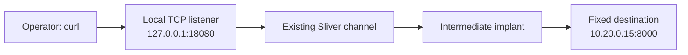
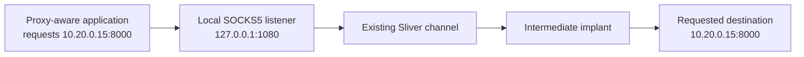

# Lesson 9 — Port Forwarding and SOCKS5 { #lesson-9-port-forwarding-and-socks }

**Goal:** Reach a lab service through an implant host, and distinguish a fixed TCP forward from a SOCKS5 proxy.

**Supplement:** These worked examples expand the networking discussion. The next lesson applies both techniques to an internal SSH server.

## Three separate gates { #three-gates }

| Gate | Question | What passing it does not establish |
|---|---|---|
| Reachability | Can this machine connect to the destination service? | Valid login credentials |
| Authentication | Does the service accept this identity? | Permission for every operation |
| Authorization | May this identity perform the requested operation? | Unlimited access elsewhere |

**Pivoting** uses an intermediate host's connectivity. The host must already have a permitted route to the destination. A tunnel does not supply missing credentials or create a network route that the intermediate host lacks.

Sliver's `portfwd` and `socks5` carry application connections through an existing C2 channel. The separate `pivots` feature concerns implant-to-implant C2 connectivity; it is not a synonym for either command.

## Example hosts and preparation { #lab-and-preparation }

| Role | Address | Assumption |
|---|---|---|
| Operator and Sliver console | `192.168.56.10` | Linux; Client and Server run on this VM |
| Intermediate implant host | `192.168.56.20` | Windows; permitted path to the internal host |
| Internal test service | `10.20.0.15:8000` | Linux; a dedicated lab HTTP server |

Routing and firewall rules are prepared before these commands. The operator cannot connect directly to the internal service; the intermediate host can. Addresses alone do not enforce that separation.

On the **internal Linux VM's console**, in a dedicated folder containing only test material:

```bash
printf '%s\n' 'INTERNAL LAB OK' > index.html
python3 -m http.server 8000 --bind 10.20.0.15
```

This creates the lab page and serves that directory. Keep the terminal open. On the **Windows intermediate VM's PowerShell**, check the single intended destination:

```powershell
Test-NetConnection -ComputerName 10.20.0.15 -Port 8000
```

`TcpTestSucceeded: True` supports TCP reachability from that host at that time. It does not establish HTTP content, authentication, or permissions inside an application.

## Use an interactive session { #interactive-session }

The checked Sliver command definitions restrict these `portfwd` and `socks5` commands to **Sessions**. Start by checking your installed help:

```text
help portfwd
help socks5
sessions
```

If a live session already exists, select its actual ID:

```text
sessions --interact <Session_ID>
```

Replace angle-bracket placeholders with values from your console; do not type the brackets. If you currently have only a beacon, select it and request an additional interactive session:

```text
beacons
beacons --interact <Beacon_ID>
interactive
```

Wait for the task to be collected and a new session to connect. Then list and select that new session with `sessions` and `sessions --interact <Session_ID>`. Selection alone does not change a beacon into a session. The new connection also depends on a working listener and supported C2 settings. [Sliver session commands](https://github.com/BishopFox/sliver/blob/master/client/command/sessions/commands.go)

## Port forwarding: fix the destination in advance { #port-forwarding }



In the **Sliver console with the intermediate host's session selected**:

```text
portfwd add --bind 127.0.0.1:18080 --remote 10.20.0.15:8000
portfwd
```

| Argument | Meaning |
|---|---|
| `--bind 127.0.0.1:18080` | Listen on loopback port 18080 on the machine running the Sliver console |
| `--remote 10.20.0.15:8000` | Have the selected implant connect to this fixed destination |

The forward is TCP; the application still speaks HTTP. `portfwd` lists forwarding entries, including their IDs. A listed entry establishes a configured listener, not successful communication with the final service. [Command flags](https://github.com/BishopFox/sliver/blob/master/client/command/portfwd/commands.go), [client-side listener implementation](https://github.com/BishopFox/sliver/blob/master/client/command/portfwd/portfwd-add.go)

Open a **separate Linux terminal on the operator VM**:

```bash
curl --noproxy "*" --max-time 10 -i http://127.0.0.1:18080/
```

`--noproxy "*"` avoids an environment-configured HTTP proxy for this test. `--max-time 10` limits the total attempt to ten seconds, and `-i` displays response headers. A response containing the expected `INTERNAL LAB OK` body supports end-to-end delivery of this request through the forward. A timeout still needs diagnosis; it does not identify the failed component by itself.

Here, `127.0.0.1` means the **operator VM**, not the implant. If the Client runs on a different machine from the Server, run the application on the Client machine where this listener was created.

## SOCKS5: the application requests a destination { #socks5 }



In the **Sliver console**, with the same live session selected:

```text
socks5 start --host 127.0.0.1 --port 1080
socks5
```

This creates a local SOCKS5 listener. Unlike the fixed forward, its start command does not specify the final internal service. The application supplies that destination through the SOCKS protocol. [SOCKS5 flags](https://github.com/BishopFox/sliver/blob/master/client/command/socks/commands.go), [listener implementation](https://github.com/BishopFox/sliver/blob/master/client/command/socks/socks-start.go)

In a **separate operator Linux terminal**:

```bash
curl --noproxy "" --socks5-hostname 127.0.0.1:1080 --max-time 10 -i http://10.20.0.15:8000/
```

| Part | Meaning |
|---|---|
| `--socks5-hostname 127.0.0.1:1080` | Use this SOCKS5 proxy; ask the proxy side to resolve a destination hostname when one is supplied |
| `--noproxy ""` | Prevent a `NO_PROXY` setting from bypassing the explicitly selected proxy |
| `http://10.20.0.15:8000/` | The final requested service |

This example uses a numeric IP, so destination DNS resolution does not change the outcome. A successful expected response supports this particular proxied request. [curl option reference](https://curl.se/docs/manpage.html)

Starting SOCKS5 does not redirect every program automatically. The client application must support SOCKS or use a suitable adapter. Sending ordinary HTTP directly to port 1080 does not perform a SOCKS handshake. These examples do not provide a general VPN or establish support for every protocol, UDP, or ICMP.

## Choose and verify the technique { #comparison-and-evidence }

| Point | Fixed port forward | SOCKS5 |
|---|---|---|
| Where the destination is specified | Sliver `portfwd add` | Each proxy-aware client connection |
| Application's target in this example | `127.0.0.1:18080` | `10.20.0.15:8000` through the proxy |
| Application proxy configuration | Unnecessary for this local TCP mapping | Required |
| Useful starting exercise | One known service | Clients that need selectable destinations |

An HTTP `401` or `403` is an application-level response. It can show that an HTTP-speaking endpoint responded, while access remains restricted. Check the actual responder and message before blaming the tunnel or declaring the intended destination verified.

## End the exercise { #cleanup }

In Sliver, list entries and remove **only the IDs created for this exercise**:

```text
portfwd
portfwd rm --id <Forward_ID>
socks5
socks5 stop --id <Proxy_ID>
```

The two ID lists are separate. On the internal VM, stop the temporary HTTP server with `Ctrl+C`.

## Review questions { #review-questions }

1. `portfwd` lists an entry. Has the internal service necessarily answered?
2. SOCKS5 is listening. Will an ordinary client automatically use it?
3. A tunnel reaches an SSH service. Has user authentication succeeded?

??? success "Answers and reasoning"
    **1. No.** A configured local listener and a successful end-to-end request are different observations. Test the intended application and inspect its result.

    **2. No.** Configure SOCKS support or an appropriate adapter in that client. A listening proxy does not change all host traffic.

    **3. No.** Reachability, authentication, and authorization are separate gates. The next lesson demonstrates this with a lab SSH account.

[Previous: Identity and permissions](lesson-8-identity-tokens-and-permissions.md) · [Next: Web-server-to-SSH lab](lesson-10-web-server-to-internal-ssh-lab.md)
